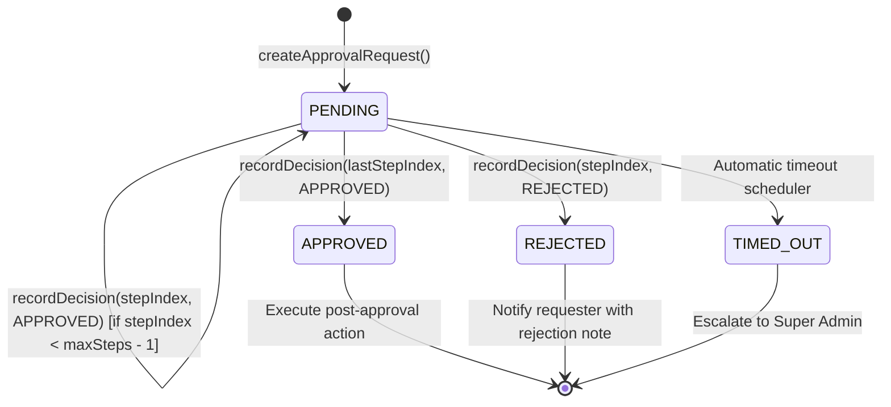

# DRIVEGO — APPROVALS AND SEGREGATION OF DUTIES (SoD) MATRIX

**Document ID:** `DRV-SOD-2026-003`  
**Version:** 1.0.0  
**Effective Date:** October 29, 2026  
**Implementation Codebase:** `car_rental_backend/src/operations/approval-engine.service.ts` & `operations.controller.ts`

---

## 1. Principles of Segregation of Duties (SoD)

DriveGo strictly enforces the **Four-Eyes Principle (Dual Control)** for sensitive operational, financial, and access-control mutations:

1. **Anti-Self-Approval Invariant:** No staff member may approve, authorize, or disburse funds for an action they personally created or requested (`requestedBy.id !== decidedBy.id`).
2. **Strict Sequential Progression:** Steps must be completed strictly in index order (`stepIndex === currentStepIndex`). Steps cannot be skipped or parallel-approved without policy definition.
3. **Role-Enforced Authority:** The approver must possess an authorized administrative role matching the designated `approverRole` or be a designated `SUPER_ADMIN`.
4. **State Machine Finality:** Resolved approval requests (`APPROVED` or `REJECTED`) cannot be reopened or mutated. Conflicting decisions throw `BadRequestException`.
5. **Correlation Audit Trail:** Every decision records the approver's user ID, exact timestamp, decision note, and immutable correlation ID.

---

## 2. Policy-Driven Approval Workflows & Thresholds

```
┌────────────────────────────────────────────────────────────────────────┐
│                   DRIVEGO DUAL-CONTROL APPROVAL TIERS                  │
├──────────────────────────┬──────────────┬──────────────┬───────────────┤
│ Approval Category        │ Financial    │ Tier 1       │ Tier 2        │
│                          │ Threshold    │ Approver     │ Approver      │
├──────────────────────────┼──────────────┼──────────────┼───────────────┤
│ Customer Trip Refund     │ < ₹5,000     │ SUPPORT_LEAD │ Auto-released │
│                          │ ₹5K - ₹25K   │ FINANCE_EXEC │ FINANCE_MGR   │
│                          │ > ₹25,000    │ FINANCE_MGR  │ SUPER_ADMIN   │
├──────────────────────────┼──────────────┼──────────────┼───────────────┤
│ Vendor Security Deposit  │ Deduction    │ FLEET_OPS    │ FINANCE_MGR   │
│ Adjust / Forfeit         │ Forfeiture   │ COMPLIANCE   │ SUPER_ADMIN   │
├──────────────────────────┼──────────────┼──────────────┼───────────────┤
│ Vendor Weekly Payout     │ < ₹1,00,000  │ FINANCE_EXEC │ Auto-batched  │
│ Disbursal Batch          │ ≥ ₹1,00,000  │ FINANCE_MGR  │ SUPER_ADMIN   │
├──────────────────────────┼──────────────┼──────────────┼───────────────┤
│ Vendor Suspension / Ban  │ Commercial   │ OPS_MANAGER  │ COMPLIANCE    │
├──────────────────────────┼──────────────┼──────────────┼───────────────┤
│ Vehicle Retirement       │ Salvage/Loss │ FLEET_MGR    │ FINANCE_MGR   │
├──────────────────────────┼──────────────┼──────────────┼───────────────┤
│ Production Integration   │ Live Outage  │ TECH_LEAD    │ SUPER_ADMIN   │
│ Circuit Breaker Manual   │ Failover     │              │               │
├──────────────────────────┼──────────────┼──────────────┼───────────────┤
│ Staff Role Escalation    │ Any Role     │ SUPER_ADMIN  │ 2FA Password  │
└──────────────────────────┴──────────────┴──────────────┴───────────────┘
```

---

## 3. Server-Side Execution Model & State Transitions



### Data Model Contract (`ApprovalRequest`):
```typescript
interface ApprovalRequest {
  requestId: string;
  definitionType: 'LARGE_REFUND' | 'VENDOR_ONBOARDING' | 'DAMAGE_CLAIM_PAYOUT' | 'VEHICLE_RETIREMENT' | 'MANUAL_OVERRIDE';
  entityType: string;
  entityId: string;
  requestedBy: { id: string; role: string };
  currentStepIndex: number;
  steps: ApprovalStep[];
  overallStatus: 'PENDING' | 'APPROVED' | 'REJECTED' | 'TIMED_OUT';
  metadata: Record<string, any>;
  timeoutAt?: string;
  createdAt: string;
  updatedAt: string;
}
```

---

## 4. Verification Evidence

- **Unit & Integration Suite:** `car_rental_backend/src/operations/tests/operations-startup-isolation.spec.ts` (11 passing tests) & `phase-l-enterprise-operations-automation.spec.ts` (17 passing tests).
- **Enforced Assertions:**
  1. Prevents out-of-order step approvals.
  2. Rejects unauthorized decision makers.
  3. Ensures zero fake approvals are seeded in production on module init.

