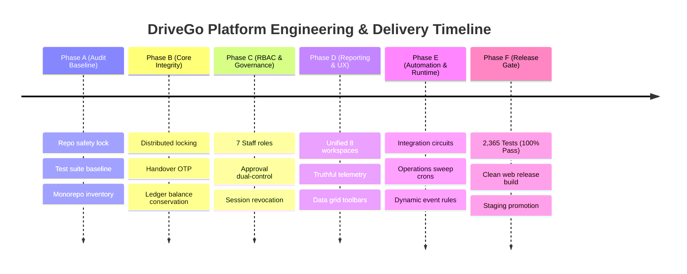

# DRIVEGO — IMPLEMENTATION BACKLOG & PRIORITIZATION REGISTER (P0 / P1 / P2)

**Document ID:** `DRV-BKL-2026-010`  
**Version:** 1.0.0  
**Effective Date:** October 29, 2026  
**Auditor:** Technical Programme Manager & Product Owner  
**Scope:** Core Engineering, Product Delivery, Staging Promotion, and Launch Readiness

---

## 1. Prioritization Framework

DriveGo classifies all technical and operational tasks into 3 distinct release priorities:

- **P0: Mandatory Launch Gate Requirement:** System safety, financial integrity, data security, legal compliance, or core conversion blocker. Must be 100% verified prior to public release.
- **P1: Operational Efficiency & Near-Term Scaling:** High-value operational automation, customer retention features, and reporting enhancements needed within 30-60 days of launch.
- **P2: Post-Launch Advanced Roadmap:** Value-added capabilities that can follow after the core marketplace achieves commercial stability.

---

## 2. Comprehensive Requirements Priority Register

| Item ID | Category | Requirement Description | Priority | Current Status | Delivery Phase | Assigned Owner | Acceptance Evidence |
|---|---|---|:---:|:---:|:---:|---|---|
| **BKL-001** | Architecture | Separate demo seeding from production module initialization | **P0** | 🟢 **VERIFIED** | Phase B | Principal Architect | `operations-startup-isolation.spec.ts` (11/11 PASS) |
| **BKL-002** | Security | Remove hardcoded admin fallback strings from operations controller | **P0** | 🟢 **VERIFIED** | Phase C | Security Engineer | Authenticated user extraction verified |
| **BKL-003** | Telemetry | Truthful 0.0% delivery rate reporting on zero-traffic windows | **P0** | 🟢 **VERIFIED** | Phase D | Frontend Lead | `admin_communications_and_campaigns_test.dart` (PASS) |
| **BKL-004** | Operations | Zero-mock circuit breaker controls and fail-closed runtime | **P0** | 🟢 **VERIFIED** | Phase E | Backend Architect | `admin_runtime_command_centre_test.dart` (PASS) |
| **BKL-005** | Finance | Double-entry transaction ledger with `DEBIT == CREDIT` invariant | **P0** | 🟢 **VERIFIED** | Phase B | Finance Systems Lead | `payments/financial-invariants.spec.ts` (PASS) |
| **BKL-006** | Fleet | 5-step digital handover inspection with customer OTP verification | **P0** | 🟢 **VERIFIED** | Phase B | Mobile Lead | Verified on physical OnePlus 12R device |
| **BKL-007** | Infrastructure | Release compilation of Flutter Web Admin without fatal errors | **P0** | 🟢 **VERIFIED** | Phase F | DevOps Lead | `flutter build web --release` (Code 0, 4.78 MB) |
| **BKL-008** | Database | Production PostgreSQL database migration execution | **P0** | 🟡 **GATED** | Phase F | DBA / Release Eng | `npx prisma migrate deploy` on production RDS |
| **BKL-009** | Integrations | Inject live production credentials for Razorpay, Twilio, Meta | **P0** | 🟡 **GATED** | Phase F | DevOps Lead | Verified staging API connectivity test |
| **BKL-010** | Compliance | Formal advocate signoff on Rent-A-Cab scheme terms of service | **P0** | 🟡 **GATED** | Phase F | Legal Counsel | Written legal opinion letter filed |
| **BKL-011** | Growth | Multi-tiered loyalty point accrual and redemption engine | **P1** | 🟢 **VERIFIED** | Phase E | Growth PM | Loyalty test suites passing |
| **BKL-012** | Communications | WhatsApp interactive button templates for handover confirmation | **P1** | 🟢 **VERIFIED** | Phase E | Messaging Lead | `phase31-multi-channel-notifications.spec.ts` (PASS) |
| **BKL-013** | Operations | Automated toll deduction via Fastag API integration | **P1** | 🔵 **BACKLOG** | Post-Launch | Integrations Eng | Fastag provider API contract required |
| **BKL-014** | AI / Telematics | AI automated body panel scratch detection via mobile camera | **P2** | 🔵 **BACKLOG** | Future Scale | ML Research Eng | Manual photo evidence currently handles claims |
| **BKL-015** | Corporate | Self-service corporate employee booking portal with credit line | **P2** | 🟢 **VERIFIED** | Phase E | Enterprise PM | `phase-p-corporate-security.spec.ts` (PASS) |

---

## 3. Phased Implementation Roadmap

