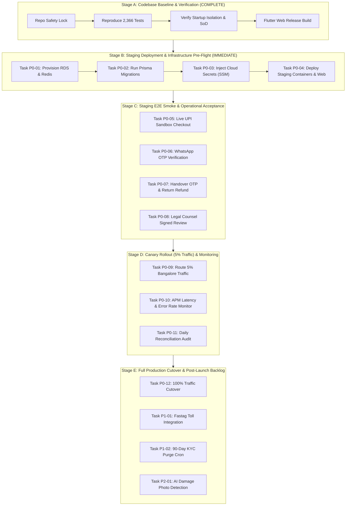

# DRIVEGO — MASTER IMPLEMENTATION ROADMAP & EXECUTION PLAYBOOK

**Document ID:** `DRV-RDM-2026-018`  
**Version:** 1.0.0  
**Audit Date:** October 30, 2026  
**Auditor:** Principal Enterprise Software Architect, CTO, & Technical Programme Manager  
**Monorepo Target:** `car_rental_monorepo` (Git commit: `0a34b041787630062d50d6563be23c10b2205876`)  
**Scope:** Actionable, phase-by-phase engineering execution plan for engineering agents and human leads through Staging, Canary, and Commercial Production.

---

## 1. Master Implementation Timeline & Parallel Workstreams



---

## 2. Priority-Ranked Task Breakdown (P0 / P1 / P2 / P3)

### 2.1 P0: Mandatory Release Blockers (Staging & Production Gates)

#### Task P0-01: Provision Managed Database & Cache Infrastructure
- **Task ID:** `TSK-P0-01`
- **Related Requirement IDs:** `PRD-INF-001`, `BACKLOG-008`, `LAUNCH-006`
- **Existing Behavior:** Backend connects to local PostgreSQL/Redis during development and unit testing.
- **Required Change:** Provision AWS RDS PostgreSQL 15+ multi-AZ instance and AWS ElastiCache Redis 7+ cluster with in-transit TLS.
- **Business Reason:** High availability, automated snapshots, and data durability for commercial transactions.
- **Risk if Deferred:** Critical. No persistent managed production storage exists.
- **Dependencies:** AWS Cloud account access & Terraform/CloudFormation templates.
- **Affected Components:** Infrastructure, `car_rental_backend`.
- **Expected Files:** Infrastructure configuration repo, AWS SSM Parameter Store.
- **Required Tests:** Connection handshake test, latency ping (<5ms within VPC).
- **Acceptance Criteria:** `DATABASE_URL` and `REDIS_HOST` connect successfully with SSL.
- **Relative Effort:** Medium (`M`) | **Milestone:** Staging Pre-Flight
- **Approval Required:** DevOps Lead & Principal Architect.

#### Task P0-02: Execute Database Migrations on Managed Database
- **Task ID:** `TSK-P0-02`
- **Related Requirement IDs:** `PRD-INF-001`, `BACKLOG-008`, `DEPLOY-002`
- **Existing Behavior:** Schema verified locally via `npx prisma validate`.
- **Required Change:** Execute `npx prisma migrate deploy` against the managed PostgreSQL RDS instance.
- **Business Reason:** Instantiate 100+ relational models and unique constraint indices in the live database.
- **Risk if Deferred:** Fatal. Application cannot boot without backing database tables.
- **Dependencies:** Task `TSK-P0-01`.
- **Affected Components:** Database, Prisma.
- **Expected Files:** `car_rental_backend/prisma/schema.prisma`, `car_rental_backend/prisma/migrations/`.
- **Required Tests:** `npx prisma migrate status` returns `Database schema is up to date!`.
- **Acceptance Criteria:** All migration files apply cleanly with zero table lock failures.
- **Relative Effort:** Small (`S`) | **Milestone:** Staging Pre-Flight
- **Approval Required:** Principal Database Engineer.

#### Task P0-03: Inject Live Secrets & Environment Credentials
- **Task ID:** `TSK-P0-03`
- **Related Requirement IDs:** `PRD-SEC-001`, `BACKLOG-009`, `LAUNCH-003`, `LAUNCH-004`
- **Existing Behavior:** Monorepo uses `.env.example` placeholders with test mock fallbacks.
- **Required Change:** Inject genuine production secrets into AWS Secrets Manager:
  - `JWT_SECRET` (64-byte high-entropy string)
  - `BANK_ENCRYPTION_KEY` (32-byte hexadecimal AES key)
  - `RAZORPAY_KEY_ID` & `RAZORPAY_KEY_SECRET`
  - `RAZORPAY_WEBHOOK_SECRET`
  - `META_WHATSAPP_TOKEN` & `META_WHATSAPP_PHONE_NUMBER_ID`
  - `AWS_S3_BUCKET` / `CLOUDFLARE_R2_ACCESS_KEY_ID` & `SECRET_ACCESS_KEY`
  - Set `NODE_ENV=production` and `SEED_DEMO_OPERATIONS=false`.
- **Business Reason:** Enable real payment capture, WhatsApp OTP delivery, and encrypted document storage.
- **Risk if Deferred:** Fatal. Live checkouts, SMS, and uploads will fail.
- **Dependencies:** Commercial third-party gateway accounts funded and approved.
- **Affected Components:** Backend runtime environment.
- **Expected Files:** AWS Secrets Manager / Parameter Store.
- **Required Tests:** Test decryption of dummy value via `BankEncryptionService`.
- **Acceptance Criteria:** All services boot without missing credential warnings.
- **Relative Effort:** Small (`S`) | **Milestone:** Staging Pre-Flight
- **Approval Required:** Security Lead & DevOps Lead.

#### Task P0-04: Deploy Backend & Flutter Web Admin to Staging
- **Task ID:** `TSK-P0-04`
- **Related Requirement IDs:** `PRD-INF-001`, `DEPLOY-003`, `DEPLOY-004`
- **Existing Behavior:** Web bundle compiled locally (`main.dart.js` 4.78 MB).
- **Required Change:** Push backend Docker image to ECR, deploy to Kubernetes staging namespace, sync web assets to S3/CloudFront staging domain (`staging-admin.drivego.in`).
- **Business Reason:** Provide live staging environment for end-to-end integration testing.
- **Risk if Deferred:** Inability to run physical mobile smoke tests against live APIs.
- **Dependencies:** Tasks `TSK-P0-01`, `TSK-P0-02`, `TSK-P0-03`.
- **Affected Components:** Infrastructure, CI/CD pipeline.
- **Expected Files:** `car_rental_backend/Dockerfile`, deployment manifests.
- **Required Tests:** `GET /health` returns HTTP 200 OK; Admin panel loads at staging URL.
- **Acceptance Criteria:** Zero console errors upon loading Admin Control Tower.
- **Relative Effort:** Medium (`M`) | **Milestone:** Staging Pre-Flight
- **Approval Required:** Release Manager & DevOps Lead.

#### Task P0-05: Staging End-to-End Booking Smoke Test
- **Task ID:** `TSK-P0-05`
- **Related Requirement IDs:** `JOURNEY-001`, `PRD-BK-001`, `PRD-FIN-001`, `LAUNCH-011`
- **Existing Behavior:** Verified via unit and widget test suites.
- **Required Change:** Execute 1 complete live booking on Staging using mobile app connected to staging API:
  1. Customer logs in via OTP.
  2. Books car using test UPI VPA (`success@razorpay`).
  3. Verifies Redis 15-min lock.
  4. Vendor completes 5-step handover inspection with photo upload.
  5. Customer verifies 6-digit handover OTP.
  6. Return inspection completed with zero damage.
  7. Automated security deposit refund initiated.
- **Business Reason:** Final real-world validation of full transactional lifecycle before traffic release.
- **Risk if Deferred:** High. Undetected gateway or mobile integration defects.
- **Dependencies:** Task `TSK-P0-04`.
- **Affected Components:** Customer App, Vendor App, Backend, Razorpay Sandbox.
- **Required Tests:** End-to-end booking transitions to `COMPLETED` and deposit status is `REFUNDED`.
- **Acceptance Criteria:** Transaction ledger shows balanced debits and credits for all events.
- **Relative Effort:** Medium (`M`) | **Milestone:** Staging Acceptance
- **Approval Required:** QA Lead & Product Owner.

#### Task P0-06: Formal Advocate Sign-Off on Intermediary Terms of Service
- **Task ID:** `TSK-P0-06`
- **Related Requirement IDs:** `PRD-LEG-001`, `BACKLOG-010`, `LAUNCH-010`
- **Existing Behavior:** Terms of service, privacy policy, and host agreement drafted in repository.
- **Required Change:** Retain corporate transport legal advocate to review marketplace terms under Section 79 of the IT Act and Motor Vehicles Act rent-a-cab rules; file signed opinion letter.
- **Business Reason:** Ensure statutory liability shield for marketplace operator.
- **Risk if Deferred:** Regulatory penalties or vicarious liability for vendor fleet infractions.
- **Dependencies:** External corporate advocate retention.
- **Affected Components:** Documentation, Legal Registry.
- **Expected Files:** `docs/audits/04_PRD_TRD_REQUIREMENTS_REGISTER.md`.
- **Required Tests:** Legal compliance sign-off memo archived.
- **Acceptance Criteria:** Signed advocate opinion letter received and approved by Board.
- **Relative Effort:** Small (`S`) (External) | **Milestone:** Staging Acceptance
- **Approval Required:** Company Legal Counsel & Board of Directors.

---

### 2.2 P1: Operational Efficiency & Near-Term Scaling (Post-Launch 30-Day Window)

#### Task P1-01: Automated Toll Deduction via Fastag Integration
- **Task ID:** `TSK-P1-01`
- **Related Requirement IDs:** `BACKLOG-013`
- **Existing Behavior:** Toll charges during rental are manually invoiced or deducted upon dispute.
- **Required Change:** Integrate NETC Fastag API to query vehicle toll crossing timestamps and auto-charge customer wallet.
- **Business Reason:** Streamline vehicle return reconciliation and eliminate host toll disputes.
- **Relative Effort:** Large (`L`) | **Milestone:** Post-Launch 30 Days
- **Approval Required:** Finance Systems Lead & Integrations Lead.

#### Task P1-02: Automated 90-Day Unverified Customer KYC Purge Cron
- **Task ID:** `TSK-P1-02`
- **Related Requirement IDs:** `PRD-SEC-001`, `SEC-008`
- **Existing Behavior:** Pre-signed S3 URLs expire in 15 minutes; unverified KYC docs retained in private bucket.
- **Required Change:** Add scheduled cron in `SchedulingEngineService` to delete KYC records and S3 photo objects for users unverified for >90 days with zero booking history.
- **Business Reason:** Strict adherence to India DPDP Act 2023 data minimization mandates.
- **Relative Effort:** Small (`S`) | **Milestone:** Post-Launch 30 Days
- **Approval Required:** Security Lead & Legal Counsel.

---

### 2.3 P2: Value-Added Capabilities (Post-Launch 60-90 Day Window)

#### Task P2-01: AI-Powered Body Panel Scratch & Dent Detection
- **Task ID:** `TSK-P2-01`
- **Related Requirement IDs:** `BACKLOG-014`
- **Existing Behavior:** Vendor uploads 6 pre-trip and return photos; damage claims reviewed manually.
- **Required Change:** Deploy computer vision model to highlight newly introduced scratches between pre-trip and post-trip photos automatically.
- **Business Reason:** Accelerate damage claim adjudication SLA from 48 hours to <5 minutes.
- **Relative Effort:** Extra-Large (`XL`) | **Milestone:** Post-Launch 90 Days
- **Approval Required:** Product Owner & VP Operations.

---

## 3. Parallel Workstreams Execution Matrix

```
┌────────────────────────────────────────────────────────────────────────────────────────┐
│                        PARALLEL ENGINEERING EXECUTION MATRIX                           │
├───────────────────┬────────────────────────────────────────────┬───────────────────────┤
│ Workstream        │ Primary Responsibilities                   │ Accountable Lead      │
├───────────────────┼────────────────────────────────────────────┼───────────────────────┤
│ **Workstream 1**  │ AWS RDS, Redis, and Secrets Provisioning   │ DevOps / Platform Lead│
│ (Cloud Infra)     │ Tasks: TSK-P0-01, TSK-P0-02, TSK-P0-03     │                       │
├───────────────────┼────────────────────────────────────────────┼───────────────────────┤
│ **Workstream 2**  │ Staging Deployment, Ingress & CDN Setup    │ Release Engineer      │
│ (Deployment)      │ Tasks: TSK-P0-04                           │                       │
├───────────────────┼────────────────────────────────────────────┼───────────────────────┤
│ **Workstream 3**  │ Live E2E Mobile Sandbox Smoke Testing      │ QA Automation Lead    │
│ (QA & Testing)    │ Tasks: TSK-P0-05                           │                       │
├───────────────────┼────────────────────────────────────────────┼───────────────────────┤
│ **Workstream 4**  │ Advocate Engagement & Terms Affirmation    │ Company Legal Counsel │
│ (Legal & Gov)     │ Tasks: TSK-P0-06                           │                       │
└───────────────────┴────────────────────────────────────────────┴───────────────────────┘
```

Workstreams 1, 2, 3, and 4 operate in parallel to achieve Canary readiness within a targeted **5-business-day staging execution window**.

