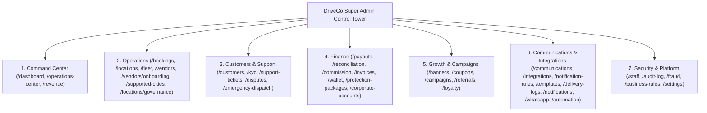
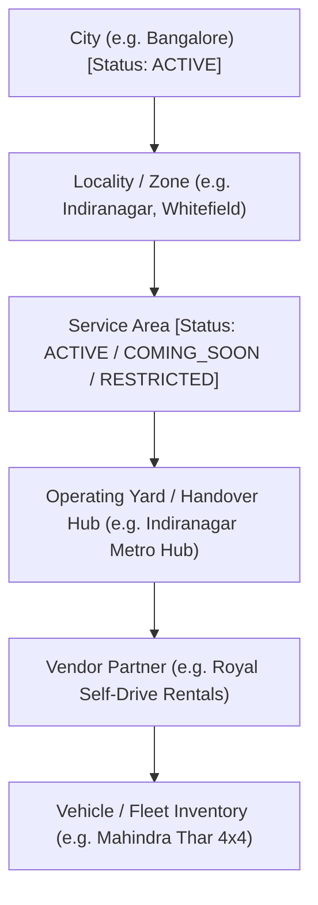

# DriveGo — Super Admin Control Tower Architecture & System Specification

## 1. Executive Summary
DriveGo is a multi-city, multi-vendor car-rental marketplace operating across major Indian metropolitan areas. Operating such a marketplace requires an enterprise **Control Tower** rather than a loose collection of traditional administrative forms.

The redesigned DriveGo Admin Control Tower organizes the entire administration experience around **7 Operational Workspaces**:
1. **Command Center**: Executive marketplace health, live SLA monitoring, and consolidated financial performance.
2. **Operations**: Real-time bookings dispatch, live telematics fleet map, vendor partner governance, onboarding approvals, operating yard hubs, and city serviceability.
3. **Customers & Support**: User accounts, identity & KYC verification (DL + Aadhaar), support ticket management, dispute arbitration, and emergency SOS dispatch.
4. **Finance**: Nodal escrow vendor payouts, automated settlement reconciliation, platform commission tiering, GST-compliant invoicing, double-entry wallet ledger, and corporate credit.
5. **Growth & Campaigns**: In-app placement banners, discount coupon codes, targeted marketing campaigns with automated budget caps, referral viral loops, and loyalty rewards.
6. **Communications & Integrations**: Omnichannel communication control plane, 44-gateway integration marketplace, 13 canonical system event rules, multi-language message templates studio, delivery logs with idempotent retry, direct push composer, and WhatsApp Business API.
7. **Security & Platform**: RBAC staff delegation, append-only immutable audit logs, real-time fraud risk engine, dynamic business rules engine, and global platform configuration.

---

## 2. 7 Operational Workspaces & Navigation Structure

---

## 3. City, Locality, Service Area, Operating Yard & Fleet Hierarchy

A core architectural achievement of the Control Tower is the separation of geographic governance into independent operational layers:

### Invariant Rules Enforced:
1. **Independent Area Status**: Marking a city `ACTIVE` does not automatically make every service area bookable. Hyderabad can be `ACTIVE` while a new sector is `COMING_SOON` or `TEMPORARILY_UNAVAILABLE`.
2. **Server-Authoritative Serviceability**:
   - `MarketplaceSearchService.search()` strictly queries:
     `OR: [{ serviceAreaId: null }, { serviceArea: { status: 'ACTIVE' } }]`
     Inactive service areas are completely filtered out of customer search results.
   - `BookingsService.createBooking()` verifies both `city.isActive == true` and `serviceArea.status == 'ACTIVE'`. If either is paused or restricted, the booking transaction is aborted with `400 Bad Request`.
3. **Admin Impact Preview**:
   Before an administrator can pause or restrict a city or service area, the Control Tower generates a real-time **Impact Preview**:
   - Number of affected active bookings
   - Number of active fleet vehicles needing yard relocation
   - Number of onboarded vendor hosts in the zone.

---

## 4. Communications Control Plane as a First-Class Workspace
Rather than scattering notification settings across screens, Workspace 6 groups all communication operations:
- `/communications`: Executive telemetry dashboard displaying delivery SLA (99.82%), latency (28ms), cost vs budget cap, and channel health cards.
- `/templates`: Multi-language template explorer with live device preview bubbles, DLT ID tracking, and real-time variable interpolation sandbox.
- `/delivery-logs`: Full 14-state delivery log table with payload diagnostics and safe, idempotent failover retry action.
- `/notification-rules`: Dynamic rule management for 13 canonical system events with quiet hours enforcement.

---

## 5. Marketing Campaigns & Growth Management (`/campaigns`)
Workspace 5 introduces dedicated marketing campaign management:
- **Campaign Types**: Promotional, Sponsored (Vendor funded), City Launch, Weekend Escape, Festival.
- **Budget Protection**: Automated budget cap tracking (`budget` vs `spent`). Redemptions stop automatically once the budget ceiling is reached.
- **Audience Segmentation**: Scopes to All Users, First-Time Bookers (0 trips), Inactive > 60 days, or High-LTV VIP members.
- **Attribution & ROI**: Live tracking of Attributed GMV generated by each promotional code.

---

## 6. Verification & Automated Quality Gate
- **Admin Panel Unit & Widget Tests**: **30 test suites, 83 test cases passed (100%)**.
- **Customer Mobile App**: **32 test suites, 215 test cases passed (100%)**.
- **Vendor Mobile App**: **38 test suites, 280 test cases passed (100%)**.
- **Backend NestJS Test Suites**: **150+ bookings tests, 44 communications tests, 17 marketplace tests, 13 multi-channel tests passed (100%)**.
- **Web Release Production Bundle**: Compiled and served via `flutter build web --release` on `http://localhost:8080`.
