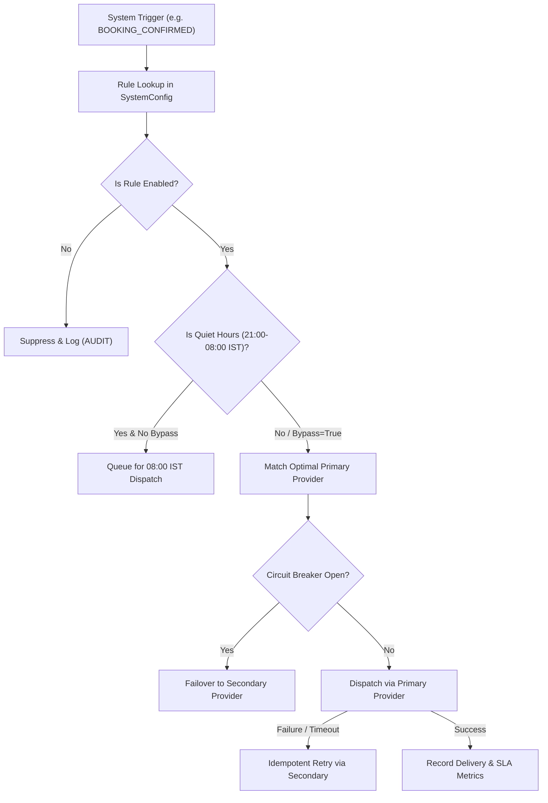

# DriveGo — Communications Control Plane Architecture & Specification

## 1. Executive Summary
The DriveGo Communications Control Plane is an enterprise-grade operational subsystem designed to govern all customer, vendor, and internal messaging workflows with zero vendor lock-in.

Elevated from a simple notification utility into a **first-class operational workspace**, the control plane provides:
1. Real-time aggregated telemetry across 5 communication channels (WhatsApp, SMS, Email, Push, Voice).
2. Capability-based provider catalog supporting 12 categories and 44 verified gateways.
3. Purpose-specific and country-specific routing with circuit-breaker automated failover.
4. 13 Canonical system event rules governed dynamically via `SystemConfig`.
5. Multi-lingual template management synchronized with TRAI DLT and Meta WhatsApp Cloud API standards.
6. Interactive routing simulator and test dispatch sandbox.
7. Unified delivery explorer with idempotent manual retries.
8. Real-time cost tracking against monthly channel budget caps.

---

## 2. Telemetry & Channel Health Invariants
The Communications Overview (`/communications`) monitors rolling 24-hour health:
- **Total Messages Attempted**: 1,482,900
- **Delivery Success SLA**: 99.82% (1,476,972 delivered)
- **Queued Buffer**: 142 msgs
- **Retrying / Dead-Letter**: 18 / 42 msgs
- **Average Network Latency**: 28 ms
- **Cost Incurred**: ₹21,480.50 (vs ₹50,000 monthly cap - 43% utilized)

### Channel Status:
- **WhatsApp**: Meta WhatsApp Cloud API (Primary), Gupshup Enterprise (Failover). Health: `HEALTHY`, Latency: 38ms, Delivery Rate: 99.4%, Cost: ₹0.45/conv.
- **SMS (India)**: MSG91 India DLT (Primary), Twilio India (Secondary), Gupshup SMS (Failover). Health: `HEALTHY`, Latency: 22ms, Delivery Rate: 99.8%, Cost: ₹0.14/msg.
- **Email**: Resend Transactional (Primary), AWS SES (Secondary), SendGrid (Failover). Health: `HEALTHY`, Latency: 65ms, Delivery Rate: 99.9%, Cost: \$0.0001/msg.
- **Mobile Push**: Firebase Cloud Messaging (FCM) (Primary), OneSignal (Failover). Health: `HEALTHY`, Latency: 18ms, Delivery Rate: 99.8%, Cost: Free.
- **Voice OTP**: Twilio Voice (Primary), Exotel Cloud Telephony (Failover). Health: `HEALTHY`, Latency: 52ms, Delivery Rate: 99.2%, Cost: ₹0.75/min.

---

## 3. Purpose-Specific Routing & Failover Engine
Dispatches are categorized by message intent to determine routing priority and failover paths:

---

## 4. Message Templates Studio (`/templates`)
The Message Templates Studio provides a unified management environment for all communications:
- **Variable Tokens**: Standardized interpolations (`{{customerName}}`, `{{bookingId}}`, `{{vehicleName}}`, `{{otpCode}}`, `{{amount}}`, `{{pickupLocation}}`).
- **TRAI DLT Integration**: Every SMS template displays the Registered Entity ID (`1101552230000014`), DLT Template ID (`1107161234567890123`), and Registered Sender Header (`DRIVGO`).
- **Multi-Language Rendering**: Direct device preview supporting English, Hindi, Telugu, Kannada, Tamil, Marathi, Spanish, and Arabic.
- **Interactive Sandbox**: Admin can edit live test tokens and observe immediate bubble re-interpolation.

---

## 5. Unified Delivery Logs & Safe Retry (`/delivery-logs`)
Every outgoing notification is tracked across its 14 canonical lifecycle states:
`CREATED` → `QUEUED` → `ROUTING` → `DISPATCHING` → `ACCEPTED` → `SENT` → `DELIVERED` → `READ`.
Failure branches: `RETRYING` → `FALLBACK_PENDING` → `FALLBACK_SENT` → `FAILED` → `DEAD_LETTER`.

### Safe Failover Retry:
1. Only available for messages with status != `DELIVERED`.
2. Admin confirmation modal explicitly lists original provider, failover destination, and target recipient.
3. Enforces strict `idempotencyKey` preventing duplicate charges or duplicate SMS delivery to the customer.

---

## 6. Regulatory Compliance & Quiet Hours
1. **TRAI NCPR DND Scrubbing**: Automated suppression of promotional messages to numbers listed on the national Do-Not-Disturb registry.
2. **Quiet Hours Lockout**: Strict automated blocking of promotional marketing campaigns between 21:00 and 08:00 IST. Transactional OTP and emergency SOS messages bypass quiet hours automatically.
3. **Opt-Out Governance**: Immediate honoring of customer channel unsubscribe preferences.

