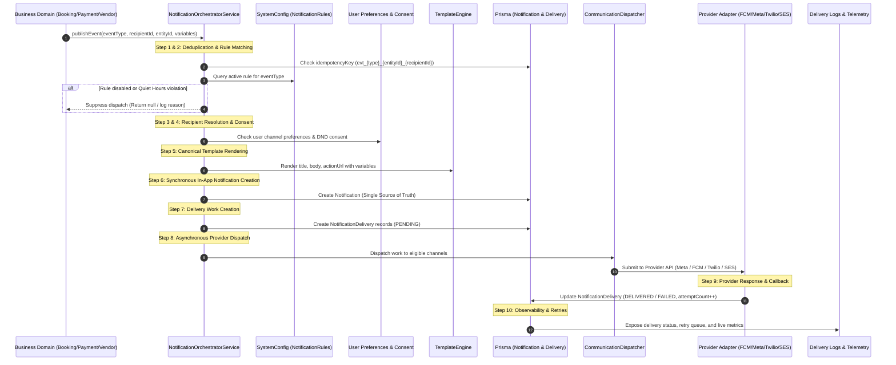

# DRIVEGO — COMMUNICATIONS & INTEGRATIONS ARCHITECTURE SPECIFICATION

**Document ID:** `ARCH-DRV-2026-009`  
**Date:** October 29, 2026  
**Architect:** Principal Enterprise Software Architect & Messaging Systems Lead  
**Scope:** Architectural blueprint for the Communications & Integrations domain across Super Admin, Backend, Database, Providers, and Mobile applications.

---

## 1. Information Architecture & Navigation Design

The Super Admin navigation organizes communications and integrations into a clean, hierarchical structure under the `Communications & Integrations` domain in `AdminShell`:

```
COMMUNICATIONS & INTEGRATIONS
├── 1. Communications Overview (/communications)
│   └── Real-time delivery rates, buffer queues, provider health, and incident alerts.
│
├── 2. Integrations Hub (/integrations)
│   └── Gateway configurations, credentials (masked), health checks, circuit breakers, and webhook replays.
│
├── 3. Event & Notification Rules (/notification-rules)
│   └── Event-to-channel routing matrix, quiet hours bypass, priority tiering, and execution simulations.
│
├── 4. Message Templates (/templates)
│   └── Multi-language template studio (EN, HI, TE, KN, TA) with variable validation and live preview.
│
├── 5. Delivery Logs & Retries (/delivery-logs)
│   └── Unified delivery audit trail, recipient PII masking, provider responses, and bounded manual retries.
│
├── 6. Push Notifications (/notifications)
│   └── Mobile push composer with target audience selection (All Users, City, Phone) and FCM analytics.
│
├── 7. WhatsApp Messaging (/whatsapp)
│   └── Dedicated WhatsApp Business console, Meta templates, timeline debugger, and INR cost tracking.
│
└── 8. Workflow Automation (/automation)
    └── Operational maintenance sweeps (quote expiry, unconfirmed reservations, overdue returns) and event workflows.
```

---

## 2. Shared Communications Topology & 10-Step Message Lifecycle

Every communication follows a strict 10-step lifecycle to guarantee zero duplicate sends, compliance with Indian regulatory quiet hours (TRAI), and decoupling of business events from delivery providers:



---

## 3. Provider Gateway Ecosystem

DriveGo supports pluggable provider adapters behind standard interfaces. The core operational matrix:

| Channel | Primary Provider | Fallback Provider | Local Regulations & Protocols |
|---|---|---|---|
| **Push** | Firebase Cloud Messaging (FCM) | APNs (Direct via HTTP/2) | Token lifecycle, device invalidation on unregister. |
| **WhatsApp** | Meta Cloud WhatsApp API | Gupshup Enterprise | Meta 24-hr customer service window, pre-approved templates. |
| **SMS** | Airtel IQ | Twilio SMS | TRAI DLT registration (Principal Entity ID, Header ID, Template ID). |
| **Email** | AWS SES | SendGrid / Nodemailer | DKIM, SPF, DMARC, unsubscribe headers. |
| **Voice / IVR** | Exotel | Twilio Voice | Emergency SOS dispatch, automated IVR fallback. |

---

## 4. Security, Privacy & Reliability Guarantees

### 4.1 Recipient PII Masking
To prevent unauthorized staff from harvesting customer contact information from logs:
- **Phone Numbers:** Masked to show only country code and last 4 digits (e.g., `+91 98765*****` or `+91 ***** *4321`).
- **Email Addresses:** Masked to show initial character and domain (e.g., `r***@gmail.com`).
- **Device Tokens:** Truncated to first 12 characters followed by `...` in UI tables.

### 4.2 Credential Protection & Secret Vault
- Provider secrets (API keys, Meta Access Tokens, AWS Secret Keys, Twilio Auth Tokens) are stored in encrypted format or server environment variables.
- Responses to the admin panel NEVER contain plaintext credentials. The API returns masked tokens (e.g., `sk_live_...9f2a`).

### 4.3 Idempotency & Bounded Retries
- **Permanent Deduplication:** Every delivery records a deterministic `idempotencyKey`. Repeated events within the deduplication window return the existing record without creating duplicate deliveries.
- **Bounded Backoff:** Failures are classified into `TRANSIENT` (network timeout, rate limit) and `PERMANENT` (invalid phone number, unregistered template).
- Only `TRANSIENT` failures are retried up to `maxRetries` (default: 3 attempts) with exponential backoff ($2^{\text{attempt}} \times 30\text{s}$).

### 4.4 TRAI Quiet Hours Compliance
- In accordance with Indian Telecom Regulations (TRAI), promotional messaging is strictly prohibited between **21:00 and 08:00 IST**.
- Operational and security messages (`BOOKING_CONFIRMED`, `OTP`, `EMERGENCY_SOS`) have `quietHoursBypass: true` and dispatch 24/7.
- Marketing campaigns have `quietHoursBypass: false` and are automatically queued or suppressed if triggered outside the allowed window.

