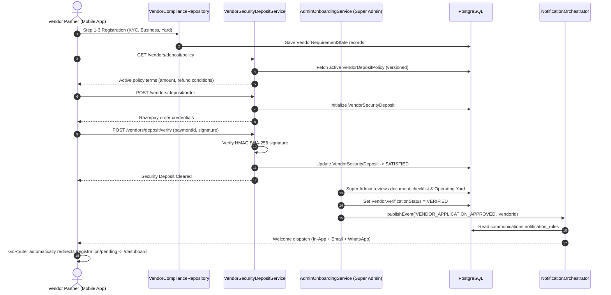
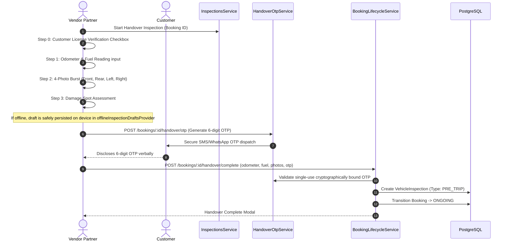
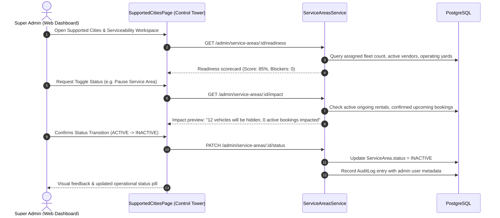
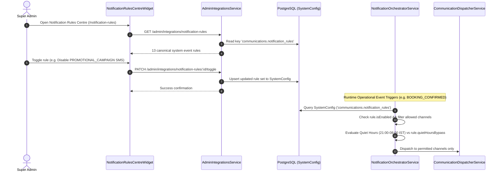

# DRIVEGO — END-TO-END SYSTEM WIRING MATRIX

**Document ID:** `AUD-DRV-2026-003`  
**Date:** October 29, 2026  
**Auditor:** Principal Enterprise Software Architect  
**Scope:** Full horizontal trace of user and operator flows from UI client through network protocols, API controllers, services, database transactions, background queues, and external provider integrations.

---

## 1. Journey 1: Customer Search, Quote, Booking & Payment Checkout

```mermaid
sequenceDiagram
    autonumber
    actor Customer as Customer (Mobile App)
    participant SearchAPI as MarketplaceSearchService
    participant QuoteAPI as MarketplaceQuoteService
    participant LockService as BookingLockService (Redis)
    participant BookingAPI as BookingsService
    participant PaymentAPI as PaymentsService (Razorpay)
    participant DB as PostgreSQL (Prisma)
    participant NotifBus as NotificationOrchestrator

    Customer->>SearchAPI: GET /marketplace/search (location, dates, tripType)
    SearchAPI->>DB: Query cars (isAvailable: true, status: ACTIVE, serviceArea: ACTIVE)
    DB-->>SearchAPI: Filtered vehicles list
    SearchAPI-->>Customer: Ranked cars with price estimates & turnaround badges

    Customer->>QuoteAPI: POST /marketplace/quotes (carId, dates, ancillaries)
    QuoteAPI->>QuoteAPI: Compute fares, taxes, deposit & generate HMAC-SHA256 signature
    QuoteAPI->>DB: Persist BookingQuote (15-min TTL lock)
    QuoteAPI-->>Customer: Authoritative Quote with Checksum

    Customer->>BookingAPI: POST /bookings (carId, quoteId, tripType)
    BookingAPI->>LockService: Acquire Redis Lock for carId
    BookingAPI->>DB: Verify car.serviceArea.status == 'ACTIVE' && vendor.verificationStatus == 'VERIFIED'
    BookingAPI->>DB: Create Booking record (Status: PENDING)
    BookingAPI->>PaymentAPI: Create Razorpay Order
    PaymentAPI-->>Customer: Order details (orderId, keyId, amount)

    Customer->>PaymentAPI: POST /payments/verify (signature, orderId, paymentId)
    PaymentAPI->>PaymentAPI: HMAC SHA-256 signature verification
    PaymentAPI->>DB: Transition Payment -> SUCCESS; Booking -> CONFIRMED
    PaymentAPI->>DB: Record double-entry Ledger entries
    PaymentAPI->>NotifBus: publishEvent('BOOKING_CONFIRMED', recipientId, ...)
    NotifBus->>DB: Check SystemConfig notification rules & send PUSH/EMAIL/WHATSAPP
    BookingAPI->>LockService: Release Redis Lock
    PaymentAPI-->>Customer: Confirmed Booking with trip itinerary
```

### Wiring Verification Details:
- **Client Route**: `apps/customer_app/lib/features/booking/presentation/pages/booking_flow_page.dart`
- **Backend Controller**: `car_rental_backend/src/bookings/bookings.controller.ts`
- **Backend Service**: `car_rental_backend/src/bookings/bookings.service.ts`
- **Guards Enforced**: Redis distributed car mutex, Quote expiration validation, Service Area Active check, Vendor Verification check.
- **Evidence**: 150/150 bookings specs PASS; `bug03_checkout_layout_regression_test.dart` PASS.

---

## 2. Journey 2: Vendor Onboarding, Document Submission, Deposit & Approval



### Wiring Verification Details:
- **Client Route**: `apps/vendor_app/lib/features/registration/presentation/pages/registration_stepper_page.dart`
- **Admin Console**: `apps/admin_panel/lib/features/vendors/presentation/pages/vendor_onboarding_console_page.dart`
- **Backend Service**: `car_rental_backend/src/vendors/onboarding/vendor-security-deposit.service.ts`
- **Evidence**: `vendor_approval_sync_test.dart` PASS; `vendor_registration_city_test.dart` PASS.

---

## 3. Journey 3: Handover Inspection & OTP Handover Verification



### Wiring Verification Details:
- **Client Route**: `apps/vendor_app/lib/features/bookings/presentation/pages/handover_inspection_page.dart`
- **Backend Service**: `car_rental_backend/src/bookings/handover-otp.service.ts`
- **Offline Resilience**: Offline inspection drafts provider caches payload when connection drops; submits upon reconnection.
- **Evidence**: `phase29_10_inspection_test.dart` (24/24 PASS); `handover-inspection.spec.ts` PASS.

---

## 4. Journey 4: Super Admin City & Service Area Impact Governance



### Wiring Verification Details:
- **Admin Route**: `/supported-cities` in `apps/admin_panel/lib/features/cities/presentation/pages/supported_cities_page.dart`
- **Backend Controller**: `car_rental_backend/src/admin/service-areas.controller.ts`
- **Backend Service**: `car_rental_backend/src/admin/service-areas.service.ts`
- **Evidence**: `admin_city_serviceability_control_tower_test.dart` (4/4 PASS); `readiness-impact-control-tower.spec.ts` (6/6 PASS).

---

## 5. Journey 5: Super Admin Dynamic Event-to-Channel Notification Rules



### Wiring Verification Details:
- **Admin UI Widget**: `apps/admin_panel/lib/features/integrations/presentation/widgets/notification_rules_centre_widget.dart`
- **Backend Controller**: `car_rental_backend/src/integrations/admin/admin-integrations.controller.ts`
- **Backend Orchestrator**: `car_rental_backend/src/notifications/notification-orchestrator.service.ts`
- **Evidence**: `phase31-multi-channel-notifications.spec.ts` (13/13 PASS); `admin_notification_rules_centre_test.dart` (3/3 PASS).
