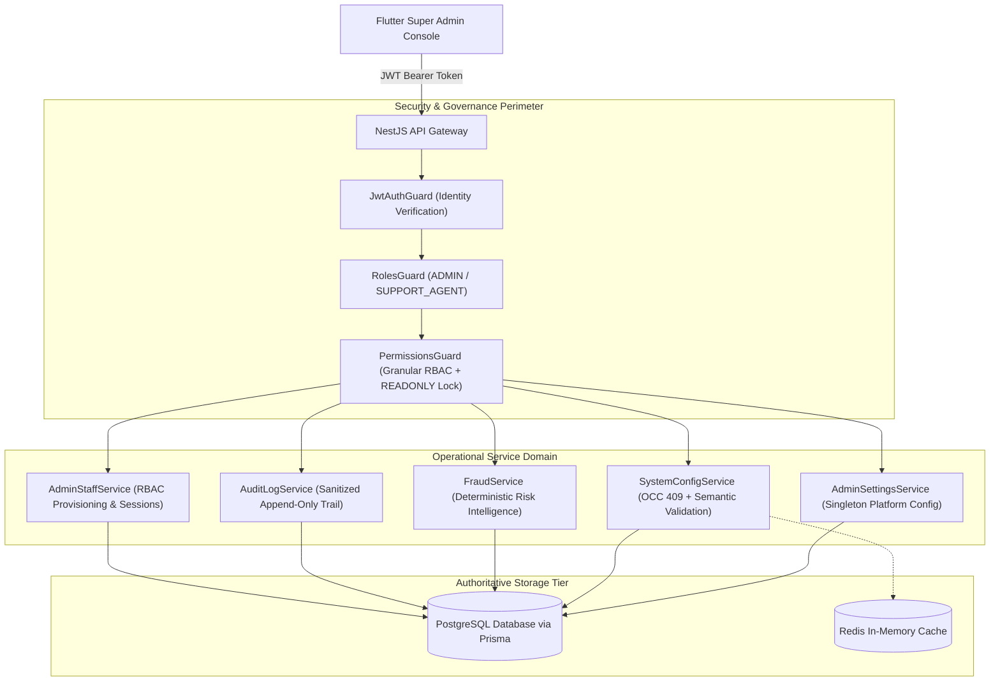

# DRIVEGO — SECURITY & PLATFORM MODULES CROSS-MODULE ARCHITECTURE

**Document ID:** `ARCH-DRV-2026-003`  
**Date:** October 29, 2026  
**Architect:** Principal Enterprise Software Architect, Application Security Engineer & Systems Lead  
**Scope:** Architecture specification for the 5 Security & Platform modules:
1. Staff & Role Delegation (RBAC)
2. Audit Log
3. Fraud & Risk
4. Business Rules Engine
5. Platform Settings

---

## 1. System Topology & Responsibilities

The DriveGo Security & Platform architecture establishes strict, non-overlapping boundaries across authentication, authorization, business rules evaluation, risk intelligence, and audit logging:

---

## 2. Core Operational Pillars & Data Flows

### 2.1. Authentication & Session Identity
- **Entry Point:** `POST /auth/login` and `GET /auth/me`.
- **JWT Payload:** Authoritatively encapsulates `{ userId, role, staffRole }`.
- **Session Revocation:** On administrative session revocation, all user refresh tokens (`RefreshToken.revoked = true`) are invalidated immediately. The client's subsequent `/auth/refresh` request fails with `401 Unauthorized`, terminating the session across all devices.

### 2.2. Role-Based Access Control (RBAC) Architecture
- **7 Granular Staff Roles:**
  1. `SUPER_ADMIN`: Full unrestricted platform access.
  2. `OPERATIONS_MANAGER`: Fleet, vendor onboarding, vehicle approvals, service area governance, bookings.
  3. `CUSTOMER_SUPPORT`: Customer verification, bookings, tickets, dispute arbitration, emergency SOS.
  4. `FINANCE_MANAGER`: Vendor payouts, ledger reconciliation, commission rules, invoices, wallet adjustments.
  5. `MARKETING_MANAGER`: Banners, coupons, promotional campaigns, referral loops, loyalty rewards.
  6. `COMPLIANCE_OFFICER`: KYC reviews, vendor legal requirements, fraud inspection, dispute arbitration, audit logs.
  7. `READONLY_ANALYST`: View-only read permissions; all mutating HTTP methods (`POST`, `PUT`, `PATCH`, `DELETE`) are strictly forbidden.
- **Server-Side Enforcement:** Every sensitive admin endpoint is protected by:
  `@UseGuards(JwtAuthGuard, RolesGuard, PermissionsGuard)`
  `@Roles(Role.ADMIN)`
  `@RequirePermissions(AdminPermission.<PERMISSION>)`

### 2.3. Audit Log Invariant & Data Sanitization
- **Immutable Log:** No update or delete operations are permitted on `AuditLog` records.
- **Recursive Sensitive Key Redaction:** Before writing any metadata to `AuditLog`, all keys matching:
  `['password', 'token', 'refreshToken', 'accessToken', 'secret', 'apiKey', 'authorization', 'creditCard', 'cvv', 'pin']`
  are automatically replaced with `'[REDACTED]'`.
- **Correlation:** Every administrative action captures the `adminUserId`, `action`, `targetType`, `targetId`, and before/after transition state.

### 2.4. Fraud Detection & Risk Engine
- **Deterministic 8-Signal Intelligence:**
  Evaluates identity signals, duplicate KYC documents, booking velocity, cancellation spikes, payment distress patterns, concurrent vehicle custody, new account activity, and self-referral attempts.
- **Severity Bands:**
  - `CRITICAL` (Score 80–100): Immediate automatic block (`BLOCK`).
  - `HIGH` (Score 60–79): Mandatory staff review (`REVIEW_REQUIRED`).
  - `MEDIUM` (Score 30–59): Telemetry monitoring (`MONITOR`).
  - `LOW` (Score 0–29): Normal transaction flow (`ALLOW`).
- **Resolution Workflow:** Administrative resolutions record notes, responsible staff ID, previous status, and new status (`CLEARED`, `DISMISSED`, `BLOCKED`) with dual-action audit tracking.

### 2.5. Business Rules & Semantic Validation
- **OCC 409 Protocol:** Any rule mutation requires `expectedVersion`. Concurrent writes resulting in version mismatch trigger HTTP 409 Conflict with before/after diff resolution.
- **Zero Arbitrary Execution:** Rules are defined as declarative JSON schemas; no dynamic or unsanitized code execution is permitted.
- **Transaction Safety:** Batch updates execute inside atomic database transactions (`$transaction`), ensuring all-or-nothing consistency.

### 2.6. Platform Settings Singleton
- **Storage:** Persisted as a single authoritative record (`id: 'singleton'`) in the `PlatformSettings` table.
- **Secret Isolation:** API keys, database credentials, and payment gateway secrets are strictly forbidden from database storage; they reside exclusively in server-side environment configurations.

