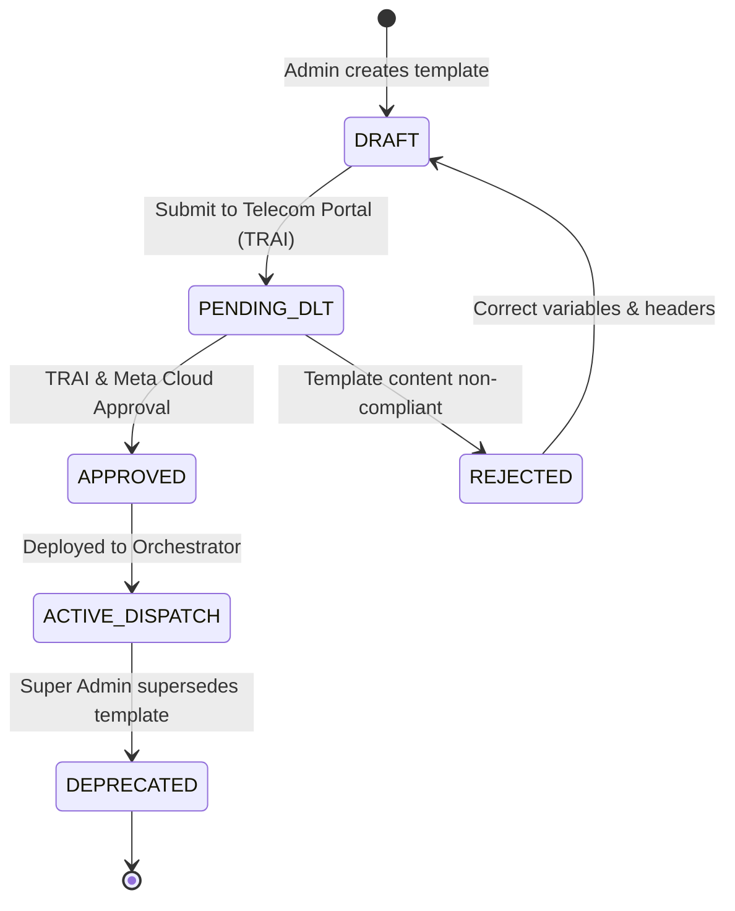
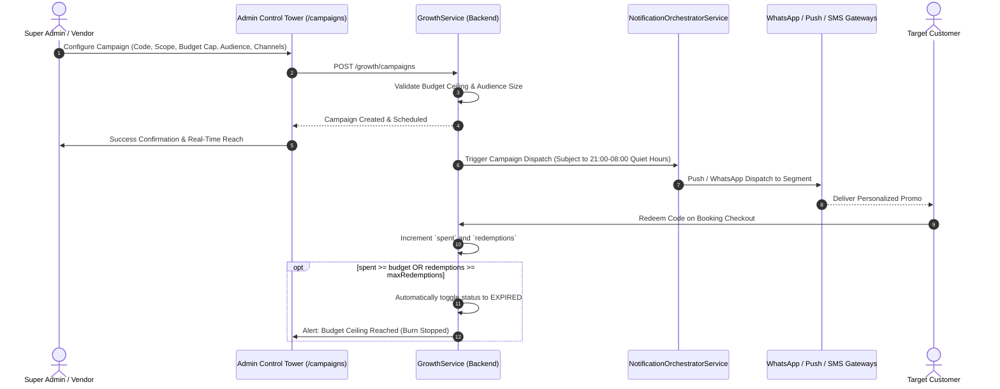

# DriveGo — Template and Campaign Workflow Specification

## 1. Executive Summary
This document establishes the end-to-end lifecycle, compliance requirements, and execution architecture for:
1. **Multi-Channel Message Templates** (SMS, WhatsApp, Email, Push).
2. **Growth & Marketing Campaigns** with automated budget protection and ROI attribution.

---

## 2. Unified Template Management Lifecycle

Every message dispatched by the DriveGo platform is governed by canonical templates to guarantee regulatory compliance and uniform brand experience:

### Invariant Rules for Templates:
1. **TRAI DLT Registration**: All SMS messages targeting Indian phone numbers must supply a valid 19-digit DLT Template ID and 6-character registered header (`DRIVGO`).
2. **Dynamic Variable Formatting**: Variables follow mustache double-curly notation (`{{variableName}}`). The orchestrator validates that all required tokens are present in the payload before invoking the gateway adapter.
3. **Multi-Lingual Localization**: Templates support automatic language selection based on customer preference (`en`, `hi`, `te`, `kn`, `ta`, `mr`). If an explicit translation is absent, the system gracefully falls back to English (`en`).

---

## 3. Marketing Campaign Workflow & Automated Budget Caps

Marketing campaigns (`/campaigns`) allow platform administrators and vendor sponsors to run targeted customer acquisition and retention promotions:

### Core Campaign Governance Invariants:
1. **Automatic Budget Cap Termination**: Every campaign has a mandatory `budget` (₹) and `maxRedemptions` limit. When `spent >= budget`, subsequent booking attempts receive `Promo code budget exhausted`.
2. **Geographic City Scoping**: Campaigns can be restricted to specific active cities (e.g., `Bangalore`, `Hyderabad`, `Mumbai`) or apply globally (`ALL`).
3. **Regulatory Quiet Hours Lockout**: Promotional campaigns cannot dispatch between 21:00 and 08:00 IST. The orchestrator defers promotional batches to 08:00 IST next morning.
4. **Attribution & GMV ROI**: Every booking using the promo code increments `attributedGmv`, providing immediate ROI visibility in the Control Tower.
