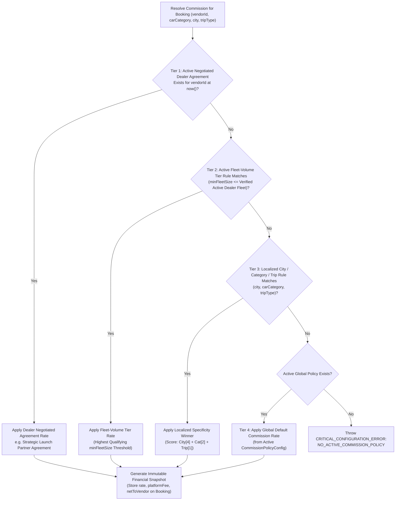
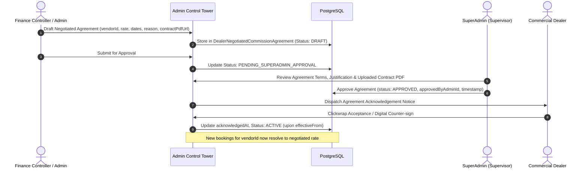

# DriveGo — Platform Commission Configuration & Financial Snapshots

**Document Reference**: `docs/product/DRIVEGO_COMMISSION_CONFIG_SPEC.md`  
**Classification**: Authoritative Financial Policy Specification  
**Effective Date**: November 9, 2026  
**Author**: Chief Technology Officer, FinTech Systems Architect & Delivery Lead  
**Repository**: `https://github.com/saicharanrao21/car_rental_monorepo`  
**Git Baseline Commit**: `b87cfe90527c801172529290b96f3d7c0200b941` (Branch: `main`)  
**Status**: APPROVED RECONCILED COMMISSION SPECIFICATION — IMPLEMENTATION STATUS: PENDING EXPLICIT FOUNDER APPROVAL  

---

> [!CAUTION]
> **Implementation Authorization Directive**: This specification defines platform commission models and financial snapshot architecture. **NO IMPLEMENTATION AUTHORIZATION HAS BEEN GRANTED**. All engineering implementation remains strictly `PENDING EXPLICIT FOUNDER APPROVAL`.

---

## 1. Executive Summary & Founder Directives

```
========================================================================================
             FOUNDER-CONFIRMED DIRECTIVES: PLATFORM COMMISSION POLICY
========================================================================================
1. ADMIN CONTROLS GLOBAL COMMISSION RATE:
   Authorized Admin users control the global platform commission rate.
   Admin determines the initial launch default rate. The founder does not select a
   fixed percentage in advance.
2. ZERO HARDCODED COMMISSION PERCENTAGES:
   Previously discussed percentages (such as 15%, 17.5%, 18%, or 20%) are illustrative
   examples only. They must NEVER be hardcoded into backend services, database defaults,
   or client applications.
3. CONTROLLED CONFIGURATION ERROR ON MISSING POLICY:
   If no approved global commission policy is active, the system produces a controlled
   system error (CRITICAL_CONFIGURATION_ERROR: NO_ACTIVE_COMMISSION_POLICY). The platform
   must NEVER fall back to an invented constant (such as 10% or 15%).
4. NEGOTIATED DEALER-SPECIFIC RATES:
   Admin can negotiate a separate commission rate with an individual dealer.
   Admin can create, modify, approve, and schedule dealer-specific negotiated rates.
   Different dealers may operate under different approved commission rates simultaneously.
5. COEXISTING FLEET TIERS & LOCALIZED RULES:
   Optional fleet-volume tiers and localized city/category rules may coexist with
   dealer-specific negotiated agreements.
6. STRICT DETERMINISTIC PRECEDENCE:
   Active dealer-specific negotiated agreements take absolute precedence over global
   defaults, fleet tiers, and city/category rules whenever an approved agreement applies.
   No arbitrary priority integer may silently override a negotiated dealer agreement.
7. FLEET-VOLUME VERIFICATION CALCULATION:
   Fleet-volume tier qualification is calculated strictly from approved, active,
   verified dealer-owned vehicles. Draft, unverified, or suspended cars do not count.
8. SINGLE AUTHORITATIVE COMMISSION RESOLVER:
   The existing divergent services (CommissionResolverService and MarketplaceCommissionService)
   are unified into one single authoritative engine. Legacy 5% branch split assumptions
   are completely eliminated in favor of clean Platform / Dealer revenue splits.
9. CRITICAL FINANCIAL SNAPSHOT PROTECTION:
   Quotes hold provisional commission snapshots (TTL 15 min). Confirmed bookings capture
   the finalized immutable financial snapshot. Historical bookings and completed
   payout settlements are NEVER recalculated.
========================================================================================
```

---

## 2. Definitive Commission Precedence Hierarchy

When a booking quote is calculated or a reservation is confirmed, the backend resolves the effective commission percentage using a single, unambiguous 4-tier precedence hierarchy:



### 2.1 The 4 Tiers of Precedence

| Tier Level | Rule Dimension | Scope & Authority | Precedence Weight |
| :---: | :--- | :--- | :--- |
| **Tier 1 (Highest)** | **Active Dealer Negotiated Agreement** | Bilateral commercial agreement between DriveGo and a specific dealer (`vendorId`). Overrides all tiers, rules, and global defaults. | **Absolute Precedence** (Cannot be overridden by integers or tiers) |
| **Tier 2** | **Fleet-Volume Tier Rule** | Volume discount granted based on dealer's active verified fleet size (`minFleetSize`). Highest matching threshold wins. | **Tier 2 Precedence** (Applies when no Tier 1 agreement is active) |
| **Tier 3** | **City / Category / Trip Type Rule** | Localized operational pricing (e.g. Airport surcharge, Luxury segment rate). Specificity scoring resolves overlaps. | **Tier 3 Precedence** (Applies when no Tier 1 or Tier 2 rule matches) |
| **Tier 4 (Fallback)** | **Global Default Commission** | Platform-wide baseline commission rate set by SuperAdmin in the active `CommissionPolicyConfig`. | **Tier 4 Precedence** (Guaranteed fallback for all commercial rentals) |

### 2.2 Conflict Resolution & Specificity Scoring for Tier 3 Overlaps
If multiple rules match at Tier 3, specificity is calculated mathematically:
$$\text{Specificity Score} = (\text{City Match} \times 4) + (\text{Category Match} \times 2) + (\text{TripType Match} \times 1)$$

- **Score 7**: Exact City + Category + TripType match (Highest specificity).
- **Score 6**: City + Category match.
- **Score 4**: City only match.
- **Score 2**: Category only match.
- **Score 1**: TripType only match.
- If two rules produce identical specificity scores at Tier 3, the rule with the most recent `effectiveFrom` timestamp takes precedence, and an automated audit warning is logged for administrative review.

---

## 3. Commission Architecture Reconciliation & Service Unification

### 3.1 Audit of Existing Codebase Implementations
An inspection of the repository revealed two distinct, un-unified commission implementations:
1. `CommissionResolverService` (`car_rental_backend/src/common/commission-resolver.service.ts`):
   - Queries mutable `CommissionConfig` table.
   - Evaluates City (weight 4), CarCategory (weight 2), TripType (weight 1).
   - Hardcoded fallback constant: `defaultCommission = 10.0` or `SystemConfigService`.
   - Lacks `vendorId` parameter, fleet volume, versioning, and agreement tracking.
2. `MarketplaceCommissionService` (`car_rental_backend/src/finance/marketplace-commission.service.ts`):
   - Queries `MarketplaceCommissionRule` (`branchId`, `vendorId`, `PricingRuleScope.PLATFORM`).
   - Hardcoded fallback constants: `platformPct = 15.00`, `vendorPct = 80.00`, `branchPct = 5.00`, `gatewayFeePct = 2.00`.
   - Divides taxable revenue into 3 parties: Platform, Vendor, and a legacy "Branch" entity.

### 3.2 The Single Authoritative Commission Engine (`MarketplaceCommissionEngine`)
To eliminate contradictions, both legacy services are unified into a single authoritative engine:
- **Retirement of `CommissionResolverService`**: The city/category/tripType scoring logic is absorbed into Tier 3 of the unified engine. The legacy `CommissionConfig` table is superseded by `CommissionPolicyConfig` and `CommissionPolicyRule`.
- **Elimination of Legacy 5% Branch Split**: In DriveGo's dealer-only marketplace, vehicles are 100% dealer-owned and operated from dealer yards. DriveGo does not operate branches taking a 5% cut. The revenue split is strictly:
  $$\text{Taxable Rental Revenue} = \text{Platform Commission Fee} + \text{Net Dealer Rental Earnings}$$
  Multi-yard cost accounting within a dealer entity is internal dealer bookkeeping, not a platform take-rate deduction.
- **Dynamic Fleet-Volume Calculation**: Qualification for Tier 2 volume discounts is calculated dynamically via database aggregation over approved dealer inventory:
  ```ts
  const activeFleetCount = await this.prisma.car.count({
    where: {
      vendorId: booking.vendorId,
      verificationStatus: VerificationStatus.VERIFIED,
      operationalStatus: OperationalStatus.ACTIVE,
    },
  });
  ```
  Vehicles temporarily rented out (`isAvailable = false`) or undergoing routine turnaround maintenance remain counted toward verified fleet volume so tier status does not fluctuate unfairly. Unverified, draft, or suspended vehicles are strictly excluded.

---

## 4. Dealer Negotiation Workflow & Agreement Evidence Tracking



### 4.1 Agreement Evidence Mandates
Every negotiated agreement record must capture:
1. `vendorId`: The legal dealer entity receiving the negotiated rate.
2. `agreedPercentage`: Negotiated commission percentage ($0.00\% \le \text{rate} \le 50.00\%$).
3. `effectiveFrom` & `effectiveTo`: Explicit start timestamp and optional sunset date.
4. `negotiationReason`: Documented commercial justification (e.g. *"Strategic launch partner in Telangana hub with 25 premium vehicles"*).
5. `agreementDocumentUrl`: Secure pre-signed URL to counter-signed commercial agreement or partnership MOU.
6. `acknowledgedAt`: Timestamp when the dealer acknowledged the commercial terms.
7. `createdByAdminId` & `approvedByAdminId`: Dual-control Maker-Checker audit record.

---

## 5. Quote Validity, Re-Quotation & Booking Snapshot Invariant

### 5.1 The Binding Financial Snapshot Lifecycle
1. **Quote Generation (`POST /api/v1/bookings/quotes`)**:
   - Backend evaluates active commission rules for the dealer, vehicle, and city.
   - Calculates estimated customer fare, platform fee, and net to vendor.
   - Emits a provisional quote valid for **15 minutes** (`expiresAt = createdAt + 15 minutes`).
   - **Crucial Rule**: The quote snapshot is provisional and must NEVER be used directly as the final booking financial record without confirmation revalidation.
2. **Checkout Confirmation Gate (`POST /api/v1/bookings`)**:
   - Backend verifies `now() <= quote.expiresAt`. If expired, returns `HTTP 409 Conflict: QUOTE_EXPIRED`.
   - Backend performs atomic policy version revalidation: checks if `CommissionPolicyConfig.version` or `DealerNegotiatedCommissionAgreement.version` changed since quote generation.
   - **Financial Policy Mutation During Checkout**: If commission changed between quote generation and confirmation, backend recalculates splits. If customer-payable fare changed, returns `HTTP 409 Conflict: POLICY_UPDATED_REQUOTE_REQUIRED` requiring customer review and approval.
3. **Confirmed Booking Immutability**:
   - At checkout confirmation, the resolved commission rate and monetary split are permanently frozen into `Booking`:
     - `baseFare`
     - `platformFee`
     - `gstAmount`
     - `netToVendor`
     - `priceSnapshot` (JSON containing exact resolved rule type, version, and calculation formula).
   - Once confirmed, subsequent policy mutations, dealer renegotiations, or tier changes **never** alter existing bookings.
   - Completed vendor payouts and accounting ledger journals are **never recalculated**.
4. **Concurrency, Retries & Duplicate Protection**:
   - Confirmation requests mandate an `idempotencyKey`. Concurrent requests for the same quote acquire a Redis distributed lock (`lock:booking:quote:${quoteId}`).
   - Duplicate confirmation requests after payment authorization return the already-confirmed booking representation without re-executing transactions.
   - Payment gateway webhook retries (`payment.captured`) verify HMAC SHA256 signatures, check `Booking.status`, and idempotently acknowledge duplicate delivery without re-triggering payout ledger entries.

---

## 6. Strict Financial Separation & Calculation Formulas

### 6.1 Payment Component Breakdown & Definitions
Every booking transaction $B$ decomposes into five (5) distinct, non-commingled financial components:
1. **Base Rental Fare**: Primary time/vehicle hire charge configured by dealer or admin pricing rules.
2. **Doorstep Delivery Fee**: Logistics fee for vehicle dispatch and handover outside the dealer yard.
3. **Platform Convenience Fee**: Digital booking platform access fee collected by DriveGo.
4. **Additional Services**: Optional auxiliary add-ons (protection packages, child seat, extra driver, GPS).
5. **Refundable Security Deposit**: Reversible deposit held in an isolated holding account against post-trip damage or violations.

### 6.2 Commission Calculation Formulas
For commission split modeling between platform and dealer:

$$\text{Gross Rental Total} = \text{Base Rental Fare} + \text{Doorstep Delivery Fee}$$

$$\text{Platform Commission Fee} = \text{Gross Rental Total} \times \left( \frac{\text{Resolved Commission \%}}{100} \right)$$

$$\text{Applicable GST on Platform Commission} = \text{Platform Commission Fee} \times \left( \frac{\text{Approved GST Rate}}{100} \right)$$
*(Platform Commission GST — PENDING WRITTEN CA / TAX-COUNSEL APPROVAL. Percentages such as 18% are illustrative test data only; no tax calculation is implemented).*

$$\text{Net Dealer Rental Earnings} = \text{Gross Rental Total} - \text{Platform Commission Fee}$$

$$\text{Net Dealer Payout} = \text{Net Dealer Rental Earnings} - \text{Statutory Tax Withholding}$$
*(Section 194-O TDS Withholding — BLOCKED PENDING WRITTEN CA / TAX-COUNSEL APPROVAL. No tax calculation is implemented).*

### 6.3 Cancellation Refund Base & Dealer Cancellation Reconciled
> [!IMPORTANT]
> **Cancellation Refund Base Invariant (FND-CONF-12 & FND-CONF-13)**:
> In the event of customer or dealer cancellation:
> 1. All cancellation refund percentages apply strictly to the **rental fare only**.
> 2. Security deposits (`CUSTOMER_DEPOSIT_HOLDING`), platform convenience fees, and separately charged additional services are strictly excluded from the cancellation refund calculation.
> 3. "Before dealer acceptance" takes absolute priority over all time tiers (100% rental fare refund).
> 4. **Dealer Cancellation**: Results in a mandatory **100% rental fare refund** to the customer. Platform convenience fees and additional services are distinguished from rental fare and marked for separate founder / deferred CA review. Security deposits are decoupled and governed separately by the active deposit policy (subject to deferred CA/legal review), not as a cancellation refund calculation. No automatic cancellation-time release schedule or refund timing is invented.
> 5. **Delivery Fee in Cancellation Refund Base (FND-UNRES-02)**: In the commission model above, Gross Rental Total includes Base Rental Fare plus Doorstep Delivery Fee. However, whether the approved "rental fare" cancellation refund base denotes **Base Rental Fare only** or includes **Doorstep Delivery Fee** (prior to vehicle dispatch) is an open financial-definition issue (`FND-UNRES-02`) awaiting explicit founder or CA determination. The cancellation engine must parameterize this distinction and never silently conflate delivery fees with rental fare.

```
+-------------------------------------------------------------------------------------------------+
|                                 FINANCIAL BUCKET SEPARATION                                     |
+-----------------------------------+--------------------+----------------------------------------+
| Bucket Name                       | Flow & Custody     | Ledger Account Type & Governance Status|
+-----------------------------------+--------------------+----------------------------------------+
| Customer Refundable Deposit       | Internal Holding   | `CUSTOMER_DEPOSIT_HOLDING` (Internal   |
|                                   |                    | pass-through holding ledger. No bank   |
|                                   |                    | escrow exists. GST treatment pending   |
|                                   |                    | CA sign-off; no exemption assumed)     |
| Customer Trip Fare Subtotal       | Gateway Clearing   | `GATEWAY_CLEARING`                     |
| Platform Commission (Take-Rate)   | DriveGo Revenue    | `PLATFORM_COMMISSION_REVENUE`          |
| Applicable Platform GST           | Tax Liability      | `GOVERNMENT_TAX_PAYABLE` (Rate pending |
|                                   |                    | CA/tax-counsel written determination)  |
| Dealer Net Rental Earnings        | Dealer Settlement  | `VENDOR_PAYABLE_LEDGER`                |
| Payment Gateway Convenience Fee   | Processor Fee      | `PAYMENT_GATEWAY_EXPENSE`              |
+-----------------------------------+--------------------+----------------------------------------+
```

---

## 7. Proposed Database Architecture (Prisma Models)

```prisma
// ============================================================================
// GLOBAL PLATFORM COMMISSION CONFIGURATION (VERSIONED - ZERO BUSINESS DEFAULTS)
// ============================================================================
model CommissionPolicyConfig {
  id                    String              @id @default(cuid())
  version               Int                 @unique
  name                  String              // e.g. "DriveGo Master Commission Policy - Launch v1"
  defaultPercentage     Decimal             @db.Decimal(5, 2) // NO DEFAULT - Must be explicitly configured by Admin
  isActive              Boolean             @default(false)   // Technical default: inactive until approved
  effectiveFrom         DateTime
  effectiveTo           DateTime?
  createdByAdminId      String
  approvedByAdminId     String?             // Maker-checker sign-off
  status                ConfigApprovalStatus @default(DRAFT)   // Technical default: draft
  changeReason          String
  createdAt             DateTime            @default(now())   // Technical default: timestamp
  updatedAt             DateTime            @updatedAt
  rules                 CommissionPolicyRule[]
  auditLogs             CommissionPolicyAuditLog[]

  @@index([isActive, effectiveFrom])
  @@index([status])
}

// ============================================================================
// HIERARCHICAL COMMISSION RULES (TIERS 2 & 3: FLEET TIERS & LOCAL RULES)
// ============================================================================
model CommissionPolicyRule {
  id                    String                  @id @default(cuid())
  policyConfigId        String
  policyConfig          CommissionPolicyConfig  @relation(fields: [policyConfigId], references: [id], onDelete: Cascade)
  ruleType              CommissionRuleType      // FLEET_VOLUME_TIER or LOCALIZED_RULE
  city                  String?                 // Tier 3: City match
  carCategory           CarCategory?            // Tier 3: Category match
  tripType              TripType?               // Tier 3: Trip-type match
  minFleetSize          Int?                    // Tier 2: Fleet-volume threshold
  percentage            Decimal                 @db.Decimal(5, 2)
  priority              Int                     @default(0) // Specificity ranking within Tier 3

  @@index([policyConfigId])
  @@index([city])
  @@index([minFleetSize])
  @@index([ruleType])
}

// ============================================================================
// DEALER NEGOTIATED COMMISSION AGREEMENTS (TIER 1: HIGHEST PRECEDENCE)
// ============================================================================
model DealerNegotiatedCommissionAgreement {
  id                    String                  @id @default(cuid())
  vendorId              String
  vendor                Vendor                  @relation(fields: [vendorId], references: [id], onDelete: Cascade)
  version               Int                     @default(1)
  ruleType              CommissionRuleType      @default(DEALER_NEGOTIATED)
  agreementReference    String                  // e.g. "AGR-BLR-2026-0042"
  agreementDocumentKey  String?                 // Stable private S3 / R2 object key (e.g. "agreements/vnd_123/contract_v1.pdf")
  agreedPercentage      Decimal                 @db.Decimal(5, 2) // NO DEFAULT - Explicit negotiated rate
  isActive              Boolean                 @default(false)
  effectiveFrom         DateTime
  effectiveTo           DateTime?               // Scheduled expiration
  negotiationReason     String                  // Business rationale
  acknowledgedAt        DateTime?               // Dealer clickwrap acceptance
  createdByAdminId      String
  approvedByAdminId     String?                 // Maker-checker sign-off
  status                ConfigApprovalStatus    @default(DRAFT)
  createdAt             DateTime                @default(now())
  updatedAt             DateTime                @updatedAt
  auditLogs             DealerCommissionAuditLog[]

  @@index([vendorId, isActive, effectiveFrom])
  @@index([status])
}

// ============================================================================
// AUDIT LOGGING FOR COMMISSION MUTATIONS (PROTECTED FROM CASCADE DELETION)
// ============================================================================
model CommissionPolicyAuditLog {
  id                    String                  @id @default(cuid())
  policyConfigId        String
  policyConfig          CommissionPolicyConfig  @relation(fields: [policyConfigId], references: [id], onDelete: Restrict)
  adminId               String
  action                String                  // CREATED, PROPOSED, APPROVED, ACTIVATED, RETIRED, REJECTED
  previousPayload       Json?
  newPayload            Json
  reason                String
  timestamp             DateTime                @default(now())

  @@index([policyConfigId])
  @@index([adminId])
}

model DealerCommissionAuditLog {
  id                    String                                @id @default(cuid())
  agreementId           String
  agreement             DealerNegotiatedCommissionAgreement  @relation(fields: [agreementId], references: [id], onDelete: Restrict)
  adminId               String
  action                String                                // CREATED, PROPOSED, APPROVED, ACTIVATED, RETIRED, REJECTED
  previousPayload       Json?
  newPayload            Json
  reason                String
  timestamp             DateTime                              @default(now())

  @@index([agreementId])
  @@index([adminId])
}

enum CommissionRuleType {
  DEALER_NEGOTIATED
  FLEET_VOLUME_TIER
  LOCALIZED_RULE
  GLOBAL_DEFAULT
}

enum ConfigApprovalStatus {
  DRAFT
  PENDING_SUPERADMIN_APPROVAL
  APPROVED
  ACTIVE
  RETIRED
  REJECTED
}
```

---

## 8. Security, Tenant Isolation & RBAC Controls

1. **Cross-Dealer Isolation**: Dealer A cannot read, query, infer, or view Dealer B's commission agreements or earnings structures. All vendor-facing queries in `MarketplaceCommissionEngine` enforce `where: { vendorId: session.vendorId }`.
2. **Dealer Mutation Prohibition**: Dealers have **zero** write access to platform commission rates or their own negotiated agreements (`HTTP 403 Forbidden`). Only authorized Admin roles can create, negotiate, or approve agreements.
3. **Backend Authorization Enforcement**: All Admin commission endpoints are guarded on the backend via `@UseGuards(JwtAuthGuard, RolesGuard)` with `@Roles(Role.ADMIN)`. Frontend route guards or hidden UI elements are strictly secondary.
4. **Maker-Checker Protocol**:
   - `FINANCE_CONTROLLER`: Creates and drafts commission rule sets and dealer agreements.
   - `SUPER_ADMIN`: Executes the formal activation approval (`approvedByAdminId`).

---

## 9. Documented Acceptance-Test Matrix

> [!NOTE]
> **ACCEPTANCE TEST SPECIFICATION (TEST DATA ONLY)**: All commission percentages in the matrix below are strictly test fixture values designed to validate precedence hierarchy, tier fallback, and tie-breaking logic. **None represents an approved production launch rate.**
> 
> **Verification Status Key**:
> - `TEST CASE DOCUMENTED`: Fully specified in documentation; awaiting sprint implementation.
> - `TEST IMPLEMENTED`: Test suite code written in repository.
> - `TEST EXECUTED`: Executed in local / CI environment.
> - `TEST PASSED`: Verified passing with reproducible evidence.
> - `NOT VERIFIED`: Requires live third-party runtime or physical hardware.

| Scenario ID | Test Scenario Description | Setup & Execution [TEST DATA ONLY] | Expected Outcome & Invariant Verification | Verification Status |
| :---: | :--- | :--- | :--- | :---: |
| **TEST-COM-01** | **Dealer A receives global default rate** | Global: 18.00%. Dealer A has zero agreements and fleet size = 3. | Booking resolves to Tier 4 global default rate (18.00%). | **TEST CASE DOCUMENTED** |
| **TEST-COM-02** | **Dealer B receives negotiated rate** | Global: 18.00%. Dealer B has active Tier 1 agreement for 12.00%. Fleet size = 5. | Booking resolves to exactly 12.00%, overriding all other rules and defaults. | **TEST CASE DOCUMENTED** |
| **TEST-COM-03** | **Dealer C qualifies for fleet-volume tier** | Global: 18.00%. Tier 2 rule: `minFleetSize = 15` @ 15.00%. Dealer C has 18 verified cars. | With no Tier 1 agreement, booking resolves to 15.00% via Tier 2 volume discount. | **TEST CASE DOCUMENTED** |
| **TEST-COM-04** | **Dealer D has custom deposit and negotiated commission** | Dealer D has custom deposit override (₹10,000) and active Tier 1 commission (11.50%). | Booking simultaneously resolves to ₹10,000 deposit and 11.50% commission. | **TEST CASE DOCUMENTED** |
| **TEST-COM-05** | **Negotiated rate takes precedence over volume tier** | Dealer B has 20 cars (qualifying for Tier 2 at 15.00%) and Tier 1 agreement at 12.00%. | System deterministically applies Tier 1 rate (12.00%). Tier 2 volume rule is superseded. | **TEST CASE DOCUMENTED** |
| **TEST-COM-06** | **Global rate change with existing dealer agreements** | Global updates from 18.00% to 20.00%. Dealer A has no agreement; Dealer B has 12.00% agreement. | Dealer A new quotes reflect 20.00%. Dealer B new quotes retain negotiated 12.00%. | **TEST CASE DOCUMENTED** |
| **TEST-COM-07** | **Single dealer rate change without affecting others** | Admin amends Dealer B's agreement to 13.00%. | Dealer B quotes reflect 13.00%. Dealer A, C, and D rates remain completely unaffected. | **TEST CASE DOCUMENTED** |
| **TEST-COM-08** | **Agreement expiration and documented fallback** | Dealer B agreement reaches `effectiveTo`. Verified fleet = 18 cars. Next quote requested. | System automatically falls back to Tier 2 volume tier (15.00%), or Tier 4 default if fleet < 15. | **TEST CASE DOCUMENTED** |
| **TEST-COM-09** | **Concurrent policy update during quote confirmation** | Customer receives quote under 18.00%. Policy updates to 20.00%. Customer confirms booking. | If customer fare changes, backend rejects with `HTTP 409 Conflict: POLICY_UPDATED_REQUOTE_REQUIRED`. | **TEST CASE DOCUMENTED** |
| **TEST-COM-10** | **Confirmed booking snapshot immutability** | Booking confirmed under 12.00% rate. Dealer renegotiates to 14.00%. | Confirmed booking's `priceSnapshot` and `netToVendor` remain at 12.00%. | **TEST CASE DOCUMENTED** |
| **TEST-COM-11** | **Completed settlement immutability** | Payout journal settled and transferred. Commission policy subsequently altered. | Historical vendor remittance and accounting journal entries are permanently immutable. | **TEST CASE DOCUMENTED** |
| **TEST-COM-12** | **Cross-dealer access attempts rejected** | Dealer A attempts `GET /api/v1/vendors/{dealerB}/agreements`. | Backend returns `HTTP 403 Forbidden`. | **TEST CASE DOCUMENTED** |
| **TEST-COM-13** | **Unauthorized dealer policy mutation** | Vendor attempts `POST /api/v1/admin/commission-rules` or `PATCH /negotiated-agreements`. | Backend guards reject with `HTTP 403 Forbidden`. | **TEST CASE DOCUMENTED** |
| **TEST-COM-14** | **Maker-checker separation enforcement** | Same admin attempts to author and approve agreement (`createdByAdminId === approvedByAdminId`). | System rejects activation with `HTTP 400 Bad Request: MAKER_CHECKER_VIOLATION`. | **TEST CASE DOCUMENTED** |
| **TEST-COM-15** | **Missing global policy error gate** | Database contains zero active global policies. Customer requests quote. | Backend throws `CRITICAL_CONFIGURATION_ERROR: NO_ACTIVE_COMMISSION_POLICY`. Never invents fallback rate. | **TEST CASE DOCUMENTED** |

---

## 10. Technical Safeguards & Implementation Recommendations

1. **Audit Evidence Preservation**: Audit log relations MUST use `onDelete: Restrict` in Prisma. Policies must never be hard-deleted; decommissioned policies transition to `status: RETIRED`.
2. **Stable Private Storage Keys for Legal Documents**: The database stores a private object key (e.g. `agreementDocumentKey: "agreements/vnd_123/contract_v1.pdf"`). Client applications access documents strictly through authorized, short-lived (15-minute / 900-second) pre-signed download URLs generated on demand via `GET /api/v1/admin/agreements/:id/document-url`.
3. **PostgreSQL Partial Unique Index for Global Policy**: To physically prevent concurrent activations of multiple global commission policies:
   ```sql
   CREATE UNIQUE INDEX unique_active_global_commission_policy 
   ON "CommissionPolicyConfig" ("isActive") 
   WHERE "isActive" = true;
   ```
4. **Invalid Nullable Condition Prevention**: `CommissionPolicyRule` must enforce validation: if `ruleType = FLEET_VOLUME_TIER`, `minFleetSize` must be non-null; if `ruleType = LOCALIZED_RULE`, at least one of `city`, `carCategory`, or `tripType` must be non-null.
5. **Atomic Serializable Transactions**: Commission resolution and snapshot commits at booking confirmation must be wrapped in `prisma.$transaction(async (tx) => { ... })` with row-level locks on the parent `Car` and `Vendor`.
