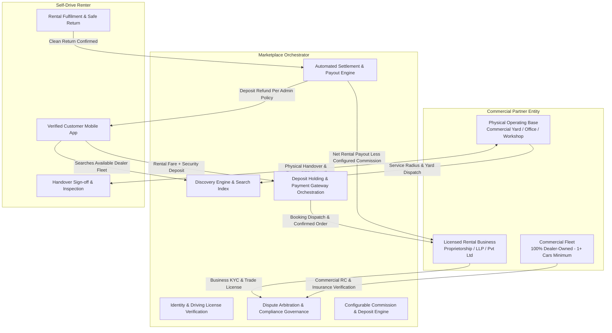

# DriveGo — Confirmed Business Model & Regulatory Framework

**Document Reference**: `docs/product/DRIVEGO_CONFIRMED_BUSINESS_MODEL.md`  
**Classification**: Authoritative Business Architecture  
**Effective Date**: November 9, 2026  
**Author**: Chief Technology Officer, FinTech Systems Architect & Legal Compliance Lead  
**Repository**: `https://github.com/saicharanrao21/car_rental_monorepo`  
**Git Baseline Commit**: `b87cfe90527c801172529290b96f3d7c0200b941` (Branch: `main`)  
**Status**: APPROVED FOUNDER BUSINESS SPECIFICATION  

---

## 1. The Commercial Rental Dealer Marketplace

DriveGo is exclusively an **Enterprise & Commercial Rental Dealer Marketplace**. The platform serves as the digital orchestration layer connecting licensed car rental companies, fleet agencies, and transport operators with retail drivers seeking self-drive car rentals across urban hubs and tourist destinations in India.



### 1.1 Fundamental Operating Invariants
1. **No Peer-to-Peer Car Sharing**: Ordinary private car owners cannot list their private vehicles. Private individuals looking to monetize personal cars (white registration plates) are strictly rejected during onboarding.
2. **Dealer Ownership Mandatory**: Every vehicle in the DriveGo fleet must be titled directly in the name of the registered dealer business or its verified sole proprietor. Leased vehicles, subleased vehicles, managed vehicles, consignment vehicles, and third-party-owned vehicles are **strictly prohibited without exception**.
3. **Confirmed Minimum Fleet Size: ONE (1) Vehicle**: A commercial rental dealer may apply and onboard with a minimum of **one (1) eligible dealer-owned vehicle**. No artificial 3-car or 5-car barrier is imposed.
4. **Physical Commercial Base**: Every dealer must maintain at least one physical, verifiable operational base (yard, service station, or commercial office) for vehicle storage, maintenance, and handovers. Fictional or purely virtual hubs are disallowed.
5. **Full Operational Responsibility**: The dealer remains legally and operationally responsible for vehicle roadworthiness, periodic maintenance, sanitization, valid statutory documentation, and on-ground customer handover.
6. **Hybrid Booking Acceptance**: Eligible vehicles and dealers can receive instant bookings when all six configured eligibility conditions pass. Manual dealer approval is required wherever instant-booking eligibility conditions are not met.
7. **Customer & Dealer Cancellation & Refund Policy**: Formal 7-tier cancellation refund schedule applies strictly to **rental fare only**; "Before dealer acceptance" takes absolute priority over time-based tiers (100% rental fare refund); dealer cancellation yields 100% rental fare refund; non-rental-fare components (platform fee, additional services) are distinguished for founder/CA review; security deposit is decoupled and governed separately by the active deposit policy (subject to deferred CA/legal review). Confirmed bookings preserve immutable cancellation policy snapshots.
8. **Phased Multi-City Telangana Launch**: Approved 3-phase rollout: Phase 1: Hyderabad; Phase 2: Karimnagar & Warangal; Phase 3: Nizamabad & Khammam.
9. **Distinct Three-Stage Customer KYC Gate**: Stage 1: Customers can browse vehicles without KYC; Stage 2: Customer KYC must be completed before booking confirmation; Stage 3: Mandatory 7-point handover verification checklist must be completed before vehicle release.

---

## 2. Unit Economics & Marketplace Monetization

DriveGo operates on a commission-based take-rate model. The platform never holds vehicle inventory on its balance sheet, eliminating vehicle depreciation and insurance overhead.

### 2.1 Customer Payment Breakdown & Fare Decomposition
DriveGo checkout decomposes customer payments into five (5) distinct financial components:
1. **Base Rental Fare**: Primary vehicle rental charge based on trip duration and vehicle tier.
2. **Doorstep Delivery Fee**: Operational fee for vehicle delivery/return outside the dealer yard (passed through or shared per policy).
3. **Platform Convenience Fee**: Digital booking platform access fee collected by DriveGo.
4. **Additional Services / Protection Packages**: Optional add-ons such as damage protection packages, GPS, or child seats.
5. **Refundable Security Deposit**: Reversible deposit held in an isolated internal holding ledger (`CUSTOMER_DEPOSIT_HOLDING`) against damages or post-trip violations.

For every booking transaction $B$:

$$\text{Total Customer Checkout} = \text{Base Rental} + \text{Doorstep Delivery Fee} + \text{Platform Convenience Fee} + \text{Additional Services} + \text{Applicable GST (Pending CA Approval)} + \text{Refundable Security Deposit} - \text{Discount}$$

```
+---------------------------------------------------------------------------------------------------------+
|                                  CUSTOMER CHECKOUT FARE STRUCTURE                                        |
+------------------------------------+--------------------+-----------------------------------------------+
| Component                          | Payer / Recipient  | Financial Nature & Governance Status          |
+------------------------------------+--------------------+-----------------------------------------------+
| 1. Base Rental Fare                | Customer -> Split  | Shared: Dealer Net + DriveGo Take-Rate        |
| 2. Doorstep Delivery Fee           | Customer -> Dealer | Passed through to Dealer (or yard operations) |
| 3. Platform Convenience Fee        | Customer -> DriveGo| Platform auxiliary booking revenue            |
| 4. Additional Services / Packages  | Customer -> DriveGo| Auxiliary service revenue (protection, etc.)  |
| 5. Applicable GST on Rental        | Customer -> Govt   | Tax remittance (Rate & SAC 9966               |
|                                    |                    | pending formal written CA approval)           |
| 6. Refundable Security Deposit     | Customer -> Holding| Pass-through holding; refundable per          |
|                                    |                    | admin policy (Internal holding account        |
|                                    |                    | - not a statutory bank escrow trust.          |
|                                    |                    | GST treatment pending CA determination)       |
+------------------------------------+--------------------+-----------------------------------------------+
```

> [!IMPORTANT]
> **Delivery Fee in Cancellation Refund Base (FND-UNRES-02)**: Whether the approved "rental fare" cancellation refund base denotes **Base Rental Fare only** or includes **Doorstep Delivery Fee** (when cancelled prior to vehicle dispatch) is an open financial-definition issue (`FND-UNRES-02`) awaiting explicit founder or CA determination. The system must parameterize this distinction and never silently conflate delivery fees with rental fare.

> [!NOTE]
> **Deposit Holding & Tax Terminology**: Any reference to customer deposit holding denotes an isolated internal ledger account (`CUSTOMER_DEPOSIT_HOLDING`) separating deposits from platform revenue. It does not constitute a formal third-party statutory bank escrow trust under RBI guidelines, as no legally established bank escrow trustee arrangement exists. GST treatment of refundable deposits and any forfeiture or damage compensation is pending written CA/tax-counsel determination. No exemption or non-taxable treatment is assumed.

### 2.2 Admin-Configurable Commission & Dealer Negotiations
In accordance with founder determinations, **commission rates are dynamically configurable in Admin Control Tower** (see [DRIVEGO_COMMISSION_CONFIG_SPEC.md](file:///D:/Flutter/car_rental_monorepo/docs/product/DRIVEGO_COMMISSION_CONFIG_SPEC.md)):
- **Global Platform Commission**: Admin sets the platform-wide default rate and determines the initial launch default. The founder does not select a fixed rate in advance.
- **Zero Database Defaults**: Schema contains zero hardcoded commission rates; missing active policy produces `CRITICAL_CONFIGURATION_ERROR: NO_ACTIVE_COMMISSION_POLICY`.
- **Single Authoritative Resolver (`MarketplaceCommissionEngine`)**: Unifies legacy services; eliminates legacy 5% branch split deductions in favor of clean Platform Commission + Net Dealer Rental Earnings.
- **Negotiated Dealer Rates**: Admin can negotiate, modify, and schedule custom commission rates with individual dealers. Different dealers may operate under different approved commission rates simultaneously.
- **Definitive Precedence Hierarchy**: (1) Active Dealer Negotiated Agreement > (2) Fleet-Volume Tier Rule > (3) City/Category/Trip Rule > (4) Global Default Commission.
- **Fleet-Volume Tier Calculation**: Volume qualification is calculated dynamically from approved, verified, dealer-owned vehicles in the active fleet inventory (`verificationStatus = VERIFIED`, `operationalStatus = ACTIVE`). Vehicles temporarily rented out (`isAvailable = false`) or undergoing routine turnaround maintenance remain counted toward verified fleet volume so tier status does not fluctuate unfairly.
- **Agreement Evidence Tracking**: Every negotiated agreement requires documented business justification, uploaded contract evidence URL, dealer acknowledgement, and maker-checker approval.
- **Illustrative Percentages**: Previously discussed percentages (e.g. 20%, 17.5%, 15%, or 18%) are illustrative examples of optional tiered models, **not hardcoded constants**:

| Illustrative Tier Example | Fleet Scale Benchmark | Illustrative Platform Commission | Illustrative Dealer Net Share |
| :--- | :---: | :---: | :---: |
| **Standard Partner** | 1 – 5 cars | *Configurable via Admin* (e.g. 20.0%) | *Balance to Dealer* |
| **Growth Partner** | 6 – 15 cars | *Configurable via Admin* (e.g. 17.5%) | *Balance to Dealer* |
| **Enterprise / Fleet** | 16+ cars | *Configurable via Admin* (e.g. 15.0%) | *Balance to Dealer* |

Every booking retains an immutable snapshot of its resolved commission rate and monetary split. Changing global commission settings or dealer agreements never recalculates historical bookings or settled payouts.

### 2.3 Admin-Configurable Security Deposit Policy (Global + Dealer Overrides)
Customer security deposits protect against post-trip damage, traffic challans, fuel shortfalls, and excessive toll charges:
- **Global Default Policy**: Admin controls the platform default deposit policy and determines launch default. The founder does not pick a fixed release schedule or amount in advance.
- **Zero Business Defaults in Schema**: No database default for category amounts or release schedules; missing active policy produces `CRITICAL_CONFIGURATION_ERROR: NO_ACTIVE_DEPOSIT_POLICY`.
- **Dealer-Specific Deposit Overrides**: Admin can configure and modify a separate deposit policy for an individual dealer. Different dealers may operate under different approved deposit policies simultaneously.
- **Field-Level Inheritance**: Dealer overrides specify only the fields they customize (e.g. custom category amounts or release schedules); all non-overridden fields inherit directly from the active global policy.
- **No Universal Hardcoded Schedules**: No universal fixed 24-hour, 48-hour, or 80/20 release rule is approved or hardcoded.
- **Monetary Holding Isolation**: Deposits are collected upfront at checkout and maintained in an isolated ledger account (`CUSTOMER_DEPOSIT_ESCROW`). They are never commingled with platform operational revenue. Dealers have zero ability to unilaterally debit or divert customer deposits.
- **Immutable Booking Snapshots**: Quotes contain provisional snapshots (TTL 15 min); confirmed bookings capture the finalized immutable deposit policy snapshot. If policy mutated during checkout, system rejects confirmation with `HTTP 409 Conflict: POLICY_UPDATED_REQUOTE_REQUIRED`. Subsequent policy updates never touch confirmed bookings.

### 2.4 Customer & Dealer Cancellation and Refund Policy
In accordance with confirmed founder directives, the platform enforces the following authoritative cancellation schedule:

| Cancellation Timing | Customer Refund | Calculation Base | Precedence Level |
| :--- | :---: | :---: | :--- |
| **Before dealer acceptance** | **100%** | Rental Fare Only | **Tier 1 (Highest Precedence)** — Overrides all time-based tiers |
| **More than 48 hours before pickup** | **90%** | Rental Fare Only | Tier 2 (Time-based post-acceptance / instant) |
| **24–48 hours before pickup** | **75%** | Rental Fare Only | Tier 2 (Time-based post-acceptance / instant) |
| **6–24 hours before pickup** | **50%** | Rental Fare Only | Tier 2 (Time-based post-acceptance / instant) |
| **Less than 6 hours before pickup** | **0%** | Rental Fare Only | Tier 2 (Time-based post-acceptance / instant) |
| **No-show** | **0%** | Rental Fare Only | Tier 2 (Time-based post-acceptance / instant) |
| **Dealer cancellation** | **100%** | Rental Fare Only | Mandatory 100% rental fare refund (other components distinguished; deposit governed separately by deposit policy) |

#### Operational Invariants:
1. **Clear Actor Distinction**: Customer-initiated cancellations and dealer-initiated cancellations follow strictly distinct financial flows. Dealer-initiated cancellations result in a mandatory 100% refund of the **rental fare**. Non-rental-fare components (platform convenience fee, additional services) are explicitly distinguished from the rental fare and marked for separate founder / deferred CA review. Security deposits are not combined with cancellation refunds; their accounting and release treatment are governed separately by the active deposit policy, subject to deferred CA/legal review.
2. **Exact Approved Percentages**: Refund percentages are codified exactly as approved by the founder. No additional processing fees, penalty buffers, or dispute exceptions are invented.
3. **Refund Calculation Base Confirmed (Rental Fare Only)**:
   > [!IMPORTANT]
   > **Calculation Base Invariant (FND-CONF-12 & FND-UNRES-02)**: All cancellation refund percentages apply strictly to the **rental fare only**. The following are excluded from cancellation refunds:
   > - Refundable security deposit (decoupled and governed separately by the active deposit policy, subject to deferred CA/legal review)
   > - Platform convenience fee
   > - Separately charged additional services or fees
   >
   > Security deposits are **NEVER** combined with cancellation refunds. Their accounting, segregation, and release treatment remain completely decoupled, subject to deferred CA/legal review. No automatic cancellation-time release schedule or refund timing is invented.
   > 
   > Whether the approved "rental fare" cancellation refund base denotes **Base Rental Fare only** or includes **Doorstep Delivery Fee** (when cancelled prior to vehicle dispatch) is an open financial-definition issue (`FND-UNRES-02`) awaiting explicit founder or CA determination. The cancellation calculation worker must parameterize this distinction and never silently conflate delivery fees with rental fare.
4. **Cancellation Precedence Confirmed (Pre-Acceptance Priority)**:
   > [!IMPORTANT]
   > **Precedence Hierarchy Invariant (FND-CONF-13)**: The rule **"Before dealer acceptance" takes absolute priority over all time-based cancellation tiers**.
   > - If a customer cancels before dealer acceptance, they receive a **100% rental fare refund**, regardless of the time remaining before scheduled pickup (e.g. even if less than 6 hours before pickup).
   > - Once dealer acceptance occurs (or for instant bookings confirmed immediately), time-based tiers (90%, 75%, 50%, 0%) apply strictly.
5. **Security Deposit Decoupling**: Customer refundable security deposits are completely isolated from cancellation deductions. The security deposit is governed entirely by the separately configured deposit policy and deferred CA/legal review, rather than an invented cancellation-time release schedule or refund timing.
6. **Immutable Booking Policy Snapshots**: Every confirmed booking captures an immutable snapshot of its applicable cancellation policy. Subsequent changes to platform or dealer cancellation terms never alter historical bookings.

### 2.5 Hybrid Booking Acceptance Architecture
In accordance with confirmed founder directives, DriveGo operates a **Hybrid Booking Acceptance Model**:
1. **Instant Booking Pathway (Six Confirmed Eligibility Conditions - FND-CONF-14)**:
   Instant booking is permitted **ONLY** when **ALL SIX** of the following conditions pass:
   - **Condition 1**: Dealer account is approved and active (`Vendor.status == ACTIVE`).
   - **Condition 2**: Vehicle is approved and active (`Car.verificationStatus == VERIFIED && operationalStatus == ACTIVE`).
   - **Condition 3**: Vehicle availability is verified for the entire requested trip without scheduling conflict.
   - **Condition 4**: Pricing and applicable policies are configured.
   - **Condition 5**: Dealer has enabled instant booking (`Car.instantBookingEnabled == true`).
   - **Condition 6**: No pending verification, restriction, or operational hold exists on dealer or vehicle.
   
   If **ANY** eligibility condition fails, the booking routes automatically to manual dealer approval. Admin controls and configures eligibility policies through authorized settings; no arbitrary numeric thresholds are introduced.
2. **Manual Dealer Approval Pathway**: Wherever instant-booking eligibility conditions are not met, the booking transitions to `AWAITING_DEALER_ACCEPTANCE`, requiring manual dealer review and approval.
3. **Dealer Response SLA Window (Open Operational Detail - FND-UNRES-01)**:
   > [!NOTE]
   > **Dealer Acceptance Response SLA (Pending Founder / Operational Definition)**: The platform preserves manual booking response handling. The exact dealer response deadline and acceptance timeout window (before automated voiding/expiry) remain an open operational decision pending explicit founder determination (`FND-UNRES-01`).
   > - Strict boundary: No response deadline, automatic acceptance, automatic rejection, timeout duration, or penalty/escalation schedule is invented.

### 2.6 Customer Workflow Progression & Three-Stage KYC Gate
In accordance with confirmed founder directives, customer progression is strictly partitioned across three distinct workflow stages:
1. **Stage 1: Vehicle Discovery & Browsing (No KYC Required)**: Customers can freely browse available dealer vehicles, filter by location and specs, and generate provisional pricing quotes without completing KYC.
2. **Stage 2: Booking Confirmation Gate (Mandatory Customer KYC - FND-CONF-11)**: Customer KYC verification must be fully completed and approved before a booking reservation can be confirmed.
3. **Stage 3: On-Ground Vehicle Release (Mandatory 7-Point Handover Checklist - FND-CONF-16)**:
   Before physical vehicle keys and vehicle dispatch occur at the yard, dealer staff must execute and complete all **seven (7) mandatory auditable checklist items**:
   1. Customer identity verification.
   2. Valid driving licence verification.
   3. Booking and payment confirmation.
   4. Vehicle condition photographs.
   5. Existing damage acknowledgement.
   6. Customer handover acknowledgement.
   7. Keys and vehicle documents handover record.
   
   All seven items represent mandatory auditable gates in the Partner App. Technical implementation mechanisms (such as capturing 4 exterior/interior photos, customer OTP exchange, cryptographic OTP validation, or digital signature capture) are proposed engineering options in the mobile app, NOT founder-mandated checks. The founder mandated the 7 checklist gates without prescribing a specific photo count or signature/OTP mechanism. Zero unapproved legal document types are invented; jurisdiction-specific requirements are marked for deferred legal review.

### 2.7 Approved Telangana Launch Geography (Three Phased Rollout - FND-CONF-15)
In accordance with confirmed founder directives, the commercial launch covers a phased multi-city rollout across Telangana:
- **Phase 1**: **Hyderabad**
- **Phase 2**: **Karimnagar**, **Warangal**
- **Phase 3**: **Nizamabad**, **Khammam**

Multi-city Telangana launch scope is strictly preserved. No unapproved launch cities or operational dates are added.

---

## 3. Statutory Regulatory & Legal Framework (India)

Operating a commercial self-drive car rental marketplace in India requires rigorous compliance across transport, commercial, tax, and data protection domains. In accordance with audit directives, all requirements are categorized by objective legal, statutory, and operational status without unsupported categorical claims:

### 3.1 Transport & Vehicle Compliance Register

| Requirement | Authority | Applicability | Geography | Vehicle Category | Evidence | Status | Owner Action |
| :--- | :--- | :--- | :--- | :--- | :--- | :---: | :--- |
| **Commercial Transport Registration** | Motor Vehicles Act, 1988 (MVA) Section 66; Section 2(47) | Mandates transport vehicle registration and permits for vehicles used for commercial hire or reward. | Central statute, enforced by states | Transport vehicles / Motor Cabs | MVA 1988 s.66(1) & s.2(47) | **Tier A — Verified statutory requirement** | Dealer must provide valid commercial registration certificate (RC). |
| **Certificate of Fitness (Form 38)** | Motor Vehicles Act, 1988 Section 56; CMVR 1989 Rule 62 | General statutory provision requires fitness certification for transport vehicles; specific operational applicability to self-drive rental motor cabs and new vehicles (where initial RC incorporates statutory fitness period) depends on launch-state RTO practice. | Central rule, state RTO renewal | Transport vehicles / Commercial cabs | MVA 1988 s.56; CMVR Rule 62 | **Tier B — Conditional statutory requirement** | Upload is conditional pending written transport legal counsel confirmation of launch-state rules; Admin verifies valid fitness period on RC or Form 38 where issued separately. |
| **Third-Party Commercial Insurance** | Motor Vehicles Act, 1988 Section 146 | Mandates minimum third-party passenger liability insurance for public-road vehicle operation. | Central statute | All commercial motor vehicles | MVA 1988 s.146 | **Tier A — Verified statutory requirement** | Dealer must upload valid commercial third-party policy. Comprehensive coverage enforced per Tier C policy. |
| **Pollution Under Control (PUC)** | Central Motor Vehicles Rules, 1989 Rule 115(7) | Mandatory emissions testing and certification for all motor vehicles operating on public roads. | Central rule | All motor vehicles | CMVR 1989 Rule 115(7) | **Tier A — Verified statutory requirement** | Dealer must upload current PUC with verifiable QR/record. |
| **Registration Plate Colour Schemes** | MVA 1988 s.41(6); CMVR Rule 50; MoRTH Notification RT-11028/11/2015-MVL (12-06-2015) | Specifies number plate colour schemes (e.g. black background with yellow lettering under Rent a Cab Scheme vs yellow background with black lettering for commercial taxis; green for EVs). State-level RTO enforcement varies. | Central framework, state RTO enforcement | Self-drive rental cabs | MoRTH Circular RT-11028/11/2015; CMVR Rule 50 | **Tier B — Pending legal verification** | Written transport counsel confirmation required on exact acceptable plate schemes across target launch geography (Telangana multi-city rollout). |
| **Speed Governor Requirement & Calibration** | Central Motor Vehicles Rules, 1989 Rule 118; MoRTH Notification G.S.R. 290(E) (15-04-2015) | Rule 118 prescribes speed limiting devices (e.g. 80 km/h cap) for certain transport vehicles. State-level applicability, tourist cab exemptions, and factory ECU speed limiter acceptance vary across launch states. | Central rule with significant state-level exemptions | M1 passenger transport cabs | CMVR 1989 Rule 118; state transport circulars | **Tier B — Pending legal verification** | Written legal counsel confirmation required regarding speed governor mandates and exemptions for self-drive rental cabs in launch state (Telangana). |
| **Rent a Cab Scheme, 1989 State Licensing** | Motor Vehicles Act, 1988 Section 75; Rent a Cab Scheme, 1989 | Prescribes licensing requirements (Form 4) for operating self-drive car rental businesses. Applicability to digital aggregators vs individual fleet owners, and statutory fleet threshold applicability (e.g. 50-car threshold under central 1989 scheme vs 1-car dealer onboarding), varies by state transport authority rules. | State-specific licensing rules | Self-drive car rental fleets & operators | MVA 1988 s.75; Rent a Cab Scheme 1989 | **Tier B — Conditional legal requirement** | Written transport legal counsel opinion required on platform aggregator vs dealer operating permit obligations and fleet thresholds. Dealer upload remains conditional during onboarding. |
| **Interstate Commercial Permits & Entry Taxes** | Motor Vehicles Act, 1988 Section 88; All India Tourist Vehicles (Permit) Rules, 2023 | Regulates inter-state operation of commercial passenger vehicles, permit reciprocity, and state border commercial passenger taxes. | Inter-state transport authorities | Self-drive commercial vehicles | MVA 1988 s.88; AITP Rules 2023 | **Tier B — Pending legal verification** | Written legal counsel confirmation required on inter-state permit workflows and customer toll/tax liabilities. |
| **Private (White-Plate) Vehicle Exclusion** | Founder Business Decision | DriveGo restricts marketplace participation exclusively to commercial rental dealers and dealer-owned vehicles. Private personal vehicles are strictly excluded. | Platform-wide operational standard | Private passenger vehicles (LMV) | Founder Directives (FND-CONF-01, FND-CONF-02) | **Tier C — Internal DriveGo policy** | Onboarding and admin review interfaces strictly reject private white-plate vehicle listings. |
| **Dealer-Owned Fleet Model (No Leases / Managed)** | Founder Business Decision | DriveGo permits only vehicles legally titled to the registered dealer entity or verified sole proprietor. Leased, subleased, managed, and consignment cars are prohibited. | Platform-wide operational standard | All listed fleet assets | Founder Directives (FND-CONF-02, FND-CONF-03) | **Tier C — Internal DriveGo policy** | Admin side-by-side RC audit enforces entity name match against registration certificate. |
| **Minimum Fleet Size: 1 Vehicle** | Founder Business Decision | Confirmed minimum onboarding threshold is one (1) eligible dealer-owned vehicle. | Platform-wide operational standard | Registered dealer entities | Founder Directive FND-CONF-04 | **Tier C — Internal DriveGo policy** | System permits dealer onboarding upon submission of one eligible vehicle. |
| **Admin Verification-Based Roadworthiness (No Universal Age Cap)** | Founder Business Decision | There is no universal fixed vehicle age cap. Admin evaluates vehicle condition, Form 38 fitness, and maintenance records individually. | Platform-wide operational standard | All onboarding fleet assets | Founder Directive FND-CONF-05 | **Tier C — Internal DriveGo policy** | Admin Control Tower executes structured roadworthiness checklist. |
| **Prohibition of Physical Custody** | Founder Business Decision | DriveGo strictly prohibits physical custody of original customer identity documents, physical cash, and customer personal vehicles for security deposits. | Platform-wide operational standard | Customer security deposits & handovers | Founder Directives | **Tier C — Internal DriveGo policy** | Handover inspection workflows enforce pure digital verification. Legal liability implications under DPDP/MVA remain **Pending Legal Verification**. |
| **Vehicle Condition Photographs & Handover Checklist Gates** | Company Operational Quality Standard | Mandatory 7-point handover verification checklist (FND-CONF-16). Proposed technical mechanisms (such as 4-point photographic evidence, real-time OTP exchange) are mobile engineering options, not founder mandates. | Platform-wide operational standard | All trip handovers and returns | System Architecture Specifications | **Tier C — Internal DriveGo policy** | Partner and Customer apps implement auditable gates for the 7 checks before vehicle release and return. |

---

### 3.2 Goods and Services Tax (GST) & Direct Tax Architecture

No tax treatment or statutory percentage is hardcoded or treated as confirmed policy. Invoicing mechanics and tax liabilities are partitioned across five separate financial components:

1. **Rental Fare GST**: **PENDING WRITTEN CA / TAX-COUNSEL APPROVAL**. (Applicable GST rate and classification under SAC 9966, e.g. 5% without ITC vs 12%/18% with ITC, require formal CA sign-off. Percentages used in specifications or test fixtures are non-binding illustrative examples).
2. **Platform Commission GST**: **PENDING WRITTEN CA / TAX-COUNSEL APPROVAL**. (Taxability, applicable GST rate, and invoice issuance on DriveGo platform commission / service fees charged to dealers require formal written CA sign-off).
3. **Refundable Security Deposit GST Treatment**: **PENDING WRITTEN CA / TAX-COUNSEL APPROVAL**. (GST treatment of refundable deposits and any forfeiture or damage compensation is pending written CA/tax-counsel determination. No exemption or non-taxable treatment is assumed).
4. **Deposit Forfeiture / Damage Compensation Tax Treatment**: **PENDING WRITTEN CA / TAX-COUNSEL APPROVAL**. (GST treatment of forfeited deposits, liquidated damages, or repair charges retained from customer deposits is pending written CA/tax-counsel determination. No specific tax treatment is assumed).
5. **Section 9(5) versus Section 52 Invoicing**: **PENDING WRITTEN CA / TAX-COUNSEL APPROVAL**. (Determination whether DriveGo is notified under Section 9(5) of the CGST Act as the deemed supplier liable to discharge GST on passenger transport, or acts as an e-commerce operator collecting TCS under Section 52 with dealers issuing tax invoices, requires formal CA/Tax Counsel sign-off).
6. **Section 194-O TDS Withholding**: **BLOCKED PENDING WRITTEN CA / TAX-COUNSEL APPROVAL**. (Automated TDS withholding on dealer payouts under Section 194-O is strictly blocked from code implementation until the company Chartered Accountant provides written determination on statutory rates, exemption thresholds, and Form 26Q filing rules). Structural ledger fields (`grossAmount`, `platformFee`, `tdsRate`, `tdsAmount`, `netAmount`) are preserved to support future compliance without schema changes.

---

### 3.3 Digital Personal Data Protection Act, 2023 (DPDP Act)
- Customer driving licenses and identity proofs must be collected solely for vehicle eligibility verification and statutory transport logs.
- Aadhaar numbers must be masked (first 8 digits obfuscated).
- Document images must reside in private encrypted Cloudflare R2 / S3 storage and be accessed solely via short-lived (15-minute / 900-second) pre-signed URLs.
