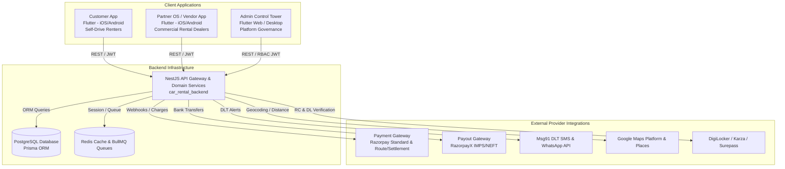
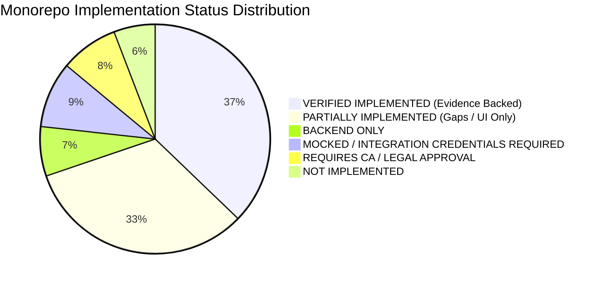

# DriveGo — Corrected Master Product Baseline

**Document Reference**: `docs/product/DRIVEGO_CORRECTED_MASTER_PRODUCT_BASELINE.md`  
**Classification**: Authoritative Product Baseline (Stage 1 — Dealer Model)  
**Effective Date**: November 9, 2026  
**Author**: Chief Technology Officer, Principal Product Architect & Technical Delivery Lead  
**Repository**: `https://github.com/saicharanrao21/car_rental_monorepo`  
**Git Baseline Commit**: `b87cfe90527c801172529290b96f3d7c0200b941` (Branch: `main`)  
**Status**: APPROVED RECONCILED BASELINE — IMPLEMENTATION STATUS: PENDING EXPLICIT FOUNDER APPROVAL  

---

> [!CAUTION]
> **Implementation Authorization Directive**: This document defines the reconciled product baseline. **NO IMPLEMENTATION AUTHORIZATION HAS BEEN GRANTED**. All engineering implementation remains strictly `PENDING EXPLICIT FOUNDER APPROVAL`.

---

## 1. Executive Summary & Founder-Confirmed Core Decisions

This specification establishes the authoritative, reconciled product baseline for **DriveGo**. It supersedes and overrides all conflicting descriptions, specifications, or planning items in legacy documentation.

Following explicit determinations by the founder, the following seven core architecture decisions are finalized:

```
========================================================================================
                      FOUNDER-CONFIRMED AUTHORITATIVE DIRECTIVES
========================================================================================
1. PARTNER MODEL: DEALER ONLY
   Multi-vendor self-drive car rental marketplace exclusively for established commercial
   car rental dealers, agencies, and fleet operators.
   Peer-to-peer (P2P) hosting for private individuals is STRICTLY EXCLUDED from launch.

2. VEHICLE OWNERSHIP MODEL: DEALER-OWNED ONLY
   A partner may list only vehicles legally owned by the registered dealer entity or its
   verified sole proprietor.
   STRICTLY EXCLUDED: Leased, subleased, managed, consignment, third-party-owned, and
   privately hosted vehicles. NO EXCEPTIONS FOR LEASED VEHICLES WITH SUBLEASE NOCs.

3. MINIMUM FLEET SIZE: ONE (1) ELIGIBLE VEHICLE
   Confirmed minimum fleet size is ONE (1) eligible dealer-owned vehicle.
   Do not impose a 3-vehicle or 5-vehicle minimum for partner onboarding.

4. MAXIMUM VEHICLE AGE: ADMIN VERIFICATION-BASED (NO UNIVERSAL HARDCODED CAP)
   There is NO hardcoded 5-year or 7-year age limit. Admin assesses eligibility
   individually based on condition, RC classification, commercial insurance, Form 38
   fitness, inspection evidence, and regulatory roadworthiness.

5. CUSTOMER SECURITY DEPOSIT: ADMIN-CONFIGURABLE (GLOBAL + DEALER OVERRIDES)
   Admin controls the global default deposit policy and determines launch default.
   Admin can configure and modify separate deposit policies for individual dealers.
   Zero database schema defaults for business policies; missing active policy produces
   controlled error (NO_ACTIVE_DEPOSIT_POLICY), never an invented fallback.
   Field-level inheritance: Dealer overrides customize specific fields; non-overridden
   fields inherit from the active global policy. No fixed 24h, 48h, or 80/20 rule is hardcoded.
   Quotes hold provisional snapshots (TTL 15 min); confirmed bookings capture the finalized
   immutable deposit policy snapshot. Requote gate enforces review if terms change at checkout.
   Implementation priority is sequenced as P2 (Sprint 3) in the engineering roadmap, while
   remaining strictly MANDATORY PRE-LAUNCH before commercial onboarding.

6. DRIVEGO COMMISSION: ADMIN-CONFIGURABLE & NEGOTIATED DEALER AGREEMENTS
   Admin controls global platform commission rate and determines launch default.
   Admin can negotiate, modify, and schedule dealer-specific negotiated rates.
   Zero database schema defaults for commission; missing active policy produces controlled
   error (NO_ACTIVE_COMMISSION_POLICY). Single authoritative resolver unifies legacy logic
   and eliminates arbitrary 5% branch split deductions. Fleet-volume tier qualification
   is evaluated strictly from verified, active dealer fleet.
   Definitive precedence hierarchy: (1) Active Dealer Negotiated Agreement > (2) Fleet-Volume Tier >
   (3) City/Category/Trip-type Rule > (4) Global Default Commission. Rates like 20%, 17.5%, 15% are
   illustrative examples only. Confirmed bookings preserve immutable financial snapshots.
   Completed payouts and historical settlements are NEVER recalculated.
   Implementation priority is sequenced as P2 (Sprint 3) in the engineering roadmap, while
   remaining strictly MANDATORY PRE-LAUNCH before commercial transactions occur.
   Statutory Section 194-O TDS withholding — BLOCKED PENDING WRITTEN CA / TAX-COUNSEL APPROVAL. GST treatment of refundable deposits and any forfeiture or damage compensation is pending written CA/tax-counsel determination; no exemption or non-taxable treatment is assumed (PENDING WRITTEN CA / TAX-COUNSEL APPROVAL).

7. ADMIN CONFIGURATION ARCHITECTURE: VERSIONED POLICY RECORDS
   The platform implements versioned, immutable configuration records with maker-checker
   governance, effective date windows, and comprehensive audit trails.

8. BOOKING ACCEPTANCE MODEL: HYBRID (6 CONFIRMED INSTANT CONDITIONS + MANUAL APPROVAL)
   Eligible vehicles and dealers receive instant bookings when all six configured eligibility
   and availability checks pass (Vendor ACTIVE, Car VERIFIED & ACTIVE, trip availability verified,
   pricing/policies configured, instant enabled, zero holds). Manual dealer approval is required
   wherever instant conditions fail. Admin controls eligibility policies without arbitrary numeric
   thresholds. Manual dealer response handling is preserved; dealer response SLA duration and
   acceptance timeout window remain pending explicit operational definition (FND-UNRES-01).

9. CANCELLATION & REFUND POLICY: APPROVED 7-TIER SCHEDULE ON RENTAL FARE ONLY
   Authoritative schedule: Before dealer acceptance: 100% | >48h before pickup: 90% |
   24–48h before pickup: 75% | 6–24h before pickup: 50% | <6h before pickup: 0% |
   No-show: 0% | Dealer cancellation: 100% rental fare refund. Customer cancellation is strictly
   distinguished from dealer cancellation. Calculation base is confirmed as RENTAL FARE ONLY
   (excludes security deposit, platform fee, and separately charged additional services).
   On dealer cancellation, customer receives a mandatory 100% rental fare refund; non-rental-fare
   components (platform fee, additional services) are distinguished for founder/CA review;
   security deposits are decoupled and governed separately by the active deposit policy (subject to deferred CA/legal review). Whether Doorstep
   Delivery Fee is included in the approved rental-fare cancellation refund base is an open
   financial-definition issue (FND-UNRES-02). Precedence is confirmed: "Before dealer acceptance"
   takes absolute priority over all time-based tiers (100% rental fare refund regardless of time
   remaining). Decoupled from refundable security deposit. Confirmed bookings preserve immutable
   policy snapshots. Historical settlements never recalculated.

10. LAUNCH GEOGRAPHY: APPROVED THREE-PHASE TELANGANA ROLLOUT
   Initial launch covers an approved 3-phase rollout across Telangana:
   Phase 1: Hyderabad; Phase 2: Karimnagar, Warangal; Phase 3: Nizamabad, Khammam.
   Multi-city scope strictly preserved. Zero unapproved launch cities or dates added.

11. CUSTOMER KYC GATE & VEHICLE HANDOVER: THREE-STAGE WORKFLOW & 7-POINT CHECKLIST
   Stage 1: Customers can browse vehicles and quotes without completing KYC.
   Stage 2: Customer KYC must be completed before booking confirmation.
   Stage 3: Mandatory 7-point handover verification checklist executed before vehicle release
   (Customer ID, driving licence, booking confirmation, vehicle condition photographs, existing
   damage acknowledgement, customer handover acknowledgement, keys & documents record).
   All seven items represent auditable gates in Partner App. Technical implementation mechanisms
   (such as 4 photos, customer OTP exchange, cryptographic OTP validation, and digital signatures)
   are proposed engineering implementation options in the mobile app, NOT founder-mandated rules.
========================================================================================
```

> [!NOTE]
> **Checklist vs. Founder Decision Count Reconciliation**: The 14 technical and architectural consistency checklist entries in this baseline represent design invariants and must **NOT** be conflated with or presented as 14 founder decisions. The authoritative register contains exactly **16 Confirmed Founder Decisions** (`FND-CONF-01` through `FND-CONF-16`) and **2 Unresolved Operational / Financial Decisions** (`FND-UNRES-01` and `FND-UNRES-02`).

---

## 2. Platform Architecture Overview

DriveGo consists of four integrated software systems operating over a unified backend and PostgreSQL database:



### 2.1 Component Specifications

| System Component | Technology Stack | Primary User Role | Mission & Scope |
| :--- | :--- | :--- | :--- |
| **Customer App** | Flutter (Dart 3), Riverpod, GoRouter | Retail Renter (Customer) | City discovery, dealer-owned vehicle search, hourly/daily booking, KYC verification, upfront rental & deposit payment, handover/return verification, dispute filing. |
| **Partner App (Vendor OS)** | Flutter (Dart 3), Riverpod, GoRouter | Commercial Rental Dealer & Staff | Dealer registration, trade document upload, dealer-owned fleet listing (1+ cars), yard/pickup point configuration, calendar dispatch, pre/post trip handover checklist inspection, booking fulfilment, payout ledger. |
| **Admin Control Tower** | Flutter Web, Riverpod, GoRouter | Platform SuperAdmin, Finance, Ops | Dealer KYC approval, vehicle RC title audit, dispute arbitration, deposit refund policy configuration, commission configuration, city serviceability, multi-tenant security governance. |
| **Backend Core Platform** | NestJS (TypeScript), Prisma ORM, PostgreSQL, Redis | System Engine & Worker Daemons | Multi-tenant REST APIs, booking state machines, double-entry financial ledger, deposit holding ledger, automated webhook reconciliation, audit logging. |

---

## 3. Product Vocabulary & Standard Terminology

All code, UI copy, and documentation must adhere to the standard commercial terminology:

```
+------------------------+------------------------------------+------------------------------------------+
| Standard Term          | Meaning in DriveGo                 | Prohibited / Deprecated Terms            |
+------------------------+------------------------------------+------------------------------------------+
| DriveGo / Platform     | The marketplace and operator       | Aggregator, Portal, Software Agency      |
| Partner / Rental Dealer| Approved commercial rental agency  | Host, Private Host, Car Owner, P2P Host  |
| Rental Business        | Registered legal dealer entity     | Individual Host Profile, Car Share Host  |
| Fleet                  | Dealer-owned commercial vehicles   | Host Inventory, Peer Vehicles            |
| Operating Base / Yard  | Physical commercial yard or office | Fictional Hub, Virtual Hub, Metro Zone   |
| Customer               | Verified retail self-drive renter  | Guest, Rider, Passenger, Driver          |
| Admin                  | DriveGo operations and finance     | Moderator, Platform Staff                |
+------------------------+------------------------------------+------------------------------------------+
```

---

## 4. Master Requirements Register & Implementation Status Summary

Across the monorepo, 86 distinct core capabilities have been audited:



---

## 5. Master Architecture Document Suite

| Doc Reference | Specification Document | Description |
| :---: | :--- | :--- |
| **01** | [DRIVEGO_CORRECTED_MASTER_PRODUCT_BASELINE.md](file:///D:/Flutter/car_rental_monorepo/docs/product/DRIVEGO_CORRECTED_MASTER_PRODUCT_BASELINE.md) | This master baseline synthesis & system boundaries |
| **02** | [DRIVEGO_CONFIRMED_BUSINESS_MODEL.md](file:///D:/Flutter/car_rental_monorepo/docs/product/DRIVEGO_CONFIRMED_BUSINESS_MODEL.md) | Dealer-only economics, configurable commission, statutory tax & legal framework |
| **03** | [DRIVEGO_DEALER_ONBOARDING_AND_VERIFICATION_SPEC.md](file:///D:/Flutter/car_rental_monorepo/docs/product/DRIVEGO_DEALER_ONBOARDING_AND_VERIFICATION_SPEC.md) | Dealer registration, 1-car minimum, operating yards & staff hierarchy |
| **04** | [DRIVEGO_DEALER_OWNED_FLEET_SPEC.md](file:///D:/Flutter/car_rental_monorepo/docs/product/DRIVEGO_DEALER_OWNED_FLEET_SPEC.md) | Dealer fleet onboarding, RC ownership audit, compliance & handovers |
| **05** | [DRIVEGO_CUSTOMER_PARTNER_ADMIN_WORKFLOW_MAP.md](file:///D:/Flutter/car_rental_monorepo/docs/product/DRIVEGO_CUSTOMER_PARTNER_ADMIN_WORKFLOW_MAP.md) | Cross-actor sequence diagrams, swimlanes & state transitions |
| **06** | [DRIVEGO_BACKEND_AND_DATABASE_GAP_ANALYSIS.md](file:///D:/Flutter/car_rental_monorepo/docs/product/DRIVEGO_BACKEND_AND_DATABASE_GAP_ANALYSIS.md) | Prisma schema audit, versioned config models, and collateral code trace |
| **07** | [DRIVEGO_REQUIREMENTS_TRACEABILITY_MATRIX.md](file:///D:/Flutter/car_rental_monorepo/docs/product/DRIVEGO_REQUIREMENTS_TRACEABILITY_MATRIX.md) | Complete 86-item RTM with verified source code mappings |
| **08** | [DRIVEGO_CORRECTED_IMPLEMENTATION_BACKLOG.md](file:///D:/Flutter/car_rental_monorepo/docs/product/DRIVEGO_CORRECTED_IMPLEMENTATION_BACKLOG.md) | Prioritized backlog across P0 (Foundation) to P4 (Growth) |
| **09** | [DRIVEGO_NEXT_SPRINT_IMPLEMENTATION_PLAN.md](file:///D:/Flutter/car_rental_monorepo/docs/product/DRIVEGO_NEXT_SPRINT_IMPLEMENTATION_PLAN.md) | Actionable Sprint 1 execution plan, dependencies & complexity |
| **10** | [DRIVEGO_FOUNDER_DECISIONS_AND_BLOCKERS.md](file:///D:/Flutter/car_rental_monorepo/docs/product/DRIVEGO_FOUNDER_DECISIONS_AND_BLOCKERS.md) | Authoritative register of confirmed decisions, open choices & blockers |
| **11** | [DRIVEGO_SECURITY_DEPOSIT_CONFIG_SPEC.md](file:///D:/Flutter/car_rental_monorepo/docs/product/DRIVEGO_SECURITY_DEPOSIT_CONFIG_SPEC.md) | Dedicated specification for Admin-configurable deposit policies |
| **12** | [DRIVEGO_COMMISSION_CONFIG_SPEC.md](file:///D:/Flutter/car_rental_monorepo/docs/product/DRIVEGO_COMMISSION_CONFIG_SPEC.md) | Dedicated specification for Admin-configurable commission engine |
| **13** | [DRIVEGO_VEHICLE_VERIFICATION_AND_APPROVAL_SPEC.md](file:///D:/Flutter/car_rental_monorepo/docs/product/DRIVEGO_VEHICLE_VERIFICATION_AND_APPROVAL_SPEC.md) | Dedicated specification for vehicle ownership audit and admin review |
| **14** | [DRIVEGO_FINAL_DOCUMENTATION_CONSISTENCY_REPORT.md](file:///D:/Flutter/car_rental_monorepo/docs/product/DRIVEGO_FINAL_DOCUMENTATION_CONSISTENCY_REPORT.md) | Authoritative documentation consistency audit & pre-implementation readiness verdict |
| **Index**| [README.md](file:///D:/Flutter/car_rental_monorepo/docs/product/README.md) | Master documentation index and contradiction scan report |
