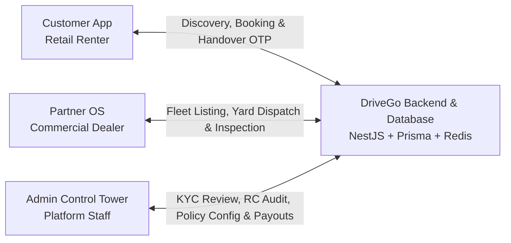
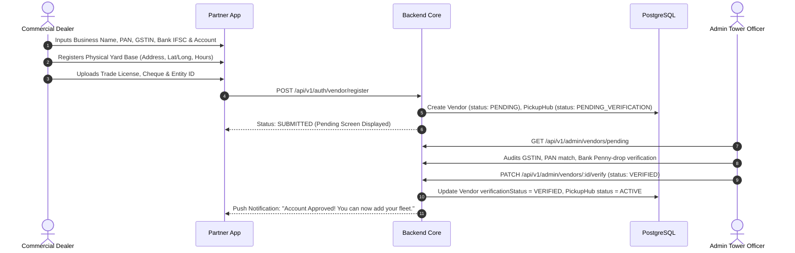
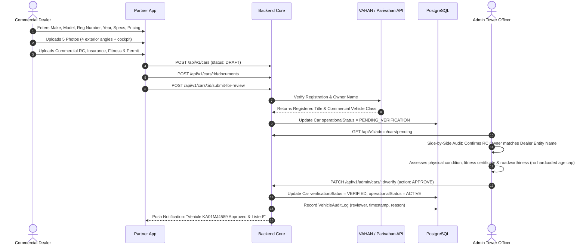
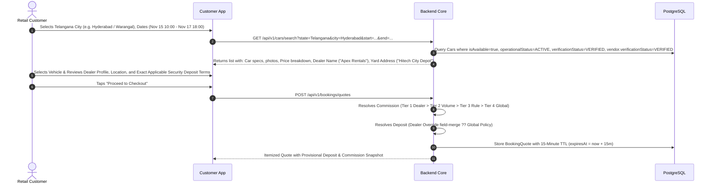
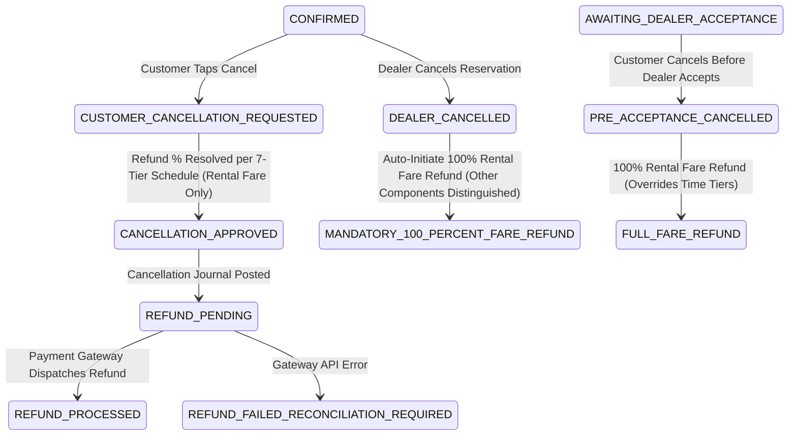
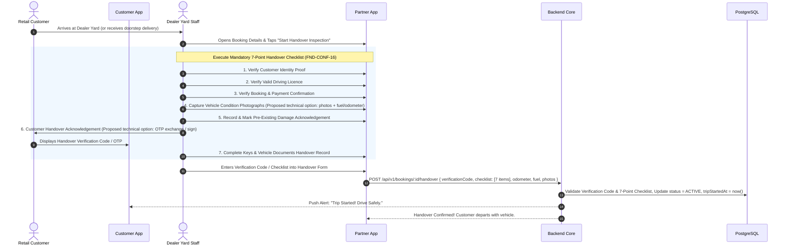
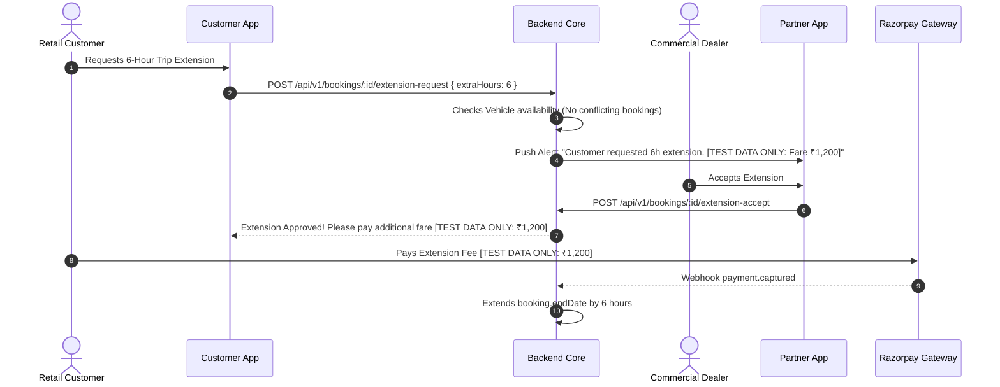
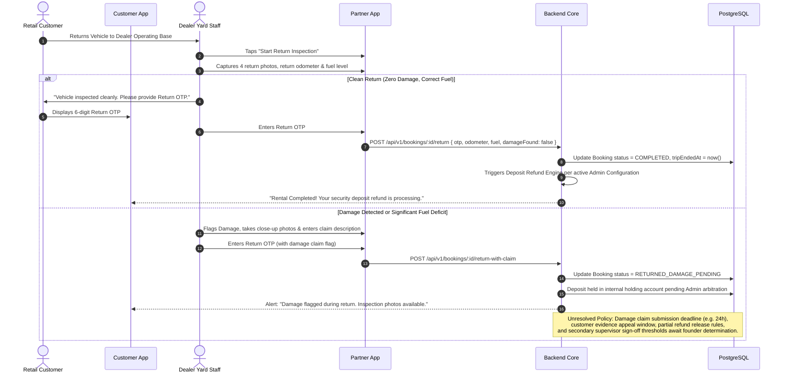
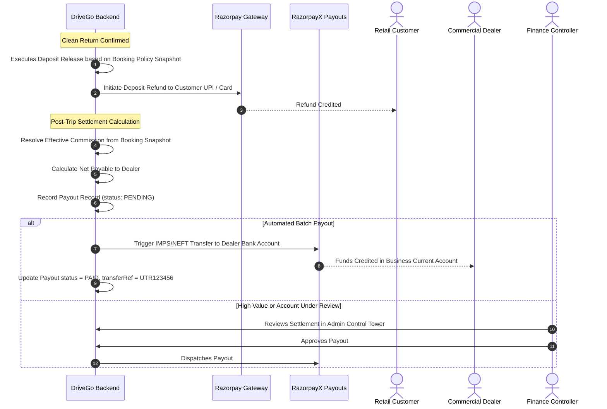

# DriveGo — Cross-Actor Workflow Map & Sequence Architecture

**Document Reference**: `docs/product/DRIVEGO_CUSTOMER_PARTNER_ADMIN_WORKFLOW_MAP.md`  
**Classification**: Authoritative System Integration Blueprint  
**Effective Date**: November 9, 2026  
**Author**: Chief Technology Officer & Principal Systems Architect  
**Repository**: `https://github.com/saicharanrao21/car_rental_monorepo`  
**Git Baseline Commit**: `b87cfe90527c801172529290b96f3d7c0200b941` (Branch: `main`)  
**Status**: APPROVED RECONCILED INTERACTION BLUEPRINT — IMPLEMENTATION STATUS: PENDING EXPLICIT FOUNDER APPROVAL  

---

> [!CAUTION]
> **Implementation Authorization Directive**: This document specifies system interaction and workflow state transitions. **NO IMPLEMENTATION AUTHORIZATION HAS BEEN GRANTED**. All engineering implementation remains strictly `PENDING EXPLICIT FOUNDER APPROVAL`.

---

## 1. System Interaction Model

DriveGo coordinates actions between three primary actors and the automated backend engine:
1. **The Customer (Renter)**: Seeking flexible, reliable self-drive transportation.
2. **The Partner (Commercial Rental Dealer)**: Providing clean, compliant, dealer-owned vehicles (1+ cars minimum).
3. **The Admin (Operations & Governance Tower)**: Enforcing compliance, configuring policies, arbitrating disputes, and managing payouts.
4. **DriveGo Core Engine (Backend & Database)**: Enforcing business logic, ledger accounting, and external integrations.



---

## 2. Core End-to-End Journeys

### Journey 1: Dealer Business Registration & Operating Base Setup


### Journey 2: Vehicle Onboarding, RC Audit & Listing Approval (1+ Cars)


### Journey 3: Customer Search, Dealer Visibility & Quote Generation (Stage 1: Browsing)

> [!NOTE]
> **Stage 1 (Browsing Without KYC & Approved Telangana Launch Scope)**: In accordance with **FND-CONF-11** and **FND-CONF-15**, customers can freely browse vehicles, view dealer profiles and yards, and generate itemized quotes across approved Telangana launch cities (Phase 1: Hyderabad; Phase 2: Karimnagar, Warangal; Phase 3: Nizamabad, Khammam) without completing KYC. Multi-city scope is strictly preserved without unapproved additions.



### Journey 4: Checkout Confirmation Gate, Payment & Hybrid Acceptance (Stage 2: KYC & Booking Gate)

> [!IMPORTANT]
> **Approved Founder Decisions Applied (FND-CONF-08 & FND-CONF-11)**:
> 1. **Customer KYC Gate**: Customer KYC must be fully completed and approved **before booking confirmation**.
> 2. **Hybrid Booking Acceptance**: Eligible vehicles and dealers receive instant bookings when all configured eligibility and availability checks pass. Manual dealer approval is required wherever instant-booking eligibility conditions are not met.
> 3. **Snapshot Immutability**: Confirmed bookings capture immutable `priceSnapshot`, `depositPolicySnapshot`, and `cancellationPolicySnapshot`.

```mermaid
sequenceDiagram
    autonumber
    actor Customer as Retail Customer
    participant CA as Customer App
    participant PG as Razorpay Gateway
    participant API as Backend Core
    participant DB as PostgreSQL
    actor Dealer as Commercial Dealer

    Customer->>CA: Taps "Pay & Confirm Booking"
    CA->>API: POST /api/v1/bookings { quoteId, idempotencyKey }
    API->>API: Check now() <= quote.expiresAt (TTL 15m valid?)
    API->>API: Atomic Revalidation: Did Deposit or Commission Policy Version mutate?
    
    alt Customer KYC Not Verified
        API-->>CA: HTTP 403 Forbidden: KYC_REQUIRED_BEFORE_CONFIRMATION
        Customer->>CA: Completes KYC (Uploads Driving License & Identity Proof)
        CA->>API: POST /api/v1/customer/kyc
        API->>DB: Verify & Approve CustomerKyc (status: VERIFIED)
        API-->>CA: KYC Approved -> Customer resumes checkout
    end

    alt Policy Mutated During Checkout
        API-->>CA: HTTP 409 Conflict: POLICY_UPDATED_REQUOTE_REQUIRED (Displays delta to customer)
        Customer->>CA: Reviews & Accepts Updated Policy Terms -> Requests New Quote
    else Policy Unchanged & KYC Verified
        API->>PG: Create Razorpay Order
        Customer->>PG: Authorizes Payment via UPI / Card / NetBanking
        PG-->>API: Webhook payment.authorized / payment.captured (HMAC verified)
        
        API->>API: Evaluate 6-Point Instant Booking Eligibility (FND-CONF-14)
        Note over API: 1. Dealer ACTIVE | 2. Car VERIFIED & ACTIVE | 3. Available full trip | 4. Pricing configured | 5. Instant enabled | 6. Zero holds
        
        alt Pathway A: All 6 Eligibility Conditions Pass (Instant Booking)
            API->>DB: Create Booking (status: CONFIRMED, paymentStatus: PAID)
            API->>DB: Commit Immutable priceSnapshot, depositPolicySnapshot & cancellationPolicySnapshot
            API->>DB: Post Internal Deposit Holding & Fare Journal Entries
            API-->>CA: Booking Confirmation Screen with Reservation ID (Instant Confirm!)
            API->>Dealer: Push Alert: "New Instant Booking Confirmed for Fleet KA01MJ4589"
        else Pathway B: Any Condition Fails (Manual Dealer Approval Required)
            API->>DB: Create Booking (status: AWAITING_DEALER_ACCEPTANCE, paymentStatus: AUTHORIZED)
            API->>DB: Commit Immutable priceSnapshot, depositPolicySnapshot & cancellationPolicySnapshot
            API->>Dealer: Dispatch Push Alert: "New Booking Request! Action required within SLA window."
            alt Dealer Accepts within Window
                Dealer->>API: POST /api/v1/bookings/:id/accept
                API->>PG: Capture Authorized Payment
                API->>DB: Update Booking status = CONFIRMED, paymentStatus = PAID
                API-->>CA: Notification: "Dealer Confirmed Your Reservation!"
            else Dealer Rejects or Window Expires
                opt Dealer Rejection
                    Dealer->>API: POST /api/v1/bookings/:id/reject
                    API->>DB: Update Booking status = REJECTED
                else Window Lapses
                    API->>DB: Update Booking status = EXPIRED
                end
                API->>PG: Void Authorization / Trigger 100% Full Auto-Refund
                API->>DB: Update paymentStatus = REFUND_PROCESSED
                API-->>CA: Notification: "Reservation could not be fulfilled. Funds 100% released."
            end
        end
    end
```

> [!NOTE]
> **Manual Booking Response SLA Window (FND-UNRES-01 - Pending Founder / Operational Definition)**: The platform preserves manual booking response handling for non-instant bookings. The exact dealer response deadline / acceptance timeout window (and subsequent auto-expiration/void behavior) is an open operational detail requiring explicit operational definition. No response deadline, automatic acceptance, automatic rejection, timeout duration, or penalty/escalation schedule is invented.

### 4.1 Customer & Dealer Cancellation and Refund Lifecycle

In accordance with **FND-CONF-09**, **FND-CONF-12**, and **FND-CONF-13**, cancellations follow an authoritative 7-tier schedule applied strictly to the **rental fare only**, with pre-acceptance cancellations holding absolute precedence:



#### Authoritative Approved Cancellation Schedule:

| Cancellation Timing | Customer Refund | Calculation Base | Financial & Operational Behavior |
| :--- | :---: | :---: | :--- |
| **Before dealer acceptance** | **100%** | Rental Fare Only | **Absolute Precedence (FND-CONF-13)**: Overrides all time-based tiers. 100% rental fare refunded regardless of time remaining. |
| **More than 48 hours before pickup** | **90%** | Rental Fare Only | 90% rental fare refund; 10% cancellation fee retained. |
| **24–48 hours before pickup** | **75%** | Rental Fare Only | 75% rental fare refund; 25% cancellation fee retained. |
| **6–24 hours before pickup** | **50%** | Rental Fare Only | 50% rental fare refund; 50% cancellation fee retained. |
| **Less than 6 hours before pickup** | **0%** | Rental Fare Only | 0% rental fare refund; 100% cancellation fee retained. |
| **No-show** | **0%** | Rental Fare Only | 0% rental fare refund if customer fails to arrive for scheduled handover. |
| **Dealer cancellation** | **100%** | Rental Fare Only | Mandatory 100% rental fare refund (platform fees & additional services distinguished for founder/CA review; deposit governed separately by deposit policy). |

> [!IMPORTANT]
> **Cancellation Invariants**:
> 1. **Refund Calculation Base Confirmed (Rental Fare Only - FND-CONF-12)**: All cancellation refund percentages apply strictly to the **rental fare only**. Excluded from cancellation refund: security deposit, platform convenience fee, and separately charged additional services or fees.
> 2. **Cancellation Precedence Confirmed (FND-CONF-13)**: The rule "Before dealer acceptance" takes absolute priority over all time-based cancellation tiers. If a customer cancels before dealer acceptance, they receive a 100% rental fare refund, regardless of the time remaining before scheduled pickup.
> 3. **Dealer Cancellation Reconciled**: Dealer-initiated cancellations result in a mandatory 100% refund of the **rental fare**. Non-rental-fare components (platform fee, additional services) are distinguished from rental fare and marked for founder / CA review; security deposits are governed separately by the active deposit policy, subject to deferred CA/legal review.
> 4. **Delivery Fee in Cancellation Refund Base (FND-UNRES-02)**: Whether the approved "rental fare" cancellation refund base denotes Base Rental Fare only or includes Doorstep Delivery Fee (prior to dispatch) is an open financial-definition issue (`FND-UNRES-02`) awaiting explicit founder or CA determination. The system must parameterize this distinction and never silently conflate delivery fees with rental fare.
> 5. **Security Deposit Decoupling**: Customer refundable security deposits are completely isolated from cancellation deductions. The deposit is governed separately by the active deposit policy (and subject to deferred CA/legal review) rather than an invented cancellation-time release schedule or refund timing, and is never combined with cancellation refunds.
> 6. **Immutable Booking Snapshots**: Confirmed bookings capture an immutable snapshot of their applicable cancellation policy. Future policy changes never alter historical bookings.

### Journey 5: Vehicle Handover & On-Ground Release Verification (Stage 3: Vehicle Release - FND-CONF-16)

> [!NOTE]
> **Stage 3 Mandatory 7-Point Handover Checklist (FND-CONF-16)**: In accordance with confirmed founder directives, dealer staff must execute and document **all seven mandatory auditable checks** before physical vehicle keys and vehicle dispatch occur:
> 1. Customer identity verification.
> 2. Valid driving licence verification.
> 3. Booking and payment confirmation.
> 4. Vehicle condition photographs.
> 5. Existing damage acknowledgement.
> 6. Customer handover acknowledgement.
> 7. Keys and vehicle documents handover record.
> 
> **Separation of Founder Decisions vs Technical Implementation Options**: Technical implementation mechanisms (such as capturing 4 exterior photos, live condition photos, customer OTP exchange, cryptographic OTP validation, or digital signature capture) are proposed engineering options in the mobile app, NOT founder-mandated rules. The founder mandated the 7 checklist gates without prescribing a specific photo count or signature/OTP mechanism. Zero unapproved legal document types are invented. Jurisdiction-specific requirements are marked for deferred legal review.



### Journey 6: Active Rental & Extension Request


### Journey 7: Return Inspection, Damage Adjudication & Return OTP


### Journey 8: Security Deposit Reconciliation & Dealer Payout Settlement

