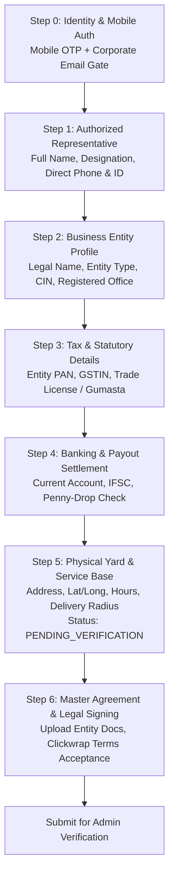
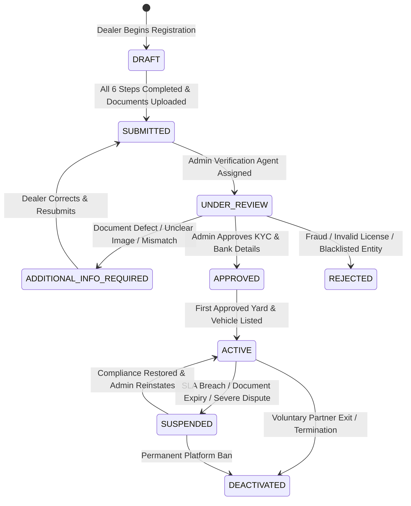
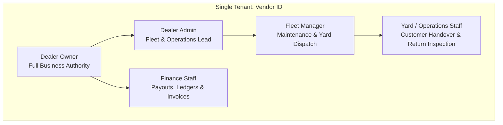

# DriveGo — Dealer Onboarding, Operating Base & Verification Specification

**Document Reference**: `docs/product/DRIVEGO_DEALER_ONBOARDING_AND_VERIFICATION_SPEC.md`  
**Classification**: Authoritative Partner Domain Specification  
**Effective Date**: November 9, 2026  
**Author**: Chief Technology Officer & Principal Systems Architect  
**Repository**: `https://github.com/saicharanrao21/car_rental_monorepo`  
**Git Baseline Commit**: `b87cfe90527c801172529290b96f3d7c0200b941` (Branch: `main`)  
**Status**: APPROVED DEALER ONBOARDING SPECIFICATION — IMPLEMENTATION STATUS: PENDING EXPLICIT FOUNDER APPROVAL  

---

> [!CAUTION]
> **Implementation Authorization Directive**: This specification defines partner onboarding rules and verification architecture. **NO IMPLEMENTATION AUTHORIZATION HAS BEEN GRANTED**. All engineering implementation remains strictly `PENDING EXPLICIT FOUNDER APPROVAL`.

---

## 1. Overview & Founder-Confirmed Principles

In DriveGo's dealer-led marketplace, onboarding is the front-line security, legal, and operational firewall. DriveGo only onboards legitimate, commercial car rental enterprises capable of fulfilling self-drive vehicle rentals to retail customers.

```
========================================================================================
                      FOUNDER-CONFIRMED ONBOARDING DIRECTIVES
========================================================================================
1. MINIMUM FLEET SIZE: ONE (1) ELIGIBLE DEALER-OWNED VEHICLE
   A commercial rental dealer may register and onboard with a minimum of ONE (1)
   eligible vehicle. This is an onboarding threshold, not automatic approval.
   Both dealer entity and vehicle must pass rigorous administrative audits.
2. COMMERCIAL BUSINESS ENTITY TYPES:
   Must support authentic commercial structures: Sole Proprietorship, Registered
   Partnership, Limited Liability Partnership (LLP), Private Limited Company (Pvt Ltd),
   or Public Limited Company.
3. ACTUAL OPERATING BASES (NO FICTIONAL HUBS):
   Dealers must register their genuine physical commercial yards, depots, or service
   offices. No fictional or artificial platform hubs are imposed.
4. BACKEND APPROVAL ENFORCEMENT & GUARDS:
   A disabled, suspended, or unapproved dealer must NEVER be able to list vehicles,
   accept bookings, or access financial controls through direct API calls.
========================================================================================
```

---

## 2. Comprehensive Dealer Registration Workflow

The onboarding journey is structured as an initial Authentication Gate (Step 0) followed by 6 progressive registration stages (Steps 1 through 6) — totaling 7 synchronized steps in the Partner App (`apps/vendor_app/lib/features/registration/presentation/pages/registration_stepper_page.dart`):



### 2.1 Step-by-Step Data Capture Specification

#### Step 0: Pre-Registration Authentication Gate
- **Primary Auth**: 10-digit Indian Mobile Number with SMS/WhatsApp OTP verification (Msg91 DLT gateway).
- **Secondary Auth**: Authorized corporate email address with cryptographic email verification link/code.
- **Session State**: Session initialized with temporary registration token; draft saved automatically to local Riverpod state and backend `VendorRegistrationDraft`.

#### Step 1: Authorized Representative Details
- **Full Legal Name**: As appearing on government ID (Aadhaar / Passport).
- **Designation / Title**: Managing Director, Partner, Proprietor, General Manager, or Operations Head.
- **Direct Phone & Official Email**: Used for legal service, dispute escalation, and primary security alerts.
- **Identity Proof Upload**: Masked Aadhaar or Passport of the authorized signatory (Internal verification requirement).

#### Step 2: Commercial Business Entity Profile
- **Registered Business Name**: Full legal entity name (e.g. `Zenith Auto Rentals Pvt Ltd`, `Apex Self Drive Solutions`).
- **Brand / Trade Name**: Customer-facing trade name displayed in marketplace search and vehicle cards.
- **Legal Business Structure**:
  - `PROPRIETORSHIP`: Unincorporated entity owned by an individual.
  - `PARTNERSHIP`: Registered under Indian Partnership Act, 1932.
  - `LLP`: Registered under Limited Liability Partnership Act, 2008.
  - `PRIVATE_LIMITED`: Registered under Companies Act, 2013 (CIN required).
  - `PUBLIC_LIMITED`: Registered under Companies Act, 2013 (CIN required).
- **Years in Operation**: Historical operating experience in car rental.
- **Registered Office Address**: Door/Plot number, Street, Locality, City, State, PIN code.

#### Step 3: Tax & Statutory Compliance
- **Permanent Account Number (PAN)**: 10-digit alphanumeric PAN of the business entity (or proprietor). Mandatory statutory requirement verified via NSDL/Income Tax database API.
- **Goods and Services Tax Identification Number (GSTIN)**: 15-digit state-specific GSTIN. Validated via GST Portal API for active status and legal name match where entity exceeds statutory turnover or operates interstate rentals. (Statutory & operational verification).
- **Trade License / Shop & Establishment Act Certificate**: Municipal trade license, Gumasta registration, or Udyam MSME registration. (Municipal statutory requirement).
- **Rent a Cab Operator Permit**: Form 4 under Rent a Cab Scheme 1989 if operating a fleet exceeding state licensing thresholds (Tier B: Pending written transport/legal counsel verification).

#### Step 4: Banking & Payout Settlement
- **Bank Account Number**: Active commercial current account of the business entity (or proprietor's business account).
- **IFSC Code**: 11-digit IFSC with automated branch lookup (Bank name, branch address).
- **Account Holder Name**: Must match the registered business entity name (or proprietor name).
- **Verification Method**: Automated ₹1.00 "penny-drop" bank validation via RazorpayX to verify active status and beneficiary name matching. (Internal operational risk control).
- **Document Evidence**: Uploaded PDF or clear photograph of a cancelled cheque or bank account statement.

#### Step 5: Physical Operating Yard & Dispatch Base
Dealers configure their genuine operating bases (`model PickupHub` in `schema.prisma`):
- **Base Name**: e.g., `Indiranagar Depot & Yard`, `Airport Service Hub`, `Cyber City Fleet Center`.
- **Physical Address**: Complete street address where customers can inspect and collect vehicles.
- **Geographic Coordinates**: Precise latitude and longitude selected via Google Maps Places picker.
- **Operating Hours**: Standard daily opening time (e.g. `07:00`) and closing time (e.g. `23:00`), or `is24x7 = true`.
- **Doorstep Delivery Radius**: Configurable service radius in kilometers across approved launch cities in Telangana (Phase 1: Hyderabad; Phase 2: Karimnagar, Warangal; Phase 3: Nizamabad, Khammam per FND-CONF-10 and FND-CONF-15).
- **Supported Handover Types**: Yard self-pickup (enabled by default), doorstep customer delivery, airport terminal drop, railway station drop.
- **Operating Status**: **PENDING_VERIFICATION by default**. An unapproved dealer's pickup location MUST NOT become `ACTIVE` or appear in customer vehicle search until both the dealer legal entity and the yard location are formally audited and verified by the Admin Control Tower.

#### Step 6: Master Agreement & Legal Signing
- **Master Partner Terms of Service**: Electronic clickwrap agreement governed by the Information Technology Act, 2000.
- **Service Level Agreement (SLA)**: Commitments on vehicle condition, hygiene, fuel readiness, handover timeliness, manual booking request response compliance within configured SLA window (exact duration pending operational definition) (FND-CONF-08), mandatory 100% rental fare refund compliance upon dealer-initiated cancellations (FND-CONF-09, FND-CONF-12, FND-CONF-13), execution of the mandatory 7-point vehicle handover verification checklist before vehicle release (FND-CONF-16), and instant booking eligibility maintenance (FND-CONF-14).

---

## 3. Partner Lifecycle State Machine & Backend Enforcement

The dealer account transitions through explicit states governed by business rules and Admin Control Tower audits:



### 3.1 Backend Status Enforcement & API Guards

| Account Status | Backend Enum | Can Access Partner OS? | Can Add Vehicles? | Fleet Searchable? | Payouts Active? |
| :--- | :--- | :---: | :---: | :---: | :---: |
| **Draft** | `DRAFT` | Limited (Wizard Only) | No | No | No |
| **Submitted** | `SUBMITTED` | Pending Screen Only | No | No | No |
| **Under Review** | `UNDER_REVIEW` | Pending Screen Only | No | No | No |
| **Info Required** | `ADDITIONAL_INFO_REQUIRED`| Edit Deficient Fields | No | No | No |
| **Approved** | `VERIFIED` | Full Access | Yes | Yes (When Approved) | Yes |
| **Rejected** | `REJECTED` | Rejection Notice | No | No | No |
| **Suspended** | `SUSPENDED` | Read-Only | No | No (Hidden) | Frozen |
| **Deactivated** | `DEACTIVATED` | Locked Out | No | No (Purged) | Settled & Closed |

> [!IMPORTANT]
> **API Guard Verification**: As confirmed in code audit of `bookings.service.ts` line 149 and `cars.service.ts` line 166, backend guards strictly reject booking requests for unverified or suspended dealers (`throw new BadRequestException('Cannot book a vehicle from an unverified vendor.')`). An unapproved partner cannot bypass verification via direct API manipulation.

---

## 4. Multi-User Dealer Staff Roles & RBAC Hierarchy

Commercial rental operations employ diverse staff across locations. To prevent operational bottlenecks while maintaining data isolation, DriveGo supports role-based delegation within each dealer organization:



### 4.1 Granular Permissions Matrix

| Functional Capability | Dealer Owner | Dealer Admin | Fleet Manager | Operations / Yard | Finance Staff |
| :--- | :---: | :---: | :---: | :---: | :---: |
| **Edit Legal Profile & Bank Details** | **Full** | No | No | No | Read-Only |
| **Manage Staff Accounts & Invites** | **Full** | **Full** | No | No | No |
| **Onboard / Edit Fleet Vehicles** | **Full** | **Full** | **Full** | Read-Only | No |
| **Set Daily & Hourly Rental Pricing** | **Full** | **Full** | Edit (Limits) | No | Read-Only |
| **Manage Yard Bases & Delivery Zones**| **Full** | **Full** | Edit | Read-Only | No |
| **Accept / Dispatch Customer Bookings**| **Full** | **Full** | **Full** | **Full** | Read-Only |
| **Execute Handover Inspection & OTP** | **Full** | **Full** | **Full** | **Full** | No |
| **Execute Return Inspection & OTP** | **Full** | **Full** | **Full** | **Full** | No |
| **Report Damage & File Claims** | **Full** | **Full** | **Full** | **Full** | No |
| **View Financial Ledger & Statements** | **Full** | **Full** | No | No | **Full** |
| **Trigger Instant Payout Request** | **Full** | No | No | No | View / Export |
