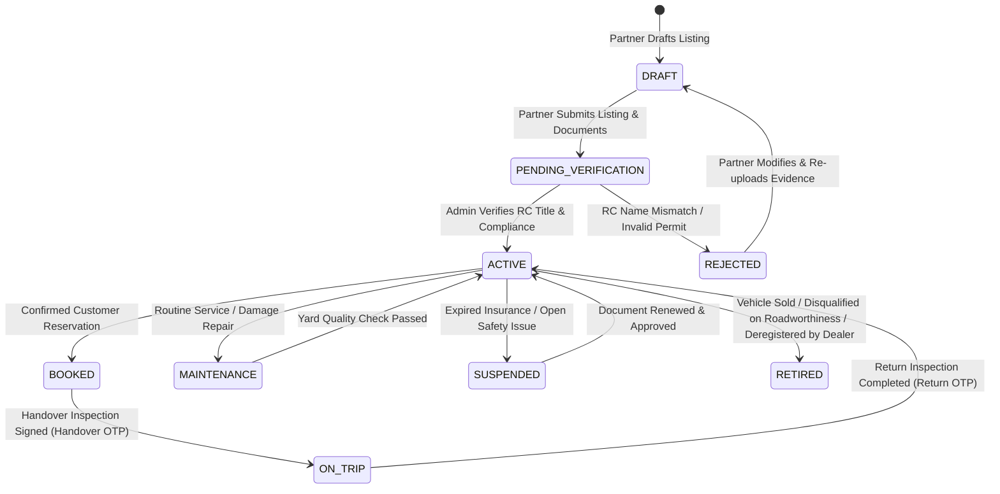

# DriveGo — Dealer-Owned Fleet Onboarding & Compliance Specification

**Document Reference**: `docs/product/DRIVEGO_DEALER_OWNED_FLEET_SPEC.md`  
**Classification**: Authoritative Fleet Architecture  
**Effective Date**: November 9, 2026  
**Author**: Chief Technology Officer, Fleet Operations Lead & Automotive Compliance Specialist  
**Repository**: `https://github.com/saicharanrao21/car_rental_monorepo`  
**Git Baseline Commit**: `b87cfe90527c801172529290b96f3d7c0200b941` (Branch: `main`)  
**Status**: APPROVED DEALER FLEET SPECIFICATION — IMPLEMENTATION STATUS: PENDING EXPLICIT FOUNDER APPROVAL  

---

> [!CAUTION]
> **Implementation Authorization Directive**: This specification defines fleet eligibility and compliance requirements. **NO IMPLEMENTATION AUTHORIZATION HAS BEEN GRANTED**. All engineering implementation remains strictly `PENDING EXPLICIT FOUNDER APPROVAL`.

---

## 1. Executive Fleet Policy: Dealer-Owned Only

DriveGo operates strictly on a **Dealer-Owned Fleet Model**. Every listed vehicle must be legally owned by the approved dealer entity or its verified sole proprietor.

```
========================================================================================
                      VEHICLE ELIGIBILITY & OWNERSHIP INVARIANTS
========================================================================================
ALLOWED:
[x] Commercial passenger vehicle titled in registered Business Entity name (Pvt Ltd, LLP, Firm).
[x] Commercial passenger vehicle titled in verified Sole Proprietor name (Proprietorship).
[x] Valid commercial registration plate (Tier B: Colour standards pending legal counsel verification).
[x] Valid commercial insurance policy covering passenger hire (Tier A: Statutory third-party; Tier C: Operational comprehensive).
[x] Valid Form 38 Certificate of Fitness (Conditional statutory provision per MVA 1988 s.56 / CMVR Rule 62; applicability to specific self-drive cab classes and launch state pending written transport counsel confirmation) and valid PUC certificate (Tier A: Statutory requirement per CMVR Rule 115).
[x] Minimum fleet size: ONE (1) eligible dealer-owned vehicle (Tier C: Founder non-negotiable operational decision).

STRICTLY PROHIBITED & EXCLUDED FROM LAUNCH:
[!] Individually owned private vehicles (white plates) listed by peer-to-peer hosts (Tier C: Excluded by founder operational decision; legal status under state rules is Tier B pending legal verification).
[!] Leased vehicles (STRICTLY NO EXCEPTIONS FOR LEASED VEHICLES WITH SUBLEASE NOCs).
[!] Vehicles operated under third-party management, consignment, or custodial arrangements.
[!] Vehicles where registered RC owner does NOT match the dealer entity or proprietor.
[!] Vehicles with open police seizures, hypothecation disputes, or blacklisted RTO records.
========================================================================================
```

---

## 2. Vehicle Age & Roadworthiness Assessment

```
========================================================================================
             FOUNDER-CONFIRMED DIRECTIVE: ADMIN VERIFICATION-BASED AGE
========================================================================================
There is NO universal hardcoded maximum vehicle age (no hardcoded 5-year or 7-year cap).
Vehicle eligibility is assessed individually by Admin based on:
1. Physical vehicle condition and structural integrity (Tier C: Operational requirement).
2. Valid Form 38 Certificate of Fitness issued by RTO or statutory fitness period endorsed on commercial RC (Conditional statutory provision per s.56 MVA 1988 / Rule 62 CMVR; launch state applicability pending written transport counsel confirmation).
3. Commercial insurance covering self-drive passenger hire (Tier A: Statutory third-party; Tier C: Operational comprehensive).
4. Speed Governor calibration certificate (Tier B: Prescribed under Rule 118 CMVR 1989; state-level cab enforcement pending legal counsel verification).
5. Government Pollution Under Control (PUC) certificate with QR verification (Tier A: Statutory requirement).
6. 5-point interior and exterior photographic inspection evidence (Tier C: Operational requirement).
7. Odometer reading and mechanical maintenance service records (Tier C: Operational requirement).
Every decision permanently records reviewer, timestamp, decision, reason, and evidence.
========================================================================================
```

---

## 3. Comprehensive Vehicle Data Model & Onboarding Flow

Vehicle onboarding is executed in the Partner App (`apps/vendor_app/lib/features/fleet/presentation/pages/add_edit_car_page.dart`) and governed by the backend `Car` and `Document` domain models:

```mermaid
flowchart TD
    Step0[Step 0: Identity & Core Details\nMake, Model, Variant, Reg Number, VIN/Chassis] --> Step1
    Step1[Step 1: Specifications & Transmission\nYear, Body Type, Fuel, Automatic/Manual, Seating, AC] --> Step2
    Step2[Step 2: Dynamic Pricing & Packages\nDaily Fare, Hourly Fare, Price per Extra Km, Discounts] --> Step3
    Step3[Step 3: Authentic Photographic Evidence\nExterior 4-Sides, Cockpit Dashboard, Odometer, Rear Seats] --> Step4
    Step4[Step 4: Statutory & Fleet Documents\nRC Commercial Book, Insurance, Fitness (conditional), Permit (conditional), PUC] --> Step5
    Step5[Step 5: Base Yard Assignment & Dispatch\nAssign to Physical Yard Depot, Delivery Radii] --> Step6
    Step6[Step 6: Review & Submit for Audit\nAutomated Parivahan Check -> Admin Review]
```

### 3.1 Detailed Field Specifications

| Category | Field Name | Data Type / Enum | Business Validation & Rule |
| :--- | :--- | :--- | :--- |
| **Identity** | `registrationNumber` | String (Regex) | Valid Indian State RTO code format: `^[A-Z]{2}[0-9]{2}[A-Z0-9]{1,3}[0-9]{4}$` (e.g. `KA01MJ4589`, `MH02CD1234`). |
| **Identity** | `chassisNumber` / `vin` | String (17 chars) | Full 17-character alphanumeric Vehicle Identification Number. Cross-checked with RC. |
| **Identity** | `engineNumber` | String | Engine serial number from RC book. |
| **Specifications**| `make` | String | Manufacturer (e.g. Maruti Suzuki, Hyundai, Tata Motors, Mahindra, Toyota). |
| **Specifications**| `model` | String | Model line (e.g. Swift, Creta, Nexon, Thar, Innova Crysta). |
| **Specifications**| `variant` | String | Trim level (e.g. ZXi+, SX(O), Fearless, AX7L, ZX). |
| **Specifications**| `year` | Integer | Manufacturing year (assessed individually by Admin for roadworthiness; no hardcoded cap). |
| **Specifications**| `type` | `CarCategory` | `HATCHBACK`, `SEDAN`, `SUV`, `COMPACT_SUV`, `LUXURY`, `MUV`. |
| **Specifications**| `fuelType` | `FuelType` | `PETROL`, `DIESEL`, `ELECTRIC`, `CNG`, `HYBRID`. |
| **Specifications**| `transmission` | String | `Manual` or `Automatic` (Torque Converter, CVT, DCT, AMT). |
| **Specifications**| `seating` | Integer | Permitted seating capacity (4, 5, 6, 7, 8). Matches RC specification. |
| **Pricing** | `pricePerDay` | Decimal (INR) | Standard 24-hour rental rate (e.g. ₹2,400.00). |
| **Pricing** | `pricePerHour` | Decimal (INR) | Minimum hourly rental rate (e.g. ₹180.00/hr). |
| **Pricing** | `pricePerKm` | Decimal (INR) | Additional distance rate over free mileage allowance (e.g. ₹14.00/km). |
| **Pricing** | `weeklyDiscountPercent`| Float | Discount percentage for 7+ day rentals (e.g. 10.0%). |
| **Pricing** | `monthlyDiscountPercent`| Float| Discount percentage for 30+ day rentals (e.g. 25.0%). |
| **Photos** | `photos` | Array of URLs | Min 5 high-resolution authentic photos: Front, Rear, Left Side, Right Side, Cockpit. |
| **Yard Base** | `pickupHubId` | Foreign Key | Physical yard where vehicle is stationed (`model PickupHub`). |

---

## 4. Statutory Vehicle Documentation & Ownership Verification

A vehicle cannot transition to `ACTIVE` status without platform verification of required statutory and conditional fleet documents (detailed in [DRIVEGO_VEHICLE_VERIFICATION_AND_APPROVAL_SPEC.md](file:///D:/Flutter/car_rental_monorepo/docs/product/DRIVEGO_VEHICLE_VERIFICATION_AND_APPROVAL_SPEC.md)):

```mermaid
graph LR
    subgraph Dealer Document Submissions
        D1[Commercial RC Book]
        D2[Commercial Rent-a-Cab Insurance]
        D3[Form 38 Fitness Certificate\n(Conditional)]
        D4[Tourist / State Taxi Permit\n(Conditional)]
        D5[Pollution Under Control - PUC]
    end

    subgraph Verification Engine
        V1[Automated VAHAN API / Karza / Surepass]
        V2[Admin Control Tower Compliance Officer]
    end

    subgraph Verification Checks
        C1[RC Owner Name == Dealer Legal Entity / Proprietor]
        C2[Registration Class == Commercial / Tourist Taxi]
        C3[Active Insurance Policy With Self-Drive Coverage]
        C4[Fitness Valid for at least 60 Days]
        C5[Zero Outstanding Police Stolen / Seizure Alerts]
    end

    D1 & D2 & D3 & D4 & D5 --> V1 & V2
    V1 & V2 --> C1 & C2 & C3 & C4 & C5
    C1 & C2 & C3 & C4 & C5 -->|All Passed| Appr[Approved for Search Index]
```

---

## 5. Vehicle Lifecycle & Operational State Machine



---

## 6. Physical Handover & Return Inspection Protocols

> [!NOTE]
> **Mandatory 7-Point Handover Checklist & Technical Implementation Options (FND-CONF-16)**:
> In accordance with confirmed founder directives (`FND-CONF-16`), dealer staff must execute the seven mandatory auditable checks before vehicle release:
> 1. Customer identity verification
> 2. Valid driving licence verification
> 3. Booking and payment confirmation
> 4. Vehicle condition photographs
> 5. Existing damage acknowledgement
> 6. Customer handover acknowledgement
> 7. Keys and vehicle documents handover record
> 
> Technical mechanisms detailed below (such as capturing 4 standardized photo angles, fuel/odometer telemetry capture, and 6-digit OTP verification) represent proposed engineering implementation options in the mobile app, NOT founder-mandated rules. The founder approved the seven auditable checklist gates without prescribing a specific photo count or OTP/signature mechanism.

To eliminate damage disputes and establish legal accountability, every vehicle dispatch and check-in executes a digital inspection protocol:

### 6.1 Pre-Trip Handover Protocol (Pickup)
1. **Physical Inspection at Yard or Customer Doorstep**:
   - Operations staff and customer inspect exterior condition.
   - Staff captures 4 mandatory live photos via Partner App: Front view, Rear view, Driver side, Passenger side.
2. **Telemetry Capture**:
   - Exact physical odometer reading recorded in app.
   - Fuel level percentage recorded (e.g. 100% full, 75%, 50%).
3. **Pre-Existing Scratches / Dents**:
   - Marked directly on an interactive 2D car diagram in the app.
4. **Cryptographic Handover Sign-Off**:
   - Customer verifies condition and reads the 6-digit **Handover OTP** displayed on the Customer App.
   - Dealer staff inputs the OTP into Partner App (`handover_inspection_page.dart`).
   - Backend verifies OTP, changes booking status to `ACTIVE`, and triggers trip start event.

### 6.2 Post-Trip Return Inspection Protocol (Drop-off)
1. **Condition Comparison**:
   - Staff re-photographs all 4 sides in the same standardized angles.
   - Odometer reading captured to calculate excess distance charges ($> \text{free limit}$).
   - Fuel level verified against pickup percentage.
2. **Damage Adjudication**:
   - If new damage is detected, staff logs photos and damage description immediately.
   - Claim reviewed in Admin Control Tower against held deposit.
3. **Cryptographic Return Sign-Off**:
   - Both parties verify final odometer and fuel readings.
   - 6-digit **Return OTP** entered and verified by backend.
   - Trip marked `COMPLETED`. Triggers deposit release state machine per active Admin configuration.
