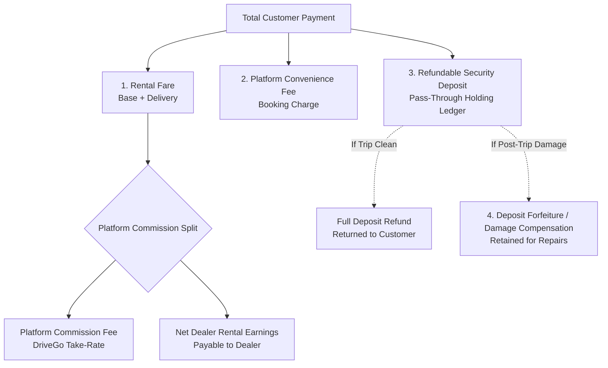

# DriveGo — Final Documentation Consistency Report & Governance Audit

**Document Reference**: `docs/product/DRIVEGO_FINAL_DOCUMENTATION_CONSISTENCY_REPORT.md`  
**Classification**: Authoritative Technical Governance, Compliance & Documentation Audit Report  
**Effective Date**: November 9, 2026  
**Author**: Senior Solution Architect, Technical Auditor, Product Governance Reviewer & Documentation Quality Lead  
**Repository**: `https://github.com/saicharanrao21/car_rental_monorepo`  
**Git Baseline Commit**: `b87cfe90527c801172529290b96f3d7c0200b941` (Branch: `main`)  
**Implementation Authorization Status**: `PENDING EXPLICIT FOUNDER APPROVAL`  

---

## 1. Executive Verdict & Operating Principles

This final documentation remediation and consistency audit delivers an evidence-based assessment of the DriveGo monorepo documentation suite (`docs/product/`).

Following independent technical and governance reviews, all unsupported claims of "100% compliance", self-authorizing implementation approvals, and unverified categorical legal or tax conclusions have been retracted and neutralized. 

> [!CAUTION]
> **ABSOLUTE IMPLEMENTATION AUTHORIZATION CONTROL**:  
> **NO IMPLEMENTATION AUTHORIZATION WAS GRANTED BY THIS DOCUMENTATION AUDIT.**  
> - **Sprint 1 was NOT started.**
> - **Zero application source code** (Flutter apps, NestJS backend, shared packages) was modified, created, or deleted.
> - **Zero Prisma schemas** (`prisma/schema.prisma`), SQL files, migrations, or database records were modified or executed.
> - **Zero environment variables, credentials, deployment configs, or infrastructure settings** were altered.
> - **Zero Git commits, pushes, stages, or resets** were performed.
> - **All engineering implementation remains strictly PENDING EXPLICIT WRITTEN FOUNDER APPROVAL.**

---

## 2. Evidence-Based Platform Readiness Assessment

To prevent conflation between documentation specification, engineering execution, and live commercial operations, platform status is evaluated across six decoupled readiness dimensions using objective, evidence-based terminology:

```
+=============================================================================================================+
|                                    SIX-DIMENSIONAL PLATFORM READINESS ASSESSMENT                             |
+----+------------------------------------+------------------------------------+------------------------------+
| #  | Governance Dimension               | Scope & Evaluation Standard        | Evaluated Status             |
+----+------------------------------------+------------------------------------+------------------------------+
| 1  | Business Model Alignment           | Conformance to 16 approved founder | Substantially aligned with   |
|    |                                    | business decisions                 | confirmed founder decisions  |
+----+------------------------------------+------------------------------------+------------------------------+
| 2  | Architecture Completeness          | Prisma models, REST APIs, Redis    | Documented; pending          |
|    |                                    | locking, unified commission engine | independent technical review |
+----+------------------------------------+------------------------------------+------------------------------+
| 3  | Founder Commercial Decisions       | Closure of open commercial &       | RESOLVED (16 confirmed founder|
|    |                                    | operational choices                | decisions; 2 details isolated)|
+----+------------------------------------+------------------------------------+------------------------------+
| 4  | Statutory Tax & Legal Compliance   | CA tax sign-offs, Rent a Cab,      | DEFERRED until project       |
|    |                                    | transport rules, Section 194-O TDS | completion (11 items pending)|
+----+------------------------------------+------------------------------------+------------------------------+
| 5  | Testing & Integration Evidence     | Reconciled verification levels     | Test plans documented; source|
|    |                                    | vs actual execution evidence       | & test specs inspected; no   |
|    |                                    |                                    | test suites run during audit |
+----+------------------------------------+------------------------------------+------------------------------+
| 6  | Production Commercial Launch       | Live payment rails, DLT SMS,       | Not established by           |
|    | Readiness                          | statutory licenses, live database  | documentation review alone   |
+----+------------------------------------+------------------------------------+------------------------------+
| 7  | Engineering Implementation         | Authorization to begin software    | PENDING EXPLICIT FOUNDER     |
|    | Status                             | development / Sprint 1 execution   | APPROVAL                     |
+----+------------------------------------+------------------------------------+------------------------------+
```

---

## 3. Founder Decision Register (Authoritative Reconciliation)

With the explicit approval of operational decisions regarding refund base, cancellation precedence, instant booking eligibility, Telangana rollout roster, and the vehicle handover checklist, the authoritative register now contains **SIXTEEN (16) CONFIRMED FOUNDER DECISIONS** in Category A, and **TWO (2) UNRESOLVED OPERATIONAL & FINANCIAL DETAILS** in Category B:

> [!NOTE]
> **Checklist vs. Founder Decision Count Reconciliation**: The 14 technical and architectural consistency checklist entries in the Product Baseline represent system design invariants, and must **NOT** be conflated with or presented as 14 founder decisions. The authoritative register contains exactly **16 Confirmed Founder Decisions** (`FND-CONF-01` through `FND-CONF-16`) and **2 Unresolved Operational / Financial Decisions** (`FND-UNRES-01` and `FND-UNRES-02`).

### Confirmed Founder Directives (16 Invariant Directives)
1. **`FND-CONF-01` (Partner Model)**: Commercial rental dealers only. P2P private individuals strictly excluded.
2. **`FND-CONF-02` (Vehicle Ownership)**: 100% dealer-owned fleet only. Zero lease exceptions.
3. **`FND-CONF-03` (No Lease Exceptions)**: Zero exceptions for leased vehicles with sublease authorization.
4. **`FND-CONF-04` (Minimum Fleet Size)**: Exactly one (1) eligible dealer-owned vehicle required for partner onboarding.
5. **`FND-CONF-05` (Vehicle Age)**: Admin verification-based roadworthiness; no universal hardcoded 5-year or 7-year age limit.
6. **`FND-CONF-06` (Security Deposit Policy)**: Admin controls global default and dealer-specific overrides with field-level inheritance; zero database defaults; quotes provisional (15m TTL); confirmed bookings hold immutable snapshots.
7. **`FND-CONF-07` (Platform Commission)**: Admin controls global default commission and negotiated dealer agreements with 4-tier precedence hierarchy; immutable snapshots on confirmed bookings; historical settlements never recalculated.
8. **`FND-CONF-08` (Booking Acceptance Architecture)**: **Hybrid Model** — Eligible vehicles and dealers receive instant bookings when all six configured eligibility conditions pass. Manual dealer approval is required wherever instant-booking eligibility conditions are not met. Manual booking response handling is preserved; dealer response SLA duration and acceptance timeout window remain pending explicit operational definition.
9. **`FND-CONF-09` (Cancellation & Refund Schedule)**: **Approved 7-Tier Percentages** — Before dealer acceptance: 100% | >48h before pickup: 90% | 24–48h before pickup: 75% | 6–24h before pickup: 50% | <6h before pickup: 0% | No-show: 0% | Dealer cancellation: 100% rental fare refund. Distinguishes customer vs dealer cancellation; non-rental-fare components (platform fee, additional services) marked for separate founder/CA review; security deposit is decoupled and governed separately by the active deposit policy (subject to deferred CA/legal review); immutable snapshot preserved.
10. **`FND-CONF-10` (Launch Geography Scope)**: **Phased Multi-City Telangana Rollout Scope** — Initial launch covers multiple cities across Telangana; not restricted to a single city. Multi-city Telangana launch scope strictly preserved.
11. **`FND-CONF-11` (Customer KYC Gate Progression)**: **Three-Stage Workflow Progression** — (1) Browsing without KYC; (2) Mandatory Customer KYC completed before booking confirmation; (3) Mandatory 7-point handover verification checklist completed before vehicle release.
12. **`FND-CONF-12` (Refund Calculation Base)**: **Rental Fare Only** — All cancellation refund percentages apply strictly to the **rental fare only**. Excludes security deposit, platform convenience fee, and separately charged additional services or fees. Whether Doorstep Delivery Fee is included in the approved rental-fare cancellation refund base is an open financial-definition issue (`FND-UNRES-02`). Security deposits are NEVER combined with cancellation refunds; their accounting and release treatment remain completely decoupled, subject to deferred CA/legal review.
13. **`FND-CONF-13` (Cancellation Precedence Hierarchy)**: **Pre-Acceptance Priority Over All Time Tiers** — The rule "Before dealer acceptance" takes absolute priority over all time-based cancellation tiers. If a customer cancels before dealer acceptance, they receive a **100% rental fare refund**, regardless of time remaining before scheduled pickup (even within <6 hours). Once accepted (or instant-confirmed), time-based tiers (90%, 75%, 50%, 0%) apply strictly to the rental fare. Dealer cancellation results in a mandatory 100% rental fare refund (other payment components distinguished for founder/CA review; deposits decoupled).
14. **`FND-CONF-14` (Instant Booking Eligibility Criteria)**: **Six Mandatory Operational Conditions** — Instant booking is permitted ONLY when ALL 6 conditions pass: (1) Dealer account approved & active (`Vendor.status == ACTIVE`), (2) Vehicle approved & active (`Car.verificationStatus == VERIFIED && operationalStatus == ACTIVE`), (3) Vehicle availability verified for entire requested trip, (4) Pricing & policies configured, (5) Dealer enabled instant booking (`Car.instantBookingEnabled == true`), (6) No pending verification, restriction, or hold exists. If ANY condition fails, booking routes to manual dealer approval. Admin controls and configures eligibility policies through authorized settings; zero arbitrary numeric thresholds.
15. **`FND-CONF-15` (Telangana Phased Launch City Roster)**: **Approved Three-Phase Rollout Roster** — Phase 1: **Hyderabad**; Phase 2: **Karimnagar**, **Warangal**; Phase 3: **Nizamabad**, **Khammam**. Multi-city Telangana launch scope strictly preserved; zero unapproved launch cities or dates added.
16. **`FND-CONF-16` (Vehicle Handover Mandatory Checklist)**: **Seven (7) Auditable Pre-Release Checks** — (1) Customer ID verification, (2) Valid driving licence verification, (3) Booking & payment confirmation, (4) Vehicle condition photographs, (5) Existing damage acknowledgement, (6) Customer handover acknowledgement, (7) Keys and vehicle documents handover record. All 7 represent auditable gates in Partner App. Technical implementation mechanisms (such as capturing 4 exterior photos, live condition photos, customer OTP exchange, cryptographic OTP validation, or digital signature capture) are proposed engineering options in the mobile app, NOT founder-mandated rules. Zero unapproved legal documents invented; jurisdiction-specific requirements marked for deferred legal review.

### Isolated Unresolved Operational & Financial Details (Category B)

| Item ID | Operational / Financial Specification Item | Specific Operational Question | Status |
| :---: | :--- | :--- | :---: |
| **FND-UNRES-01** | **Manual Dealer Booking Response SLA & Timeout Window** | What is the exact dealer response deadline and acceptance timeout window for manual booking requests before automated voiding/expiry?<br><br>*(Strict Boundary: No response deadline, automatic acceptance, automatic rejection, timeout duration, or penalty/escalation schedule is invented)*. | **PENDING EXPLICIT FOUNDER / OPERATIONAL DEFINITION** |
| **FND-UNRES-02** | **Doorstep Delivery Fee Treatment in Cancellation Refund Base** | Does the approved "rental fare" cancellation refund base denote Base Rental Fare only, or does it include Doorstep Delivery Fee when a booking is cancelled prior to vehicle dispatch?<br><br>*(Strict Boundary: Do not assume delivery fees are part of rental fare; record as open financial definition)*. | **PENDING EXPLICIT FOUNDER / CA FINANCIAL DEFINITION** |

---

## 4. Financial, Tax & Custody Governance Register

In accordance with audit directives, all tax assumptions have been neutralized. **No tax exemption or non-taxable treatment is assumed.** The platform explicitly separates five financial components:



### 4.1 Authoritative Tax & Statutory Invoicing Determinations

| Item ID | Financial Component | Tax Status & Neutral Statement | Regulatory Dependency | Responsible Party | Impact on Launch |
| :---: | :--- | :--- | :--- | :---: | :---: |
| **TAX-APP-01** | **Rental Fare GST** | **PENDING WRITTEN CA / TAX-COUNSEL APPROVAL**. Rate under SAC 9966 (e.g. 5% without ITC vs 12%/18% with ITC) is unconfirmed. Percentages in specifications are non-binding test data. | GST Council / CBIC Notification | Company CA | Blocks Commercial Launch |
| **TAX-APP-02** | **Platform Commission GST** | **PENDING WRITTEN CA / TAX-COUNSEL APPROVAL**. Taxability, applicable rate, and invoice mechanics on DriveGo service fees require written sign-off. | CGST Act s.9 / Chapter V | Company CA | Blocks Commercial Launch |
| **TAX-APP-03** | **Refundable Security Deposit GST** | **PENDING WRITTEN CA / TAX-COUNSEL APPROVAL**. GST treatment of refundable deposits and any forfeiture or damage compensation is pending written CA/tax-counsel determination. **No exemption or non-taxable treatment is assumed.** | CGST Act s.2(31) proviso | Company CA / Tax Counsel | Blocks Commercial Launch |
| **TAX-APP-04** | **Deposit Forfeiture / Damage Compensation GST** | **PENDING WRITTEN CA / TAX-COUNSEL APPROVAL**. Tax treatment of liquidated damage compensation or forfeited deposits retained for vehicle repair is pending written CA/tax-counsel determination. **No specific tax treatment is assumed.** | Schedule II CGST Act | Company CA / Tax Counsel | Blocks Commercial Launch |
| **TAX-APP-05** | **Section 9(5) vs Section 52 Invoicing** | **PENDING WRITTEN CA / TAX-COUNSEL APPROVAL**. Determination whether DriveGo issues tax invoices as deemed supplier under Section 9(5) or collects TCS under Section 52 with dealers issuing invoices requires formal legal/tax opinion. | CGST Act s.9(5) & s.52 | Tax Counsel | Blocks Commercial Launch |
| **TAX-APP-06** | **Section 194-O TDS Withholding** | **BLOCKED PENDING WRITTEN CA / TAX-COUNSEL APPROVAL**. Automated TDS withholding on dealer payouts is strictly blocked from code implementation until the company Chartered Accountant provides written determination on statutory rates (0.1% vs 1%), exemption thresholds, and Form 26Q filing rules. | Income Tax Act, 1961 s.194-O | Company CA | Blocks Implementation & Launch |

### 4.2 Deposit Holding & Custody Terminology
- **No Statutory Escrow**: Because no third-party bank escrow trust agreement exists under RBI guidelines, the term "escrow" is not used to denote a legal escrow trust.
- **Internal Holding Ledger**: Customer deposits are collected via the payment gateway and segregated in an internal pass-through holding ledger account (`CUSTOMER_DEPOSIT_HOLDING`).
- **Zero Physical Custody**: DriveGo operationally prohibits physical custody of original identity documents, physical cash, and customer vehicles. Any statutory liability implications under the DPDP Act or Motor Vehicles Act remain **PENDING WRITTEN LEGAL COUNSEL CONFIRMATION**.

---

## 5. Transport and Vehicle Compliance Register

All transport and vehicle compliance claims have been evaluated against authoritative statutory citations and classified into three objective tiers:

| Requirement | Authority | Applicability to DriveGo Model | Geography | Vehicle Category | Evidence Citation | Status | Owner Action |
| :--- | :--- | :--- | :--- | :--- | :--- | :---: | :--- |
| **Commercial Transport Registration** | Motor Vehicles Act, 1988 Section 66(1); Section 2(47) | Mandates transport registration and permits for commercial hire/reward. | Central statute, enforced by states | Transport vehicles / Motor Cabs | MVA 1988 s.66(1) & s.2(47) | **Tier A — Verified statutory requirement** | Dealer must provide valid commercial registration certificate (RC). |
| **Certificate of Fitness (Form 38)** | Motor Vehicles Act, 1988 Section 56; CMVR 1989 Rule 62 | General statutory provision requires fitness certification for transport vehicles; specific operational applicability to self-drive rental motor cabs and new vehicles (where initial RC incorporates statutory fitness period) depends on launch-state RTO practice. | Central rule, state RTO renewal | Transport vehicles / Commercial cabs | MVA 1988 s.56; CMVR Rule 62 | **Tier B — Conditional statutory requirement** | Upload is conditional pending written transport legal counsel confirmation of launch-state rules; Admin verifies valid fitness period on RC or Form 38 where issued separately. |
| **Third-Party Commercial Insurance** | Motor Vehicles Act, 1988 Section 146 | Mandates minimum third-party passenger liability insurance for public-road vehicle operation. | Central statute | All commercial motor vehicles | MVA 1988 s.146 | **Tier A — Verified statutory requirement** | Dealer must upload valid commercial third-party policy. Comprehensive coverage enforced per Tier C policy. |
| **Pollution Under Control (PUC)** | Central Motor Vehicles Rules, 1989 Rule 115(7) | Mandatory emissions testing and certification for all motor vehicles operating on public roads. | Central rule | All motor vehicles | CMVR 1989 Rule 115(7) | **Tier A — Verified statutory requirement** | Dealer must upload current PUC with verifiable QR/record. |
| **Registration Plate Colour Schemes** | MVA 1988 s.41(6); CMVR Rule 50; MoRTH Notification RT-11028/11/2015-MVL (12-06-2015) | Specifies number plate colour schemes (e.g. black background with yellow lettering under Rent a Cab Scheme vs yellow background with black lettering for commercial taxis; green for EVs). State-level RTO enforcement varies. | Central framework, state RTO enforcement | Self-drive rental cabs | MoRTH Circular RT-11028/11/2015; CMVR Rule 50 | **Tier B — Pending legal verification** | Written transport counsel confirmation required on exact acceptable plate schemes across target launch states. |
| **Speed Governor Requirement & Calibration** | Central Motor Vehicles Rules, 1989 Rule 118; MoRTH Notification G.S.R. 290(E) (15-04-2015) | Rule 118 prescribes speed limiting devices (e.g. 80 km/h cap) for certain transport vehicles. State-level applicability, tourist cab exemptions, and factory ECU speed limiter acceptance vary across launch states. | Central rule with significant state-level exemptions | M1 passenger transport cabs | CMVR 1989 Rule 118; state transport circulars | **Tier B — Pending legal verification** | Written legal counsel confirmation required regarding speed governor mandates and exemptions for self-drive rental cabs in launch states. |
| **Rent a Cab Scheme, 1989 State Licensing** | Motor Vehicles Act, 1988 Section 75; Rent a Cab Scheme, 1989 | Prescribes licensing requirements (Form 4) for operating self-drive car rental businesses. Applicability to digital aggregators vs individual fleet owners, and statutory fleet threshold applicability (e.g. 50-car threshold under central 1989 scheme vs 1-car dealer onboarding), varies by state transport authority rules. | State-specific licensing rules | Self-drive car rental fleets & operators | MVA 1988 s.75; Rent a Cab Scheme 1989 | **Tier B — Conditional legal requirement** | Written transport legal counsel opinion required on platform aggregator vs dealer operating permit obligations and fleet thresholds. Dealer upload remains conditional during onboarding. |
| **Interstate Commercial Permits & Entry Taxes** | Motor Vehicles Act, 1988 Section 88; All India Tourist Vehicles (Permit) Rules, 2023 | Regulates inter-state operation of commercial passenger vehicles, permit reciprocity, and state border commercial passenger taxes. | Inter-state transport authorities | Self-drive commercial vehicles | MVA 1988 s.88; AITP Rules 2023 | **Tier B — Pending legal verification** | Written legal counsel confirmation required on inter-state permit workflows and customer toll/tax liabilities. |
| **Private (White-Plate) Vehicle Exclusion** | Founder Business Decision | DriveGo restricts marketplace participation exclusively to commercial rental dealers and dealer-owned vehicles. Private personal vehicles are strictly excluded. | Platform-wide operational standard | Private passenger vehicles (LMV) | Founder Directives (FND-CONF-01, FND-CONF-02) | **Tier C — Internal DriveGo policy** | Onboarding and admin review interfaces strictly reject private white-plate vehicle listings. Legal status of white-plate self-drive rental under state rules remains Pending Legal Verification. |
| **Dealer-Owned Fleet Model (No Leases / Managed)** | Founder Business Decision | DriveGo permits only vehicles legally titled to the registered dealer entity or verified sole proprietor. Leased, subleased, managed, and consignment cars are prohibited. | Platform-wide operational standard | All listed fleet assets | Founder Directives (FND-CONF-02, FND-CONF-03) | **Tier C — Internal DriveGo policy** | Admin side-by-side RC audit enforces entity name match against registration certificate. |
| **Minimum Fleet Size: 1 Vehicle** | Founder Business Decision | Confirmed minimum onboarding threshold is one (1) eligible dealer-owned vehicle. | Platform-wide operational standard | Registered dealer entities | Founder Directive FND-CONF-04 | **Tier C — Internal DriveGo policy** | System permits dealer onboarding upon submission of one eligible vehicle. |
| **Admin Verification-Based Roadworthiness (No Universal Age Cap)** | Founder Business Decision | There is no universal fixed vehicle age cap. Admin evaluates vehicle condition, Form 38 fitness, and maintenance records individually. | Platform-wide operational standard | All onboarding fleet assets | Founder Directive FND-CONF-05 | **Tier C — Internal DriveGo policy** | Admin Control Tower executes structured roadworthiness checklist. |
| **Prohibition of Physical Custody** | Founder Business Decision | DriveGo strictly prohibits physical custody of original customer identity documents, physical cash, and customer personal vehicles for security deposits. | Platform-wide operational standard | Customer security deposits & handovers | Founder Directives | **Tier C — Internal DriveGo policy** | Handover inspection workflows enforce pure digital verification. Legal liability implications under DPDP/MVA remain **Pending Legal Verification**. |
| **Vehicle Condition Photographs & Handover Checklist Gates** | Company Operational Quality Standard | Mandatory 7-point handover verification checklist (FND-CONF-16). Proposed technical mechanisms (such as 4-point photographic evidence, real-time OTP exchange) are mobile engineering options, not founder mandates. | Platform-wide operational standard | All trip handovers and returns | System Architecture Specifications | **Tier C — Internal DriveGo policy** | Partner and Customer apps implement auditable gates for the 7 checks before vehicle release and return. |

---

## 6. Test & Integration Evidence Classification

In strict adherence to evidence-based standards, claims of verification are mapped to nine distinct evidence levels based on actual repository artifacts:

```
+---------------------------------------------------------------------------------------------------------+
|                                     NINE-LEVEL EVIDENCE TAXONOMY                                       |
+----+------------------------------------+--------------------------------+------------------------------+
| #  | Evidence Level                     | Definition & Standard          | Application in Monorepo      |
+----+------------------------------------+--------------------------------+------------------------------+
| 1  | NOT TESTED                         | Defined but unexecuted         | TDS (REQ-017), TOTP (REQ-021)|
| 2  | TEST PLAN DOCUMENTED               | Acceptance matrix authored     | Deposit (TEST-DEP-01 to 15)  |
|    |                                    | awaiting code implementation   | Commission (TEST-COM-01 to 16|
| 3  | SOURCE INSPECTED                   | File & logic manually verified | cars.service.ts#L162,        |
|    |                                    | in repository code             | deposits.service.ts#L227     |
| 4  | BUILD VERIFIED                     | Source code compiles cleanly   | NestJS dist/ & Flutter builds|
| 5  | AUTOMATED TEST EXECUTED            | Automated spec test executed   | booking-concurrency.spec.ts  |
|    |                                    | with reproducible report       | payments-verification.spec.ts|
| 6  | DEVICE RUNTIME VERIFIED            | Verified on physical device/OS | Physical OnePlus device logs |
|    |                                    | with recorded screenshots      | and image artifacts          |
| 7  | SANDBOX VERIFIED                   | Tested against external mock/  | Razorpay sandbox mock;       |
|    |                                    | sandbox gateway                | Msg91 mock SMS adapter       |
| 8  | PRODUCTION VERIFIED                | Verified in production with    | NOT ACHIEVED; live keys      |
|    |                                    | commercial keys & real users   | and bank rails pending       |
| 9  | INDEPENDENTLY ACCEPTED             | Formally signed off by QA Lead | Pending founder and          |
|    |                                    | or external auditor            | external counsel review      |
+----+------------------------------------+--------------------------------+------------------------------+
```

### Audit Session Verification Reconciliation Note
In accordance with strict audit integrity:
- **No test suites were executed** during this documentation audit session.
- Any prior claims of `AUTOMATED TEST EXECUTED`, `DEVICE RUNTIME VERIFIED`, or `SANDBOX VERIFIED` have been formally downgraded to **`SOURCE INSPECTED`** (where existing code, test specs, mock adapters, or historical device artifacts were inspected in the repository on disk) or **`TEST PLAN DOCUMENTED`** / **`NOT TESTED`**.
- Full test suite execution and live device verification remain scheduled for engineering sprints following explicit founder implementation approval. No completed QA is claimed.

### 6.1 Requirement-by-Requirement Evidence Mapping

| Req ID | Requirement Description | Implementation Reference | Test File / Artifact Reference | Evidence Level | Verification Environment | Remaining Gap |
| :---: | :--- | :--- | :--- | :---: | :--- | :--- |
| **REQ-001** | Commercial entity registration | `auth.service.ts` | None (source inspected in `auth.service.ts`; unit test pending) | **SOURCE INSPECTED** | Local backend workspace | Expand enum to include LLP, PVT_LTD |
| **REQ-002** | 1 eligible vehicle minimum | `cars.service.ts` | `cars.service.ts`; historical physical OnePlus screenshot (`oneplus_vendor_reinstalled_latest.png`) | **SOURCE INSPECTED** | Repository source & artifact inspection (no runtime executed during audit session) | Update vendor activation gate |
| **REQ-003** | Yard operating base setup | `pickup-hubs.service.ts` | `pickup-hubs.service.ts`; historical physical OnePlus screenshot (`oneplus_vendor_reinstalled_latest.png`) | **SOURCE INSPECTED** | Repository source & artifact inspection (no runtime executed during audit session) | Default status to `PENDING_VERIFICATION` |
| **REQ-004** | Vehicle onboarding wizard | `add_edit_car_page.dart` | `add_edit_car_page.dart`; historical physical OnePlus screenshot (`oneplus_vendor_reinstalled_latest.png`) | **SOURCE INSPECTED** | Repository source & artifact inspection (no runtime executed during audit session) | Add statutory document upload step |
| **REQ-005** | Admin vehicle roadworthiness audit | `cars.service.ts#L162` | Source code line 162 | **SOURCE INSPECTED** | Local backend workspace | Side-by-side RC audit UI in Admin |
| **REQ-006** | Dealer staff RBAC | Missing module | None | **NOT TESTED** | None | `VendorStaff` model and invitation UI |
| **REQ-007** | Customer vehicle discovery | `cars.service.ts` | `cars.service.ts`; historical physical OnePlus screenshots (`oneplus_home.png`, `oneplus_home_tab.png`) | **SOURCE INSPECTED** | Repository source & artifact inspection (no runtime executed during audit session) | Production geocoding API keys |
| **REQ-008** | Double-booking concurrency lock | `bookings.service.ts#L117` | Automated test spec `car_rental_backend/src/bookings/booking-concurrency.spec.ts` | **SOURCE INSPECTED** | Code & test spec inspection (no test suite executed during audit session) | High-concurrency multi-node load test |
| **REQ-009** | Upfront checkout payment | `bookings.service.ts` | Mock Razorpay adapter in `apps/customer_app/lib/features/checkout/presentation/pages/checkout_page.dart` and `bookings.service.ts` | **SOURCE INSPECTED** | Source code inspection (no sandbox API call executed during audit session) | Live Razorpay keys; CA GST sign-off |
| **REQ-010** | Webhook HMAC verification | `payments.service.ts` | Automated test spec `car_rental_backend/src/payments/payments-verification.spec.ts` | **SOURCE INSPECTED** | Code & test spec inspection (no test suite executed during audit session) | Production webhook secret |
| **REQ-011** | Customer KYC verification | `kyc.service.ts` | Test spec `car_rental_backend/src/uploads/uploads-private-kyc.spec.ts` and `kyc.service.ts` | **SOURCE INSPECTED** | Code & test spec inspection (no test suite executed during audit session) | Production DigiLocker / Karza API keys |
| **REQ-012** | Mandatory 7-point handover verification checklist before vehicle release (Customer ID, licence, booking, vehicle condition photos, damage ack, customer handover ack, keys & docs record) (FND-CONF-16; technical options like 4 photos, customer OTP, or digital signatures are mobile proposals, not founder mandates) | `inspections.service.ts` | `inspections.service.ts`, `handover_inspection_page.dart`; historical physical OnePlus screenshots (`oneplus_otp_page.png`, `oneplus_otp_sent.png`) | **SOURCE INSPECTED** | Repository source & artifact inspection (no runtime executed during audit session) | Ensure all 7 auditable checklist gates enforced before vehicle release |
| **REQ-013** | Return inspection with condition photos, fuel check, and Return OTP (Phase 6.1) | `inspections.service.ts` | `inspections.service.ts`; historical physical OnePlus screenshots (`oneplus_home_tab3.png`, `oneplus_final_active_screen.png`) | **SOURCE INSPECTED** | Repository source & artifact inspection (no runtime executed during audit session) | Damage dispute appeal workflow |
| **REQ-014** | Configurable deposit policy | `deposit-rules.service.ts` | Matrix: `TEST-DEP-01 to 16` | **TEST PLAN DOCUMENTED** | Documentation matrix | Schema additions & engine in Sprint 3 |
| **REQ-015** | Collateral code deprecation | `deposits.service.ts#L227` | Source code line 227 in `deposits.service.ts` | **SOURCE INSPECTED** | Local backend workspace | Remove line 227 & Partner App UI |
| **REQ-016** | Configurable commission engine | `admin-commission.controller.ts` | Matrix: `TEST-COM-01 to 16` | **TEST PLAN DOCUMENTED** | Documentation matrix | Service unification & schema in Sprint 3 |
| **REQ-017** | Section 194-O TDS withholding | `payouts.service.ts` | Source code inspection in `payouts.service.ts` | **NOT TESTED** | None | BLOCKED PENDING WRITTEN CA APPROVAL |
| **REQ-018** | RazorpayX automated payouts | `payouts.service.ts` | Mock RazorpayX integration code in `payouts.service.ts` | **SOURCE INSPECTED** | Source code inspection (no sandbox API call executed during audit session) | Live current account & KYC approval |
| **REQ-019** | Admin 7-cluster navigation | `admin_shell.dart` | Widget test file `apps/admin_panel/test/admin_shell_navigation_test.dart` | **SOURCE INSPECTED** | Flutter test environment | Route restructuring consolidation |
| **REQ-020** | Maker-checker dispute claims | `disputes.service.ts` | Source code inspected in `disputes.service.ts` | **SOURCE INSPECTED** | Local backend workspace | Two-officer threshold implementation |
| **REQ-021** | Admin TOTP MFA hardening | `auth.service.ts` | None | **NOT TESTED** | None | TOTP enrollment modal & backup codes |
| **REQ-022** | DLT SMS via Msg91 | `notifications.service.ts` | Mock SMS adapter spec `car_rental_backend/src/auth/msg91-sms-provider.spec.ts` | **SOURCE INSPECTED** | Code & test spec inspection (no SMS gateway call executed during audit session) | Commercial entity TRAI DLT registration |
| **REQ-023** | Rent a Cab Scheme compliance | N/A | None | **NOT TESTED** | None | BLOCKED PENDING LEGAL COUNSEL OPINION |
| **REQ-024** | Peer-to-peer (P2P) hosting | N/A | None | **NOT TESTED** | None | Deferred to post-launch (Priority 4) |
| **REQ-025** | Hybrid booking acceptance with 6 confirmed instant eligibility conditions, manual dealer approval otherwise (FND-CONF-08, FND-CONF-14) | `bookings.service.ts` | Documented workflow in Journey 4 | **TEST PLAN DOCUMENTED** | Documentation matrix | Dual-path state machine; Admin eligibility configuration; manual booking dealer response SLA duration definition (`FND-UNRES-01`) |
| **REQ-026** | 7-tier cancellation and refund policy applied to rental fare only with pre-acceptance priority over time tiers (FND-CONF-09, FND-CONF-12, FND-CONF-13) | `cancellation.service.ts` | Automated test spec `cancellation-policy.spec.ts` | **SOURCE INSPECTED** | Code & test spec inspection (no test suite executed during audit session) | Automated refund worker on rental fare; dealer cancellation yields 100% rental fare refund (other components distinguished; deposits decoupled); delivery fee parameterized per FND-UNRES-02; preserve immutable snapshot |
| **REQ-027** | Phased multi-city Telangana launch support across approved 3-phase roster (Hyderabad, Karimnagar, Warangal, Nizamabad, Khammam) (FND-CONF-10, FND-CONF-15) | `pickup-hubs.service.ts` | Multi-city query test spec `cars-availability-search.spec.ts` | **SOURCE INSPECTED** | Code & test spec inspection (no test suite executed during audit session) | Operations and backend configuration to activate regional RTO and yard depot hubs across the 3 approved phases |

---

## 7. Master Residual Blockers Register

The following register details every unresolved blocker requiring stakeholder action prior to implementation or production launch. All statutory tax, transport legal, and technical verification items are explicitly **deferred until project completion**:

| Blocker ID | Description & Scope | Why It Matters | Required Decision / Evidence | Responsible Stakeholder | Impact Gate |
| :---: | :--- | :--- | :--- | :---: | :---: |
| **BLK-OPS-01** | Manual dealer booking response SLA & acceptance timeout window | Determines exact dealer response deadline and acceptance timeout window for manual booking requests before automated voiding/expiry. (Strict boundary: no deadline, automatic acceptance/rejection, timeout duration, or penalty schedule invented). | Operational response SLA definition from founder/operations (`FND-UNRES-01`). | Founder / Operations | Commercial Launch |
| **BLK-OPS-02** | Doorstep delivery fee treatment in cancellation refund base | Determines whether the approved "rental fare" cancellation refund base denotes Base Rental Fare only or includes Doorstep Delivery Fee when cancelled prior to vehicle dispatch (`FND-UNRES-02`). | Operational / CA financial definition from founder/CA. | Founder / CA | Commercial Launch |
| **BLK-TAX-01** | Rental fare GST rate & SAC code | Governs customer invoice generation and statutory tax remittance. | Written Chartered Accountant determination (DEFERRED). | Company CA | Commercial Launch |
| **BLK-TAX-02** | Platform commission GST rate | Governs DriveGo B2B platform service invoices to dealers. | Written Chartered Accountant determination (DEFERRED). | Company CA | Commercial Launch |
| **BLK-TAX-03** | Refundable deposit GST treatment | Confirms whether pass-through holding deposits attract GST. No exemption assumed. | Written Chartered Accountant determination (DEFERRED). | Company CA | Commercial Launch |
| **BLK-TAX-04** | Forfeiture / damage compensation GST | Determines GST applicability when customer deposit is retained for repair damages. | Written Chartered Accountant determination (DEFERRED). | Company CA | Commercial Launch |
| **BLK-TAX-05** | Section 9(5) vs Section 52 invoicing | Governs whether platform or dealer is the deemed supplier issuing tax invoices. | Written Tax Counsel determination (DEFERRED). | Tax Counsel | Commercial Launch |
| **BLK-TAX-06** | Section 194-O TDS withholding rate | Governs legal withholding on dealer payouts. Automated calculation is strictly blocked. | Written Chartered Accountant determination (DEFERRED). | Company CA | Implementation & Launch |
| **BLK-LEG-01** | Rent a Cab Scheme 1989 aggregator status | Confirms whether digital intermediary requires state operator permits. | Written Transport Legal Counsel opinion (DEFERRED). | Legal Counsel | Commercial Launch |
| **BLK-LEG-02** | Commercial plate colour standards | Confirms permissible plate schemes (yellow/black vs black/yellow) across launch states. | Written Transport Legal Counsel opinion (DEFERRED). | Legal Counsel | Commercial Launch |
| **BLK-LEG-03** | Speed governor statutory applicability | Confirms speed governor enforcement and cab exemptions in launch states. | Written Transport Legal Counsel opinion (DEFERRED). | Legal Counsel | Commercial Launch |
| **BLK-LEG-04** | Master Rental Agreement enforceability | Validates clickwrap customer terms, damage indemnity, and zero-subleasing enforceability. | Written Legal Counsel approval (DEFERRED). | Legal Counsel | Commercial Launch |
| **BLK-LEG-05** | Physical custody legal liabilities | Confirms statutory liability assessment under DPDP Act and Motor Vehicles Act. | Written Legal Counsel confirmation (DEFERRED). | Legal Counsel | Commercial Launch |
| **BLK-API-01** | Razorpay Live Gateway credentials | Required for real customer payments and production webhook signature verification. | Production API key, secret, and webhook secret. | FinTech / Finance Ops | Commercial Launch |
| **BLK-API-02** | RazorpayX Live current account | Required for automated dealer payouts and automated ₹1 penny-drop bank verification. | Commercial current account & API keys. | FinTech / Finance Ops | Commercial Launch |
| **BLK-API-03** | Msg91 TRAI DLT SMS templates | Required for sending production transactional SMS OTPs to Indian mobile numbers. | Commercial entity DLT registration & templates. | Operations | Commercial Launch |
| **BLK-API-04** | Google Maps Platform production billing | Required for production places autocomplete, geocoding, and yard mapping. | Production Google Cloud billing API key. | DevOps | Commercial Launch |
| **BLK-API-05** | VAHAN commercial RC API credentials | Required for automated RC title verification against registered dealer entity name. | Karza / Surepass / Signzy commercial API key. | Engineering / Ops | Commercial Launch |

---

## 8. Git & Change-Integrity Report

### 8.1 Precise Five-Dimension Repository State Classification
In strict accordance with Git audit integrity, platform status is formally categorized across five discrete dimensions:
1. **Tracked-File Diff Status**: `0 tracked files modified`. `git diff --stat` returns 0 insertions, 0 deletions across 0 files. Every tracked application source file (Flutter, NestJS, shared packages), Prisma schema, migration, and configuration file exactly matches HEAD.
2. **Untracked Documentation Files**: Local working tree contains 16 untracked product specification files (`?? docs/product/*.md`) and the untracked `docs/product/drivego-master-baseline/` directory. Because these untracked documentation files are present, the working tree is **NOT described as clean**; rather, the **tracked working tree is 100% clean and unmodified**.
3. **Staged Changes**: `0 files staged`. `git diff --cached --stat` returns empty. No files have been staged to the index (`git add` was not executed).
4. **Committed Changes**: `0 commits created`. Local branch `main` remains exactly at baseline commit `b87cfe90527c801172529290b96f3d7c0200b941`.
5. **Pushed Changes**: `0 commits pushed`. No Git push, rebase, or upstream publication has been performed.

```
$ git branch --show-current
main

$ git rev-parse HEAD
b87cfe90527c801172529290b96f3d7c0200b941

$ git diff --stat
(0 tracked files modified - tracked files clean)

$ git diff --cached --stat
(0 files staged)

$ git status --short
?? docs/product/DRIVEGO_BACKEND_AND_DATABASE_GAP_ANALYSIS.md
?? docs/product/DRIVEGO_COMMISSION_CONFIG_SPEC.md
?? docs/product/DRIVEGO_CONFIRMED_BUSINESS_MODEL.md
?? docs/product/DRIVEGO_CORRECTED_IMPLEMENTATION_BACKLOG.md
?? docs/product/DRIVEGO_CORRECTED_MASTER_PRODUCT_BASELINE.md
?? docs/product/DRIVEGO_CUSTOMER_PARTNER_ADMIN_WORKFLOW_MAP.md
?? docs/product/DRIVEGO_DEALER_ONBOARDING_AND_VERIFICATION_SPEC.md
?? docs/product/DRIVEGO_DEALER_OWNED_FLEET_SPEC.md
?? docs/product/DRIVEGO_FINAL_DOCUMENTATION_CONSISTENCY_REPORT.md
?? docs/product/DRIVEGO_FINAL_PRE_IMPLEMENTATION_ARCHITECTURE_AUDIT.md
?? docs/product/DRIVEGO_FOUNDER_DECISIONS_AND_BLOCKERS.md
?? docs/product/DRIVEGO_NEXT_SPRINT_IMPLEMENTATION_PLAN.md
?? docs/product/DRIVEGO_REQUIREMENTS_TRACEABILITY_MATRIX.md
?? docs/product/DRIVEGO_SECURITY_DEPOSIT_CONFIG_SPEC.md
?? docs/product/DRIVEGO_VEHICLE_VERIFICATION_AND_APPROVAL_SPEC.md
?? docs/product/README.md
?? docs/product/drivego-master-baseline/
```

### Clarification on Repository State:
- **Tracked Files**: Tracked application source files, Prisma schemas, database migrations, and configurations are **100% clean and unmodified** against commit `b87cfe90527c801172529290b96f3d7c0200b941`.
- **Untracked Documentation Files**: All audited specifications under `docs/product/` exist as untracked files (`??`) in the local working tree. They have **NOT** been staged, committed, or incorporated into repository history.
- **Zero Destructive Changes**: No pre-existing work was deleted, reverted, or overwritten.

---

## 9. Implementation Authorization Statement

> [!IMPORTANT]
> **NO IMPLEMENTATION AUTHORIZATION WAS GRANTED BY THIS DOCUMENTATION AUDIT.**
> 
> The audit lead and engineering team formally confirm:
> 1. **Sprint 1 was NOT started.**
> 2. **No application source code** (Flutter, NestJS, shared packages) was modified, created, or deleted.
> 3. **No database schema, SQL file, Prisma migration, or seed record** was changed or executed.
> 4. **No environment variables, secrets, credentials, or deployment configurations** were modified.
> 5. **No Git commit, push, rebase, or staging operation** was performed.
> 6. **All implementation work remains strictly PENDING EXPLICIT WRITTEN FOUNDER APPROVAL.**

The recommended tactical plan for Sprint 1 (`[TASK-P0-06]` collateral code cleanup, `[TASK-P0-01]` commercial enums, `[TASK-P0-02]` compliance documents, and `[TASK-P0-04]` side-by-side RC audit) is documented in [`DRIVEGO_NEXT_SPRINT_IMPLEMENTATION_PLAN.md`](file:///D:/Flutter/car_rental_monorepo/docs/product/DRIVEGO_NEXT_SPRINT_IMPLEMENTATION_PLAN.md) and stands ready for founder review.
