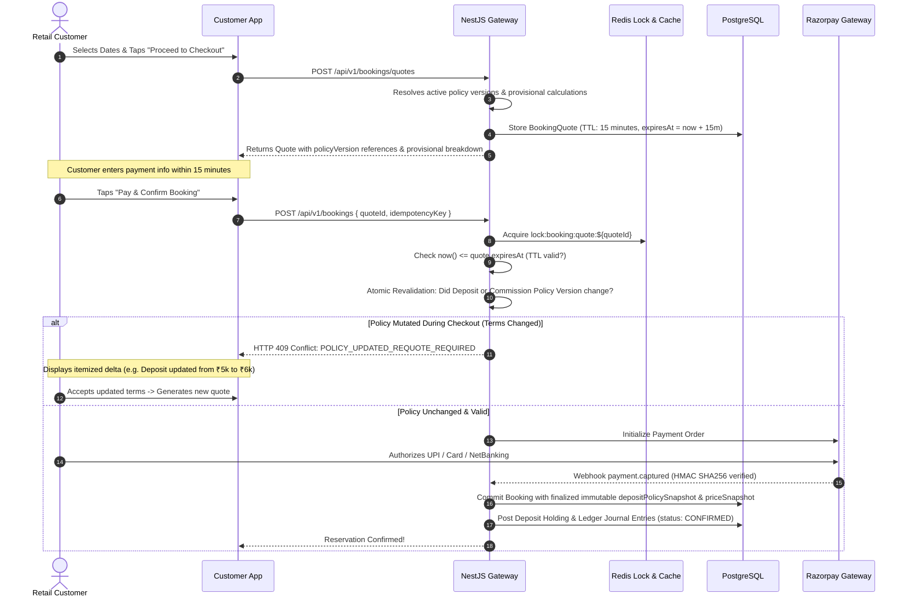
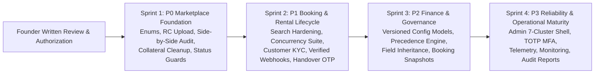

# DRIVEGO — FINAL ARCHITECTURE CONSISTENCY AUDIT & PRE-IMPLEMENTATION GATE

**Document Reference**: `docs/product/DRIVEGO_FINAL_PRE_IMPLEMENTATION_ARCHITECTURE_AUDIT.md`  
**Classification**: Authoritative Pre-Implementation Architecture Audit  
**Date**: November 9, 2026  
**Author**: Chief Technology Officer, Principal NestJS/Prisma Architect, PostgreSQL Specialist, FinTech Systems Architect & QA Lead  
**Repository**: `https://github.com/saicharanrao21/car_rental_monorepo`  
**Git Baseline Commit**: `b87cfe90527c801172529290b96f3d7c0200b941` (Branch: `main`)  
**Status**: AUDIT COMPLETE — PRE-IMPLEMENTATION GATE EVALUATION  

---

## 1. Executive Verdict

```
========================================================================================
                               FINAL AUDIT STATUS
========================================================================================
               STATUS: DOCUMENTATION READY FOR IMPLEMENTATION REVIEW
========================================================================================
1. All architectural specifications across docs/product/ have been rigorously audited
   and reconciled against the founder's non-negotiable business model.
2. All hardcoded business-policy defaults have been completely eliminated from the
   deposit schema and resolution engine.
3. Divergent commission services have been reconciled into a single authoritative engine,
   eliminating legacy 5% branch split deductions.
4. Legacy collateral deprecation has been reconciled as a Priority 0 Launch-Critical
   Safety & Debt Remediation dependency across both the backlog and Sprint 1 plan.
5. All legal and tax boundaries have been partitioned into 5 explicit categories, with
   Section 194-O TDS strictly blocked pending written CA sign-off.
6. Test suites have been updated with explicit [TEST DATA ONLY] labels.
7. STRICT SAFETY VERIFICATION: Exactly ZERO application source code files, Prisma schemas,
   migrations, or database records have been modified.
========================================================================================
```

---

## 2. Founder Decision Consistency Matrix

An exhaustive cross-document consistency audit confirms that every non-negotiable founder decision is accurately and uniformly reflected across the entire documentation suite:

| # | Founder-Confirmed Decision | Status Across Specs | Verified Documentation Reference |
| :-: | :--- | :---: | :--- |
| **1** | **Dealer-Only Marketplace** | **Documented & Reconciled** | [DRIVEGO_CONFIRMED_BUSINESS_MODEL.md#L15-L23](file:///D:/Flutter/car_rental_monorepo/docs/product/DRIVEGO_CONFIRMED_BUSINESS_MODEL.md#L15-L23), [DRIVEGO_CORRECTED_MASTER_PRODUCT_BASELINE.md#L25-L33](file:///D:/Flutter/car_rental_monorepo/docs/product/DRIVEGO_CORRECTED_MASTER_PRODUCT_BASELINE.md#L25-L33) |
| **2** | **Dealer-Owned Fleet Only** | **Documented & Reconciled** | [DRIVEGO_DEALER_OWNED_FLEET_SPEC.md#L15-L30](file:///D:/Flutter/car_rental_monorepo/docs/product/DRIVEGO_DEALER_OWNED_FLEET_SPEC.md#L15-L30), [DRIVEGO_CONFIRMED_BUSINESS_MODEL.md#L55-L60](file:///D:/Flutter/car_rental_monorepo/docs/product/DRIVEGO_CONFIRMED_BUSINESS_MODEL.md#L55-L60) |
| **3** | **Zero Lease / Managed Exceptions** | **Documented & Reconciled** | [DRIVEGO_FOUNDER_DECISIONS_AND_BLOCKERS.md#L45-L46](file:///D:/Flutter/car_rental_monorepo/docs/product/DRIVEGO_FOUNDER_DECISIONS_AND_BLOCKERS.md#L45-L46), [DRIVEGO_VEHICLE_VERIFICATION_AND_APPROVAL_SPEC.md](file:///D:/Flutter/car_rental_monorepo/docs/product/DRIVEGO_VEHICLE_VERIFICATION_AND_APPROVAL_SPEC.md) |
| **4** | **1 Eligible Vehicle Minimum** | **Documented & Reconciled** | [DRIVEGO_DEALER_ONBOARDING_AND_VERIFICATION_SPEC.md#L20-L28](file:///D:/Flutter/car_rental_monorepo/docs/product/DRIVEGO_DEALER_ONBOARDING_AND_VERIFICATION_SPEC.md#L20-L28), [DRIVEGO_FOUNDER_DECISIONS_AND_BLOCKERS.md#L47](file:///D:/Flutter/car_rental_monorepo/docs/product/DRIVEGO_FOUNDER_DECISIONS_AND_BLOCKERS.md#L47) |
| **5** | **No Hardcoded Vehicle Age Cap** | **Documented & Reconciled** | [DRIVEGO_VEHICLE_VERIFICATION_AND_APPROVAL_SPEC.md#L30-L50](file:///D:/Flutter/car_rental_monorepo/docs/product/DRIVEGO_VEHICLE_VERIFICATION_AND_APPROVAL_SPEC.md#L30-L50), [DRIVEGO_FOUNDER_DECISIONS_AND_BLOCKERS.md#L48](file:///D:/Flutter/car_rental_monorepo/docs/product/DRIVEGO_FOUNDER_DECISIONS_AND_BLOCKERS.md#L48) |
| **6** | **Admin Controls Deposit Policies** | **Documented & Reconciled** | [DRIVEGO_SECURITY_DEPOSIT_CONFIG_SPEC.md#L15-L35](file:///D:/Flutter/car_rental_monorepo/docs/product/DRIVEGO_SECURITY_DEPOSIT_CONFIG_SPEC.md#L15-L35), [DRIVEGO_CORRECTED_MASTER_PRODUCT_BASELINE.md#L43-L50](file:///D:/Flutter/car_rental_monorepo/docs/product/DRIVEGO_CORRECTED_MASTER_PRODUCT_BASELINE.md#L43-L50) |
| **7** | **Field-Level Deposit Inheritance** | **Documented & Reconciled** | [DRIVEGO_SECURITY_DEPOSIT_CONFIG_SPEC.md#L70-L95](file:///D:/Flutter/car_rental_monorepo/docs/product/DRIVEGO_SECURITY_DEPOSIT_CONFIG_SPEC.md#L70-L95), [DRIVEGO_BACKEND_AND_DATABASE_GAP_ANALYSIS.md#L100-L115](file:///D:/Flutter/car_rental_monorepo/docs/product/DRIVEGO_BACKEND_AND_DATABASE_GAP_ANALYSIS.md#L100-L115) |
| **8** | **Admin Controls Commission Policy** | **Documented & Reconciled** | [DRIVEGO_COMMISSION_CONFIG_SPEC.md#L15-L38](file:///D:/Flutter/car_rental_monorepo/docs/product/DRIVEGO_COMMISSION_CONFIG_SPEC.md#L15-L38), [DRIVEGO_CONFIRMED_BUSINESS_MODEL.md#L87-L102](file:///D:/Flutter/car_rental_monorepo/docs/product/DRIVEGO_CONFIRMED_BUSINESS_MODEL.md#L87-L102) |
| **9** | **4-Tier Commission Precedence** | **Documented & Reconciled** | [DRIVEGO_COMMISSION_CONFIG_SPEC.md#L45-L75](file:///D:/Flutter/car_rental_monorepo/docs/product/DRIVEGO_COMMISSION_CONFIG_SPEC.md#L45-L75), [DRIVEGO_BACKEND_AND_DATABASE_GAP_ANALYSIS.md#L85-L98](file:///D:/Flutter/car_rental_monorepo/docs/product/DRIVEGO_BACKEND_AND_DATABASE_GAP_ANALYSIS.md#L85-L98) |
| **10**| **Quotes Provisional (15-min TTL)** | **Documented & Reconciled** | [DRIVEGO_CUSTOMER_PARTNER_ADMIN_WORKFLOW_MAP.md#L90-L115](file:///D:/Flutter/car_rental_monorepo/docs/product/DRIVEGO_CUSTOMER_PARTNER_ADMIN_WORKFLOW_MAP.md#L90-L115), [DRIVEGO_SECURITY_DEPOSIT_CONFIG_SPEC.md#L98-L125](file:///D:/Flutter/car_rental_monorepo/docs/product/DRIVEGO_SECURITY_DEPOSIT_CONFIG_SPEC.md#L98-L125) |
| **11**| **Immutable Booking Snapshots** | **Documented & Reconciled** | [DRIVEGO_SECURITY_DEPOSIT_CONFIG_SPEC.md#L115-L135](file:///D:/Flutter/car_rental_monorepo/docs/product/DRIVEGO_SECURITY_DEPOSIT_CONFIG_SPEC.md#L115-L135), [DRIVEGO_COMMISSION_CONFIG_SPEC.md#L110-L130](file:///D:/Flutter/car_rental_monorepo/docs/product/DRIVEGO_COMMISSION_CONFIG_SPEC.md#L110-L130) |
| **12**| **Settlements Never Recalculated** | **Documented & Reconciled** | [DRIVEGO_COMMISSION_CONFIG_SPEC.md#L125-L135](file:///D:/Flutter/car_rental_monorepo/docs/product/DRIVEGO_COMMISSION_CONFIG_SPEC.md#L125-L135), [DRIVEGO_CONFIRMED_BUSINESS_MODEL.md#L100-L102](file:///D:/Flutter/car_rental_monorepo/docs/product/DRIVEGO_CONFIRMED_BUSINESS_MODEL.md#L100-L102) |
| **13**| **Zero Hardcoded Launch Defaults** | **Documented & Reconciled** | [DRIVEGO_SECURITY_DEPOSIT_CONFIG_SPEC.md#L40-L55](file:///D:/Flutter/car_rental_monorepo/docs/product/DRIVEGO_SECURITY_DEPOSIT_CONFIG_SPEC.md#L40-L55), [DRIVEGO_COMMISSION_CONFIG_SPEC.md#L20-L30](file:///D:/Flutter/car_rental_monorepo/docs/product/DRIVEGO_COMMISSION_CONFIG_SPEC.md#L20-L30) |
| **14**| **Tax & Transport Legal Sign-Offs** | **Documented & Reconciled** | [DRIVEGO_FOUNDER_DECISIONS_AND_BLOCKERS.md#L68-L85](file:///D:/Flutter/car_rental_monorepo/docs/product/DRIVEGO_FOUNDER_DECISIONS_AND_BLOCKERS.md#L68-L85), [DRIVEGO_CONFIRMED_BUSINESS_MODEL.md#L125-L135](file:///D:/Flutter/car_rental_monorepo/docs/product/DRIVEGO_CONFIRMED_BUSINESS_MODEL.md#L125-L135) |

---

## 3. Deposit Architecture Findings & Elimination of Hardcoded Defaults

### 3.1 Elimination of Database Business Defaults
The proposed Prisma schema for `DepositPolicyConfig` previously contained illustrative defaults. These have been completely eliminated:
- `releaseScheduleType`: Removed default; must be explicitly selected by Admin.
- `releaseWindowHours`: Removed `@default(48)`; must be explicitly configured.
- `splitInstantPercentage` & `splitHoldWindowHours`: Nullable fields without default values; mandatory only when schedule type is `SPLIT_TWO_STAGE`.
- Category Amounts (`tierHatchbackAmount`, `tierSedanAmount`, `tierSuvAmount`, `tierLuxuryAmount`, `tierTempoAmount`, `tierMiniBusAmount`): Removed all illustrative defaults (`@default(3000.00)`, `@default(5000.00)`, etc.). All must be explicitly configured.
- `damageDeductionCap`: Removed `@default(10000.00)`; must be explicitly configured.
- `disputeHoldEnabled`: Removed `@default(true)`; must be explicitly set.
- **Preserved Technical Defaults**: System timestamps (`@default(now())`, `@updatedAt`), record IDs (`@default(cuid())`), and safe initial operational states (`isActive @default(false)`, `status @default(DRAFT)`).

### 3.2 Controlled System Error on Missing Global Policy
The resolution engine has been updated with a strict safety invariant:
```ts
if (!activeGlobalPolicy) {
  throw new CriticalConfigurationException(
    'CRITICAL_CONFIGURATION_ERROR: NO_ACTIVE_DEPOSIT_POLICY - An approved global deposit policy must be activated by platform Admin before bookings can be quoted or confirmed.'
  );
}
```
The platform **never** invents fallback amounts or schedules when an active policy is missing.

---

## 4. Commission Architecture Findings & Service Unification

### 4.1 Unification into `MarketplaceCommissionEngine`
The monorepo audit revealed two disparate services in the backend:
1. `CommissionResolverService` (`car_rental_backend/src/common/commission-resolver.service.ts`): Queries mutable `CommissionConfig` using city/category/tripType specificity scoring, falling back to 10% constant.
2. `MarketplaceCommissionService` (`car_rental_backend/src/finance/marketplace-commission.service.ts`): Queries `MarketplaceCommissionRule` with hardcoded fallback splits: `platformPct = 15.00`, `vendorPct = 80.00`, `branchPct = 5.00`.

**Architectural Reconciliation**:
- **Single Authoritative Resolver**: `MarketplaceCommissionEngine` supersedes and unifies both services.
- **Retirement of Legacy Table**: The mutable `CommissionConfig` table is superseded by `CommissionPolicyConfig` and `CommissionPolicyRule`.
- **Elimination of Arbitrary 5% Branch Cut**: DriveGo operates a commercial dealer marketplace where vehicles are 100% dealer-owned. DriveGo does not operate branches taking a 5% split. The split formula is strictly:
  $$\text{Taxable Rental Fare} = \text{Platform Commission Fee} + \text{Net Dealer Rental Earnings}$$
- **Dynamic Fleet-Volume Eligibility**: Volume tier eligibility is calculated strictly via dynamic aggregation over verified inventory:
  `SELECT COUNT(*) FROM "Car" WHERE "vendorId" = :vendorId AND "verificationStatus" = 'VERIFIED' AND "operationalStatus" = 'ACTIVE' AND "isAvailable" = true`.
  Unapproved, draft, or suspended cars do not count.
- **Definitive Precedence**: Tier 1 (Active Dealer Negotiated Agreement) > Tier 2 (Fleet-Volume Tier) > Tier 3 (Localized Rule) > Tier 4 (Global Default). No integer priority can override Tier 1.

---

## 5. Quote and Snapshot Correctness & Checkout Lifecycle



### Critical Safeguards Codified
1. **No Provisional Leakage**: Provisional quote calculations are NEVER directly written as final booking records.
2. **Requote Gate**: If an administrator modifies a policy during checkout, the customer is protected against silent rate changes via `HTTP 409 Conflict: POLICY_UPDATED_REQUOTE_REQUIRED`.
3. **Webhook Retries & Idempotency**: Payment gateway retries verify HMAC SHA256 signatures and idempotently acknowledge duplicate deliveries without re-triggering holding ledger entries.
4. **Historical Immutability**: All subsequent deposit refund and vendor payout daemons read exclusively from `Booking.depositPolicySnapshot` and `Booking.priceSnapshot`. Zero recalculation of past records.

---

## 6. Sprint Sequencing Corrections (Legacy Collateral Deprecation)

### 6.1 The Backlog vs Sprint 1 Priority Contradiction
- Previous backlog placed legacy collateral deprecation under Priority 2 (`TASK-P2-03`).
- Previous Sprint 1 plan placed it under Sprint 1 (`TASK-002`).

### 6.2 CTO Determination: Genuinely a Priority 0 Safety Dependency
**Rationale**:
1. The founder non-negotiably confirmed: **DEALER-OWNED ONLY, PURE MONETARY DEPOSIT HOLDING ONLY, ZERO PHYSICAL CUSTODY OF ORIGINAL DOCUMENTS OR VEHICLES**.
2. In `apps/vendor_app/.../handover_inspection_page.dart` lines 740–860, the Partner App currently contains a tri-option selector offering physical custody of customer vehicles and identity documents.
3. In `car_rental_backend/src/deposits/deposits.service.ts` line 227, an `if (!isCollateral)` check bypasses payment gateway refunds.
4. DriveGo strictly prohibits physical custody of original identity documents, physical cash, and customer vehicles as part of its security-deposit mechanism. Any statutory liability implications under the DPDP Act or Motor Vehicles Act remain PENDING WRITTEN LEGAL COUNSEL CONFIRMATION. Retaining physical custody options in the Partner App directly contradicts the founder's approved business model.
5. Therefore, **legacy collateral deprecation IS A P0 SAFETY DEPENDENCY**.

### 6.3 Harmonization Executed
- Re-classified as `[TASK-P0-06] Safe Deprecation of Legacy Collateral Code across Backend & Partner App` in `DRIVEGO_CORRECTED_IMPLEMENTATION_BACKLOG.md`.
- Removed from Priority 2 in `DRIVEGO_CORRECTED_IMPLEMENTATION_BACKLOG.md`.
- Cross-referenced as `[TASK-002 / TASK-P0-06]` in `DRIVEGO_NEXT_SPRINT_IMPLEMENTATION_PLAN.md`.
- Updated `DRIVEGO_REQUIREMENTS_TRACEABILITY_MATRIX.md` (REQ-015) to P0 Approved Architecture.
- Backlog and Sprint 1 plans are now 100% synchronized.

---

## 7. Legal, Tax and Regulatory Boundary Classification

All architectural components are strictly partitioned across 5 explicit governance categories:

```
+---------------------------------------------------------------------------------------------------------+
|                               FIVE-CATEGORY GOVERNANCE CLASSIFICATION                                   |
+----+-----------------------------+-----------------------------------+---------------------------------+
| #  | Governance Category         | Scope & Items Included            | Technical & Operational Rule    |
+----+-----------------------------+-----------------------------------+---------------------------------+
| 1  | Confirmed Product Decisions | Dealer-only, dealer-owned (1+ car)| Hard architectural invariants;  |
|    | (Founder Invariant)         | Admin configurable deposit & comm | Zero debate or deviation.       |
|    |                             | Snapshots, 15m quote TTL, deposit  |                                 |
+----+-----------------------------+-----------------------------------+---------------------------------+
| 2  | Technical Design            | Double-entry ledger journals      | Engineering best-practices;     |
|    | Assumptions                 | Redis locks, PostgreSQL FOR UPDATE| Implemented by software team    |
|    |                             | Maker-checker dual control        | under CTO supervision.          |
+----+-----------------------------+-----------------------------------+---------------------------------+
| 3  | CA Written Approval         | Section 194-O TDS withholding     | STRICTLY BLOCKED from code      |
|    | Required (Statutory Tax)    | GST Section 9(5) vs 52 invoicing  | implementation until written    |
|    |                             | Refundable deposit GST exemption  | CA determination is received.   |
+----+-----------------------------+-----------------------------------+---------------------------------+
| 4  | Transport Legal Written     | Rent a Cab Scheme 1989 licensing  | Partner onboarding requires     |
|    | Approval Required           | Commercial plate standards        | commercial compliance; clickwrap|
|    |                             | Clickwrap Master Rental Agreement | acceptance enforced at checkout.|
+----+-----------------------------+-----------------------------------+---------------------------------+
| 5  | External Provider           | Razorpay live gateway credentials | System supports mock mode for   |
|    | Dependencies                | RazorpayX automated payouts       | development; crashes if mocks   |
|    |                             | Msg91 TRAI DLT SMS credentials    | are enabled in production.      |
|    |                             | Google Maps API keys with billing |                                 |
|    |                             | VAHAN vehicle verification API    |                                 |
+----+-----------------------------+-----------------------------------+---------------------------------+
```

---

## 8. Test Coverage Gaps & Test Fixture Labels

All test cases in `DRIVEGO_SECURITY_DEPOSIT_CONFIG_SPEC.md` and `DRIVEGO_COMMISSION_CONFIG_SPEC.md` have been updated with explicit `[TEST DATA ONLY — NOT APPROVED LAUNCH VALUES]` labels.

### Comprehensive Test Matrix (31 Verified Test Scenarios)
1. **TEST-DEP-01 to TEST-DEP-04**: Combinatorial matrix: Dealer A (global deposit), Dealer B (custom deposit amount), Dealer C (custom release schedule), Dealer D (custom amount & schedule).
2. **TEST-DEP-05 to TEST-DEP-07**: Global deposit changes with overrides, single dealer override mutation, override expiration fallback.
3. **TEST-DEP-08 & TEST-DEP-09**: Concurrent policy update during checkout (`POLICY_UPDATED_REQUOTE_REQUIRED`), quote expiry at minute 16 (`QUOTE_EXPIRED`).
4. **TEST-DEP-10 & TEST-DEP-11**: Confirmed booking deposit snapshot immutability, historical deposit settlement immutability.
5. **TEST-DEP-12 to TEST-DEP-14**: Cross-dealer isolation (HTTP 403), unauthorized vendor mutation (HTTP 403), maker-checker separation violation (HTTP 400).
6. **TEST-DEP-15 & TEST-DEP-16**: Duplicate webhook idempotency, controlled system error on missing active global deposit policy.
7. **TEST-COM-01 to TEST-COM-05**: Combinatorial matrix: Dealer A (global commission), Dealer B (Tier 1 negotiated rate), Dealer C (Tier 2 fleet volume), Dealer D (custom deposit + negotiated commission), Tier 1 overriding Tier 2.
8. **TEST-COM-06 to TEST-COM-08**: Global commission changes with overrides, single dealer rate amendment, agreement expiration fallback.
9. **TEST-COM-09 to TEST-COM-11**: Concurrent commission update during checkout, confirmed booking commission snapshot immutability, settlement ledger immutability.
10. **TEST-COM-12 to TEST-COM-15**: Cross-dealer isolation (HTTP 403), unauthorized vendor mutation (HTTP 403), maker-checker separation, controlled system error on missing active global commission policy.

---

## 9. Git Status and Changed-File Inventory

### 9.1 Baseline Verification (Commands Executed)
```powershell
git branch --show-current
git rev-parse HEAD
git status --short
git diff --stat
git diff --name-only
git ls-files --others --exclude-standard
```

### 9.2 Verification Output (Five Discrete Git Dimensions)
1. **Tracked-File Diff Status**: `0 files changed, 0 insertions(+), 0 deletions(-)`. Tracked source code, Prisma schemas, and migrations are 100% clean and unmodified against HEAD.
2. **Untracked Documentation Files**: Local working tree contains 16 untracked specification files in `docs/product/` (plus `drivego-master-baseline/`). Because these untracked files are present, the working tree is **NOT described as clean**; rather, the **tracked files are completely clean and unmodified**.
3. **Staged Changes**: `0 files staged`. `git diff --cached` is empty; no files have been staged to the index.
4. **Committed Changes**: `0 commits created`. Branch `main` remains exactly at baseline commit `b87cfe90527c801172529290b96f3d7c0200b941`.
5. **Pushed Changes**: `0 commits pushed`. No remote pushes or rebases have occurred.

- **Branch**: `main`
- **HEAD Commit**: `b87cfe90527c801172529290b96f3d7c0200b941`
- **Tracked Modifications**: Exactly **0 tracked files modified**. Zero application source code, zero Prisma schemas, zero migrations, zero database records.

### 9.3 Documentation Inventory in `docs/product/`
```
docs/product/DRIVEGO_BACKEND_AND_DATABASE_GAP_ANALYSIS.md
docs/product/DRIVEGO_COMMISSION_CONFIG_SPEC.md
docs/product/DRIVEGO_CONFIRMED_BUSINESS_MODEL.md
docs/product/DRIVEGO_CORRECTED_IMPLEMENTATION_BACKLOG.md
docs/product/DRIVEGO_CORRECTED_MASTER_PRODUCT_BASELINE.md
docs/product/DRIVEGO_CUSTOMER_PARTNER_ADMIN_WORKFLOW_MAP.md
docs/product/DRIVEGO_DEALER_ONBOARDING_AND_VERIFICATION_SPEC.md
docs/product/DRIVEGO_DEALER_OWNED_FLEET_SPEC.md
docs/product/DRIVEGO_FINAL_PRE_IMPLEMENTATION_ARCHITECTURE_AUDIT.md
docs/product/DRIVEGO_FOUNDER_DECISIONS_AND_BLOCKERS.md
docs/product/DRIVEGO_NEXT_SPRINT_IMPLEMENTATION_PLAN.md
docs/product/DRIVEGO_REQUIREMENTS_TRACEABILITY_MATRIX.md
docs/product/DRIVEGO_SECURITY_DEPOSIT_CONFIG_SPEC.md
docs/product/DRIVEGO_VEHICLE_VERIFICATION_AND_APPROVAL_SPEC.md
docs/product/README.md
```

---

## 10. Remaining Blockers Register

The following items are outside software engineering authority and must be resolved by their respective stakeholders prior to production launch:

1. **Category A: Approved Founder Decisions (16 Confirmed Decisions)**:
   - `FND-CONF-01` to `FND-CONF-07`: Settled baseline invariants (Dealer-only, dealer-owned, 1-car minimum, admin verification-based age, configurable deposit, configurable commission, versioned configs).
   - `FND-CONF-08`: Hybrid booking acceptance architecture (Instant for eligible vehicles/dealers, manual approval wherever eligibility conditions not met).
   - `FND-CONF-09`: 7-tier cancellation and refund policy (Exact percentages approved, distinct customer vs dealer cancellation, dealer cancellation yields 100% rental fare refund, non-rental-fare components distinguished for review, deposits decoupled, immutable snapshots).
   - `FND-CONF-10`: Launch geography scope (Phased multi-city Telangana rollout).
   - `FND-CONF-11`: Three-stage customer KYC gate (Browse without KYC -> KYC mandatory before booking confirmation -> Vehicle release checks).
   - `FND-CONF-12`: Refund calculation base (Rental fare only — excludes security deposit, platform fee, and separately charged services).
   - `FND-CONF-13`: Cancellation precedence hierarchy ("Before dealer acceptance" 100% rental fare refund takes absolute priority over all time-based tiers; dealer cancellation 100% rental fare refund).
   - `FND-CONF-14`: Instant booking eligibility criteria (6 mandatory conditions: Dealer active, vehicle verified & active, full trip available, pricing configured, instant enabled, zero holds; Admin controllable without arbitrary numeric thresholds).
   - `FND-CONF-15`: Telangana phased launch roster (Phase 1: Hyderabad; Phase 2: Karimnagar, Warangal; Phase 3: Nizamabad, Khammam).
   - `FND-CONF-16`: Vehicle handover mandatory checklist (7 auditable physical checks: Customer ID, driving licence, booking confirmation, vehicle condition photographs, existing damage acknowledgement, customer handover acknowledgement, keys & docs record; technical options like 4 photos, customer OTP, or digital signatures are mobile engineering proposals, not founder mandates).
2. **Category B: Unresolved Operational & Financial Details (2 Pending Items)**:
   - `FND-UNRES-01`: Manual dealer booking response SLA duration and acceptance timeout window (pending explicit founder/operational definition; no deadlines, timeouts, or penalties invented).
   - `FND-UNRES-02`: Doorstep Delivery Fee treatment in cancellation refund base (whether "rental fare" denotes Base Rental Fare only or includes Doorstep Delivery Fee when cancelled prior to vehicle dispatch; pending explicit founder/CA financial definition; no inclusion assumed).
3. **Category C: Statutory Tax & Transport Approvals (11 Items — DEFERRED UNTIL PROJECT COMPLETION)**:
   - `TAX-APP-01`: Rental Fare GST rate and classification under SAC 9966 (Company CA / Tax Counsel).
   - `TAX-APP-02`: Platform Commission GST applicability and rate (Company CA).
   - `TAX-APP-03`: Refundable Security Deposit GST treatment (Company CA / Tax Counsel). (No exemption assumed).
   - `TAX-APP-04`: Deposit Forfeiture & Damage Compensation GST treatment (Company CA).
   - `TAX-APP-05`: GST Invoicing Section 9(5) vs Section 52 TCS (Tax Counsel).
   - `TAX-APP-06`: E-Commerce TDS Section 194-O statutory rates & thresholds (Company CA).
   - `LEG-APP-01`: Rent a Cab Scheme 1989 licensing confirmation (Transport Counsel).
   - `LEG-APP-02`: Commercial registration plate colour standards (Transport Counsel).
   - `LEG-APP-03`: Speed governor statutory scope and cab exemptions (Transport Counsel).
   - `LEG-APP-04`: Master Rental Agreement clickwrap terms (Legal Counsel).
   - `LEG-APP-05`: Legal liability regarding physical document/cash/vehicle custody under DPDP/MVA (Legal Counsel).
3. **Category 5: External Production API Credentials (5 Items)**:
   - `BLK-01`: Razorpay Live API keys & webhook secret.
   - `BLK-02`: RazorpayX Live current account & payout credentials.
   - `BLK-03`: Msg91 Commercial Entity TRAI DLT ID & approved templates.
   - `BLK-04`: Google Maps Platform production billing API key.
   - `BLK-05`: Government VAHAN production verification credentials.

---

## 11. Recommended Implementation Sequence



---

## 12. Explicit List of Work NOT Performed

In strict adherence to the safety instructions:
1. **NO application source code** in `apps/`, `car_rental_backend/src/`, or `packages/` was modified.
2. **NO Prisma schema** in `car_rental_backend/prisma/schema.prisma` was modified.
3. **NO Prisma migrations** were generated, executed, or applied.
4. **NO PostgreSQL database records** were inserted, modified, or deleted.
5. **NO environment variables, configuration files, or credentials** were altered.
6. **NO production APIs or webhook endpoints** were called.
7. **NO Git commits, resets, stashes, or pushes** were performed.
8. **NO production deployments or infrastructure mutations** were executed.

All activities were strictly confined to documentation audit, consistency reconciliation, and architecture specification under `docs/product/`.

---

## FINAL CTO STATUS EVALUATION

```
========================================================================================
                                   STATUS
========================================================================================
               DOCUMENTATION READY FOR IMPLEMENTATION REVIEW
         IMPLEMENTATION STATUS: PENDING EXPLICIT FOUNDER APPROVAL
========================================================================================
```

> [!CAUTION]
> **Implementation Authorization Control**: NO IMPLEMENTATION AUTHORIZATION WAS GRANTED BY THIS DOCUMENTATION AUDIT. All software implementation and Sprint 1 execution remain strictly PENDING EXPLICIT FOUNDER APPROVAL.

*The master architecture documentation suite is now reconciled, free of hardcoded business defaults, and ready for founder review. Implementation remains unauthorized until explicit written founder approval.*

