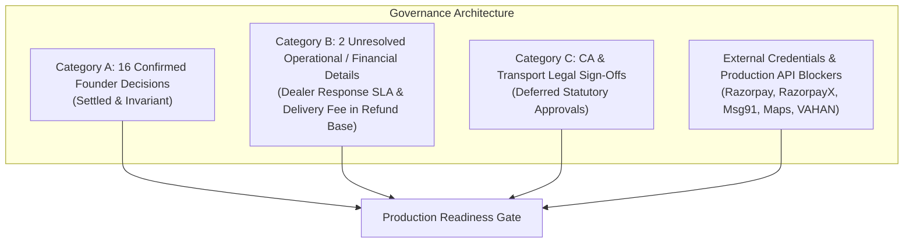

# DriveGo — Confirmed Decisions, Open Items & External Blockers

**Document Reference**: `docs/product/DRIVEGO_FOUNDER_DECISIONS_AND_BLOCKERS.md`  
**Classification**: Authoritative Governance Register  
**Effective Date**: November 9, 2026  
**Author**: Chief Technology Officer & Legal/Regulatory Auditor  
**Repository**: `https://github.com/saicharanrao21/car_rental_monorepo`  
**Git Baseline Commit**: `b87cfe90527c801172529290b96f3d7c0200b941` (Branch: `main`)  
**Status**: ACTIVE GOVERNANCE & BLOCKER TRACKER — IMPLEMENTATION STATUS: PENDING EXPLICIT FOUNDER APPROVAL  

---

> [!CAUTION]
> **Implementation Authorization Directive**: This register classifies governance status and external dependencies. **NO IMPLEMENTATION AUTHORIZATION HAS BEEN GRANTED**. All engineering implementation remains strictly `PENDING EXPLICIT FOUNDER APPROVAL`.

---

## 1. Executive Summary

This register formally isolates decisions across three explicit categories:
- **Category A**: Settled, authoritative founder decisions (**16 Confirmed Founder Decisions**, `FND-CONF-01` through `FND-CONF-16`) that must never be questioned or reopened.
- **Category B**: Genuinely open operational and financial choices awaiting founder/professional determination (**2 Unresolved Operational / Financial Details**, `FND-UNRES-01` and `FND-UNRES-02`).
- **Category C**: Statutory tax and transport legal items requiring qualified professional confirmation (Deferred until project completion).
- **External Integration Blockers**: Production API credentials required before live commercial operations.

> [!NOTE]
> **Checklist vs. Founder Decision Count Reconciliation**: The 14 technical and architectural consistency checklist entries in the Product Baseline represent system design invariants, and must **NOT** be conflated with or presented as 14 founder decisions. The authoritative register contains exactly **16 Confirmed Founder Decisions** in Category A and **2 Unresolved Operational / Financial Details** in Category B.

---

## 2. Category A: Confirmed Founder Decisions (Settled & Invariant)

These 16 decisions are finalized and binding. Engineering specifications, database models, and workflows adhere strictly to them:

| Decision ID | Domain | Confirmed Founder Decision | Architectural & Operational Impact |
| :---: | :--- | :--- | :--- |
| **FND-CONF-01** | **Partner Model** | **DEALER ONLY**: Multi-vendor self-drive car rental marketplace exclusively for established rental dealers and rental agencies. Peer-to-peer (P2P) hosting for private individuals is strictly excluded from launch. | Purge "Host" and "P2P" terminology; defer P2P to post-launch (Priority 4). Enforce business registration checks. |
| **FND-CONF-02** | **Vehicle Ownership** | **DEALER-OWNED ONLY**: Every vehicle must be legally owned by the registered dealer entity or verified sole proprietor. Leased, subleased, managed, consignment, third-party, and privately hosted vehicles are strictly excluded. | Prohibit all lease exceptions; mandate commercial RC title audit against dealer entity name. |
| **FND-CONF-03** | **No Lease Exceptions** | **ZERO LEASE EXCEPTIONS**: There must be no exception for leased vehicles with sublease authorization or management agreements. | Do not introduce sublease checkboxes or leased vehicle workflows. |
| **FND-CONF-04** | **Minimum Fleet Size** | **ONE (1) ELIGIBLE VEHICLE**: Confirmed minimum fleet size is one (1) eligible dealer-owned vehicle. A dealer may apply and onboard with one vehicle. | Do not impose a 3-vehicle or 5-vehicle minimum for partner onboarding. |
| **FND-CONF-05** | **Maximum Vehicle Age** | **ADMIN VERIFICATION-BASED**: No universal hardcoded maximum vehicle age (no hardcoded 5-year or 7-year cap). Admin assesses eligibility individually based on condition, RC, commercial insurance, fitness certificate, and safety evidence. | Remove hardcoded age dropdown limits; enforce structured audit checklist in Admin Control Tower. |
| **FND-CONF-06** | **Security Deposit Policy** | **ADMIN-CONFIGURABLE (GLOBAL + DEALER OVERRIDES)**: 1. Admin controls global default deposit policy and determines launch default (founder selects no fixed schedule or amount in advance). 2. Zero database schema defaults for business policies; missing active policy produces controlled error `NO_ACTIVE_DEPOSIT_POLICY`. 3. Admin can change global default whenever required. 4. Admin can configure and modify separate deposit policies for individual dealers. 5. Multi-policy dealer operations supported. 6. No universal fixed 24h, 48h, or 80/20 release schedule is approved; no illustrative deposit amount is an approved launch default. 7. Field-level inheritance: Dealer-specific override overrides specific fields; unconfigured fields inherit from global active policy. 8. Quotes hold provisional snapshots (TTL 15 min); confirmed bookings capture finalized immutable `depositPolicySnapshot`. Zero retroactive recalculation. | Implement versioned `DepositPolicyConfig`, `VendorDepositPolicyOverride`, and immutable `depositPolicySnapshot` on `Booking`. Pure monetary deposit holding only. |
| **FND-CONF-07** | **Platform Commission** | **ADMIN-CONFIGURABLE & NEGOTIATED DEALER AGREEMENTS**: 1. Admin controls global platform commission rate and determines launch rate (founder selects no fixed percentage in advance). 2. Zero database schema defaults for commission; missing active policy produces controlled error `NO_ACTIVE_COMMISSION_POLICY`. 3. Admin can negotiate, modify, and schedule dealer-specific negotiated rates. 4. Different dealers may have different negotiated commission rates. 5. Optional fleet-volume tiers and localized rules may coexist. 6. Previously discussed percentages (15%, 17.5%, 18%, 20%) remain examples only. 7. Precedence hierarchy: (1) Active Dealer Negotiated Agreement > (2) Fleet-Volume Tier > (3) City/Category/Trip-type Rule > (4) Global Default Commission. 8. Historical bookings and completed settlements are NEVER recalculated. | Implement versioned `CommissionPolicyConfig`, `DealerNegotiatedCommissionAgreement`, and immutable commission snapshot on `Booking.priceSnapshot`. |
| **FND-CONF-08** | **Booking Acceptance Model** | **HYBRID ACCEPTANCE ARCHITECTURE**: 1. Eligible vehicles and dealers can receive instant bookings when all configured eligibility and availability checks pass. 2. Manual dealer approval is required wherever instant-booking eligibility conditions are not met. 3. Manual dealer response handling is preserved; exact dealer response SLA duration and acceptance timeout window remain pending explicit operational definition. | Booking state machine supports dual pathways: instant transition to `CONFIRMED` upon payment capture vs provisional transition to `AWAITING_DEALER_ACCEPTANCE`. Missing or unmet instant criteria route automatically to manual dealer approval. |
| **FND-CONF-09** | **Cancellation & Refund Schedule** | **APPROVED 7-TIER CANCELLATION PERCENTAGES (ON RENTAL FARE)**: 1. Before dealer acceptance: **100% rental fare refund**. 2. More than 48 hours before pickup: **90% rental fare refund**. 3. 24–48 hours before pickup: **75% rental fare refund**. 4. 6–24 hours before pickup: **50% rental fare refund**. 5. Less than 6 hours before pickup: **0% rental fare refund**. 6. No-show: **0% rental fare refund**. 7. Dealer cancellation: **100% rental fare refund**.  • Clear distinction between customer cancellation and dealer cancellation. • Refund percentages apply strictly to the rental fare only; platform fees, additional services, and security deposits are not automatically included. • Non-rental-fare components (platform fee, additional services) on dealer cancellation are distinguished and marked for separate founder / deferred CA review. • Security deposit refund and release rules remain separate and decoupled from cancellation penalties, subject to deferred CA/legal review. • Confirmed bookings preserve immutable cancellation policy snapshot; future changes never alter historical bookings. | Implement automated cancellation refund calculation worker on rental fare; preserve immutable cancellation policy snapshot on `Booking`; decouple refundable security deposit from cancellation penalties. |
| **FND-CONF-10** | **Launch Geography Scope** | **PHASED MULTI-CITY TELANGANA ROLLOUT SCOPE**: 1. Initial launch covers multiple cities across Telangana. 2. Product documentation is NOT restricted to a single city. 3. Phased operational rollout supported across Telangana hubs without adding unapproved launch cities or dates. | Multi-city serviceability architecture in backend and Flutter apps; dynamic city onboarding and dealer yard depot assignment across Telangana urban/suburban hubs. |
| **FND-CONF-11** | **Customer KYC Gate** | **DISTINCT THREE-STAGE WORKFLOW PROGRESSION**: 1. **Browsing**: Customers can browse vehicles and generate quotes without completing KYC. 2. **Booking Confirmation Gate**: Customer KYC must be completed before booking confirmation. 3. **Vehicle Release**: Mandatory 7-point handover verification executed before keys and vehicle release.  • Zero invented mandatory document types or verification vendors. • Browsing, booking confirmation, and vehicle handover maintained as distinct workflow stages. | Checkout flow enforces mandatory verified KYC gate before reservation confirmation; vehicle handover wizard enforces 7-point physical and documentation checks before vehicle key dispatch. |
| **FND-CONF-12** | **Refund Calculation Base** | **RENTAL FARE ONLY**: 1. All cancellation refund percentages apply strictly to the **rental fare only**. 2. Excluded from cancellation refund calculation: Security deposit, platform convenience fee, and separately charged additional services or fees. 3. Security deposits are NOT combined with cancellation refunds; their accounting and release treatment remain completely decoupled, subject to deferred CA/legal review. 4. Platform fee refund or retention treatment upon dealer cancellation is distinguished from rental fare and marked for founder / deferred CA review. 5. Whether "rental fare" denotes Base Rental Fare only or includes Doorstep Delivery Fee is a narrow open financial-definition issue (`FND-UNRES-02`). | Cancellation calculation worker computes refund amount strictly on rental fare (`rentalFare * refundPercentage`). Platform fee and additional service charges are non-refundable on customer cancellation. Deposit is governed separately by the active deposit policy, subject to deferred CA/legal review. |
| **FND-CONF-13** | **Cancellation Precedence Hierarchy** | **PRE-ACCEPTANCE PRIORITY OVER TIME-BASED TIERS**: 1. The rule "Before dealer acceptance" takes absolute priority over all time-based cancellation tiers. 2. If a customer cancels before dealer acceptance, they receive a **100% rental fare refund**, regardless of time remaining before scheduled pickup (even within <6 hours). 3. Once dealer acceptance occurs (or for instant bookings confirmed immediately), time-based tiers (90%, 75%, 50%, 0%) apply strictly to the rental fare. 4. Dealer-initiated cancellations result in a mandatory **100% rental fare refund** to the customer. Other payment components (platform fee, additional services) are distinguished and subject to separate founder / deferred CA review; deposit is governed separately by the active deposit policy, subject to deferred CA/legal review. | State machine evaluates `booking.status == AWAITING_DEALER_ACCEPTANCE`: if customer cancels, issue 100% rental fare refund immediately; else resolve against pickup timestamp. |
| **FND-CONF-14** | **Instant Booking Eligibility Criteria** | **SIX MANDATORY ELIGIBILITY CONDITIONS (ADMIN CONTROLLABLE)**: Instant booking is permitted ONLY when ALL six conditions pass: 1. Dealer account is approved and active (`Vendor.status == ACTIVE`). 2. Vehicle is approved and active (`Car.verificationStatus == VERIFIED && operationalStatus == ACTIVE`). 3. Vehicle availability is verified for the entire requested trip without conflict. 4. Pricing and applicable policies are fully configured. 5. Dealer has enabled instant booking (`Car.instantBookingEnabled == true`). 6. No pending verification, restriction, or operational hold exists on dealer or vehicle.  • If ANY condition fails, the booking routes automatically to manual dealer approval (`AWAITING_DEALER_ACCEPTANCE`). • Admin controls and configures eligibility policies through authorized settings; zero arbitrary numeric thresholds. | Checkout and booking engine enforce 6-point eligibility validator prior to payment capture path selection; missing criteria gracefully fallback to manual dealer approval. |
| **FND-CONF-15** | **Telangana Launch Phased Roster** | **APPROVED THREE-PHASE TELANGANA ROLLOUT**: • **Phase 1**: **Hyderabad** • **Phase 2**: **Karimnagar**, **Warangal** • **Phase 3**: **Nizamabad**, **Khammam**  Multi-city Telangana launch scope strictly preserved; zero unapproved launch cities or dates added. | Backend `City` seed configuration and serviceability filters activated sequentially across the 3 approved phases; operations team onboards dealers adhering to phased city roster. |
| **FND-CONF-16** | **Vehicle Handover Mandatory Checklist** | **SEVEN (7) AUDITABLE PRE-RELEASE CHECKS**: Mandatory checks required before keys and vehicle release: 1. Customer identity verification. 2. Valid driving licence verification. 3. Booking and payment confirmation. 4. Vehicle condition photographs. 5. Existing damage acknowledgement. 6. Customer handover acknowledgement. 7. Keys and vehicle documents handover record.  • All seven items represent auditable checklist gates in the Partner App. • Technical implementation mechanisms (e.g. 4 exterior/interior photo angles, OTP exchange, cryptographic OTP validation, and digital signatures) are proposed engineering implementation options in the mobile app, NOT founder-mandated rules. • Zero additional unapproved legal documents invented; jurisdiction-specific requirements marked for deferred legal review. | Partner App `/bookings/handover` wizard enforces completion of all 7 checklist items before dispatch API call (`POST /api/v1/bookings/:id/handover`) can succeed; OTP and photo capture wired as technical verification mechanisms. |

---

## 3. Category B: Unresolved Operational & Financial Details (Awaiting Specification)

The following narrow operational and financial-definition items remain pending explicit founder or professional determination:

| Item ID | Operational / Financial Detail | Scope & Specific Question | Dependency / Downstream Impact | Status |
| :---: | :--- | :--- | :--- | :---: |
| **FND-UNRES-01** | **Manual Dealer Booking Response SLA & Timeout Window** | What is the exact dealer response deadline and acceptance timeout window for manual booking requests before automated voiding/expiry?  *(Strict Boundary: No response deadline, automatic acceptance, automatic rejection, timeout duration, or penalty/escalation schedule is invented)*. | Required for booking expiration worker, Partner App countdown timers, and customer notification SLA schedules. | **PENDING EXPLICIT FOUNDER / OPERATIONAL DEFINITION** |
| **FND-UNRES-02** | **Doorstep Delivery Fee Treatment in Cancellation Refund Base** | Does the approved "rental fare" cancellation refund base denote Base Rental Fare only, or does it include Doorstep Delivery Fee when a booking is cancelled prior to vehicle dispatch?  *(Strict Boundary: Do not assume delivery fees are part of rental fare; record as open financial definition)*. | Required for exact cancellation refund formula parameterization in backend cancellation engine. | **PENDING EXPLICIT FOUNDER / CA FINANCIAL DEFINITION** |

---

## 4. Category C: Chartered Accountant & Transport Legal Approvals (Deferred Until Project Completion)

The following statutory tax and regulatory items remain **explicitly deferred until project completion**:
- **CA Review**: GST treatment on rental fare, platform commission, and deposits; Section 194-O TDS withholding rates and thresholds; invoicing mechanics (Section 9(5) vs Section 52); deposit accounting and release treatment.
- **Legal Review**: Transport authority Rent a Cab licensing compliance; speed governor statutory scope; commercial plate colour verification; vehicle documents and permits; Master Rental Agreement enforceability; DPDP Act physical custody liabilities.
- **Technical QA & Verification**: Automated concurrency test suite runs, physical device runtime QA, sandbox gateway live executions.
- **Final Implementation Sign-Off**: Engineering implementation authorization.

None of these items are marked as approved or completed.

### 4.1 Statutory Tax Determinations (Chartered Accountant Sign-Off — DEFERRED)

| Item ID | Tax Requirement | Required Professional Action | Classification Status | Technical Preparedness |
| :---: | :--- | :--- | :---: | :--- |
| **TAX-APP-01** | **Rental Fare GST** | CA/tax-counsel must determine applicable GST rate and SAC code (e.g. SAC 9966, 5% without ITC vs 12%/18% with ITC) for self-drive passenger vehicle rental. | **DEFERRED PENDING WRITTEN CA APPROVAL** | Fare engine parameterized; rate configured via Admin; no hardcoded percentage. |
| **TAX-APP-02** | **Platform Commission GST** | CA/tax-counsel must confirm GST liability and rate on DriveGo's platform commission / service fees charged to dealers. | **DEFERRED PENDING WRITTEN CA APPROVAL** | Commission ledger isolates platform revenue; tax calculation uncommitted. |
| **TAX-APP-03** | **Refundable Security Deposit GST** | GST treatment of refundable deposits and any forfeiture or damage compensation is pending written CA/tax-counsel determination. No exemption or non-taxable treatment is assumed. | **DEFERRED PENDING WRITTEN CA APPROVAL** | Internal deposit holding ledger account isolates customer deposits from platform revenue. |
| **TAX-APP-04** | **Deposit Forfeiture / Damage Compensation GST** | CA/tax-counsel must determine GST treatment on forfeited deposits, liquidated damages, or repair charges retained from customer deposits. No specific tax treatment is assumed. | **DEFERRED PENDING WRITTEN CA APPROVAL** | Dispute adjudication engine records gross claim and tax delta. |
| **TAX-APP-05** | **Section 9(5) vs Section 52 Invoicing** | CA / Tax Counsel must confirm whether DriveGo issues tax invoices under Section 9(5) directly to customers or facilitates dealer-to-customer tax invoices with TCS under Section 52. | **DEFERRED PENDING WRITTEN CA APPROVAL** | Invoicing service architected to support both platform billing and merchant pass-through. |
| **TAX-APP-06** | **Section 194-O TDS Withholding** | CA must provide written determination on statutory TDS withholding rate (0.1% vs 1%), exemption thresholds for unincorporated dealers, and Form 26Q schedule. | **BLOCKED PENDING WRITTEN CA APPROVAL** | Structural ledger fields preserved; automated calculation strictly blocked from code. |

### 4.2 Transport Regulatory & Legal Determinations (Transport / Legal Counsel Sign-Off — DEFERRED)

| Item ID | Topic & Statute | Required Professional Action | Classification Status | Technical Preparedness |
| :---: | :--- | :--- | :---: | :--- |
| **LEG-APP-01** | **Rent a Cab Scheme 1989 Operator Licensing** | Transport legal counsel must determine state licensing obligations: whether platform aggregator requires a state operator license (Form 4) or operates under digital intermediary safe-harbor (Section 79, IT Act). | **DEFERRED PENDING WRITTEN LEGAL OPINION** | Partner onboarding mandates dealer trade license and commercial permits. |
| **LEG-APP-02** | **Commercial Registration Plate Standards** | Transport legal counsel must confirm permissible registration plate schemes across target launch states (yellow-on-black vs black-on-yellow, green for EVs). | **DEFERRED PENDING WRITTEN LEGAL OPINION** | Admin audit checklist validates commercial transport vehicle classification on RC. |
| **LEG-APP-03** | **Speed Governor Statutory Scope** | Transport legal counsel must confirm speed governor (Rule 118 CMVR) enforcement, vehicle class exemptions, and retrofitting rules in launch states. | **DEFERRED PENDING WRITTEN LEGAL OPINION** | Vehicle onboarding document checklist includes speed governor certificate. |
| **LEG-APP-04** | **Master Rental Agreement Enforceability** | Legal counsel must review and approve standard clickwrap Master Rental Agreement regarding customer damage liability, zero-subleasing clause, and indemnification. | **DEFERRED PENDING WRITTEN LEGAL OPINION** | Customer checkout enforces clickwrap acceptance timestamp and IP capture. |
| **LEG-APP-05** | **Physical Custody Legal Implications** | Legal counsel must confirm legal liability under DPDP Act and Motor Vehicles Act regarding physical document/vehicle custody. | **DEFERRED PENDING WRITTEN LEGAL OPINION** | DriveGo operationally prohibits physical custody of original IDs, cash, and vehicles. |

---

## 5. External Credentials & Integration Blockers

The following production credentials must be provisioned before live commercial operations can commence:

| Blocker ID | External Provider | Required Production Artifacts | Impact on Production Operations |
| :---: | :--- | :--- | :--- |
| **BLK-01** | **Razorpay Live Gateway** | Production `RAZORPAY_KEY_ID`, `RAZORPAY_KEY_SECRET`, `RAZORPAY_WEBHOOK_SECRET` | Real customer UPI, card, and net banking payments; production webhook verification. |
| **BLK-02** | **RazorpayX Live Payouts** | Production `RAZORPAYX_ACCOUNT_NUMBER`, `RAZORPAYX_KEY_ID`, `RAZORPAYX_KEY_SECRET` | Automated dealer payouts via IMPS/NEFT; automated ₹1 penny-drop bank account validation. |
| **BLK-03** | **Msg91 TRAI DLT SMS** | Commercial Entity DLT Registration ID, Sender Header (`DRVGO`), DLT Approved Template IDs | Production SMS OTPs and transactional booking alerts to real Indian phone numbers. |
| **BLK-04** | **Google Maps Platform** | Production Google Maps Android/iOS & Web API Key with Billing Enabled | Production Places autocomplete, geocoding, and live operating yard rendering. |
| **BLK-05** | **Government VAHAN API** | Karza / Surepass / Signzy Production API credentials | Automated commercial RC title verification and chassis/engine number validation. |
