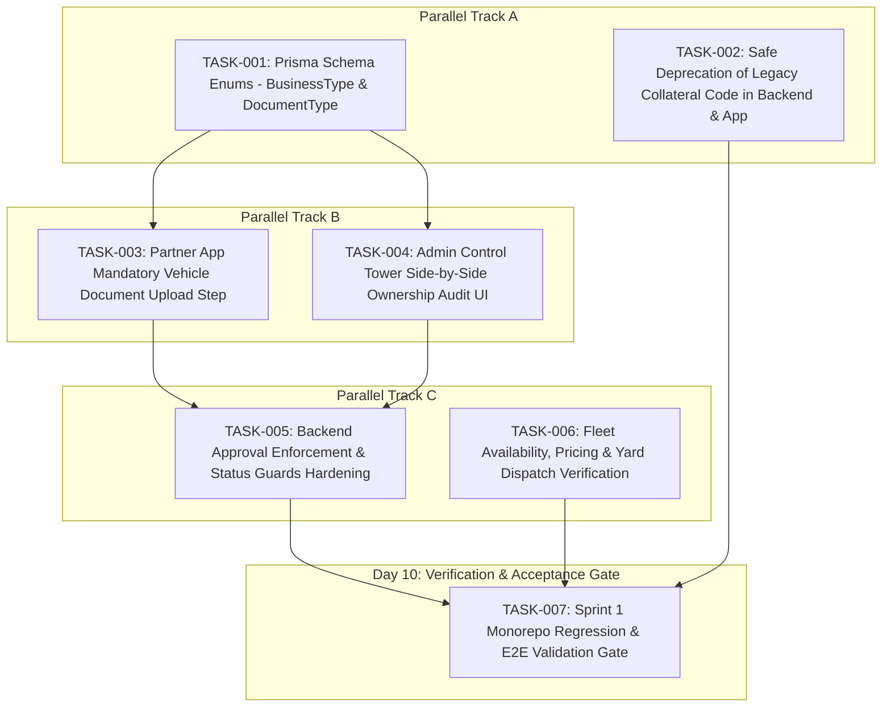

# DriveGo — Next Sprint Implementation Plan (Sprint 1 & Roadmap)

**Document Reference**: `docs/product/DRIVEGO_NEXT_SPRINT_IMPLEMENTATION_PLAN.md`  
**Classification**: Authoritative Tactical Execution Plan  
**Effective Date**: November 9, 2026  
**Author**: Chief Technology Officer & Technical Delivery Lead  
**Repository**: `https://github.com/saicharanrao21/car_rental_monorepo`  
**Git Baseline Commit**: `b87cfe90527c801172529290b96f3d7c0200b941` (Branch: `main`)  
**Status**: APPROVED REVISED SPRINT 1 BLUEPRINT — IMPLEMENTATION STATUS: PENDING EXPLICIT FOUNDER APPROVAL  

---

> [!CAUTION]
> **Implementation Authorization Directive**: This document defines the recommended tactical execution blueprint for Sprint 1. **NO IMPLEMENTATION AUTHORIZATION HAS BEEN GRANTED**. All engineering implementation remains strictly `PENDING EXPLICIT FOUNDER APPROVAL`.

---

## 1. Sprint 1 Overview & Business Outcome (P0 Marketplace Foundation)

```
========================================================================================
                                    SPRINT 1 SUMMARY
========================================================================================
Sprint Theme       : Priority 0 — Launch-Critical Marketplace Foundation
Duration           : 10 Working Days (2 Weeks)
Primary Objective  : Complete and verify the end-to-end dealer onboarding and vehicle
                     verification pipeline: extend commercial schema enums, implement
                     mandatory statutory vehicle document uploads in the Partner App,
                     build the side-by-side ownership audit UI in the Admin Control Tower,
                     tighten backend status guards, and safely deprecate legacy physical
                     collateral code.
Key Business Outcome: Enable commercial rental dealers to apply with 1+ dealer-owned cars,
                     submit authentic commercial documents, provide admin officers with
                     an unbypasable ownership verification workspace, and ensure zero
                     unapproved or suspended vehicles can appear in search or receive bookings.
========================================================================================
```

---

## 2. Sprint 1 Task Breakdown & Dependency Sequencing



### 2.1 Detailed Task Specifications

#### [TASK-001] Prisma Schema Enums Expansion (`BusinessType`, `DocumentType`)
- **Priority**: P0 (Marketplace Foundation)
- **Role**: Senior Database Architect
- **Duration**: 1.5 Days
- **Files**: `car_rental_backend/prisma/schema.prisma`
- **Scope**:
  1. Add `PROPRIETORSHIP`, `PARTNERSHIP`, `LLP`, `PRIVATE_LIMITED`, `PUBLIC_LIMITED` to `enum BusinessType`.
  2. Add `FITNESS_CERTIFICATE`, `POLLUTION_UNDER_CONTROL`, `COMMERCIAL_PERMIT`, `GST_CERTIFICATE`, `BANK_CANCELLED_CHEQUE`, `RENT_A_CAB_LICENSE` to `enum DocumentType`. (Note: `FITNESS_CERTIFICATE` and `RENT_A_CAB_LICENSE` support conditional upload flows and must remain non-blocking until qualified legal counsel confirms applicability to DriveGo's specific vehicle classes and launch state).
  3. Generate Prisma migration: `npx prisma migrate dev --name add_dealer_enums --create-only`.
- **DoD**: Schema compiles cleanly; `prisma generate` passes with zero diagnostics.

#### [TASK-002 / TASK-P0-06] Safe Deprecation of Legacy Collateral Code across Backend & App
- **Priority**: P0 (Launch-Critical Safety & Debt Remediation)
- **Safety Rationale**: The founder strictly confirmed pure monetary deposit holding: DriveGo prohibits physical custody of original identity documents, physical cash, and customer vehicles as part of its security-deposit mechanism. Any statutory liability implications under the DPDP Act or Motor Vehicles Act remain PENDING WRITTEN LEGAL COUNSEL CONFIRMATION. Removing physical custody options from the Partner App handover wizard and backend deposit services eliminates architectural debt and aligns runtime flows with the approved business model.
- **Role**: Full-Stack Engineer
- **Duration**: 1 Day
- **Files**: 
  - `car_rental_backend/src/deposits/deposits.service.ts`
  - `car_rental_backend/src/deposits/deposits.controller.ts`
  - `apps/vendor_app/lib/features/bookings/presentation/pages/handover_inspection_page.dart`
  - `apps/customer_app/lib/features/my_bookings/presentation/widgets/booking_detail_deposit_card.dart`
  - `packages/models/lib/src/security_deposit_model.dart`
- **Scope**:
  1. In `handover_inspection_page.dart`, remove the "Tri-Option Collateral Verification" selector (lines 740–860). Enforce that all vehicle handovers verify monetary online deposit payment only, removing physical key/document custody liabilities.
  2. In `deposits.service.ts`, remove line 227 check (`isCollateral`); ensure all releases invoke payment gateway refunds. Deprecate controller endpoints.
  3. Remove collateral chip from `booking_detail_deposit_card.dart`.
  4. Mark `CollateralType` in `security_deposit_model.dart` as deprecated.
  5. Update unit tests in `deposits.spec.ts`.
- **DoD**: Backend unit tests pass 100%; Flutter apps compile cleanly without collateral custody UI; zero references to active physical collateral processing.

#### [TASK-003] Partner App Vehicle Document Upload Step
- **Priority**: P0 (Marketplace Foundation)
- **Role**: Flutter Engineer
- **Duration**: 2 Days
- **Files**: `apps/vendor_app/lib/features/fleet/presentation/pages/add_edit_car_page.dart`
- **Scope**:
  1. Insert Step 4 into the vehicle creation wizard: "Statutory & Fleet Documents".
  2. Add file pickers for Commercial RC, Commercial Insurance, Pollution Under Control (PUC), Form 38 Fitness Certificate (conditional), and Rent-a-Cab License (conditional).
  3. Enforce client-side validation requiring Commercial RC Book and Insurance for initial submission. Form 38 Fitness Certificate and Rent-a-Cab Scheme licensing remain strictly conditional document fields pending written transport legal counsel determination for the specific vehicle category and launch jurisdiction.
- **DoD**: Vehicle cannot be submitted without attached RC and Insurance; conditional documents (Form 38, Rent-a-Cab license) remain optional/configurable based on fleet profile; uploaded documents persist and display in Admin Control Tower.

#### [TASK-004] Admin Control Tower Side-by-Side Ownership Audit UI
- **Priority**: P0 (Marketplace Foundation)
- **Role**: Flutter Web Engineer
- **Duration**: 2.5 Days
- **Files**: `apps/admin_panel/lib/features/fleet/`, `apps/admin_panel/lib/core/widgets/admin_shell.dart`
- **Scope**:
  1. Build side-by-side audit interface in `/admin/fleet/:id` comparing dealer legal profile with uploaded RC image.
  2. Implement 5-point checklist (Registered Name Match, Plate Match, Commercial Class, Insurance, Fitness).
  3. Record structured approval/rejection notes in `VehicleAuditLog`.
- **DoD**: Admin can review and approve/reject vehicle with full auditable event log.

#### [TASK-005] Backend Approval Enforcement & Status Guards Hardening
- **Priority**: P0 (Marketplace Foundation)
- **Role**: Senior Backend Engineer
- **Duration**: 1.5 Days
- **Files**: `car_rental_backend/src/cars/cars.service.ts`, `car_rental_backend/src/bookings/bookings.service.ts`
- **Scope**:
  1. Verify and reinforce server-side guards preventing unapproved, draft, or suspended vehicles from customer search or booking.
  2. Enforce that direct API calls to `PATCH /api/v1/cars/:id` cannot alter `verificationStatus` or `operationalStatus` (Admin-only capability).
  3. Add automated integration test asserting that unauthorized booking attempts return HTTP 400/403.
- **DoD**: Concurrency and security integration tests assert 100% rejection of unapproved vehicles across all endpoints.

#### [TASK-006] Fleet Availability, Pricing & Yard Dispatch Verification
- **Priority**: P0 (Marketplace Foundation)
- **Role**: Backend & Flutter Engineer
- **Duration**: 1 Day
- **Files**: `car_rental_backend/src/cars/`, `apps/vendor_app/lib/features/fleet/`
- **Scope**:
  1. Verify calendar date blocking (`VehicleBlock`) from Partner App.
  2. Verify that newly created vehicles correctly associate with genuine dealer physical operating yards (`model PickupHub` with `locationType: VENDOR_YARD`).
  3. Verify daily, hourly, and extra-km price validation.
- **DoD**: Partner can block dates, set prices, and assign yards; changes reflect immediately in backend query responses.

#### [TASK-007] Sprint 1 Regression & E2E Validation Gate
- **Priority**: P0 (Acceptance Gate)
- **Role**: QA Lead & CTO
- **Duration**: 0.5 Day
- **Scope**:
  1. Run full monorepo analysis (`flutter analyze` across all 3 apps, `npm run build` in backend).
  2. Execute end-to-end dealer onboarding on virtual device (1-vehicle minimum).
  3. Inspect Admin Control Tower audit interface in Chrome.
- **DoD**: Zero regression errors; all acceptance criteria signed off.

---

## 3. Four-Sprint Release Roadmap (Prioritized Sequencing)

```
+---------------------------------------------------------------------------------------------------+
|                                 FOUR-SPRINT RELEASE ROADMAP                                       |
+----------+-------------------------------------+--------------------------------------------------+
| Milestone| Priority Scope                      | Core Deliverables & Focus                        |
+----------+-------------------------------------+--------------------------------------------------+
| **Sprint 1** | **Priority 0: Marketplace Foundation**  | Commercial enums, vehicle document upload, side- |
|          |                                     | by-side RC ownership audit, collateral cleanup,  |
|          |                                     | and backend approval enforcement.                |
+----------+-------------------------------------+--------------------------------------------------+
| **Sprint 2** | **Priority 1: Booking & Lifecycle**     | Search hardening, double-booking concurrency     |
|          |                                     | suite, 3-stage customer KYC gate (FND-CONF-11),  |
|          |                                     | 6-condition hybrid booking (FND-CONF-08, 14),    |
|          |                                     | cancellation on rental fare only (FND-CONF-09,12,|
|          |                                     | 13; FND-UNRES-02 delivery fee parameterization), |
|          |                                     | 3-phase Telangana rollout (FND-CONF-10, 15),     |
|          |                                     | and 7-point handover checklist (FND-CONF-16).    |
+----------+-------------------------------------+--------------------------------------------------+
| **Sprint 3** | **Priority 2: Finance & Governance**    | Versioned `CommissionPolicyConfig` (global +     |
|          |                                     | dealer negotiated agreements with 4-tier         |
|          |                                     | precedence) & `DepositPolicyConfig` (global +    |
|          |                                     | dealer overrides with field-level inheritance),  |
|          |                                     | immutable booking snapshots, quote TTL revalidation|
|          |                                     | gate, dispute maker-checker, and deposit holding ledger.|
+----------+-------------------------------------+--------------------------------------------------+
| **Sprint 4** | **Priority 3: Reliability & Maturity**  | Admin navigation consolidation (7 clusters),     |
|          |                                     | TOTP MFA hardening with backup recovery codes,   |
|          |                                     | telemetry, monitoring, and operational reports.  |
+----------+-------------------------------------+--------------------------------------------------+
```
