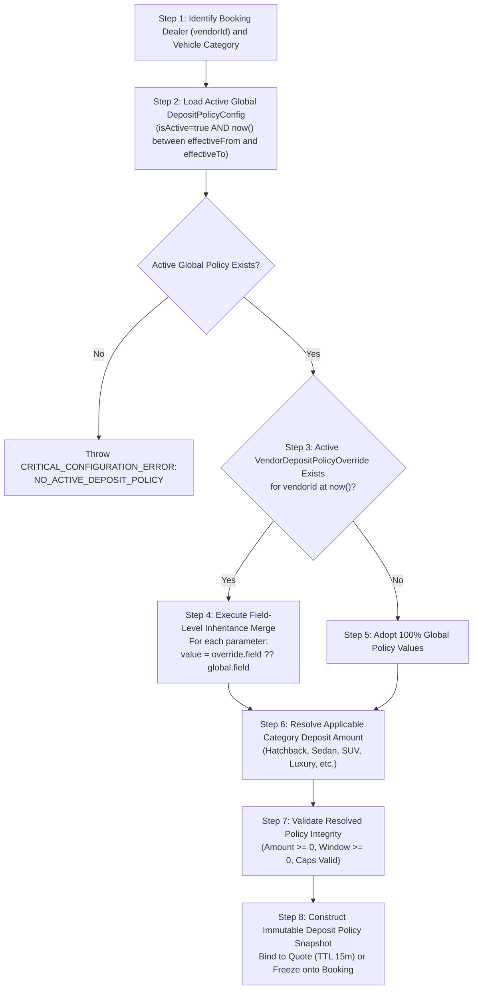

# DriveGo — Security Deposit Policy Configuration Specification

**Document Reference**: `docs/product/DRIVEGO_SECURITY_DEPOSIT_CONFIG_SPEC.md`  
**Classification**: Authoritative Financial Policy Specification  
**Effective Date**: November 9, 2026  
**Author**: Chief Technology Officer, FinTech Systems Architect & Delivery Lead  
**Repository**: `https://github.com/saicharanrao21/car_rental_monorepo`  
**Git Baseline Commit**: `b87cfe90527c801172529290b96f3d7c0200b941` (Branch: `main`)  
**Status**: APPROVED RECONCILED CONFIGURATION SPECIFICATION — IMPLEMENTATION STATUS: PENDING EXPLICIT FOUNDER APPROVAL  

---

> [!CAUTION]
> **Implementation Authorization Directive**: This specification defines security deposit policy models and workflows. **NO IMPLEMENTATION AUTHORIZATION HAS BEEN GRANTED**. All engineering implementation remains strictly `PENDING EXPLICIT FOUNDER APPROVAL`.

---

## 1. Executive Summary & Founder Directives

```
========================================================================================
             FOUNDER-CONFIRMED DIRECTIVES: SECURITY DEPOSIT POLICY
========================================================================================
1. ADMIN CONTROLS GLOBAL DEFAULT POLICY:
   Authorized Admin users control the default security deposit policy across DriveGo.
   Admin determines the initial launch default. The founder does not select a fixed
   release schedule or deposit amount in advance.
2. ZERO HARDCODED BUSINESS DEFAULTS:
   No business-policy amount, release window, or release schedule may be silently
   selected by a database default or code fallback. All policy values must be explicitly
   configured, submitted, and approved by authorized Admin users.
3. CONTROLLED CONFIGURATION ERROR ON MISSING POLICY:
   If no approved global deposit policy is active, the system produces a controlled
   system error (CRITICAL_CONFIGURATION_ERROR: NO_ACTIVE_DEPOSIT_POLICY). The platform
   must NEVER fall back to an invented or hardcoded constant.
4. DYNAMIC ADMIN MUTATION:
   Admin can change the global default policy whenever commercially or operationally required.
5. DEALER-SPECIFIC POLICY CONFIGURATION:
   Admin can configure and approve a separate security deposit policy for an individual dealer.
   Admin can modify an individual dealer's policy whenever required. Different dealers
   may operate under different approved deposit policies simultaneously.
6. FIELD-LEVEL INHERITANCE:
   Dealer-specific policies utilize explicit field-level overrides. Any field not
   explicitly overridden by the dealer inherits directly from the active global policy.
7. CRITICAL FINANCIAL SNAPSHOT PROTECTION:
   Quotes hold provisional deposit snapshots (TTL 15 min). Confirmed bookings capture
   the finalized immutable deposit policy snapshot. Zero retroactive recalculation.
8. PURE MONETARY HOLDING ONLY:
   DriveGo prohibits physical custody of original identity documents, physical cash, and customer vehicles as part of its security-deposit mechanism. Any statutory liability implications under the DPDP Act or Motor Vehicles Act remain PENDING WRITTEN LEGAL COUNSEL CONFIRMATION. As no legally established bank escrow trust arrangement exists, customer deposits are tracked via an internal pass-through holding ledger. GST treatment of refundable deposits and any forfeiture or damage compensation is pending written CA/tax-counsel determination. No exemption or non-taxable treatment is assumed (PENDING WRITTEN CA / TAX-COUNSEL APPROVAL).
========================================================================================
```

---

## 2. Configurable Policy Parameters & Data Dictionary

The Admin Control Tower governs security deposits through versioned global records (`DepositPolicyConfig`) and dealer-specific override records (`VendorDepositPolicyOverride`). 

> [!CAUTION]
> **Zero Database Defaults for Business Rules**: The table below lists parameter definitions and technical validation ranges. **All sample values are for illustration only and MUST NOT be used as database schema defaults**. Every parameter must be explicitly defined when an Admin creates a policy.

| Parameter Key | Data Type | Database Schema Default | Validation Range | Operational Purpose & Behavior |
| :--- | :--- | :---: | :--- | :--- |
| `releaseScheduleType` | Enum | **NONE** | `IMMEDIATE_AT_INSPECTION`, `POST_TRIP_HOURS`, `SPLIT_TWO_STAGE`, `MANUAL_ADMIN_RELEASE` | Governs automated deposit refund trigger mechanism. |
| `releaseWindowHours` | Integer | **NONE** | `0` to `168` hours | Post-trip buffer hours before automated gateway refund trigger. |
| `splitInstantPercentage` | Decimal(5,2)? | **NONE** | `0.00%` to `100.00%` (Mandatory if `SPLIT_TWO_STAGE`) | For two-stage release: percentage refunded immediately upon vehicle check-in. |
| `splitHoldWindowHours` | Integer? | **NONE** | `0` to `168` hours (Mandatory if `SPLIT_TWO_STAGE`) | For two-stage release: holding duration for remaining balance. |
| `tierHatchbackAmount` | Decimal(10,2) | **NONE** | $\ge 0.00$ | Baseline monetary deposit required for Hatchback category rentals. |
| `tierSedanAmount` | Decimal(10,2) | **NONE** | $\ge 0.00$ | Baseline monetary deposit required for Sedan / Compact SUV rentals. |
| `tierSuvAmount` | Decimal(10,2) | **NONE** | $\ge 0.00$ | Baseline monetary deposit required for Full-size SUV / 7-Seater rentals. |
| `tierLuxuryAmount` | Decimal(10,2) | **NONE** | $\ge 0.00$ | Baseline monetary deposit required for Luxury / Premium segment rentals. |
| `tierTempoAmount` | Decimal(10,2) | **NONE** | $\ge 0.00$ | Baseline monetary deposit required for Tempo Traveller rentals. |
| `tierMiniBusAmount` | Decimal(10,2) | **NONE** | $\ge 0.00$ | Baseline monetary deposit required for Mini Bus commercial rentals. |
| `disputeHoldEnabled` | Boolean | **NONE** | `true` / `false` | When `true`, flagging an unresolved return dispute freezes 100% of deposit in the holding ledger. |
| `damageDeductionCap` | Decimal(10,2) | **NONE** | $\ge 0.00$ | Maximum deduction permitted without secondary Maker-Checker supervisor sign-off. |
| `challanBufferAmount` | Decimal(10,2)? | **NONE** | $\ge 0.00$ | Optional temporary retention specifically for high-risk interstate highway rentals. |
| `effectiveFrom` | DateTime | **NONE** | Valid ISO 8601 | Timestamp from which this policy version or dealer override takes legal effect. |
| `effectiveTo` | DateTime? | `NULL` | Valid ISO 8601 or NULL | Optional expiration timestamp after which the policy/override is retired. |

---

## 3. Global Policy vs Dealer-Specific Policy Architecture

### 3.1 Global Policy (`DepositPolicyConfig`)
- Governed centrally by SuperAdmin and Finance Controller.
- Exactly **one** global policy is `isActive = true` for any given timestamp.
- **Mandatory Admin Initial Setup**: Platform cannot process quotes or bookings without an activated global policy. If no active policy exists, backend throws `CRITICAL_CONFIGURATION_ERROR: NO_ACTIVE_DEPOSIT_POLICY`.
- Scheduled versions can be created with future `effectiveFrom` dates without affecting current operations.

### 3.2 Dealer-Specific Policy Override (`VendorDepositPolicyOverride`)
- Admin can configure custom terms for an individual dealer (e.g. established luxury fleet partner requiring higher deposits, or strategic anchor dealer offering faster refunds).
- Explicitly linked to a specific `vendorId`.
- **Nullable Field-Level Customization**:
  - If a dealer override specifies `tierSedanAmount = 7000.00`, Sedan rentals for that dealer require ₹7,000.
  - If the dealer override leaves `tierHatchbackAmount = NULL`, Hatchback rentals for that dealer **inherit** `tierHatchbackAmount` from the active global policy.
  - If the dealer override leaves `releaseWindowHours = NULL`, release timing inherits directly from the global policy.
- Independent lifecycle status: `DRAFT`, `PENDING_APPROVAL`, `ACTIVE`, `RETIRED`, `REJECTED`.
- Governed by maker-checker controls: Authoring admin submits proposal with documented business rationale; SuperAdmin or Finance Controller signs off.

---

## 4. Deterministic Deposit Policy Resolution Engine

When a booking quote is calculated or a reservation is confirmed, the backend executes an unambiguous, deterministic 8-step resolution algorithm:



### 4.1 Field-Level Merge Specification
$$\text{ResolvedField} = \begin{cases} \text{OverrideField}, & \text{if } \text{OverrideField} \text{ is not null} \\ \text{GlobalField}, & \text{if } \text{OverrideField} \text{ is null} \end{cases}$$

### 4.2 Lifecycle & Scheduled Expiration
- When a `VendorDepositPolicyOverride` reaches its `effectiveTo` timestamp, the override automatically deactivates.
- For all subsequent quotes and bookings, the dealer seamlessly falls back to 100% inheritance from the active global policy.
- Zero manual administrative intervention is required to retire expired dealer promotions.

---

## 5. Quote Validity, Re-Quotation & Booking Snapshot Invariant

### 5.1 The Binding Financial Snapshot Lifecycle
1. **Quote Generation (`POST /api/v1/bookings/quotes`)**:
   - Backend evaluates active global policy and dealer override for the requested car and dates.
   - Generates a provisional deposit calculation and embeds the resolved configuration in `quote.metadata.depositPolicySnapshot`.
   - Quote has a strict **15-minute Time-To-Live (TTL)** (`expiresAt = createdAt + 15 minutes`).
   - **Crucial Rule**: The quote snapshot is provisional and must NEVER be used directly as the final booking financial record without confirmation revalidation.
2. **Checkout Confirmation Gate (`POST /api/v1/bookings`)**:
   - Backend validates `now() <= quote.expiresAt`. If expired, returns `HTTP 409 Conflict: QUOTE_EXPIRED`.
   - Backend performs atomic policy version revalidation: checks if `DepositPolicyConfig.version` or `VendorDepositPolicyOverride.version` has changed since quote generation.
   - **Policy Mutation During Checkout**: If policy changed and calculated deposit differs, the system **rejects** confirmation with `HTTP 409 Conflict: POLICY_UPDATED_REQUOTE_REQUIRED`, returning an itemized delta to the customer. The customer must review and accept the updated terms.
3. **Confirmed Booking Immutability**:
   - Once payment is authorized, the resolved policy is permanently committed to `Booking.depositPolicySnapshot` (JSON) and `Booking.securityDeposit.amount`.
   - From that moment forward, subsequent global policy updates, dealer policy changes, or override expirations **never** touch that booking.
   - The automated deposit refund daemon reads **exclusively** from `Booking.depositPolicySnapshot`.
   - Historical bookings and completed deposit settlements are **never recalculated**.
4. **Concurrency, Retries & Duplicate Protection**:
   - Confirmation requests mandate an `idempotencyKey`. Concurrent requests for the same quote acquire a Redis distributed lock (`lock:booking:quote:${quoteId}`).
   - Duplicate confirmation requests after payment authorization return the already-confirmed booking representation without re-executing transactions.
   - Payment gateway webhook retries (`payment.captured`) verify HMAC SHA256 signatures, check `Booking.status`, and idempotently acknowledge duplicate delivery without re-triggering holding ledger entries.

---

## 6. Proposed Database Architecture (Prisma Models)

```prisma
// ============================================================================
// GLOBAL DEPOSIT POLICY CONFIGURATION (VERSIONED - ZERO BUSINESS DEFAULTS)
// ============================================================================
model DepositPolicyConfig {
  id                      String                  @id @default(cuid())
  version                 Int                     @unique
  name                    String                  // e.g. "DriveGo Master Deposit Policy - Launch v1"
  releaseScheduleType     DepositReleaseSchedule  // NO DEFAULT - Must be explicitly configured by Admin
  releaseWindowHours      Int                     // NO DEFAULT - Configured hours (0 to 168)
  splitInstantPercentage  Decimal?                @db.Decimal(5, 2) // Nullable if not SPLIT_TWO_STAGE
  splitHoldWindowHours    Int?                    // Nullable if not SPLIT_TWO_STAGE
  tierHatchbackAmount     Decimal                 @db.Decimal(10, 2) // NO DEFAULT - Explicit Admin configuration
  tierSedanAmount         Decimal                 @db.Decimal(10, 2) // NO DEFAULT
  tierSuvAmount           Decimal                 @db.Decimal(10, 2) // NO DEFAULT
  tierLuxuryAmount        Decimal                 @db.Decimal(10, 2) // NO DEFAULT
  tierTempoAmount         Decimal                 @db.Decimal(10, 2) // NO DEFAULT
  tierMiniBusAmount       Decimal                 @db.Decimal(10, 2) // NO DEFAULT
  disputeHoldEnabled      Boolean                 // NO DEFAULT - Explicit boolean
  damageDeductionCap      Decimal                 @db.Decimal(10, 2) // NO DEFAULT
  challanBufferAmount     Decimal?                @db.Decimal(10, 2)
  isActive                Boolean                 @default(false)    // Technical default: inactive until approved
  effectiveFrom           DateTime
  effectiveTo             DateTime?
  createdByAdminId        String
  approvedByAdminId       String?                 // Maker-Checker sign-off
  status                  ConfigApprovalStatus    @default(DRAFT)    // Technical default: draft
  changeReason            String
  createdAt               DateTime                @default(now())    // Technical default: timestamp
  updatedAt               DateTime                @updatedAt
  auditLogs               DepositPolicyAuditLog[]

  @@index([isActive, effectiveFrom])
  @@index([status])
}

// ============================================================================
// DEALER-SPECIFIC DEPOSIT POLICY OVERRIDES (FIELD-LEVEL INHERITANCE)
// ============================================================================
model VendorDepositPolicyOverride {
  id                      String                  @id @default(cuid())
  vendorId                String
  vendor                  Vendor                  @relation(fields: [vendorId], references: [id], onDelete: Cascade)
  version                 Int                     @default(1)
  agreementReference      String?                 // Contract or ticket reference
  // Nullable fields: NULL means inherit directly from active DepositPolicyConfig
  releaseScheduleType     DepositReleaseSchedule?
  releaseWindowHours      Int?
  splitInstantPercentage  Decimal?                @db.Decimal(5, 2)
  splitHoldWindowHours    Int?
  tierHatchbackAmount     Decimal?                @db.Decimal(10, 2)
  tierSedanAmount         Decimal?                @db.Decimal(10, 2)
  tierSuvAmount           Decimal?                @db.Decimal(10, 2)
  tierLuxuryAmount        Decimal?                @db.Decimal(10, 2)
  tierTempoAmount         Decimal?                @db.Decimal(10, 2)
  tierMiniBusAmount       Decimal?                @db.Decimal(10, 2)
  disputeHoldEnabled      Boolean?
  damageDeductionCap      Decimal?                @db.Decimal(10, 2)
  challanBufferAmount     Decimal?                @db.Decimal(10, 2)
  isActive                Boolean                 @default(false)
  effectiveFrom           DateTime
  effectiveTo             DateTime?
  createdByAdminId        String
  approvedByAdminId       String?                 // Maker-Checker sign-off
  status                  ConfigApprovalStatus    @default(DRAFT)
  negotiationReason       String
  createdAt               DateTime                @default(now())
  updatedAt               DateTime                @updatedAt
  auditLogs               VendorDepositAuditLog[]

  @@index([vendorId, isActive, effectiveFrom])
  @@index([status])
}

// ============================================================================
// AUDIT LOGGING FOR POLICY MUTATIONS (PROTECTED FROM CASCADE DELETION)
// ============================================================================
model DepositPolicyAuditLog {
  id                      String                  @id @default(cuid())
  policyConfigId          String
  policyConfig            DepositPolicyConfig     @relation(fields: [policyConfigId], references: [id], onDelete: Restrict)
  adminId                 String
  action                  String                  // CREATED, PROPOSED, APPROVED, ACTIVATED, RETIRED, REJECTED
  previousPayload         Json?
  newPayload              Json
  reason                  String
  timestamp               DateTime                @default(now())

  @@index([policyConfigId])
  @@index([adminId])
}

model VendorDepositAuditLog {
  id                      String                      @id @default(cuid())
  overrideId              String
  override                VendorDepositPolicyOverride @relation(fields: [overrideId], references: [id], onDelete: Restrict)
  adminId                 String
  action                  String
  previousPayload         Json?
  newPayload              Json
  reason                  String
  timestamp               DateTime                    @default(now())

  @@index([overrideId])
  @@index([adminId])
}

enum DepositReleaseSchedule {
  IMMEDIATE_AT_INSPECTION
  POST_TRIP_HOURS
  SPLIT_TWO_STAGE
  MANUAL_ADMIN_RELEASE
}
```

---

## 7. Operational Roles, Permissions & Security Enforcements

1. **Cross-Dealer Isolation**: Dealer A cannot read, query, edit, or infer Dealer B's deposit policy overrides. Every vendor query in `VendorDepositPolicyService` is strictly scoped to `where: { vendorId: session.vendorId }`.
2. **Dealer Mutation Prohibition**: Ordinary dealers have **zero** write access to platform deposit policies or their own overrides (`HTTP 403 Forbidden`). Only authorized Admin roles can create or modify overrides.
3. **Zero Dealer Debit/Release Capability**: Dealers cannot unilaterally debit customer deposits or execute refunds. All deposit deductions require photographic evidence submitted through the formal damage claim workflow (`/api/v1/damage-claims`).
4. **Maker-Checker Protocol**:
   - `OPERATIONS_AGENT` / `FINANCE_CONTROLLER`: Can author a proposed policy or override.
   - `SUPER_ADMIN`: Must execute the cryptographic sign-off (`approvedByAdminId`) before a policy transitions to `ACTIVE`.

---

## 8. Customer & Partner App Experience

### 8.1 Customer Transparency
- Vehicle details screen displays the exact resolved deposit amount and holding conditions before booking.
- Fare breakdown shows deposit as a refundable deposit holding line item.
- Confirmation voucher and PDF receipt itemize deposit terms explicitly.

### 8.2 Partner / Dealer Visibility
- Partner App booking detail card displays: *"Security Deposit Status: HELD IN DEPOSIT ACCOUNT"*.
- Inspection screen verifies deposit payment before vehicle key release.
- Dealer view shows release schedule and damage claim deadline, with zero access to divert customer funds.

---

## 9. Monorepo Legacy `COLLATERAL:` Trace & Safe Deprecation Plan

A deterministic monorepo trace confirmed that collateral references exist as experimental physical token code across backend services and Flutter widgets:

```
+---------------------------------------------------------------------------------------------------------+
|                                    LEGACY COLLATERAL CODE INVENTORY                                     |
+------------------------------------------------------+---------------+----------------------------------+
| File Path                                            | Occurrences   | Functional Role & Scope          |
+------------------------------------------------------+---------------+----------------------------------+
| `car_rental_backend/src/deposits/deposits.service.ts`| 47 occurrences| Core backend service logic       |
| `car_rental_backend/src/deposits/deposits.controller`| 8 occurrences | @Post/Get collateral endpoints   |
| `car_rental_backend/src/deposits/deposits.spec.ts`   | 29 occurrences| Unit tests lines 285–440         |
| `car_rental_backend/src/deposits/dto/*.ts`           | 5 occurrences | DTOs for record/release          |
| `packages/models/lib/src/security_deposit_model.dart`| 32 occurrences| Dart CollateralType enum & model |
| `packages/models/test/deposit_and_damage_claim_test` | 7 occurrences | Model serialization unit tests   |
| `apps/vendor_app/lib/.../handover_inspection_page`   | 36 occurrences| Tri-option UI selector in wizard |
| `apps/customer_app/lib/.../booking_detail_deposit`   | 14 occurrences| UI badge for collateral type     |
| `apps/customer_app/test/security_deposit_card_test`  | 6 occurrences | Widget tests                     |
+------------------------------------------------------+---------------+----------------------------------+
```

### 9.1 Ground-Truth Database Findings
- Database query: `SELECT COUNT(*) FROM "SecurityDeposit" WHERE "razorpayPaymentId" LIKE 'COLLATERAL:%'` returned **exactly 0 records**.
- Zero active rentals or deposits rely on physical collateral tokens.

### 9.2 Safe Deprecation Roadmap (Sprint 1 Priority 0 Safety Task)
1. **Partner App (`handover_inspection_page.dart`)**: Remove the tri-option selector (lines 740–860). Enforce that all vehicle handovers verify online monetary deposit holding only, upholding the founder's strict prohibition on physical document, cash, and vehicle custody.
2. **Customer App (`booking_detail_deposit_card.dart`)**: Remove collateral badges; display standard monetary deposit holding status.
3. **Shared Models (`security_deposit_model.dart`)**: Mark `CollateralType` as deprecated with fallback to monetary online.
4. **Backend Deposit Service (`deposits.service.ts`)**: Remove the line 227 bypass check (`isCollateral`); ensure all deposit releases invoke payment gateway refunds. Deprecate controller endpoints.

---

## 10. Documented Acceptance-Test Matrix

> [!NOTE]
> **ACCEPTANCE TEST SPECIFICATION (TEST DATA ONLY)**: All rupee amounts and schedules in the matrix below are strictly test fixture values designed to validate state transitions, boundary conditions, and precedence logic. **None represents an approved production launch value.**
> 
> **Verification Status Key**:
> - `TEST CASE DOCUMENTED`: Fully specified in documentation; awaiting sprint implementation.
> - `TEST IMPLEMENTED`: Test suite code written in repository.
> - `TEST EXECUTED`: Executed in local / CI environment.
> - `TEST PASSED`: Verified passing with reproducible evidence.
> - `NOT VERIFIED`: Requires live third-party runtime or physical hardware.

| Scenario ID | Test Scenario Description | Setup & Execution [TEST DATA ONLY] | Expected Outcome & Invariant Verification | Verification Status |
| :---: | :--- | :--- | :--- | :---: |
| **TEST-DEP-01** | **Dealer A inherits global deposit policy** | Global: Hatchback ₹3k, Sedan ₹5k, 48h. Dealer A has zero overrides. | Sedan booking resolves to ₹5,000 and 48h release window directly from global policy. | **TEST CASE DOCUMENTED** |
| **TEST-DEP-02** | **Dealer B has custom deposit amount** | Global: Sedan ₹5k, 48h. Dealer B override: `tierSedanAmount = ₹7,000`, `releaseWindowHours = null`. | Sedan booking resolves to ₹7,000 deposit; release window inherits 48h from global policy. | **TEST CASE DOCUMENTED** |
| **TEST-DEP-03** | **Dealer C has custom release schedule** | Global: Sedan ₹5k, 48h. Dealer C override: `releaseScheduleType = SPLIT_TWO_STAGE` (80/20), `tierSedanAmount = null`. | Sedan booking requires ₹5,000 deposit; refund daemon executes 80% instant / 20% held split. | **TEST CASE DOCUMENTED** |
| **TEST-DEP-04** | **Dealer D has custom amount and custom schedule** | Global: SUV ₹8k, 48h. Dealer D override: `tierSuvAmount = ₹12,000`, `releaseScheduleType = IMMEDIATE_AT_INSPECTION`. | SUV booking resolves to ₹12,000 deposit and immediate post-inspection refund trigger. | **TEST CASE DOCUMENTED** |
| **TEST-DEP-05** | **Global policy changes with existing overrides** | Global updates from v1 to v2 (Sedan changed to ₹6k). Dealer A has no override; Dealer B has ₹7k Sedan override. | Dealer A quotes immediately reflect ₹6,000. Dealer B quotes retain ₹7,000 override while inheriting non-overridden v2 updates. | **TEST CASE DOCUMENTED** |
| **TEST-DEP-06** | **Dealer-specific policy change without affecting other dealers** | Admin updates Dealer B's Sedan override to ₹7,500. | Dealer B quotes reflect ₹7,500. Dealer A, C, and D quotes remain completely unchanged. | **TEST CASE DOCUMENTED** |
| **TEST-DEP-07** | **Override expiration and automatic fallback** | Dealer B override has `effectiveTo = 2026-11-10T00:00:00Z`. At `11-10T00:01:00Z`, customer requests quote. | Dealer B quote automatically resolves to 100% inheritance from active global policy. | **TEST CASE DOCUMENTED** |
| **TEST-DEP-08** | **Concurrent policy update during quote checkout** | Customer holds 15-minute quote under v1. Admin activates v2 policy with different deposit. Customer clicks Pay. | Backend rejects confirmation with `HTTP 409 Conflict: POLICY_UPDATED_REQUOTE_REQUIRED`. Itemized delta displayed to customer. | **TEST CASE DOCUMENTED** |
| **TEST-DEP-09** | **Quote expiry and requote gate** | Customer generates quote. Customer attempts checkout at minute 16. | Backend rejects confirmation with `HTTP 409 Conflict: QUOTE_EXPIRED`. Client prompts for new quote. | **TEST CASE DOCUMENTED** |
| **TEST-DEP-10** | **Confirmed booking immutability** | Booking confirmed under v1 policy. Global policy updates to v2. | Booking's `depositPolicySnapshot` remains v1. Deposit refund daemon executes v1 release schedule. | **TEST CASE DOCUMENTED** |
| **TEST-DEP-11** | **Completed settlement immutability** | Deposit refunded and settled. Policy subsequently altered. | Completed deposit holding ledger entries are never recalculated or reopened. | **TEST CASE DOCUMENTED** |
| **TEST-DEP-12** | **Cross-dealer access attempts rejected** | Dealer A attempts to query `GET /api/v1/admin/vendors/{dealerB}/deposit-override`. | Backend returns `HTTP 403 Forbidden` / `HTTP 404 Not Found`. | **TEST CASE DOCUMENTED** |
| **TEST-DEP-13** | **Unauthorized dealer policy mutation** | Vendor attempts `POST /api/v1/admin/deposit-policies` or `PATCH /overrides`. | Backend guards reject with `HTTP 403 Forbidden`. | **TEST CASE DOCUMENTED** |
| **TEST-DEP-14** | **Maker-checker separation enforcement** | Same admin attempts to author and approve policy (`createdByAdminId === approvedByAdminId`). | System rejects activation with `HTTP 400 Bad Request: MAKER_CHECKER_VIOLATION`. | **TEST CASE DOCUMENTED** |
| **TEST-DEP-15** | **Duplicate requests & webhook retries** | Payment gateway delivers duplicate `payment.captured` webhook for already-confirmed booking. | System verifies HMAC SHA256, acknowledges HTTP 200, and prevents duplicate deposit holding entry creation. | **TEST CASE DOCUMENTED** |
| **TEST-DEP-16** | **Missing global policy error gate** | Database contains zero active global policies. Customer requests quote. | Backend throws `CRITICAL_CONFIGURATION_ERROR: NO_ACTIVE_DEPOSIT_POLICY`. Never invents fallback amount. | **TEST CASE DOCUMENTED** |

---

## 11. Technical Safeguards & Implementation Recommendations

1. **Audit Evidence Preservation**: Audit log relations MUST use `onDelete: Restrict` in Prisma. Policies must never be hard-deleted; decommissioned policies transition to `status: RETIRED`.
2. **PostgreSQL Partial Unique Index for Global Policy**: To physically prevent concurrent activations of multiple global policies, implement:
   ```sql
   CREATE UNIQUE INDEX unique_active_global_deposit_policy 
   ON "DepositPolicyConfig" ("isActive") 
   WHERE "isActive" = true;
   ```
3. **Overlapping Dealer Override Prevention**: Admin API must check `WHERE "vendorId" = :vendorId AND "isActive" = true AND tstzrange("effectiveFrom", coalesce("effectiveTo", 'infinity'::timestamptz)) && tstzrange(:newFrom, coalesce(:newTo, 'infinity'::timestamptz))` to prevent overlapping date windows.
4. **Millisecond Boundary Precision**: Queries must evaluate:
   `"effectiveFrom" <= now() AND ("effectiveTo" IS NULL OR "effectiveTo" > now())`.
5. **Atomic Serializable Transactions**: Policy resolution and snapshot commits at booking confirmation must be wrapped in `prisma.$transaction(async (tx) => { ... })` with row-level locks on the parent `Car` and `Vendor`.
