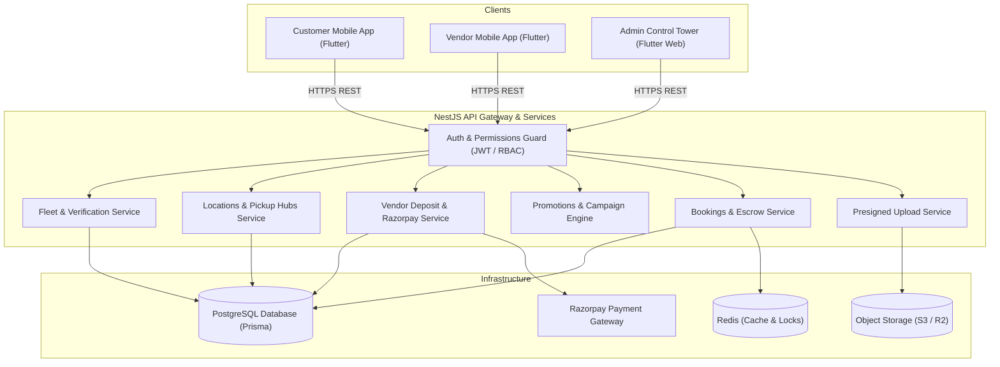
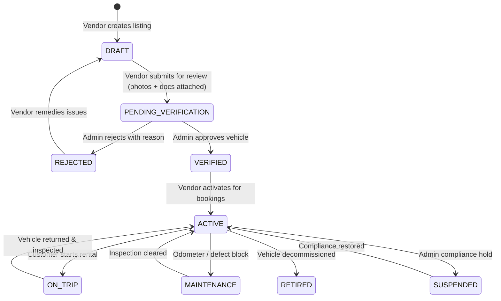
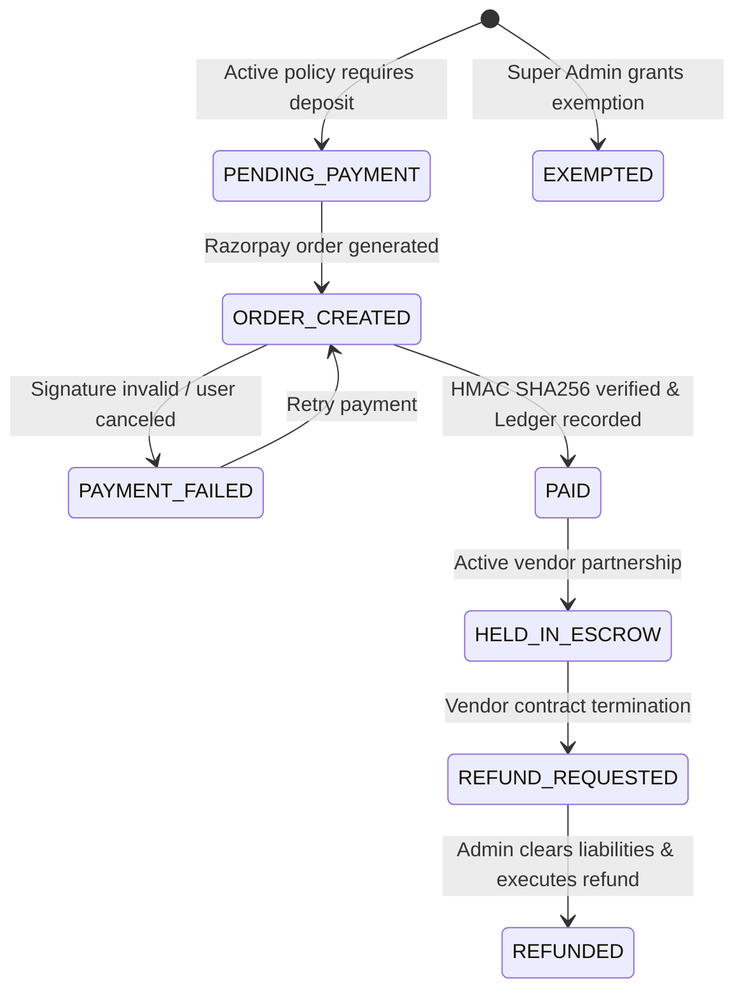
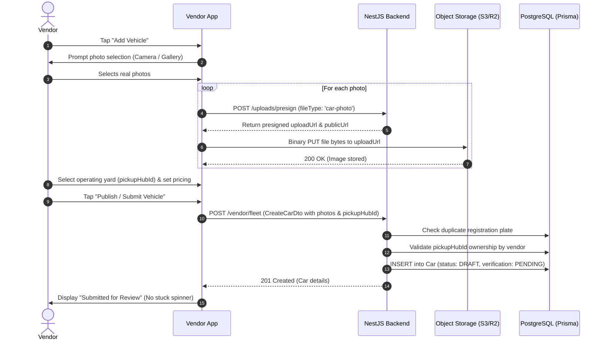
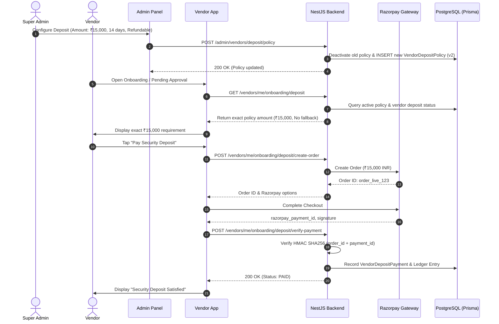

# DriveGo Self-Drive Mobility Marketplace — Technical Requirements Document (TRD)

**Document Reference:** `TRD-MKT-02`  
**Version:** 2.0.0-PROD  
**Author:** DriveGo Principal Software Architect & NestJS/Flutter Leads  
**Scope:** Architecture, Data Flow, Sequence Diagrams, State Machines, Concurrency, and Security  
**Status:** Approved for Implementation

---

## 1. System Architecture & Context

The DriveGo platform is structured as a modular distributed monolith in NestJS backed by PostgreSQL (Prisma ORM) and Redis, serving two Flutter mobile clients and a Flutter Web Control Tower.

---

## 2. Core State Machines

### 2.1 Vehicle Operational & Verification Lifecycle

### 2.2 Vendor Security Deposit Lifecycle

---

## 3. End-to-End Sequence Diagrams

### 3.1 Vehicle Creation, Photo Upload & Verification Submission

### 3.2 Authoritative Vendor Deposit Policy & Verification

---

## 4. Technical Concurrency & Data Integrity Strategy

1. **Transaction Boundaries:** Financial mutations (deposit payments, wallet deductions, payout approvals) execute strictly within `prisma.$transaction(async (tx) => ...)`.
2. **Idempotency:** Payment verification endpoints require unique `paymentId` keys. Replays are detected and return the cached success response without duplicate ledger entries.
3. **Optimistic Locking:** Vehicle booking reservations leverage Redis distributed locks (`redlock` on `carId:booking_dates`) to prevent double-booking across concurrent customer checkouts.
4. **Bounded Client Timeouts:** Mobile HTTP requests to fleet mutation endpoints enforce a 15-second timeout with explicit UI state recovery.

