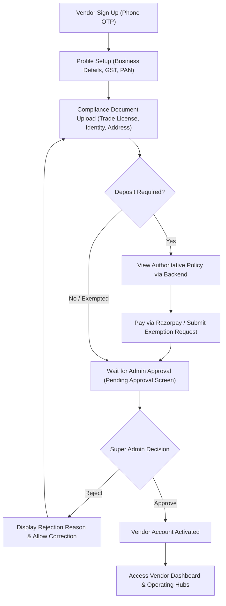

# DriveGo Self-Drive Mobility Marketplace — Vendor Onboarding & Fleet Workflow

**Document Reference:** `WORKFLOW-MKT-03`  
**Version:** 2.0.0-PROD  
**Author:** DriveGo Principal Software Architect & QA Lead  
**Scope:** Vendor Registration, KYC, Deposit Escrow, Vehicle Ingestion, and Fleet Operations  
**Status:** Approved for Implementation

---

## 1. Vendor Onboarding Lifecycle

---

## 2. Vehicle Ingestion & Publishing Workflow (Remediated)

### 2.1 The Prior Defect & Root Cause
- **Defect 1 (Stock Photos):** In `apps/vendor_app/lib/features/fleet/presentation/pages/add_edit_car_page.dart`, `samplePhotos` pre-populated mock Unsplash URLs. Clicking "Add Photo" cycled through sample images without opening the device gallery or camera.
- **Defect 2 (Stuck Spinner):** During vehicle publishing, if the backend returned validation errors (e.g. un-enabled trip types like `LOCAL` or missing vendor authorization) or experienced network latency, the UI remained in `_isSubmitting = true` with a full-screen loader, offering no error feedback, timeout, or retry mechanism.
- **Defect 3 (Fictional Hubs):** Vehicles picked from hardcoded strings (`['Main Hub', 'Airport Service Hub', 'Downtown Station']`) without associating genuine vendor operating locations (`pickupHubId`).

### 2.2 The Remediated Fleet Publishing Flow
1. **Basic Specifications:** Vendor enters Make, Model, Year, Body Category, Powertrain Fuel Type, Seating Capacity, and Registration Plate Number.
2. **Authentic Photos (Zero Stock Images):**
   - Vendor taps "Add Photo" -> Native bottom sheet presents "Take Photo (Camera)" or "Choose from Gallery".
   - The app verifies permissions, extracts selected image bytes, calls `POST /uploads/presign` with `fileType: 'car-photo'`, and PUTs bytes to object storage.
   - Live thumbnail previews render with a "Remove" button and upload progress bar.
   - Form requires at least 1 authentic uploaded photo to proceed.
3. **Rates & Trip Types:** Vendor configures Daily Rate, Hourly Rate, Per-Km Rate, and allowed trip types (`SELF_DRIVE`, `OUTSTATION`, `LOCAL`, `AIRPORT_TRANSFER`).
4. **Operating Yard Selection:**
   - App queries `GET /locations/vendors/me/hubs`.
   - If the vendor has no registered yards, the app prompts "Register Your Operating Yard" inline with address and coordinates.
   - Vendor selects their verified yard (`pickupHubId`).
5. **Bounded Submission & Status Feedback:**
   - App dispatches `POST /vendor/fleet` with a strict 15-second timeout.
   - Backend creates vehicle in `operationalStatus: DRAFT` and `verificationStatus: PENDING`.
   - On response, UI clears spinner, navigates to the Fleet Overview, and displays a success banner: `"Vehicle submitted for admin review"`.
   - If an error occurs, UI catches the server message, dismisses the spinner, displays the exact error in a floating SnackBar, and keeps form fields populated for retry.

---

## 3. Post-Publishing Fleet Governance & Status Matrix

| Vehicle Operational Status | Verification Status | Bookable on Marketplace? | Vendor Action Permitted | Admin Action Permitted |
|:---|:---|:---:|:---|:---|
| `DRAFT` | `PENDING` | ❌ No | Edit details, upload docs, submit for review | None |
| `DRAFT` | `VERIFIED` | ❌ No | Tap "Activate Vehicle" | View audit log |
| `ACTIVE` | `VERIFIED` | ✅ Yes | Set maintenance, toggle availability, edit rates | Suspend vehicle, inspect telemetry |
| `MAINTENANCE` | `VERIFIED` | ❌ No | Complete maintenance inspection | View maintenance logs |
| `SUSPENDED` | `REJECTED` | ❌ No | View rejection reason, resubmit documents | Reinstate vehicle |
| `RETIRED` | Any | ❌ No | None (Archived) | View historical bookings |
