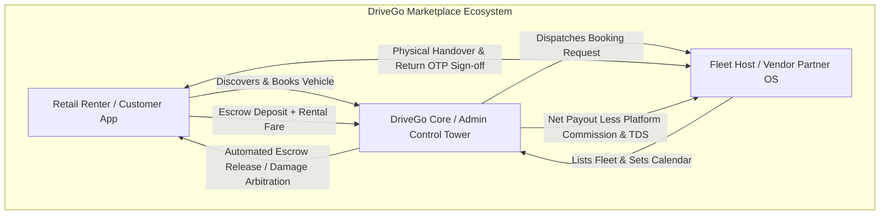
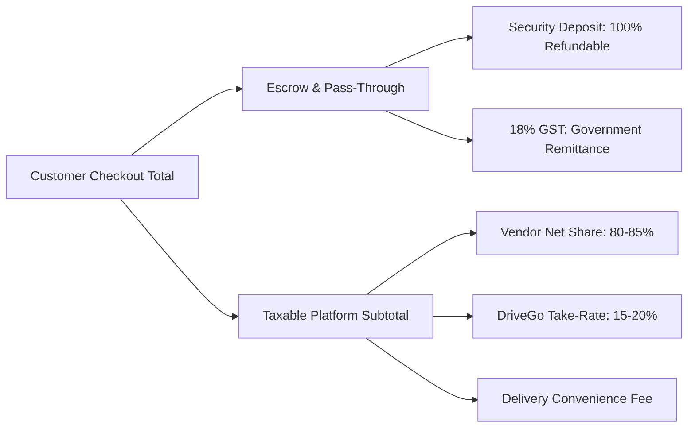
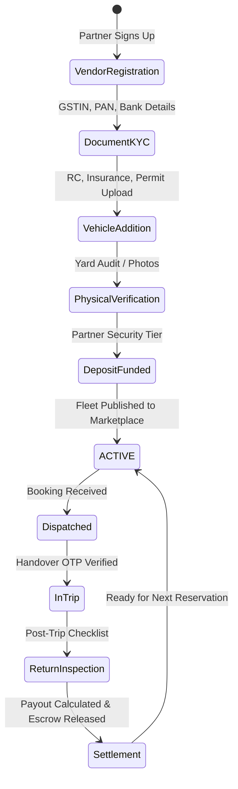

# DriveGo — Master Product Vision & Marketplace Operating Model

**Document Reference**: `docs/product/drivego-master-baseline/01_PRODUCT_VISION_AND_BUSINESS_MODEL.md`  
**Classification**: Authoritative Product Baseline (Stage 0)  
**Effective Date**: November 9, 2026  
**Author**: Chief Technology Officer, Chief Product Officer & Marketplace Architect  
**Target Repository**: `D:/Flutter/car_rental_monorepo`  
**Baseline Git Commit**: `b87cfe90527c801172529290b96f3d7c0200b941`  

---

## 1. Executive Vision & Problem Statement

### 1.1 The Marketplace Opportunity
The Indian self-drive car rental market is expanding rapidly, driven by rising domestic tourism, urbanization, shifting preferences toward flexible asset-light mobility, and highway infrastructure expansion (Bharatmala, Expressway corridors). However, existing players (Zoomcar, Revv, MyChoize) suffer from systemic operational deficiencies:
1. **Host Alienation & Vehicle Neglect**: Unchecked renter abuse, delayed or denied damage claim reimbursements, and arbitrary host penalties lead to fleet degradation.
2. **Customer Distrust**: Opaque cancellation policies, delayed security deposit refunds (often 15–45 days), surprise convenience surcharges, and vehicle condition discrepancies at pickup.
3. **Operational Blindspots**: Disconnected operational software, manual WhatsApp coordination for handovers, unverified traffic fines (e-Challans), and uncollected toll charges (FASTag).

### 1.2 The DriveGo Mission
**DriveGo is engineered as India's premier managed peer-to-peer and commercial fleet car-rental marketplace.**  
DriveGo connects retail drivers with verified fleet owners (commercial operators and individual vehicle hosts) through an end-to-end digital platform that guarantees:
- **Instant Financial Certainty**: Escrow-isolated security deposits, transparent itemized pricing, and rapid post-trip deposit release.
- **Mutual Asset Accountability**: Mandatory pre-trip and post-trip 4-point photographic inspection protocols signed off with cryptographic one-time passwords (Handover OTPs).
- **Partner Fleet Empowerment**: A dedicated mobile operating system (`Partner OS`) for hosts to control calendar dispatch, dynamic pricing, and immediate bank settlements.
- **Enterprise Control Tower Governance**: Centralized platform supervision enforcing strict city geofencing, regulatory compliance, and automated fraud prevention.

---

## 2. Core Stakeholder Value Propositions

### 2.1 For Customers (Renters)
- **Verified Vehicles Only**: Every vehicle undergoes mandatory compliance document inspection (RC, commercial insurance, fitness certificate) before being listed.
- **Transparent All-Inclusive Pricing**: No hidden surprise fees. Clear breakdown of Base Rental, Doorstep Delivery, Damage Protection, Taxes (18% GST), and Refundable Security Deposit.
- **Fast Deposit Release**: Automatic escrow release upon completed return inspection without damage claims.
- **Contactless or Yard Handover**: Choice between pickup at authorized vendor hubs or on-demand doorstep delivery.
- **24/7 Roadside & SOS Assistance**: In-app emergency breakdown dispatch and immediate operational support.

### 2.2 For Vendors (Fleet Hosts & Partners)
- **Asset Protection & Verification**: Strict customer identity verification (Driving License validation, Aadhaar masking, age threshold 21+).
- **Mandatory Handover Sign-off**: Customers cannot drive away without physically reviewing the vehicle condition, odometer, and fuel level and providing a 6-digit Handover OTP.
- **Transparent Commission & Quick Settlement**: Predictable 15%–20% commission take-rate with scheduled weekly or automated on-demand payouts via RazorpayX direct IMPS/NEFT transfers.
- **Damage Claim Arbitration**: Direct photographic dispute resolution backed by held customer security deposits.
- **Flexible Dispatch Control**: One-tap availability toggling to pause listings during personal use or maintenance.

### 2.3 For DriveGo (Platform Operator)
- **Asset-Light Scalability**: Zero vehicle balance-sheet capital expenditure; rapid multi-city expansion by aggregating existing local car rental operators and individual hosts.
- **Multiple Revenue Streams**: Platform commission take-rate, doorstep delivery convenience margins, damage protection package margins, cancellation penalty shares, and vendor onboarding subscription tiers.
- **Regulatory Compliance**: Adherence to the Motor Vehicles Act 1988, Rent a Cab Scheme 1989, DPDP Act 2023, and RBI Payment Aggregator guidelines.

---

## 3. Marketplace Business & Monetization Model

### 3.1 Unit Economics & Fare Breakdown
For every completed booking transaction $T$:

$$\text{Gross Customer Payment} = \text{Base Rental} + \text{Delivery Fee} + \text{Protection Package} + \text{GST (18\%)} + \text{Refundable Security Deposit} - \text{Discount}$$

1. **Platform Take-Rate (Commission)**: 15% (Tier 1 Preferred Hosts) to 20% (Standard Hosts) levied exclusively on the `(Base Rental + Delivery Fee)` subtotal.
2. **Refundable Security Deposit**: Category-tiered pass-through funds held strictly in escrow:
   - Hatchback: ₹2,000 – ₹3,000
   - Sedan / Compact SUV: ₹3,000 – ₹5,000
   - Premium SUV / Luxury: ₹10,000 – ₹15,000
3. **Damage Protection Packages**:
   - *Basic Protection* (Included): Customer liability capped at ₹10,000.
   - *Standard Protection* (₹299/day): Customer liability capped at ₹3,000.
   - *Zero Depreciation / Premium* (₹599/day): Zero customer damage liability (excluding tire/glass negligence).
4. **Doorstep Delivery & Pickup**:
   - Hub Self-Pickup: Free (₹0).
   - Within 10 km Yard Radius: Flat ₹400 delivery + ₹400 pickup.
   - Beyond 10 km: ₹25/km incremental delivery charge.
5. **Tax Withholding (TDS)**:
   - Under Section 194O of the Indian Income Tax Act, 1% TDS is withheld on gross vendor remittances and deposited with the tax department under the host's PAN.

---

## 4. Operational Architecture: Peer-to-Peer vs Managed Fleet

DriveGo executes a **Managed Marketplace Operating Model**:
- **Vehicle Ownership**: 100% third-party owned by independent commercial fleet operators, tour agencies, and registered private individual hosts.
- **Operations & Custody**: Vehicles remain in the custody of vendors at registered yards/hubs. Handover and return inspections are executed directly by vendors using the DriveGo Partner OS.
- **Quality & Governance**: DriveGo acts as the central quality gatekeeper. No vehicle or vendor is visible to retail customers without passing document review, physical inspection validation, and mandatory security deposit tiering.

---

## 5. Indian Regulatory & Compliance Landscape

1. **Motor Vehicles Act 1988 & Rent a Cab Scheme 1989**:
   - In India, self-drive rental operations legally require vehicles registered under the *Rent a Cab Scheme* carrying commercial registration plates (Yellow text on Black background).
   - *Phase 1 Focus*: Onboard verified commercial fleet operators holding valid Rent a Cab permits in initial launch cities (Hyderabad, Bengaluru).
   - *Peer-to-Peer Host Expansion*: Private vehicle onboarding (white plates) is restricted pending formalized state-level peer-to-peer car-sharing policy frameworks or structured lease-back arrangements.
2. **Reserve Bank of India (RBI) Payment Aggregator Guidelines**:
   - Customer payments and vendor payouts cannot be routed through platform operational checking accounts.
   - Payments must be captured into designated RBI-compliant Nodal / Escrow bank accounts managed via authorized payment aggregators (Razorpay / Cashfree).
3. **Digital Personal Data Protection (DPDP) Act 2023**:
   - Mandatory Aadhaar masking: First 8 digits redacted on ingest (`XXXXXXXX1234`).
   - Purpose limitation, explicit customer consent for GPS tracking, and accessible in-app account deletion.
4. **FASTag & Traffic Challans**:
   - Vehicles carry vendor FASTags for toll-booth passage. Net toll consumption during the rental window is calculated via electronic toll logs and deducted from the held security deposit or billed post-trip.

---

## 6. Document Authority & Strategic Baseline

This vision document serves as the permanent product foundation for all technical specifications, UX flows, database schemas, and implementation milestones. Technical implementations must adhere strictly to these marketplace principles.

