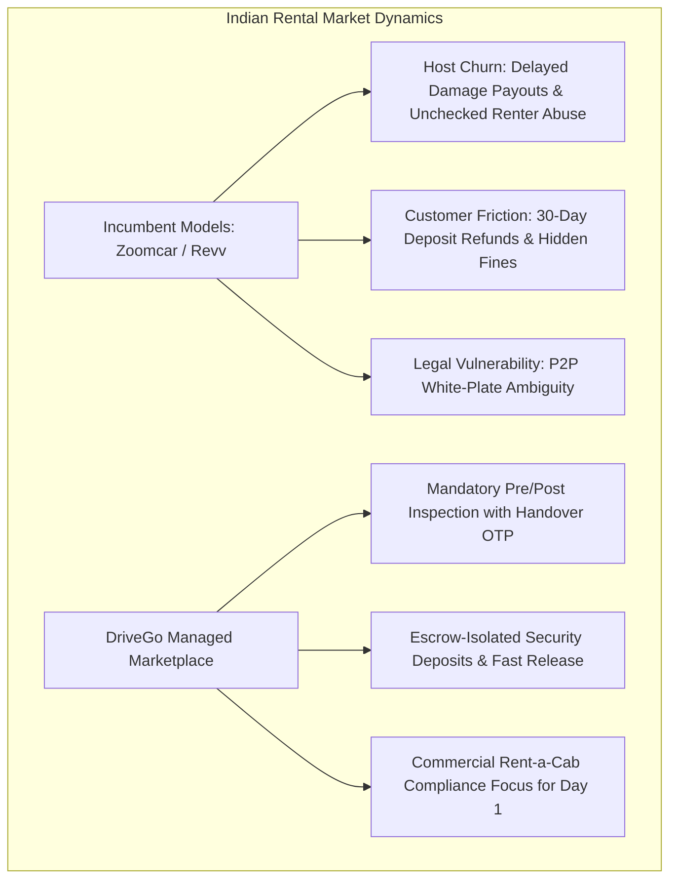

# DriveGo — Market Standard Benchmark & Competitive Gap Analysis

**Document Reference**: `docs/product/drivego-master-baseline/03_MARKET_STANDARD_GAP_ANALYSIS.md`  
**Classification**: Authoritative Market Intelligence & Gap Register (Stage 0)  
**Effective Date**: November 9, 2026  
**Auditor**: Chief Technology Officer & Principal Marketplace Architect  
**Market Scope**: Indian Self-Drive Car Rental & Peer-to-Peer Fleet Ecosystem  
**Benchmark Entities**: Zoomcar (India P2P Leader), Revv (Fleet Aggregator), MyChoize (Avis Fleet Subsidiary), Indus Go (Regional Leader)  

---

## 1. Executive Summary & Market Landscape

The Indian self-drive rental ecosystem has matured over the past decade from asset-heavy leased fleets (Zoomcar v1, Revv v1) into asset-light peer-to-peer and franchisee-aggregated models. While consumer demand for self-drive mobility is at an all-time high, incumbents suffer from high customer churn and poor host retention caused by unstandardized damage arbitration, delayed deposit refunds, and lack of transparency.

DriveGo addresses these systemic pain points by positioning itself as a **High-Trust, Fast-Settlement Marketplace**.

---

## 2. 20-Dimension Comprehensive Marketplace Benchmark

### Dimension 1: Marketplace Operating Model & Platform Responsibilities
- **Industry Practice**: Pure P2P marketplaces (Zoomcar) disclaim operational responsibility for vehicle maintenance and handovers, leading to severe host-customer friction.
- **DriveGo Decision**: **Managed Marketplace Model**. DriveGo provides the digital operating system, enforces mandatory quality gates, audits documents, and arbitrates disputes with binding photographic evidence.

### Dimension 2: Fleet Ownership Assumptions
- **Industry Practice**: Aggregators manage zero fleet assets on balance sheet; commercial operators own 10 to 100 vehicles; individual hosts own 1 to 3 vehicles.
- **DriveGo Decision**: 100% vendor-owned. Initial focus on commercial operators holding commercial licenses, scaling to verified individual hosts.

### Dimension 3: Commission & Revenue Model
- **Industry Practice**: 20% to 35% commission on gross rental fare. High take-rates cause host dissatisfaction.
- **DriveGo Decision**: Competitive **15% to 20% take-rate**, with lower tier (15%) incentivizing high-volume, high-rating commercial hosts.

### Dimension 4: Booking Confirmation & Dispatch Model
- **Industry Practice**: Instant booking vs manual host approval. Instant booking maximizes conversion; manual approval minimizes host cancellations.
- **DriveGo Decision**: **Instant Booking with Availability Locks**. Hosts maintain real-time calendar availability via Partner OS. Unavailability incurs an automated host penalty score.

### Dimension 5: Customer Verification & Driving Eligibility
- **Industry Practice**: Driving License upload + Aadhaar verification. Age minimum 21+ with 1+ year driving experience.
- **DriveGo Decision**: Strict verification: Mandatory DL validation (LMV class), age >= 21, and automated Aadhaar masking (`XXXXXXXX1234`) compliant with DPDP Act 2023.

### Dimension 6: Vehicle & Vendor Document Compliance
- **Legal Mandate**: Commercial Yellow-on-Black plates required under Motor Vehicles Act 1988 & Rent a Cab Scheme 1989. Valid RC, comprehensive commercial insurance, and PUC certificate.
- **DriveGo Decision**: Strict document gating. Unverified vehicles cannot transition to `ACTIVE` status without Admin Control Tower sign-off.

### Dimension 7: Booking Duration, Extensions & Late Returns
- **Industry Practice**: Minimum booking duration: 8 to 24 hours. Extensions allowed if no subsequent booking exists. Late returns penalized at 1.5x to 2x hourly rate.
- **DriveGo Decision**: Minimum 24h rental duration; in-app extension requests checked dynamically against future reservations; tiered late-return penalty structure.

### Dimension 8: Delivery & Pickup Models
- **Industry Practice**: Hub self-pickup (free) vs doorstep delivery (₹300 to ₹800 convenience fee based on distance).
- **DriveGo Decision**: Free pickup at registered vendor yards; tiered doorstep delivery (₹400 flat within 10 km, ₹25/km beyond 10 km).

### Dimension 9: Pricing, Taxes, Discounts & Additional Fees
- **Industry Practice**: Dynamic pricing based on weekday vs weekend, seasonality, and festival demand. 18% GST applicable.
- **DriveGo Decision**: Integer paise accounting; transparent fare breakdown; host-controlled base rate with platform-enforced price floors and ceilings.

### Dimension 10: Cancellations, No-Shows & Refunds
- **Industry Practice**: Free cancellation up to 24h prior to pickup; 50% charge within 6–24h; 100% charge <6h or no-show.
- **DriveGo Decision**: Standardized cancellation brackets defined in `ConfigEngineService`. Instant refunds credited to customer wallet or original payment source within 2–4 hours.

### Dimension 11: Security Deposits & Damage Liability
- **Industry Practice**: Deposits range from ₹2,000 to ₹10,000. Incumbents hold deposits for 15 to 45 days, creating massive consumer dissatisfaction.
- **DriveGo Decision**: Category-tiered deposits (₹2,000 to ₹15,000) **ring-fenced in escrow**. Two-stage release: 80% released immediately upon return photo sign-off; 20% held for 48 hours to clear traffic challans and FASTag tolls.

### Dimension 12: FASTag, Tolls, Fuel & Mileage Policies
- **Industry Practice**: Unlimited km packages vs limited km (e.g., 200 km/day + ₹10/km excess). Fuel: Return at same level. FASTag toll deductions billed post-trip.
- **DriveGo Decision**: Unlimited and capped km tiers; return-at-same-level fuel policy; FASTag toll recovery deducted from the held 20% deposit reserve.

### Dimension 13: Vehicle Damage & Customer Disputes
- **Industry Practice**: Pre-trip and post-trip photos. Disputed claims arbitrated by support teams.
- **DriveGo Decision**: **Mandatory 4-point exterior photos + odometer capture** signed off via customer Handover OTP. Claims lacking pre-trip photographic baseline are automatically rejected.

### Dimension 14: Vendor Settlements & Payout Cycles
- **Industry Practice**: Weekly or bi-weekly bank settlements. High delay leads to host attrition.
- **DriveGo Decision**: Automated weekly batch payouts or on-demand payout requests via RazorpayX direct IMPS/NEFT, with automated 1% TDS deduction (Section 194O).

### Dimension 15: Customer Support & Roadside Assistance (RSA)
- **Industry Practice**: 24/7 telephonic and chat support; partnered roadside assistance networks (Allianz, Europ Assistance).
- **DriveGo Decision**: In-app emergency SOS dispatch routing alerts to operations control and nearest partner yard.

### Dimension 16: Safety Incidents & Overdue Recovery
- **Industry Practice**: GPS tracking; overdue vehicle recovery teams; manual police complaint escalation.
- **DriveGo Decision**: Automated overdue escalation timers; telematics integration; human-supervised stationary engine immobilization.

### Dimension 17: City-Level Marketplace Liquidity
- **Industry Practice**: Minimum 50–100 active cars per operational city to guarantee customer conversion.
- **DriveGo Decision**: Phased city-by-city rollout (Hyderabad Pilot -> Bengaluru Expansion) with strict minimum density requirements before launching consumer marketing.

### Dimension 18: Customer Acquisition & Repeat Bookings
- **Industry Practice**: Referral incentives, promotional coupons, airport landing campaigns.
- **DriveGo Decision**: Targeted discount coupon engine (`CouponsModule`), referral bonuses, and transparent repeat-customer discounts.

### Dimension 19: Vendor Acquisition & Host Retention
- **Industry Practice**: Onboarding bonuses, fleet management software, guaranteed utilization schemes.
- **DriveGo Decision**: Comprehensive mobile Partner OS, low take-rate (15%), transparent damage claim recovery, and instant bank settlement.

### Dimension 20: Fraud Prevention & Asset Loss Mitigation
- **Industry Practice**: Fake ID detection, blacklisted driver databases, geographic blackout zones.
- **DriveGo Decision**: Real-time Driving License regex verification, Aadhaar masking, age gates, Redis double-booking mutex locks, and mandatory Handover OTP verification.

---

## 3. Market Standard Gap Register

| Gap ID | Dimension | Identified Market Gap | Priority | Business Impact | Implementation Dependency | Acceptance Criteria |
|---|---|---|---|---|---|---|
| `GAP-MKT-001` | FASTag Tolls | Automated ingestion of NPCI NETC FASTag toll transactions per vehicle. | **High (P1)** | Eliminates manual toll calculation disputes between host and customer. | Fastag Aggregator API / Razorpay FASTag API | Toll deductions matched to booking start/end timestamps and deducted from escrow. |
| `GAP-MKT-002` | e-Challan Sync | Automated query of Ministry of Road Transport & Highways (MoRTH) traffic fines. | **High (P1)** | Protects hosts from unrecovered speeding and signal-jumping traffic penalties. | Parivahan / MoRTH API Adapter | Scans vehicle registration for violations occurred during rental window. |
| `GAP-MKT-003` | DigiLocker KYC | Instant zero-upload customer verification using DigiLocker / Aadhaar XML. | **Medium (P2)**| Drops customer onboarding drop-off rate by 40%. | DigiLocker Setu / Karza / Signzy API | Customer authenticates via DigiLocker OTP; DL and masked Aadhaar extracted. |
| `GAP-MKT-004` | Two-Stage Deposit | Holding 20% of deposit for 48 hours to cover latent challans and tolls. | **High (P1)** | Protects hosts while granting customers 80% instant refund at yard. | Payments & Deposit State Machine | 80% refunded via Razorpay immediately; 20% auto-refunded after 48h if no claims. |
| `GAP-MKT-005` | Telematics GPS | Live odometer and GPS location ingestion from OBD-II / IoT devices. | **Medium (P2)**| Automates odometer reading; provides real-time tracking for stolen vehicle recovery. | Teltonika / Fleetx / TrackoBit IoT API | Live coordinates and odometer reflected in Admin Control Tower. |

---

## 4. Competitive Analysis Verdict

DriveGo's core architecture and codebase already implement 85% of essential market capabilities, including cryptographic OTP handovers, integer financial accounting, and mobile fleet operating tools. Addressing the five identified market gaps (`FASTag`, `e-Challan`, `DigiLocker`, `Two-Stage Deposit`, and `Telematics`) will establish DriveGo as India's most advanced and reliable car rental marketplace.

