# DriveGo — Admin Control Tower Master Product Specification

**Document Reference**: `docs/product/drivego-master-baseline/06_ADMIN_CONTROL_TOWER_MASTER_SPEC.md`  
**Classification**: Authoritative Platform Blueprint (Stage 0)  
**Effective Date**: November 9, 2026  
**Target Codebase**: `apps/admin_panel` (Flutter Web 3.29.0 / CanvasKit)  
**Host URL**: `http://localhost:8080` (Internal Staging) / `https://admin.drivego.in` (Production)  
**Author**: Chief Technology Officer & Principal Operations Architect  

---

## 1. Executive Redesign Philosophy & Information Architecture

The DriveGo Admin Control Tower is the operational nervous system of the marketplace. It is not an analytics playground or a showcase for decorative charts; it is a **high-density, mission-critical command center** built for operations leads, fleet auditors, support specialists, and financial controllers.

### Core Design Principles:
1. **Zero Decorative Metrics**: Every card, number, and status badge must map directly to real-time PostgreSQL database aggregates and event queues.
2. **High-Density Data Grids**: Default to responsive, paginated tabular views with column filtering, multi-field search, status filtering, and slide-over detail side-sheets (`SideSheet`).
3. **Maker-Checker Financial Governance**: Financial mutations exceeding threshold limits (e.g., manual refunds >₹5,000, vendor payout batches >₹100,000, commission rate overrides) require two-person verification (Four-Eyes Principle).
4. **Authoritative Immutable Audit Logging**: Every administrative action automatically records the staff user UUID, client IP, action type, before-state snapshot, and after-state snapshot in the append-only `AuditLog` table.
5. **Role-Enforced Presentation**: Administrative views are strictly gated based on staff RBAC privileges (`SUPER_ADMIN`, `OPERATIONS_MANAGER`, `FLEET_AUDITOR`, `FINANCE_CONTROLLER`, `SUPPORT_AGENT`).

```mermaid
graph TD
    AdminShell[Admin Shell: Desktop Responsive Navigation Drawer]
    
    AdminShell --> Cluster1[1. COMMAND CENTER]
    AdminShell --> Cluster2[2. PARTNERS & FLEET]
    AdminShell --> Cluster3[3. BOOKINGS & OPERATIONS]
    AdminShell --> Cluster4[4. FINANCE & SETTLEMENTS]
    AdminShell --> Cluster5[5. MARKETPLACE CONFIGURATION]
    AdminShell --> Cluster6[6. GROWTH & COMMUNICATIONS]
    AdminShell --> Cluster7[7. PLATFORM & GOVERNANCE]

    Cluster1 --> C1_1[Executive Dashboard /dashboard]
    Cluster1 --> C1_2[Live Operations Center /operations-center]
    Cluster1 --> C1_3[Pending Action Queue /pending-approvals]

    Cluster2 --> C2_1[Vendor KYC Review /vendors/onboarding]
    Cluster2 --> C2_2[Vendor Directory /vendors]
    Cluster2 --> C2_3[Fleet Inventory & Locks /fleet]
    Cluster2 --> C2_4[Document Compliance /compliance]

    Cluster3 --> C3_1[Booking Pipeline /bookings]
    Cluster3 --> C3_2[Inspection Evidence /inspections]
    Cluster3 --> C3_3[Damage Disputes & Claims /disputes]
    Cluster3 --> C3_4[Emergency & SOS Dispatch /emergency-dispatch]

    Cluster4 --> C4_1[Payments & Escrow Ledger /reconciliation]
    Cluster4 --> C4_2[Vendor Payout Batches /payouts]
    Cluster4 --> C4_3[Refund Management /refunds]
    Cluster4 --> C4_4[Commission & Tax Invoices /invoices]

    Cluster5 --> C5_1[Serviceable Cities & Geofences /locations]
    Cluster5 --> C5_2[Delivery Pricing Models /delivery-zones]
    Cluster5 --> C5_3[Dynamic Rules Engine /business-rules]

    Cluster6 --> C6_1[Omnichannel Control & Templates /communications]
    Cluster6 --> C6_2[Coupons & Promotional Banners /marketing]

    Cluster7 --> C7_1[Customer Directory /customers]
    Cluster7 --> C7_2[Staff Access & RBAC /staff]
    Cluster7 --> C7_3[System Health & Credentials /integrations]
    Cluster7 --> C7_4[App Release Management /app-releases]
    Cluster7 --> C7_5[Forensic Audit Log /audit-log]
```

---

## 2. Seven Operational Navigation Clusters

### 2.1 Cluster 1: Command Center
- **Executive Dashboard (`/#/dashboard`)**:
  - *Data Metrics*: Today's Gross Merchandise Value (GMV), Active Ongoing Trips, Active Listed Vehicles, Fleet Utilization Percentage (Target: 70%+), Pending KYC Approvals, and Open Support Tickets.
  - *Telemetry Stream*: Real-time SSE/WebSocket stream of platform events (Booking Confirmed, Handover Completed, SOS Triggered).
- **Live Operations Center (`/#/operations-center`)**:
  - Interactive map of operational cities showing active trip vehicles, pending yard handovers, and doorstep delivery dispatches.

---

### 2.2 Cluster 2: Partners & Fleet
- **Vendor Onboarding & KYC Queue (`/#/vendors/onboarding`)**:
  - Dedicated side-by-side verification console. Left pane: Extracted OCR and form data (PAN, GSTIN, Bank details). Right pane: High-resolution zoomable viewer for business license and cancelled cheque.
  - *Action Controls*: Approve Partner, Reject with Canned Reason, Request Re-upload.
- **Fleet Management & Emergency Locks (`/#/fleet`)**:
  - High-density car data grid. Shows Thumbnail, Make/Model, Year, Reg Number, Host Name, Daily Rate, and Operational Status (`ACTIVE`, `MAINTENANCE`, `PENDING_REVIEW`, `ADMIN_LOCKED`).
  - *Instant Platform Lock Switch*: Disabling instantly pulls the vehicle from search results and blocks new bookings.

---

### 2.3 Cluster 3: Bookings & Operations
- **Booking Lifecycle Pipeline (`/#/bookings`)**:
  - Filter by lifecycle stage (`PENDING_HANDOVER`, `ONGOING`, `RETURN_DUE`, `COMPLETED`, `DISPUTED`).
  - *Booking Detail Drawer*: Complete timeline with exact timestamps for Order Creation, Payment Capture, Handover OTP Entry, and Return Sign-off.
- **Inspection Evidence & Damage Claims (`/#/disputes`)**:
  - Side-by-side photographic viewer comparing pre-trip photos with post-trip return photos.
  - Vendor quote verification, customer counter-response, and binding claim adjudication (Deduct from deposit vs Reject claim).

---

### 2.4 Cluster 4: Finance & Settlements
- **Escrow & Financial Reconciliation (`/#/reconciliation`)**:
  - Reconciliation dashboard verifying: Total Razorpay Gateway Captures == (Platform Net Revenue + Taxes + Escrow Deposits + Vendor Payables).
  - Flags unhealed payment discrepancies or gateway timeout orphans for automated background retry.
- **Vendor Payout Engine (`/#/payouts`)**:
  - Batch payout execution console. Shows verified vendor bank accounts, gross earnings, 15% platform commission deduction, 1% TDS u/s 194O withholding, and net payable.
  - Single-click batch dispatch via RazorpayX with instant IMPS/NEFT confirmation tracking.

---

### 2.5 Cluster 5: Marketplace Configuration
- **City Boundaries & Hub Governance (`/#/locations`)**:
  - Multi-city manager (Hyderabad, Bengaluru, etc.). Hub address configuration, operating hours, holiday calendar blackout dates, and airport surcharge rules.
- **Dynamic Business Rules Engine (`/#/business-rules`)**:
  - System configuration editor with immutable version tracking: Platform Take-Rate Percentage (15–20%), Cancellation Penalty Brackets, Minimum Renter Age (21), and Security Deposit Tiers.

---

### 2.6 Cluster 6: Growth & Communications
- **Unified Communications Center (`/#/communications`)**:
  - Tabbed interface consolidating SMS, WhatsApp, Push Notification, and Email templates.
  - Live message preview, DLT template ID bindings, character count monitors, and delivery log search.
- **Promotions & Campaign Engine (`/#/marketing`)**:
  - Promo coupon creator (Fixed ₹ discount or % discount, max discount cap, minimum rental spend, usage limit per user, expiry timestamp).
  - In-app hero banner uploader and campaign push dispatcher.

---

### 2.7 Cluster 7: Platform & Governance
- **Staff Roles & Access Delegation (`/#/staff`)**:
  - Granular RBAC console assigning role templates (`SUPER_ADMIN`, `FINANCE_CONTROLLER`, `SUPPORT_AGENT`).
  - Single-click staff session revocation to immediately invalidate active JWT tokens upon employee departure.
- **Integrations & External Health Monitor (`/#/integrations`)**:
  - Gateway health telemetry for Razorpay, Twilio, Msg91, Gupshup, and AWS S3.
  - Masked credential display (`sk_live_****`) and error circuit breaker trip status.
- **Forensic Audit Log (`/#/audit-log`)**:
  - Filterable, immutable ledger of all administrative mutations. Searchable by Admin User, Entity Type (`VENDOR`, `BOOKING`, `CONFIG`), and Date Range.

---

## 3. Dedicated App Release Management Domain (`/#/app-releases`)

The Admin Control Tower incorporates a dedicated **App Release Management** console to track the lifecycle of the mobile apps across the Google Play Console and Apple App Store:

### Operational Scope:
| Field / Capability | Description & Operational Function |
|---|---|
| **Platform Target** | Android (`com.example.customer_app`, `com.example.vendor_app`) & iOS |
| **Version Tracking** | Semantic Version string (e.g., `v1.0.0`) and sequential Build Number (e.g., `10001`). |
| **Release Channel** | Internal Testing, Closed Alpha, Open Beta, Production Rollout. |
| **Minimum Supported Version** | Backend-enforced minimum build number. App versions below this threshold trigger mandatory update dialog. |
| **Store Submission Checklist** | Track completion of Store Listing Graphics, Feature Graphic (1024x500), App Icons (512x512), and 7-inch/10-inch Tablet Screenshots. |
| **Data Safety & Privacy Declarations** | Verification status of Play Console Data Safety forms (Location, Personal Info, Financial Info, Device Identifiers). |
| **Permission Justifications** | Documented justifications for `ACCESS_FINE_LOCATION`, `CAMERA`, and `READ_MEDIA_IMAGES`. |
| **Known Release Issues & Hotfixes** | Tracking operational bugs identified during phased rollout with direct link to Rollback Runbook. |

> [!NOTE]
> The Admin Panel does not execute binary code signing or directly upload APK/AAB bundles to Google Play or Apple App Store. Binary compilation, signing with keystores, and store submission remain within official CI/CD pipelines (GitHub Actions) and developer consoles.

---

## 4. Admin Redesign Summary Verdict

This redesigned 7-cluster architecture reduces administrative cognitive friction, enforces strict financial segregation of duties, and provides end-to-end operational mastery over the DriveGo two-sided marketplace.

