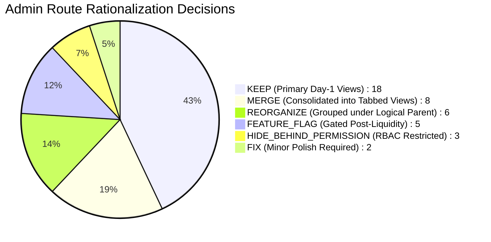

# DriveGo — Admin Control Tower Route Rationalization Register

**Document Reference**: `docs/product/drivego-master-baseline/07_ADMIN_ROUTE_RATIONALIZATION_REGISTER.md`  
**Classification**: Authoritative Architectural Register (Stage 0)  
**Effective Date**: November 9, 2026  
**Auditor**: Chief Technology Officer & Principal Frontend Architect  
**Target Codebase**: `apps/admin_panel/lib/core/router/app_router.dart`  
**Total Current Routes Mapped**: 42 Routes -> **Rationalized Target**: 7 Unified Operating Clusters  

---

## 1. Executive Summary & Rationalization Strategy

The current Admin Panel codebase contains 42 top-level routes. While all 42 routes compile cleanly and pass automated unit/widget tests (99/99 passing), exposing 42 flat navigation items in a sidebar creates severe operational fragmentation.

This register analyzes all 42 routes, assigns each a definitive architectural classification, explains the operational rationale, and maps it to its target location within the unified **7-Cluster Admin Control Tower**.

---

## 2. Master Route-by-Route Rationalization Register

| Current Route Path | Current Page / Source File | Backend Controller & Endpoint | Target Classification | Target Destination / Rationalization Decision | Operational Justification & Evidence |
|---|---|---|---|---|---|
| `/#/dashboard` | `DashboardPage` (`dashboard_page.dart`) | `AdminDashboardController` (`GET /admin/dashboard/stats`) | **KEEP** | **Cluster 1: Command Center** | Primary executive overview. Real-time GMV, active rentals, fleet count. |
| `/#/operations-center` | `OperationsCenterPage` (`operations_center_page.dart`) | `OperationsController` (`GET /operations/live`) | **KEEP** | **Cluster 1: Command Center** | Operational dispatch and live trip tracking across active cities. |
| `/#/revenue` | `RevenueReportsPage` (`revenue_reports_page.dart`) | `AnalyticsController` (`GET /analytics/revenue`) | **REORGANIZE** | **Cluster 1 -> Cluster 4: Finance** | Revenue analytics logically belongs inside Finance & Settlements cluster. |
| `/#/vendors/onboarding`| `VendorOnboardingPage` (`vendor_onboarding_page.dart`) | `AdminVendorsController` (`GET /admin/vendors/pending`) | **KEEP** | **Cluster 2: Partners & Fleet** | Critical Day-1 queue for reviewing partner business documents and KYC. |
| `/#/vendors` | `VendorsPage` (`vendors_page.dart`) | `VendorsController` (`GET /admin/vendors`) | **KEEP** | **Cluster 2: Partners & Fleet** | Directory of verified partners, active vehicles, and suspension toggles. |
| `/#/fleet` | `FleetPage` (`fleet_page.dart`) | `CarsController` (`GET /admin/cars`) | **KEEP** | **Cluster 2: Partners & Fleet** | Monorepo car catalog with status toggles (`ACTIVE`, `MAINTENANCE`, `LOCKED`). |
| `/#/compliance` | `DocumentCompliancePage` (`compliance_page.dart`) | `CarsController` (`GET /admin/compliance`) | **REORGANIZE** | **Cluster 2: Partners & Fleet (Tab)** | Merge into Fleet as a dedicated "Compliance & Expired Docs" tab. |
| `/#/bookings` | `AdminBookingManagementPage` (`bookings_page.dart`) | `BookingsController` (`GET /admin/bookings`) | **KEEP** | **Cluster 3: Bookings & Ops** | Core lifecycle pipeline: Pending Handover, Ongoing, and Return Pending. |
| `/#/disputes` | `DamageClaimsPage` (`damage_claims_page.dart`) | `DisputesController` (`GET /admin/disputes`) | **KEEP** | **Cluster 3: Bookings & Ops** | Photographic dispute arbitration and deposit deduction authorization. |
| `/#/emergency-dispatch`| `EmergencyDispatchPage` (`emergency_dispatch_page.dart`)| `EmergencyController` (`GET /emergency/active`) | **KEEP** | **Cluster 3: Bookings & Ops** | Critical 24/7 roadside breakdown, accident, and emergency dispatch console. |
| `/#/support-tickets` | `SupportTicketsPage` (`support_tickets_page.dart`) | `SupportController` (`GET /admin/support/tickets`) | **KEEP** | **Cluster 3: Bookings & Ops** | Unified customer and vendor support ticketing helpdesk with SLA tracking. |
| `/#/reconciliation` | `AdminReconciliationPage` (`reconciliation_page.dart`) | `ReconciliationController` (`GET /admin/reconciliation`)| **KEEP** | **Cluster 4: Finance** | Daily gateway capture vs escrow vs payout double-entry reconciliation. |
| `/#/payouts` | `PayoutsPage` (`payouts_page.dart`) | `PayoutsController` (`GET /admin/payouts`) | **KEEP** | **Cluster 4: Finance** | Batch payout generation, TDS calculation, and RazorpayX execution. |
| `/#/invoices` | `InvoicesPage` (`invoices_page.dart`) | `InvoicesController` (`GET /admin/invoices`) | **REORGANIZE** | **Cluster 4: Finance (Tab)** | Sub-tab under Finance for GST tax invoices and customer receipts. |
| `/#/commission` | `CommissionRatesPage` (`commission_rates_page.dart`) | `ConfigEngineController` (`GET /admin/config/rates`) | **REORGANIZE** | **Cluster 5: Configuration (Tab)** | Commission rates belong in Marketplace Configuration alongside pricing rules. |
| `/#/wallet` | `WalletPage` (`wallet_page.dart`) | `WalletsController` (`GET /admin/wallets`) | **HIDE_BEHIND_PERMISSION** | **Cluster 4: Finance (Restricted)**| Only accessible to `FINANCE_CONTROLLER` and `SUPER_ADMIN`. Prevents balance tampering. |
| `/#/corporate` | `CorporateAccountsPage` (`corporate_page.dart`) | `CorporateController` (`GET /corporate`) | **FEATURE_FLAG** | **Deferred to Phase 2 (Post-Liquidity)** | Corporate credit lines and enterprise accounts not needed for Day 1 retail B2C. |
| `/#/locations` | `LocationsPage` (`locations_page.dart`) | `LocationsController` (`GET /locations`) | **KEEP** | **Cluster 5: Configuration** | Operational hubs, yard addresses, and service area radiuses. |
| `/#/locations/governance`| `LocationGovernancePage` (`location_governance.dart`) | `LocationsController` (`GET /locations/rules`) | **MERGE** | **Cluster 5: Configuration (Tab)** | Merge into Locations as "City Boundaries & Delivery Rules" tab. |
| `/#/supported-cities` | `SupportedCitiesPage` (`supported_cities_page.dart`) | `SupportedCitiesController` (`GET /supported-cities`) | **MERGE** | **Cluster 5: Configuration (Tab)** | Merge into Locations as "Active Cities" tab. |
| `/#/delivery-zones` | `DeliveryZonesPage` (`delivery_zones_page.dart`) | `LocationsController` (`GET /locations/zones`) | **MERGE** | **Cluster 5: Configuration (Tab)** | Merge into Locations as "Delivery Pricing Models" tab. |
| `/#/business-rules` | `BusinessRulesDashboardPage` (`business_rules.dart`) | `ConfigEngineController` (`GET /admin/config`) | **KEEP** | **Cluster 5: Configuration** | Dynamic rule adjustments: Platform fees, cancellation curves, age limits. |
| `/#/communications/overview`| `CommunicationsOverviewPage` (`comms_overview.dart`) | `NotificationsController` (`GET /admin/comms/stats`)| **KEEP** | **Cluster 6: Growth & Comms** | Central communications health monitor for SMS, WhatsApp, Push, and Email. |
| `/#/communications/templates`| `CommunicationTemplatesPage` (`templates_page.dart`)| `NotificationsController` (`GET /admin/comms/templates`)| **MERGE** | **Cluster 6: Growth & Comms (Tab)**| Sub-tab under Communications for editing message templates and DLT IDs. |
| `/#/communications/delivery-logs`| `DeliveryLogsPage` (`delivery_logs_page.dart`) | `NotificationsController` (`GET /admin/comms/logs`)| **MERGE** | **Cluster 6: Growth & Comms (Tab)**| Sub-tab under Communications for querying outbound delivery logs. |
| `/#/whatsapp` | `WhatsAppConsolePage` (`whatsapp_console_page.dart`) | `WhatsAppController` (`GET /whatsapp/queue`) | **MERGE** | **Cluster 6: Growth & Comms (Tab)**| Sub-tab under Communications for WhatsApp HSM template status and errors. |
| `/#/notifications` | `PushNotificationsPage` (`notifications_page.dart`) | `NotificationsController` (`POST /admin/notifications/push`)| **MERGE** | **Cluster 6: Growth & Comms (Tab)**| Sub-tab under Communications for broadcasting marketing push messages. |
| `/#/marketing/campaigns`| `CampaignsPage` (`campaigns_page.dart`) | `GrowthController` (`GET /admin/campaigns`) | **KEEP** | **Cluster 6: Growth & Comms** | Unified marketing promotions, hero banner uploads, and campaign scheduling. |
| `/#/coupons` | `CouponsPage` (`coupons_page.dart`) | `CouponsController` (`GET /coupons`) | **MERGE** | **Cluster 6: Growth & Comms (Tab)**| Merge into Marketing as "Discount Coupons & Promo Codes" tab. |
| `/#/banners` | `BannersPage` (`banners_page.dart`) | `BannersController` (`GET /banners`) | **MERGE** | **Cluster 6: Growth & Comms (Tab)**| Merge into Marketing as "In-App Hero Banners" tab. |
| `/#/referral` | `ReferralRulesPage` (`referrals_page.dart`) | `ReferralsController` (`GET /referrals/rules`) | **FEATURE_FLAG** | **Deferred to Phase 2 (Month 2)** | Referral fraud monitoring requires mature customer identity history. |
| `/#/loyalty` | `LoyaltyProgramPage` (`loyalty_page.dart`) | `LoyaltyController` (`GET /loyalty/rules`) | **FEATURE_FLAG** | **Deferred to Phase 2 (Month 4)** | Gamified points create balance liability; simpler promo coupons are superior for launch. |
| `/#/automation` | `AutomationOverviewPage` (`automation_page.dart`) | `OperationsController` (`GET /automation/rules`) | **FEATURE_FLAG** | **Deferred to Phase 2 (Month 3)** | Day 1 requires human operational supervision; auto-dispatches gated early on. |
| `/#/fraud` | `AdminFraudPage` (`fraud_page.dart`) | `FraudController` (`GET /admin/fraud`) | **FEATURE_FLAG** | **Deferred to Phase 2 (Month 6)** | Machine learning scoring graph replaced by rule-based gates (DL verify, age 21). |
| `/#/customers` | `CustomersPage` (`customers_page.dart`) | `UsersController` (`GET /admin/users?role=CUSTOMER`)| **KEEP** | **Cluster 7: Governance** | Customer directory, trip history, KYC status, and fraud blacklisting. |
| `/#/kyc` | `CustomerKycPage` (`customer_kyc_page.dart`) | `KycController` (`GET /admin/kyc/pending`) | **MERGE** | **Cluster 7: Governance (Tab)** | Merge into Customers as "Pending Driver License Audits" tab. |
| `/#/staff` | `AdminStaffManagementPage` (`staff_page.dart`) | `AdminStaffController` (`GET /admin/staff`) | **KEEP** | **Cluster 7: Governance** | Staff user accounts, role template assignments, and active session revocation. |
| `/#/integrations` | `IntegrationsConsolePage` (`integrations_page.dart`)| `IntegrationsController` (`GET /admin/integrations`)| **HIDE_BEHIND_PERMISSION** | **Cluster 7: Governance (Super Admin)**| External gateway key status (Razorpay, Twilio, Msg91). Only for `SUPER_ADMIN`. |
| `/#/audit-log` | `AdminAuditLogPage` (`audit_log_page.dart`) | `AdminAuditLogController` (`GET /admin/audit-log`) | **KEEP** | **Cluster 7: Governance** | Forensically auditable immutable event ledger. |
| `/#/settings` | `PlatformSettingsPage` (`settings_page.dart`) | `ConfigEngineController` (`GET /admin/config/all`) | **KEEP** | **Cluster 7: Governance** | General platform metadata, legal entity details, support email, contact numbers. |
| `/#/app-releases` | `AppReleasesPage` (New Spec Section) | `AppReleasesController` (`GET /admin/app-releases`) | **KEEP (NEW)** | **Cluster 7: Governance** | Dedicated mobile app release tracking for Play Store & App Store. |

---

## 3. Net Impact of Rationalization

1. **Sidebar Link Reduction**: Top-level sidebar links reduced from **42 down to 7 structured clusters**, eliminating scrolling and cognitive fatigue.
2. **Tabbed Consolidation**: 8 specialized routes merged into logical tabs within parent views (Communications, Locations, Marketing, Fleet).
3. **Complexity Reduction**: 5 speculative enterprise routes (`/corporate`, `/loyalty`, `/referral`, `/automation`, `/fraud`) gated behind `SystemConfig.enableAdvancedModules: false` until transaction volume justifies their maintenance.
4. **Security Hardening**: High-risk financial and system views (`/wallet`, `/integrations`) strictly hidden behind role permissions (`SUPER_ADMIN`, `FINANCE_CONTROLLER`).

