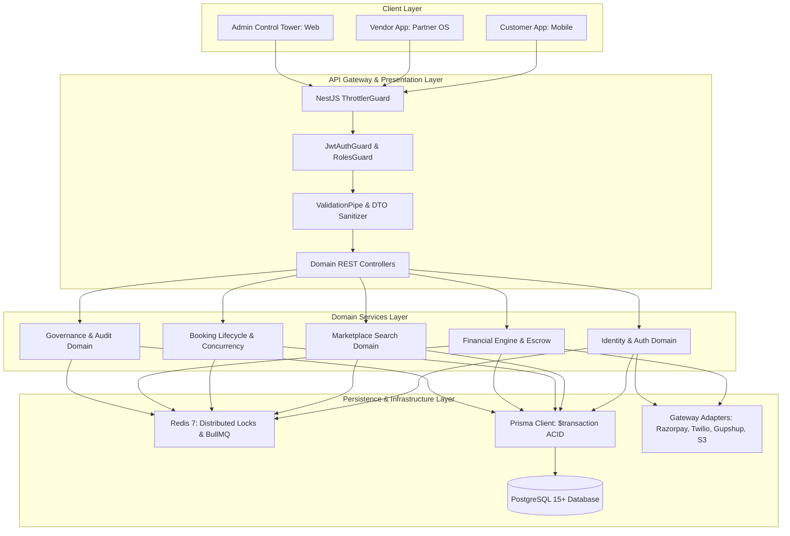
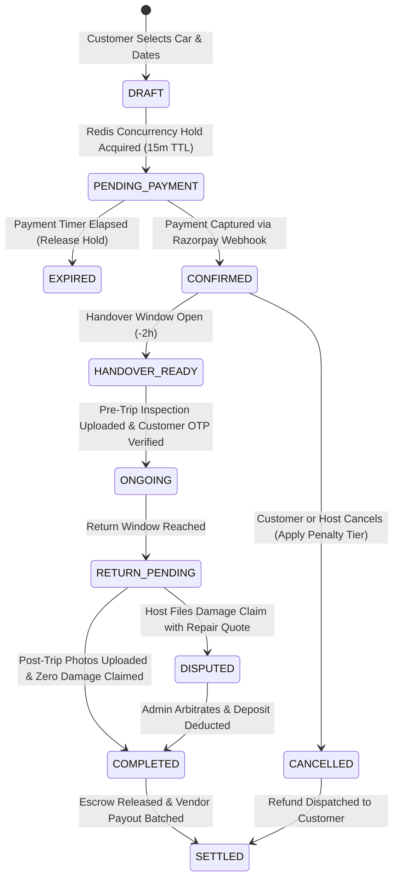

# DriveGo — Backend Domain Architecture & API Blueprint

**Document Reference**: `docs/product/drivego-master-baseline/08_BACKEND_DOMAIN_AND_API_BLUEPRINT.md`  
**Classification**: Authoritative Technical Architecture (Stage 0)  
**Effective Date**: November 9, 2026  
**Auditor**: Chief Technology Officer & Principal Backend Architect  
**Target Codebase**: `car_rental_backend` (NestJS 10.3.2 / TypeScript / Prisma ORM / PostgreSQL / Redis 7)  
**Architecture Paradigm**: Domain-Driven Design (DDD) with Strict Layer Isolation  

---

## 1. System Architectural Overview & Boundaries

The DriveGo backend is the single source of truth for all business operations, financial transactions, asset availability, and access control. Flutter mobile applications and web panels are purely presentation clients; they never compute prices, authoritatively mutate booking states, or perform direct financial ledger manipulations.



---

## 2. Canonical Domain Architecture Matrix (21 Core Domains)

| Domain ID | Domain Name | Source of Truth | Primary Prisma Models | State Machine / Invariant | Concurrency & Idempotency | Audit Requirement |
|---|---|---|---|---|---|---|
| `DOM-01` | **Authentication & Identity** | PostgreSQL `User` | `User`, `RefreshToken`, `UserSession` | Rate-limited OTP; Bcrypt hash with 5m TTL | Rate limited (5/min per IP); session UUID | Logged on failed login / lockout |
| `DOM-02` | **Customer & Vendor Profiles**| PostgreSQL `User`/`Vendor` | `User`, `Vendor`, `VendorBankDetail` | Profile verification status (`PENDING`, `VERIFIED`, `SUSPENDED`) | Optimistic concurrency via `updatedAt` | Profile status changes logged |
| `DOM-03` | **KYC & Identity Verification**| PostgreSQL `KycDocument` | `UserKycDocument`, `VendorKycDocument` | Document Status: `PENDING` -> `VERIFIED` / `REJECTED` | Immutable document uploads; UUID naming | Reviewing staff UUID recorded |
| `DOM-04` | **Marketplace Search & Geo** | PostgreSQL & Redis | `Car`, `SupportedCity`, `ServiceArea` | Active city check; active vehicle filter | Read replica scaling; in-memory geo queries | Query performance monitored |
| `DOM-05` | **City Serviceability** | PostgreSQL `SupportedCity`| `SupportedCity`, `VendorLocation` | City Status: `ACTIVE` / `COMING_SOON` / `INACTIVE` | Cached in Redis with 10m TTL | Boundary mutations audited |
| `DOM-06` | **Vehicle Inventory** | PostgreSQL `Car` | `Car`, `CarDocument`, `CarImage` | Operational: `ACTIVE`, `MAINTENANCE`, `ADMIN_LOCKED` | Version incremented on car status mutation | Admin locks logged with reason |
| `DOM-07` | **Availability & Booking Locks**| Redis Distributed Lock | `CarAvailabilityHold`, Redis key `lock:car:${id}` | Mutex lease: 15-minute checkout reservation hold | Redlock distributed lock with auto-expiry | Double-booking race attempts logged |
| `DOM-08` | **Quotes & Dynamic Pricing** | Backend Pricing Service | `SystemConfig`, `CarPricingTier` | Price freeze signature valid for 15 minutes | HMAC-SHA256 signature verification | Rule updates versioned in DB |
| `DOM-09` | **Coupons & Promotions** | PostgreSQL `Coupon` | `Coupon`, `CouponUsage`, `Banner` | Max usage per user; min spend validation | Atomic usage count increment in `$transaction` | Coupon creation & edits logged |
| `DOM-10` | **Bookings & Lifecycle** | PostgreSQL `Booking` | `Booking`, `BookingStatusHistory` | `PENDING` -> `CONFIRMED` -> `ONGOING` -> `COMPLETED` | Unique composite index `(carId, startDate, endDate)` | State change timestamp + userId |
| `DOM-11` | **Payments & Webhooks** | PostgreSQL `Payment` | `Payment`, `PaymentRefund` | Invariant: captured paise == sum of split line items | Gateway `idempotencyKey` + Webhook HMAC check | Raw webhook payload logged |
| `DOM-12` | **Deposits & Escrow** | PostgreSQL `EscrowDeposit`| `EscrowDepositRecord`, `VendorDeposit` | Deposit Status: `REQUIRED` -> `HELD` -> `RELEASED` | Pure pass-through; zero platform take-rate | Deposit releases strictly audited |
| `DOM-13` | **Inspections & Damage Claims**| PostgreSQL `Inspection` | `HandoverInspection`, `DamageClaim` | Handover OTP match required before `ONGOING` | Pre-trip photographic baseline mandatory | Adjudication decisions logged |
| `DOM-14` | **Cancellations & Refunds** | Backend Cancellation Engine| `Booking`, `PaymentRefund` | Tiered fee curve: >24h (Free), 6-24h (50%), <6h (100%) | Refund idempotency key: `rfnd_${bookingId}_${ts}` | Refund overrides audited |
| `DOM-15` | **Vendor Earnings & Payouts** | PostgreSQL `VendorPayout` | `VendorPayout`, `Payment` | Net = Gross - 15% Platform Take - 1% TDS u/s 194O | RazorpayX idempotency key: `pout_${payoutId}` | Maker-checker dual approval >₹100k |
| `DOM-16` | **Ledger & Reconciliation** | PostgreSQL `WalletLedger`| `Wallet`, `WalletLedgerEntry` | Double-entry balance invariant: `DEBIT == CREDIT` | ACID `$transaction` isolation level Serializable | Every balance change immutable |
| `DOM-17` | **Notifications & Templates** | PostgreSQL `Notification` | `NotificationLog`, `CommunicationTemplate`| DLT template ID bound; fallback adapter switch | Outbound deduplication key: `hash(phone, body)` | Delivery status & latency logged |
| `DOM-18` | **Support & Disputes** | PostgreSQL `SupportTicket`| `SupportTicket`, `TicketMessage` | Priority SLA timers: Low (48h), Urgent (2h) | Optimistic locking on ticket assignment | Ticket resolution notes mandatory |
| `DOM-19` | **Emergency & Roadside (SOS)** | PostgreSQL `Incident` | `EmergencyIncident`, `VendorLocation` | Real-time GPS coordinate dispatch to ops & host | Instantaneous WebSocket & SMS broadcast | Emergency dispatch timeline logged |
| `DOM-20` | **Staff, RBAC & Audit** | PostgreSQL `StaffUser` | `StaffUser`, `RolePermission`, `AuditLog` | Least privilege; anti-self-approval rule (DEC-01) | Instant token invalidation via session revocation | 100% administrative actions logged |
| `DOM-21` | **Integrations & Health** | Redis & Backend APM | `SystemConfig`, `IntegrationHealth` | Circuit breaker trips to OPEN on >3 gateway errors | Auto-failover to mock/fallback adapter | Circuit breaker transitions logged |

---

## 3. Core Transactional State Machine & Event Lifecycle



---

## 4. API Standardization & Fault-Tolerant Envelope

Every API response emitted by the NestJS backend adheres to a deterministic JSON envelope:

```typescript
// Standard Success Envelope (HTTP 200 / 201)
{
  "statusCode": 200,
  "timestamp": "2026-11-09T13:20:00.000Z",
  "path": "/cars",
  "data": {
    "items": [...],
    "pagination": {
      "total": 48,
      "page": 1,
      "limit": 20,
      "totalPages": 3
    }
  }
}

// Standard Error Envelope (HTTP 4xx / 5xx)
{
  "statusCode": 409,
  "timestamp": "2026-11-09T13:20:00.000Z",
  "path": "/bookings/create",
  "error": "ConflictException",
  "message": "Vehicle is currently held by another reservation lock.",
  "code": "ERR_VEHICLE_RESERVATION_CONFLICT"
}
```

---

## 5. Architectural Invariant Verdict

The backend architecture enforces absolute authority over marketplace states, prevents double-booking race conditions through Redis distributed locks, ensures double-entry accounting integrity, and isolates third-party gateway failures with resilient circuit breakers.

