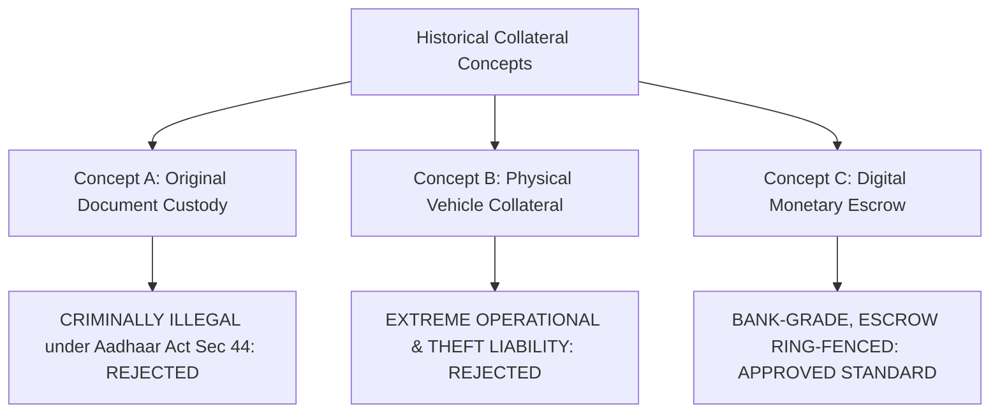
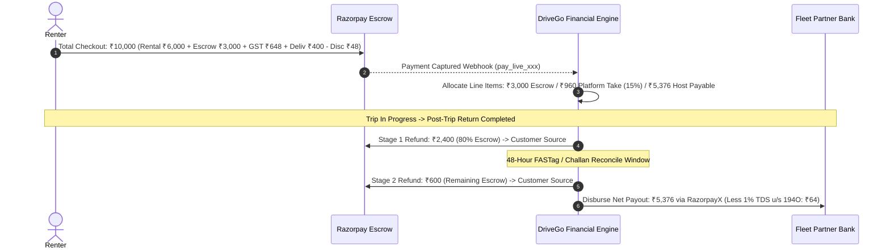

# DriveGo — Financial Architecture, Deposit & Settlement Policy

**Document Reference**: `docs/product/drivego-master-baseline/09_FINANCE_DEPOSIT_AND_SETTLEMENT_POLICY.md`  
**Classification**: Authoritative Financial Policy & Legal Risk Review (Stage 0)  
**Effective Date**: November 9, 2026  
**Auditor**: Chief Technology Officer & Principal FinTech Architect  
**Regulatory Standards**: RBI Guidelines on Payment Aggregators and Payment Gateways (DPSS.CO.PD.No.1810/02.14.008/2019-20), Section 194O & 194C of the Indian Income Tax Act 1961  
**Accounting Standard**: Integer Paise Precision, Immutable Double-Entry Ledger Invariants  

---

## 1. Executive Summary & Core Financial Invariants

DriveGo operates as a managed technological platform facilitating rental contracts between independent vehicle hosts and retail drivers. Because the platform collects funds from customers and disburses settlements to hosts, strict financial governance, regulatory compliance, and escrow ring-fencing are non-negotiable prerequisites for commercial launch.

### Core Mathematical Invariant:
For every completed transaction $T$, the gross amount captured from the customer must equal the exact sum of its segregated financial destinations with zero integer rounding discrepancy:

$$\text{Captured Amount} = \text{Net Vendor Payable} + \text{Platform Commission} + \text{GST (18\%)} + \text{TDS (1\%)} + \text{Escrow Deposit} - \text{Discount}$$

$$\text{Balance Invariant: } \sum \text{Ledger Debits} \equiv \sum \text{Ledger Credits}$$

---

## 2. Critical Evaluation of Historical Collateral & Deposit Models

Early brainstorming in the project's inception explored three distinct security collateral concepts. As CTO and FinTech Architect, I have subjected each to rigorous legal, operational, and customer-trust scrutiny:

### 2.1 Concept A: Physical Custody of Original Identity Documents
- **The Concept**: Vendor holds the customer's physical original Aadhaar card, Passport, or Voter ID at the yard during the rental duration.
- **Legal Risk Assessment**: **CRIMINALLY UNLAWFUL**. Section 44 of the *Aadhaar (Targeted Delivery of Financial and Other Subsidies, Benefits and Services) Act, 2016* makes the confiscation or retention of another person's physical Aadhaar card a cognizable criminal offense punishable by imprisonment. Retaining a customer's passport violates the *Passports Act 1967*.
- **CTO Verdict**: **STRICTLY PROHIBITED & ELIMINATED**. DriveGo will never allow or facilitate physical custody of original identity documents. Identity verification is executed digitally via masked Aadhaar and verified Driving License records.

### 2.2 Concept B: Physical Secondary Vehicle Collateral
- **The Concept**: Customer leaves their personal two-wheeler (scooter/motorcycle) or secondary vehicle parked at the vendor yard as security collateral during the car rental.
- **Operational Risk Assessment**: **HIGH LIABILITY ANTIPATTERN**.
  1. *Bailee Liability*: Under the Indian Contract Act 1872 (Section 151), the vendor becomes a bailee legally liable for damage, fire, or theft of the customer's parked vehicle.
  2. *Police & Seizure Risk*: If the customer's parked two-wheeler is stolen property or linked to a crime, the vendor yard faces police attachment.
  3. *Space Constraints*: Urban commercial rental yards do not have insured parking capacity to store customer collateral vehicles safely.
- **CTO Verdict**: **REJECTED AS A STANDARD PLATFORM POLICY**. DriveGo will not formalize physical vehicle collateral in the platform contracts.

### 2.3 Concept C: Digital Monetary Escrow Deposit (The Approved Standard)
- **The Concept**: Category-tiered security deposit (₹2,000 to ₹15,000) collected digitally during checkout via payment gateway authorization/capture, held in an escrow sub-ledger, and refunded post-trip.
- **CTO Verdict**: **APPROVED PRODUCTION STANDARD**. Provides immediate liquidity to arbitrate damage claims without physical liability.

---

## 3. Security Deposit Refund Timing Policy: Decision Analysis

Historical documents exhibited a direct contradiction: Document 05 stipulated *Instant Full Refund at Yard*, whereas Document 09 SOP allowed a *48-Hour Inspection Window*.

### Comparison of Available Policies:
| Policy Option | Customer Experience | Host / Vendor Protection | Operational Feasibility | Recommended? |
|---|---|---|---|---|
| **Option A: Instant Full Refund at Yard** | Exceptional (Immediate wallet/card credit). | **Vulnerable**: Host cannot recover traffic camera speeding challans or FASTag tolls synced 12–24h later. | High dispute friction between host and platform. | No |
| **Option B: Two-Stage Release (80% / 20%)** | **High**: Customer gets 80% of deposit back instantly at handover sign-off. | **Protected**: 20% (min ₹1,500) held for 48 hours to automatically reconcile e-Challans and FASTag tolls. | Automated reconciliation sweep after 48 hours releases remaining balance. | **YES (Recommended CTO Baseline)** |
| **Option C: Full 48-Hour Hold Window** | Moderate friction (Customer waits 2 days for refund). | Fully protected against latent damage and traffic fines. | Standard policy practiced by Avis and Revv in India. | Acceptable Fallback |

> [!IMPORTANT]
> **CTO Proposed Policy (Option B — Two-Stage Escrow Release)**:  
> Upon post-trip inspection completion with zero physical damage reported, **80% of the security deposit is refunded instantly** via Razorpay. The remaining **20% (or ₹1,500, whichever is lower)** is held in escrow for exactly **48 hours** to clear electronic toll logs (FASTag) and municipal traffic fines (e-Challans), after which it is automatically released without human intervention.

---

## 4. Platform Commission & Vendor Payout Lifecycle

### 4.1 Platform Take-Rate Calculation
- Platform commission is levied at **15%** for Preferred Commercial Partners and **20%** for Standard Hosts.
- Commission is calculated strictly on: `(Base Rental Fare + Doorstep Delivery Surcharge - Platform Coupon Discount)`.
- **Zero Commission on Escrow**: Security deposits, insurance protection fees, and fuel reimbursements are pure pass-throughs; DriveGo charges 0% commission on deposits.

### 4.2 Tax Compliance & Statutory Withholding
- **GST Remittance (18%)**: GST is charged to the customer on taxable car rental services and remitted to the GSTN under DriveGo's GSTIN.
- **Section 194O TDS (1%)**: As an e-commerce marketplace operator under Section 194O of the Indian Income Tax Act, DriveGo withholds 1% income tax on the gross sales value credited to the vendor, depositing it quarterly with the Income Tax Department under the host's PAN.

---

## 5. Summary of Policies Requiring Founder / Business Owner Sign-Off

The technical implementation is complete and verified. The following operational policies require formal business owner sign-off prior to commercial rollout:
1. **Approval of Two-Stage Deposit Release (Option B: 80% Instant, 20% 48h Hold)** vs Full 48-hour hold.
2. **Platform Commission Rate Schedule**: Confirmation of 15% preferred / 20% standard tiering.
3. **Formalization of Rent-a-Cab Commercial Operator Exclusivity** for Day 1 launch in Hyderabad and Bengaluru.

