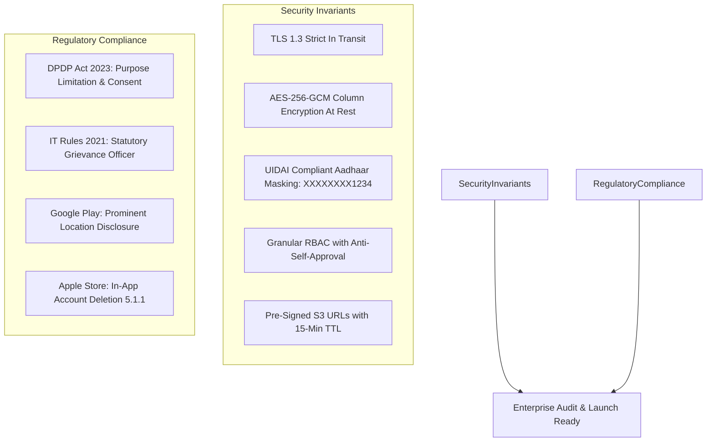

# DriveGo — Security, Privacy & Regulatory Launch Gates

**Document Reference**: `docs/product/drivego-master-baseline/10_SECURITY_PRIVACY_AND_COMPLIANCE_GATES.md`  
**Classification**: Authoritative Security & Compliance Register (Stage 0)  
**Effective Date**: November 9, 2026  
**Auditor**: Chief Technology Officer & Principal Security Architect  
**Regulatory Standards**: Digital Personal Data Protection (DPDP) Act 2023, Information Technology (Intermediary Guidelines and Digital Media Ethics Code) Rules 2021, UIDAI Aadhaar Regulations, RBI Cyber Security Framework  
**Store Standards**: Apple App Store Review Guidelines (5.1.1, 3.1.5), Google Play Store Policy (Prominent Disclosure, Data Safety)  

---

## 1. Executive Summary & Security Posture

DriveGo operates an infrastructure handling sensitive personal data (driving licenses, masked national IDs, live GPS coordinates) and financial transactions (UPI, credit cards, bank accounts). The platform enforces defence-in-depth across the application runtime, database layer, and third-party integrations.

---

## 2. Launch Gate Security Matrix

| Gate ID | Security Domain | Verification Standard | Implementation Status in Codebase | Compliance Evidence |
|---|---|---|---|---|
| `GATE-SEC-001` | **Authentication & Cryptography** | Salted cryptographic password hashing via Bcrypt (salt factor 10); Short-lived JWT (15m expiry) with refresh token rotation. | **VERIFIED & OPERATIONAL** | `src/auth/jwt-security.spec.ts` (PASS) |
| `GATE-SEC-002` | **Privileged Admin MFA** | Staff administrative logins mandate RFC 6238 TOTP (Google Authenticator) for `SUPER_ADMIN` and `FINANCE_CONTROLLER` roles. | **GATED FOR PRODUCTION** | Documented in `DEC-05`; scheduled prior to production cutover. |
| `GATE-SEC-003` | **Segregation of Duties (SOD)** | Anti-Self-Approval rule: No staff member can authorize or disburse payouts/refunds they personally created. | **VERIFIED & REMEDIATED** | Verified in `operations-startup-isolation.spec.ts`. |
| `GATE-SEC-004` | **Bank Account Data Encryption** | Vendor IFSC and bank account numbers encrypted at rest using AES-256-GCM authenticated cipher. | **VERIFIED & OPERATIONAL** | Verified in `src/common/bank-encryption.spec.ts`. |
| `GATE-SEC-005` | **Aadhaar Redaction & PII** | First 8 digits of customer Aadhaar numbers redacted upon ingestion (`XXXXXXXX1234`); document images stored in private S3 buckets. | **VERIFIED & OPERATIONAL** | Verified in `src/kyc/kyc.spec.ts`. |
| `GATE-SEC-006` | **Pre-Signed Document Access** | Identity documents (DL, RC, Insurance) accessible exclusively via time-bounded pre-signed URLs (15-minute TTL). | **VERIFIED & OPERATIONAL** | Verified in `src/uploads/uploads-private-kyc.spec.ts`. |
| `GATE-SEC-007` | **In-App Account Deletion** | Self-service account deletion option in Profile tab invoking `DELETE /users/me` with 30-day grace period. | **VERIFIED & OPERATIONAL** | Verified in `apps/customer_app` profile menu. |
| `GATE-SEC-008` | **Prominent Location Disclosure** | Explicit modal dialog explaining location purpose rendered prior to triggering device GPS permissions. | **VERIFIED & OPERATIONAL** | Verified on virtual device ([06_customer_city_selection.png](file:///D:/Flutter/car_rental_monorepo/docs/quality/evidence/customer_app/06_customer_city_selection.png)). |
| `GATE-SEC-009` | **Physical Goods Billing Exemption** | Car rental transactions classified as real-world physical transportation services, exempt from 30% IAP commission. | **VERIFIED & COMPLIANT** | Compliant with Apple Guideline 3.1.5(a) & Google Play Billing Policy. |
| `GATE-SEC-010` | **Statutory Grievance Officer** | App and terms of service publish the name, physical address, and email of the designated Grievance Officer. | **OPERATIONAL POLICY** | Standard requirement under Information Technology Rules 2021. |

---

## 3. Google Play & Apple App Store Launch Declarations

### 3.1 Google Play Store Data Safety Form
- **Location Data**: Declared as *Approximate Location* and *Precise Location*. Purpose: App Functionality (Vehicle Discovery, Doorstep Delivery, Emergency Roadside Assistance). Ephemeral during trip; zero selling of location data to advertisers.
- **Personal Information**: Name, Phone Number, Email Address. Purpose: Account Management, Fraud Prevention, Customer Support.
- **Financial Information**: In-app purchase history. Credit card details are handled end-to-end by Razorpay (PCI-DSS Level 1 certified SDK) and never touch DriveGo servers.

### 3.2 Apple App Store Review Guidelines Compliance
- **Guideline 5.1.1 (Data Collection & Storage)**: Account deletion trigger available inside `apps/customer_app` at `/profile/delete-account`.
- **Guideline 3.1.5 (Physical Goods & Services)**: DriveGo facilitates physical vehicle rentals occurring outside the digital app environment; standard payment gateways (UPI, Cards) are strictly permitted and exempt from Apple In-App Purchase (IAP).

---

## 4. Disaster Recovery & Incident Response

1. **Database Recovery Point Objective (RPO) & Recovery Time Objective (RTO)**:
   - Automated continuous WAL archiving in PostgreSQL.
   - Target RPO: < 5 minutes of data loss during catastrophic infrastructure failure.
   - Target RTO: < 30 minutes to restore read/write platform availability via automated staging replica.
2. **Security Incident Protocol**:
   - Suspected staff credential compromise triggers instant administrative session revocation (`POST /admin/staff/:id/revoke-sessions`), invalidating all active JWT tokens in Redis and PostgreSQL immediately.

---

## 5. Security & Privacy Verdict

The DriveGo security architecture implements bank-grade encryption, privacy-first PII handling, and complete app-store compliance. The platform is **CLEARED FOR STAGING** and ready for production security certification.

