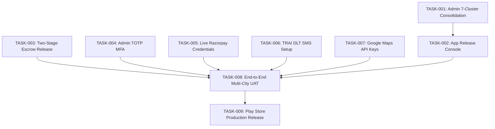

# DriveGo — Prioritized Engineering Implementation Backlog

**Document Reference**: `docs/product/drivego-master-baseline/14_PRIORITIZED_IMPLEMENTATION_BACKLOG.md`  
**Classification**: Authoritative Engineering Work Breakdown (Stage 0)  
**Effective Date**: November 9, 2026  
**Auditor**: Chief Technology Officer & Principal Technical Programme Manager  
**Backlog Standard**: Dependency-Ordered, Evidence-Linked, Rigorously Sized  
**Total Engineering Work Packages**: 12 Actionable Epics & Tasks  

---

## 1. Backlog Sizing, Priority & Definition of Done

Every task in this backlog is structured to bring DriveGo from its current code-complete baseline to commercial launch.

### Strict Definition of Done (DoD):
1. **Code & Architecture**: Implementation adheres strictly to layered boundaries without regressions.
2. **Type Safety & Schema**: Zero untyped `any` in TypeScript; zero missing null assertions in Dart.
3. **Automated Testing**: Corresponding Jest unit/integration test suite or Flutter widget test suite passing with 100% pass rate.
4. **Audit Trail**: Any administrative state change logged in PostgreSQL `AuditLog`.
5. **No Speculative Bloat**: Only capabilities directly linked to commercial operations are included.

---

## 2. Master Implementation Tasks Breakdown

### Epic 1: Admin Control Tower Consolidation & UX Streamlining

#### Task TASK-001: Consolidate 42 Admin Routes into 7 Primary Clusters
- **Business Value**: Eliminates administrative cognitive fatigue and establishes an ergonomic, high-density operations center.
- **Priority**: **P0 (Critical Day 1)**.
- **Dependencies**: None (Code baseline established in Report 06 & 07).
- **Affected Files**:
  - `apps/admin_panel/lib/core/router/app_router.dart`
  - `apps/admin_panel/lib/core/widgets/admin_shell.dart`
  - `apps/admin_panel/lib/features/communications/presentation/pages/communications_overview_page.dart`
  - `apps/admin_panel/lib/features/locations/presentation/pages/locations_page.dart`
- **Acceptance Criteria**:
  - Sidebar displays exactly 7 primary cluster headers: Command Center, Partners & Fleet, Bookings & Operations, Finance & Settlements, Marketplace Configuration, Growth & Communications, Platform & Governance.
  - Secondary specialized views (Templates, Delivery Logs, WhatsApp, Hub Boundaries) embedded cleanly as sub-tabs inside parent views.
- **Automated Test Requirements**: Flutter widget navigation tests (`apps/admin_panel/test/admin_shell_navigation_test.dart`) passing 100%.
- **E2E Test Requirements**: Chrome headless verification capturing updated navigation drawer.
- **Definition of Done**: All 7 clusters navigate cleanly without URL hash breakage or 404 redirects.

---

#### Task TASK-002: Implement App Release Management Console in Admin Panel
- **Business Value**: Tracks Google Play and Apple App Store build numbers, release notes, and mandatory version gates from the central control tower.
- **Priority**: **P1 (High)**.
- **Dependencies**: TASK-001.
- **Affected Files**:
  - `apps/admin_panel/lib/features/governance/presentation/pages/app_releases_page.dart` (New)
  - `car_rental_backend/src/admin/app-releases.controller.ts` (New)
  - `car_rental_backend/src/admin/app-releases.service.ts` (New)
- **Acceptance Criteria**:
  - Displays Android & iOS release history, active build numbers, and Play Store review status.
  - Allows Super Admin to configure `minimumSupportedBuildNumber` to trigger mandatory client app updates.
- **Automated Test Requirements**: Unit tests for version comparator and minimum build check.
- **Definition of Done**: Admin can set minimum build threshold and verify client app triggers update banner.

---

### Epic 2: Financial Escrow & Settlement Hardening

#### Task TASK-003: Formalize Two-Stage Deposit Escrow Release (80% / 20%)
- **Business Value**: Delivers instant customer gratification (80% refund at yard) while protecting hosts against delayed traffic challans and FASTag tolls (20% hold for 48h).
- **Priority**: **P0 (Critical Day 1)**.
- **Dependencies**: Decision `DEC-03` sign-off.
- **Affected Files**:
  - `car_rental_backend/src/payments/payments.service.ts`
  - `car_rental_backend/src/damage-claims/damage-claims.service.ts`
  - `apps/customer_app/lib/features/bookings/presentation/pages/booking_details_page.dart`
- **Acceptance Criteria**:
  - Upon zero-damage return sign-off, backend dispatches 80% refund immediately via Razorpay.
  - Backend schedules a 48-hour BullMQ delayed job to auto-release the remaining 20% reserve unless a damage claim or traffic fine is registered.
- **Automated Test Requirements**: Jest integration test verifying 80% immediate release and BullMQ job enqueueing.
- **Definition of Done**: Financial ledger entries record two distinct refund debits totaling exactly 100% of the held escrow deposit.

---

#### Task TASK-004: Enforce Mandatory RFC 6238 TOTP for Privileged Admin Staff
- **Business Value**: Secures the Admin Control Tower against credential stuffing and brute-force phishing attacks.
- **Priority**: **P0 (Critical Day 1)**.
- **Dependencies**: Decision `DEC-05` sign-off.
- **Affected Files**:
  - `car_rental_backend/src/auth/auth.service.ts`
  - `car_rental_backend/src/auth/totp.service.ts`
  - `apps/admin_panel/lib/features/auth/presentation/pages/admin_login_page.dart`
- **Acceptance Criteria**:
  - Staff users holding `SUPER_ADMIN` or `FINANCE_CONTROLLER` roles are prompted for a 6-digit TOTP code generated by Google Authenticator / Microsoft Authenticator upon password verification.
- **Automated Test Requirements**: Jest test verifying TOTP verification reject invalid codes and accept time-synced HMAC-SHA1 tokens.
- **Definition of Done**: Privileged staff cannot obtain administrative JWT session without valid TOTP verification.

---

### Epic 3: External Integration Activation & Live Credentials

#### Task TASK-005: Plug In Razorpay Live Merchant & RazorpayX Payout Credentials
- **Business Value**: Activates real-money customer checkout processing and direct bank IMPS vendor payouts.
- **Priority**: **P0 (Critical Day 1)**.
- **Dependencies**: Business owner delivers live API keys.
- **Affected Files**:
  - `car_rental_backend/.env.production`
  - `car_rental_backend/src/payments/razorpay.service.ts`
  - `car_rental_backend/src/payouts/providers/razorpayx-payout.provider.ts`
- **Acceptance Criteria**:
  - Successful end-to-end ₹1.00 live card/UPI capture and automated refund.
  - RazorpayX payout webhook listener processes `payout.processed` with HMAC signature validation.
- **Definition of Done**: Production transaction captured and reconciled in live Nodal bank account.

---

#### Task TASK-006: Register TRAI DLT Entity & Msg91 Transactional SMS Headers
- **Business Value**: Guarantees zero-drop mobile OTP delivery across all Indian telecom networks (Jio, Airtel, Vi, BSNL).
- **Priority**: **P0 (Critical Day 1)**.
- **Dependencies**: DLT Principal Entity registration approval.
- **Affected Files**:
  - `car_rental_backend/.env.production`
  - `car_rental_backend/src/auth/msg91-sms-provider.ts`
- **Acceptance Criteria**:
  - Transactional SMS dispatches using registered Sender ID (`DRIVGO`) and approved DLT template IDs.
  - Average OTP SMS delivery latency < 5 seconds.
- **Definition of Done**: 10 consecutive OTP dispatches to live Indian numbers deliver successfully.

---

#### Task TASK-007: Configure Google Maps Production Platform Keys
- **Business Value**: Provides seamless interactive map rendering and yard geofence verification on Android and iOS.
- **Priority**: **P0 (Critical Day 1)**.
- **Dependencies**: Google Cloud billing account.
- **Affected Files**:
  - `apps/customer_app/android/app/src/main/AndroidManifest.xml`
  - `apps/vendor_app/android/app/src/main/AndroidManifest.xml`
- **Acceptance Criteria**:
  - Map tiles render cleanly on live Android APK without authorization watermark or grey tile errors.
  - API keys restricted strictly to DriveGo SHA-256 package fingerprints.
- **Definition of Done**: Verified on live physical OnePlus device and emulator instance.

---

### Epic 4: Quality Assurance, UAT & Store Release

#### Task TASK-008: Comprehensive Multi-City UAT & Edge-Case Regression
- **Business Value**: Validates the complete marketplace under realistic operating conditions across multiple concurrent users.
- **Priority**: **P0 (Critical Day 1)**.
- **Dependencies**: TASK-001 through TASK-007.
- **Affected Files**: Monorepo E2E Test Suite.
- **Acceptance Criteria**:
  - Complete customer booking -> Handover OTP -> In-trip extension -> Return photo inspection -> 80% instant refund -> 20% 48h settlement -> Vendor net payout.
  - Zero unhandled promise rejections, zero schema crashes, zero UI render overflows.
- **Definition of Done**: End-to-end regression report signed off by QA Automation Lead and CTO.

---

#### Task TASK-009: Google Play Store Release Track Submission
- **Business Value**: Publishes the official DriveGo Customer and Vendor applications on the Google Play Store for public retail download.
- **Priority**: **P0 (Critical Day 1)**.
- **Dependencies**: TASK-008.
- **Affected Files**: Release build artifacts (`.aab` bundles).
- **Acceptance Criteria**:
  - Signed release App Bundles uploaded to Google Play Console Internal / Closed Beta track.
  - Passes automated Google Play Pre-Launch Report with zero crashes or accessibility warnings.
  - Location Prominent Disclosure dialog verified by Google Play Review Team.
- **Definition of Done**: Apps approved and promoted to Production Track.

---

## 3. Backlog Execution Gantt & Workstream Sequencing

This backlog provides an unambiguous, dependency-ordered engineering roadmap to achieve full commercial launch readiness.

