# DriveGo — Master Release Roadmap & Phased Acceptance Gates

**Document Reference**: `docs/product/drivego-master-baseline/15_RELEASE_ROADMAP_AND_ACCEPTANCE_GATES.md`  
**Classification**: Authoritative Programme Roadmap (Stage 0)  
**Effective Date**: November 9, 2026  
**Auditor**: Chief Technology Officer & Head of Marketplace Operations  
**Architecture Horizon**: Stages 0 through 7 (From Baseline to General Availability)  

---

## 1. Executive Phasing Architecture

To ensure operational stability, regulatory defensibility, and financial accuracy, DriveGo's transition from its current codebase to full commercial market operation is organized into **eight dependency-sequenced stages**.

```mermaid
graph LR
    S0[Stage 0: Product & Architecture Baseline] --> S1[Stage 1: Core Marketplace Completion]
    S1 --> S2[Stage 2: Vendor & Field Operations Completion]
    S2 --> S3[Stage 3: Finance, Safety & Compliance Hardening]
    S3 --> S4[Stage 4: Admin Control Tower Consolidation]
    S4 --> S5[Stage 5: Live Integration Activation & Staging]
    S5 --> S6[Stage 6: Multi-City UAT & Founder Acceptance]
    S6 --> S7[Stage 7: Play Store / App Store Commercial Launch]
```



---

## 2. Phased Stage Specifications & Exit Criteria

### Stage 0: Product & Architecture Baseline (COMPLETED)
- **Primary Objective**: Reconstruct product requirements, reconcile historical conflicts, execute live device E2E verification, establish 1,777-test passing baseline, and produce the 16-document master baseline.
- **Key Deliverables**: 16 authoritative documents under `docs/product/drivego-master-baseline/` and live execution evidence.
- **Exit Gate Criteria**:
  - [X] Full repository inventory and source code audit complete.
  - [X] Live virtual device E2E verification passing on Android 16 (`emulator-5554`).
  - [X] NestJS backend passing 144 test suites (1,777 tests, 0 failures).
  - [X] Admin Panel passing 35 test files (99 tests, 0 failures).
  - [X] Zero open P0/P1 defects.

---

### Stage 1: Core Marketplace Completion
- **Primary Objective**: Finalize client-side reactive state flows for search filters, instant price recalculation, and 15-minute checkout reservation hold.
- **Key Deliverables**:
  - Customer App: Dynamic date-range picker, vehicle category chips, transparent fee breakdown dialog.
  - Backend: Redis concurrency mutex lock verification and quote signature validation.
- **Exit Gate Criteria**:
  - Search queries return within <150ms.
  - Concurrent booking checkout attempts for the same vehicle ID reject with HTTP 409 Conflict within 15ms.

---

### Stage 2: Vendor & Field Operations Completion
- **Primary Objective**: Complete the Partner OS fleet operating experience, including vehicle registration documents, blackout calendars, and photographic handover inspections.
- **Key Deliverables**:
  - Vendor App: RC Book/Insurance upload wizard, maintenance blocking calendar, sequential 6-box OTP entry.
  - Pre-trip and post-trip 4-point exterior photo burst with local SQLite offline queuing.
- **Exit Gate Criteria**:
  - Vehicle cannot transition to `ONGOING` without valid customer Handover OTP verification.
  - Inspection photos compress and queue locally if cellular network drops during garage handover.

---

### Stage 3: Finance, Safety & Compliance Hardening
- **Primary Objective**: Formalize Two-Stage Escrow release (80% instant at yard, 20% 48h hold for challans) and enforce privileged staff RFC 6238 TOTP MFA.
- **Key Deliverables**:
  - Payments Service: Automated 80% refund dispatch + 48-hour BullMQ delayed sweep for remaining 20%.
  - Admin Staff: Mandatory Google Authenticator TOTP challenge on administrative logins.
  - Bank Account Encryption: Full AES-256-GCM verification across all vendor bank records.
- **Exit Gate Criteria**:
  - Zero double-entry ledger discrepancies across all test payment cycles.
  - Privileged admin logins reject invalid or expired TOTP codes.

---

### Stage 4: Admin Control Tower Consolidation
- **Primary Objective**: Redesign and consolidate the 42 existing Admin routes into the streamlined 7-Cluster high-density control tower.
- **Key Deliverables**:
  - Consolidated primary navigation: Command Center, Partners & Fleet, Bookings & Operations, Finance & Settlements, Marketplace Configuration, Growth & Communications, Platform & Governance.
  - Integrated App Release Management console tracking Play Store / App Store versions.
- **Exit Gate Criteria**:
  - 100% of admin routes navigate cleanly without URL hash breakage or 404 errors.
  - High-risk mutations (manual refunds, commission changes) enforce maker-checker authorization.

---

### Stage 5: Live Integration Activation & Staging
- **Primary Objective**: Plug in live third-party commercial credentials (Razorpay Live, RazorpayX, Msg91 DLT, Meta WhatsApp, Google Maps) in an isolated staging environment.
- **Key Deliverables**:
  - Staging cluster running on Render / AWS ECS with PostgreSQL and Redis.
  - Real ₹1.00 card/UPI payment capture and automated instant refund test.
  - Live transactional SMS OTP dispatches using registered DLT header (`DRIVGO`).
- **Exit Gate Criteria**:
  - Average SMS OTP delivery latency < 5 seconds across Jio, Airtel, and Vi.
  - Razorpay webhooks process with HMAC-SHA256 signature verification.

---

### Stage 6: Multi-City UAT & Founder Acceptance
- **Primary Objective**: Execute closed end-to-end user acceptance testing across multiple physical devices and concurrent operators in Hyderabad.
- **Key Deliverables**:
  - 5 commercial fleet partners onboarded in Hyderabad with verified commercial vehicles.
  - 20 complete end-to-end simulated rentals executed by internal team members.
- **Exit Gate Criteria**:
  - Zero vehicle double-bookings.
  - Zero payment capture or refund failures.
  - 100% of Handover OTP inspections successfully verified and archived.
  - Formal sign-off on open product decisions by Platform Founder.

---

### Stage 7: Store Submission & Commercial Launch (General Availability)
- **Primary Objective**: Publish official apps to Google Play Store and Apple App Store, activate local digital marketing campaigns, and commence retail rentals.
- **Key Deliverables**:
  - Signed release Android App Bundles (`.aab`) and iOS `.ipa` uploaded to store consoles.
  - Google Play Data Safety and Apple App Privacy declarations approved.
  - Location Prominent Disclosure verified by Google Play Review Team.
- **Exit Gate Criteria**:
  - Apps live and downloadable on Google Play Store and Apple App Store.
  - 24/7 operations monitoring active via Admin Control Tower.
  - Commercial General Availability (GA) declared.

---

## 3. Launch Gate Summary Matrix

```
[X] GATE 0: Architecture & Quality Baseline (CERTIFIED)
[ ] GATE 1: Core Marketplace & Lock Concurrency (TARGET: Sprint 1)
[ ] GATE 2: Partner OS & Inspection Offline Queuing (TARGET: Sprint 2)
[ ] GATE 3: Finance Escrow Two-Stage Release & Admin TOTP (TARGET: Sprint 3)
[ ] GATE 4: Admin Control Tower 7-Cluster Redesign (TARGET: Sprint 4)
[ ] GATE 5: Live Credentials Activation (TARGET: Commercial Dependency)
[ ] GATE 6: Multi-City Closed Pilot UAT (TARGET: Hyderabad Field Ops)
[ ] GATE 7: Google Play & App Store Public Release (COMMERCIAL GA)
```

