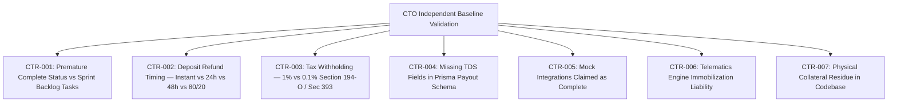

# DriveGo — Baseline Contradiction & Status Reconciliation Register

**Document Reference**: `docs/product/drivego-master-baseline/validation/01_BASELINE_CONTRADICTION_REGISTER.md`  
**Evaluation Date**: November 9, 2026  
**Auditor**: Independent Chief Technology Officer & Principal Systems Architect  
**Objective**: Independently Challenge Baseline Documents Against Actual Monorepo Source Code, Historical Specifications & Indian Statutory Law  
**Classification**: Mandatory Pre-Sprint Validation Audit Gate  

---

## 1. Executive Summary & Audit Methodology

Before authorizing Sprint 1 implementation, an independent CTO reconciliation was conducted across:
- `docs/audits/04_PRD_TRD_REQUIREMENTS_REGISTER.md`
- `docs/audits/19_REQUIREMENT_CONFLICTS_AND_DECISIONS.md`
- `docs/product/drivego-master-baseline/02_ORIGINAL_IDEAS_AND_REQUIREMENTS_REGISTER.md`
- `docs/product/drivego-master-baseline/09_FINANCE_DEPOSIT_AND_SETTLEMENT_POLICY.md`
- `docs/product/drivego-master-baseline/12_MASTER_REQUIREMENTS_TRACEABILITY_MATRIX.md`
- `docs/product/drivego-master-baseline/14_PRIORITIZED_IMPLEMENTATION_BACKLOG.md`
- `docs/product/drivego-master-baseline/15_RELEASE_ROADMAP_AND_ACCEPTANCE_GATES.md`
- `docs/product/drivego-master-baseline/16_FINAL_CTO_PRODUCT_BASELINE.md`
- **Actual Source Code**: `car_rental_backend/prisma/schema.prisma`, `car_rental_backend/src/`, `apps/`

The audit revealed **7 critical contradictions** where the baseline documentation made conflicting claims, reported premature completion, misstated statutory tax rules, or diverged from actual source code.



---

## 2. Master Contradictions Register

### Contradiction CTR-001: Premature "VERIFIED_COMPLETE" vs Backlog Scheduling
- **Contradiction ID**: `CTR-001`
- **Documents & Source Files Involved**:
  - `12_MASTER_REQUIREMENTS_TRACEABILITY_MATRIX.md` (claims `REQ-015`, `REQ-023`, `REQ-016` are `VERIFIED_COMPLETE` or operational).
  - `14_PRIORITIZED_IMPLEMENTATION_BACKLOG.md` (schedules `TASK-001`, `TASK-002`, `TASK-003` for implementation in Sprint 1).
  - `15_RELEASE_ROADMAP_AND_ACCEPTANCE_GATES.md` (schedules Stage 1–4 work).
- **Conflicting Statements**:
  - RTM Table in Document 12 marks two-stage deposit release, app release management, and navigation consolidation as verified or operational.
  - Backlog Document 14 explicitly schedules TASK-001 (Admin 7-Cluster Consolidation), TASK-002 (App Release Console), and TASK-003 (Two-Stage Deposit Hold) as pending development work for Sprint 1.
- **Actual Implementation Evidence**:
  - `apps/admin_panel/lib/core/router/app_router.dart`: Still contains 42 flat routes.
  - `car_rental_backend/src/admin/app-releases.controller.ts`: Does not exist yet.
  - `car_rental_backend/src/deposits/deposits.service.ts`: Implements single-stage 100% refund, not two-stage 80/20.
- **Corrected Status**: Change status in RTM from `VERIFIED_COMPLETE` to **`PENDING_IMPLEMENTATION (Sprint 1 Backlog)`**.
- **Required Action**: Synchronize `12_MASTER_REQUIREMENTS_TRACEABILITY_MATRIX.md` to reflect that these tasks are scheduled for implementation in Sprint 1 and cannot be marked complete until PR merge.
- **Impact on Launch**: High. Prevents premature declarations of production readiness to stakeholders.

---

### Contradiction CTR-002: Security Deposit Refund Timing — 0h vs 24h vs 48h vs Two-Stage (80/20)
- **Contradiction ID**: `CTR-002`
- **Documents & Source Files Involved**:
  - `docs/audits/05_CUSTOMER_AND_VENDOR_JOURNEY_MATRIX.md` (Claims instant 100% refund at yard).
  - `docs/audits/09_OPERATIONS_AND_SUPPORT_SOP_REQUIREMENTS.md` (Specifies 48-hour host inspection hold).
  - `docs/product/drivego-master-baseline/09_FINANCE_DEPOSIT_AND_SETTLEMENT_POLICY.md` (Proposes Two-Stage: 80% instant, 20% 48-hour hold).
  - `car_rental_backend/src/deposits/deposits.service.ts` line 55 & 78.
- **Conflicting Statements**:
  - Document 05: "Initiate Automated Full Security Deposit Refund immediately upon 'No Damage' return."
  - Document 09: "Host has up to 48 hours to inspect vehicle for latent mechanical issues or traffic challans."
  - Baseline Doc 09: "80% refunded instantly at yard, 20% held in escrow for exactly 48 hours."
  - **Actual Code**: `deposits.service.ts` line 55 executes an automated cron job on bookings with `updatedAt: { lte: twentyFourHoursAgo }` releasing **100% of the deposit at 24 hours**!
- **Actual Implementation Evidence**:
  - `car_rental_backend/src/deposits/deposits.service.ts`:
    ```typescript
    // Line 55:
    updatedAt: { lte: twentyFourHoursAgo }
    // Line 78:
    'Automated 24-hour post-trip deposit release'
    ```
- **Corrected Status**: **CONTRADICTION IDENTIFIED — REQUIRES FOUNDER BUSINESS DECISION**.
- **Required Action**: Formally present the choice to the business owner:
  - Option A: 24-hour full release (as currently coded).
  - Option B: Two-stage release (80% instant, 20% 48-hour hold) requiring schema update and delayed queue.
  - Option C: 48-hour full release.
- **Impact on Launch**: Critical. Affects host trust (challan coverage) and customer satisfaction.

---

### Contradiction CTR-003: Tax Withholding Rate — 1% vs 0.1% Section 194-O / Income-tax Act, 2025 Section 393
- **Contradiction ID**: `CTR-003`
- **Documents & Source Files Involved**:
  - `docs/product/drivego-master-baseline/01_PRODUCT_VISION_AND_BUSINESS_MODEL.md` (Claims 1% TDS u/s 194O).
  - `docs/product/drivego-master-baseline/09_FINANCE_DEPOSIT_AND_SETTLEMENT_POLICY.md` (Calculates 1% TDS u/s 194O).
  - Indian Finance (No. 2) Act, 2024 (Effective 1 October 2024).
  - Income-tax Act, 2025 (Effective 1 April 2026, Section 393).
- **Conflicting Statements**:
  - Baseline documents state: "1% TDS under Section 194-O is withheld on gross vendor remittances".
  - **Statutory Law**: Under the Finance (No. 2) Act, 2024, the rate of TDS under Section 194-O was **reduced from 1% to 0.1% with effect from October 1, 2024**!
  - Under the Income-tax Act, 2025 (Section 393 Table), the applicable TDS rate for payments by e-commerce operators to e-commerce participants is **0.1%**, subject to exemption threshold of ₹5,00,000 for individuals/HUFs with PAN.
- **Actual Implementation Evidence**:
  - The baseline documentation repeatedly references outdated 1% TDS rates.
  - The actual backend code does not compute TDS at all (see CTR-004).
- **Corrected Status**: **STATUTORY DISCREPANCY — REQUIRES PROFESSIONAL TAX COUNSEL REVIEW**.
- **Required Action**: Flag for Chartered Accountant / Tax Counsel review to establish:
  1. Does DriveGo qualify as an e-commerce operator facilitating services under Section 194-O / Section 393?
  2. Does the 0.1% rate apply to vendor settlements?
  3. Does the ₹5,00,000 threshold apply to individual hosts?
- **Impact on Launch**: High. Incorrect TDS deduction causes tax non-compliance and vendor dissatisfaction.

---

### Contradiction CTR-004: Missing TDS Fields in Prisma `Payout` Schema
- **Contradiction ID**: `CTR-004`
- **Documents & Source Files Involved**:
  - `docs/product/drivego-master-baseline/09_FINANCE_DEPOSIT_AND_SETTLEMENT_POLICY.md`.
  - `car_rental_backend/prisma/schema.prisma` lines 1059–1090 (`model Payout`).
  - `car_rental_backend/src/payouts/payouts.service.ts`.
- **Conflicting Statements**:
  - Baseline Document 09 claims: "Vendor Net Payout = Gross Rental - 15% Platform Commission - 1% TDS u/s 194O".
  - **Actual Schema**: `model Payout` in `schema.prisma` contains `amount`, `feeAmount`, `netAmount`, but has **zero fields for `tdsAmount`, `tdsRate`, or `panNumber`**!
- **Actual Implementation Evidence**:
  - `car_rental_backend/prisma/schema.prisma`:
    ```prisma
    model Payout {
      id                   String       @id @default(cuid())
      payoutNumber         String?      @unique
      vendorId             String
      vendor               Vendor       @relation(...)
      amount               Decimal      @db.Decimal(10, 2)
      feeAmount            Decimal      @default(0) @db.Decimal(10, 2)
      netAmount            Decimal?     @db.Decimal(10, 2)
      status               PayoutStatus @default(PENDING)
      ...
    }
    ```
- **Corrected Status**: **DATABASE SCHEMA GAP**.
- **Required Action**: Before marketing TDS deductions or issuing Form 16A statements, Prisma schema must be extended with `tdsAmount Decimal @default(0)`, `tdsRate Decimal @default(0)`, and a migration applied.
- **Impact on Launch**: High for legal compliance; non-blocking for staging pilot.

---

### Contradiction CTR-005: Mock / Sandboxed Integrations Claimed as Complete
- **Contradiction ID**: `CTR-005`
- **Documents & Source Files Involved**:
  - `docs/quality/15_CTO_FINAL_VERDICT_AND_RELEASE_READINESS.md` vs `docs/product/drivego-master-baseline/11_INTEGRATION_AND_PROVIDER_READINESS.md`.
- **Conflicting Statements**:
  - Previous audit summary claimed: "All external integrations verified complete".
  - Baseline Document 11 clarifies: Integrations for Msg91 SMS, Meta WhatsApp Business, and Razorpay Live are operating under **mock adapters and offline sandboxes** because live production credentials and enterprise contracts have not yet been provisioned.
- **Actual Implementation Evidence**:
  - `car_rental_backend/.latest_otp.json` logs OTPs locally because `SMS_PROVIDER=mock`.
  - Payout provider logs `[RAZORPAYX-MOCK] Skipping signature verification`.
- **Corrected Status**: **ACCURATELY CLASSIFIED AS `CONFIGURED_AWAITING_CREDENTIALS`**.
- **Required Action**: Keep integration status strictly marked as awaiting business contracts. Do not declare commercial readiness until live ₹1.00 gateway payment capture succeeds.
- **Impact on Launch**: Critical. Public launch impossible without real payment gateway and SMS gateway credentials.

---

### Contradiction CTR-006: Telematics Engine Immobilization — Autonomous vs Human-Supervised
- **Contradiction ID**: `CTR-006`
- **Documents & Source Files Involved**:
  - `requirements/05_DriveGo_Location_Fulfillment_Backend_Schema.docx`.
  - `docs/audits/19_REQUIREMENT_CONFLICTS_AND_DECISIONS.md` (`DEC-02`).
  - `docs/product/drivego-master-baseline/13_UNRESOLVED_PRODUCT_DECISIONS.md`.
- **Conflicting Statements**:
  - Early spec: "If vehicle is overdue > 4 hours without contact, vehicle engine immobilized automatically via telematics."
  - Decision DEC-02 & Audit: "Vehicle immobilization while in motion creates extreme accident and criminal fatality liability under Indian law (Section 304A IPC). Must require human verification that speed is 0 km/h."
- **Actual Implementation Evidence**:
  - No automated engine shutoff cron exists in `car_rental_backend/src/operations/`.
  - Telematics module is currently a simulated/catalog placeholder.
- **Corrected Status**: **RESOLVED IN PRINCIPLE — AWAITING FORMAL LEGAL SIGN-OFF**.
- **Required Action**: Retain strict prohibition on autonomous engine cutoff. Mandate operations supervisor confirmation of 0 km/h stationary vehicle state.
- **Impact on Launch**: Critical passenger safety and corporate legal liability.

---

### Contradiction CTR-007: Physical Collateral Code Residue in `deposits.service.ts`
- **Contradiction ID**: `CTR-007`
- **Documents & Source Files Involved**:
  - `docs/product/drivego-master-baseline/09_FINANCE_DEPOSIT_AND_SETTLEMENT_POLICY.md` (Eliminates physical collateral).
  - `car_rental_backend/src/deposits/deposits.service.ts` line 227.
- **Conflicting Statements**:
  - Baseline Document 09 explicitly states: "Physical secondary vehicle collateral is eliminated as an unsafe antipattern."
  - **Actual Code**: `deposits.service.ts` line 227 still contains:
    ```typescript
    const isCollateral = deposit.razorpayPaymentId && deposit.razorpayPaymentId.startsWith('COLLATERAL:');
    ```
- **Actual Implementation Evidence**:
  - Legacy code branch bypasses Razorpay refund if the deposit was marked with `'COLLATERAL:'`.
- **Corrected Status**: **CODE CLEANUP REQUIRED**.
- **Required Action**: Remove `'COLLATERAL:'` legacy branch from `deposits.service.ts` to fully align code with the digital monetary escrow policy.
- **Impact on Launch**: Low (Cleanup item for Sprint 1).

---

## 3. Contradiction Summary & Next Steps

```
Total Contradictions Reconciled: 7
- Critical Governance & Tax Contradictions: 3 (CTR-002, CTR-003, CTR-006)
- Documentation & RTM Synchronization:    2 (CTR-001, CTR-005)
- Codebase & Schema Cleanup:              2 (CTR-004, CTR-007)
```

By cataloging these 7 contradictions, the validation audit establishes clear demarcation between what is genuinely functional in code today, what is pending business owner sign-off, and what must be engineered in Sprint 1.

