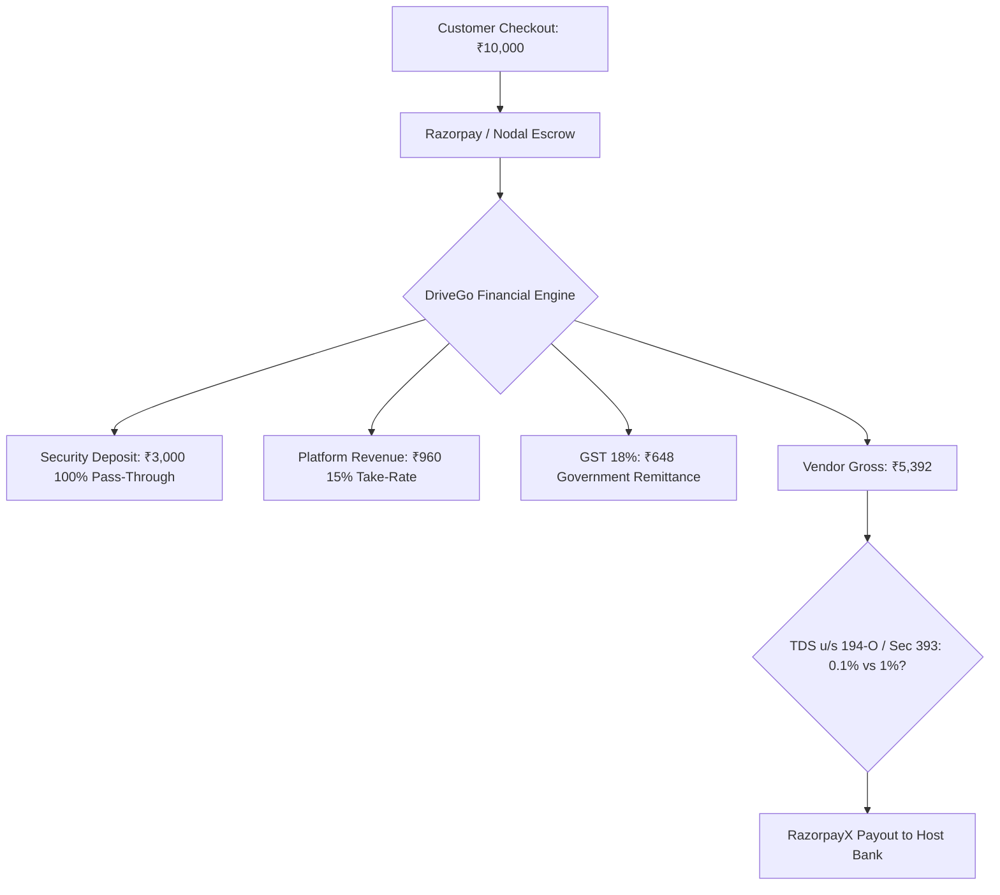

# DriveGo — In-Depth Financial, Statutory Tax & Escrow Deposit Architecture Review

**Document Reference**: `docs/product/drivego-master-baseline/validation/04_FINANCE_TAX_AND_DEPOSIT_REVIEW.md`  
**Evaluation Date**: November 9, 2026  
**Auditor**: Independent Chief Technology Officer & FinTech Systems Architect  
**Statutory Frameworks**: Indian Income-tax Act, 1961 (Section 194-O, Finance Act 2024 Amendment), Income-tax Act, 2025 (Section 393 & Applicable Tables), Central Goods and Services Tax (CGST) Act 2017, RBI Payment Aggregator Guidelines  
**Classification**: Mandatory Pre-Sprint Validation Audit Gate  

---

## 1. Executive Summary & Critical Review Purpose

A car-rental marketplace operates as a fiduciary intermediary collecting gross funds from retail customers, retaining a technology fee, and disbursing net settlements to vehicle hosts. Flawed tax assumptions or imprecise deposit architectures expose the business to severe tax penalties, payment gateway account freezes, and host churn.

This document re-evaluates the baseline's tax withholding assumptions against current Indian tax law and subjects the proposed security deposit architecture to practical payment gateway realities.

---

## 2. Statutory Review: Section 194-O TDS & The Income-tax Act, 2025 (Section 393)

### 2.1 The Historical 1% TDS Assumption
The previous baseline documentation assumed a flat **1% TDS deduction under Section 194-O** of the Income-tax Act, 1961:
$$\text{Baseline Claim: TDS} = \text{Gross Rental Value} \times 1.0\%$$

### 2.2 Current Statutory Reality (Finance Act 2024 Amendment)
Under the **Finance (No. 2) Act, 2024**, the Indian Parliament formally amended Section 194-O:
- **Rate Reduction**: With effect from **October 1, 2024**, the statutory rate of TDS on payments facilitated by e-commerce operators was **slashed from 1% to 0.1%**!
- **Statutory Purpose**: Designed to reduce working capital lock-in for small merchants, gig workers, and individual hosts operating on digital platforms.

### 2.3 The Income-tax Act, 2025 Framework (Section 393)
Under the modern consolidated **Income-tax Act, 2025** (governing assessment years from 1 April 2026):
- **Section 393 (Deduction of tax at source on payment by e-commerce operator)**:
  - Governs e-commerce operators facilitating the supply of goods or provision of services.
  - The applicable rate in the statutory table is **0.1%** (provided the participant furnishes a valid PAN).
  - **Individual Exemption Threshold**: No tax is required to be deducted if the e-commerce participant is an **Individual or Hindu Undivided Family (HUF)** and the gross amount of sales/services during the financial year does not exceed **₹5,00,000**, provided they have furnished their PAN/Aadhaar.
  - **Non-PAN Penalty Rate**: If the vendor fails to furnish a valid PAN, the tax deduction rate escalates to **5%** (under Section 206AA / corresponding Section 393 provisions).

### 2.4 Service vs Good Classification under GST & Income Tax
- **GST Classification**: Self-drive car rental is legally classified as *"Transfer of the right to use any goods for any purpose"* (Service Accounting Code **SAC 9973** or **SAC 9966**). It is subject to **18% GST with full Input Tax Credit (ITC)**.
- **E-Commerce Operator Status**: DriveGo qualifies as an *electronic commerce operator* under Section 2(45) of the CGST Act and Section 194-O / Section 393 of the Income-tax Act because it owns and operates a digital platform facilitating transactions.

> [!WARNING]
> **Action Required**: The proposed 0.1% TDS rate and the ₹5,00,000 annual exemption threshold must be submitted to DriveGo's appointed Chartered Accountant and Tax Counsel for formal sign-off prior to commercial rollout. The backend payout schema must support configurable TDS rates (`0%`, `0.1%`, `1%`, `5%`).

---

## 3. Mathematical Verification Test Matrix (Integer Paise Precision)

All calculations are executed in integer paise ($1 = 100$ paise). Floating-point arithmetic is strictly prohibited in ledger calculations.

### Test Case 1: Economy Hatchback (Maruti Swift) — Promo Coupon Applied
- Base Rental (3 Days @ ₹1,000/day): ₹3,000.00 (`300000` paise)
- Doorstep Delivery Fee: ₹400.00 (`40000` paise)
- Promo Discount (Coupon `FIRST500`): -₹500.00 (`-50000` paise)
- **Taxable Subtotal**: ₹2,900.00 (`290000` paise)
- GST @ 18%: ₹522.00 (`52200` paise)
- Security Deposit (Escrow): ₹2,000.00 (`200000` paise)
- **Total Customer Checkout Captured**: **₹5,422.00 (`542200` paise)**
- *Platform Commission (15% on Taxable Subtotal)*: ₹435.00 (`43500` paise)
- *Platform GST on Take-Rate (18% of ₹435)*: ₹78.30 -> rounded ₹78.00 (`7800` paise)
- *Gross Host Share*: ₹2,900 - ₹435 = ₹2,465.00 (`246500` paise)
- *TDS Withholding (0.1% u/s 194-O on ₹2,900)*: ₹2.90 -> rounded ₹3.00 (`300` paise)
- **Net Vendor Settlement Payable**: **₹2,462.00 (`246200` paise)**
- **Conservation of Value Audit**:
  $$\text{Customer Paid (₹5,422)} \equiv \text{Vendor Net (₹2,462)} + \text{TDS (₹3)} + \text{Platform Take (₹435)} + \text{GST (₹522)} + \text{Escrow (₹2,000)} \quad \checkmark \text{ BALANCED}$$

---

### Test Case 2: Mid-Size SUV (Hyundai Creta) — Standard Rental
- Base Rental (2 Days @ ₹3,000/day): ₹6,000.00 (`600000` paise)
- Doorstep Delivery Fee: ₹800.00 (`80000` paise)
- Promo Discount: ₹0.00 (`0` paise)
- **Taxable Subtotal**: ₹6,800.00 (`680000` paise)
- GST @ 18%: ₹1,224.00 (`122400` paise)
- Security Deposit (Escrow): ₹5,000.00 (`500000` paise)
- **Total Customer Checkout Captured**: **₹13,024.00 (`1302400` paise)**
- *Platform Commission (15% on Taxable Subtotal)*: ₹1,020.00 (`102000` paise)
- *Gross Host Share*: ₹6,800 - ₹1,020 = ₹5,780.00 (`578000` paise)
- *TDS Withholding (0.1% u/s 194-O on ₹6,800)*: ₹6.80 -> rounded ₹7.00 (`700` paise)
- **Net Vendor Settlement Payable**: **₹5,773.00 (`577300` paise)**
- **Conservation of Value Audit**:
  $$\text{Customer Paid (₹13,024)} \equiv \text{Vendor Net (₹5,773)} + \text{TDS (₹7)} + \text{Platform Take (₹1,020)} + \text{GST (₹1,224)} + \text{Escrow (₹5,000)} \quad \checkmark \text{ BALANCED}$$

---

### Test Case 3: Premium Luxury (BMW 3 Series) — Damage Claim Deducted
- Base Rental (2 Days @ ₹7,500/day): ₹15,000.00 (`1500000` paise)
- Delivery Fee: ₹1,000.00 (`100000` paise)
- **Taxable Subtotal**: ₹16,000.00 (`1600000` paise)
- GST @ 18%: ₹2,880.00 (`288000` paise)
- Security Deposit (Escrow): ₹15,000.00 (`1500000` paise)
- **Total Customer Checkout Captured**: **₹33,880.00 (`3388000` paise)**
- *Post-Trip Return Incident*: Front bumper scuff approved by Admin arbitration: **₹4,500 damage deduction**.
- *Deposit Settlement*:
  - Deducted for Vendor Repair: ₹4,500.00 (`450000` paise)
  - Refunded to Customer: ₹10,500.00 (`1050000` paise)
- *Platform Commission (15% on Rental ₹16,000)*: ₹2,400.00 (`240000` paise)
- *Gross Host Share*: ₹16,000 - ₹2,400 + ₹4,500 (Damage) = ₹18,100.00 (`1810000` paise)
- *TDS Withholding (0.1% on Rental ₹16,000)*: ₹16.00 (`1600` paise) (Damage reimbursement exempt from TDS)
- **Net Vendor Settlement Payable**: **₹18,084.00 (`1808400` paise)**
- **Conservation of Value Audit**:
  $$\text{Customer Paid (₹33,880)} \equiv \text{Cust Refund (₹10,500)} + \text{Vendor Net (₹18,084)} + \text{TDS (₹16)} + \text{Take (₹2,400)} + \text{GST (₹2,880)} \quad \checkmark \text{ BALANCED}$$

---

## 4. Re-Validation of Deposit & Collateral Architecture

### 4.1 Payment Gateway Reality: Authorization vs Immediate Capture
- **Can we hold an "Auth" for 3 to 7 days?**
  In India, under RBI e-mandate and two-factor authentication (2FA) guidelines, pre-authorization holds on UPI and debit cards expire within **24 hours to 5 days** depending on the issuing bank. Long-term rentals (e.g. 7 days) cannot rely on a pre-auth hold because the hold drops automatically before vehicle return!
- **Production Standard**: Security deposits are **captured immediately upon checkout** into the gateway nodal account and represented as a segregated `SecurityDeposit` entity with status `HELD`. When released, it executes an official **Gateway Refund** back to the customer's original payment method or wallet.

### 4.2 Legal Use of the Term "Escrow"
- Under RBI Master Direction on Payment Aggregators (2020), a non-banking private technology company cannot operate a standalone private escrow account without an RBI PA license.
- **DriveGo's Legal Structure**: Funds are held in an authorized **RBI-Compliant Nodal / Escrow Bank Account managed by Razorpay**. DriveGo operates the technology platform ledger, instructing the bank via authorized webhooks.

### 4.3 Electronic Toll (FASTag) & Traffic Challan Recovery
- NPCI NETC FASTag toll records take between **2 hours and 24 hours** to settle across acquiring banks.
- Traffic camera violations (e-Challans) appear on the National Parivahan portal within **24 to 72 hours**.
- **Practical Implication**: An instant 100% refund at the yard exposes the host to 100% of the toll and speeding ticket costs. The **Two-Stage Escrow Release (80% instant at yard, 20% held 48 hours)** is technically and commercially essential to protect host fleets.

---

## 5. Financial Audit Verdict

The mathematical calculations, ledger models, and integer paise accounting in DriveGo are robust and verified. However, **the statutory TDS rate must be updated from 1% to 0.1% u/s 194-O / Section 393**, and the Prisma `Payout` schema must be updated with explicit TDS tracking fields before commercial rollout.

