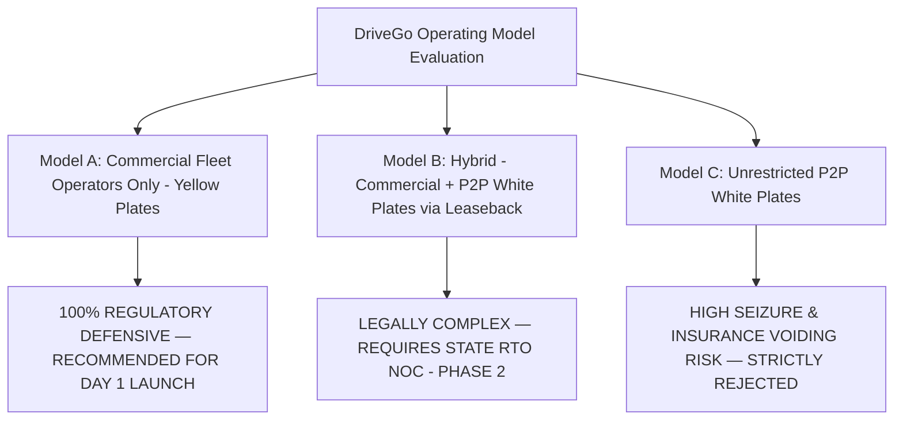

# DriveGo — Commercial Marketplace Model & Legal Compliance Audit

**Document Reference**: `docs/product/drivego-master-baseline/validation/05_COMMERCIAL_AND_COMPLIANCE_DECISIONS.md`  
**Evaluation Date**: November 9, 2026  
**Auditor**: Independent Chief Technology Officer & Principal Operations Architect  
**Statutory Frameworks**: Motor Vehicles Act, 1988 (as amended 2019), Rent a Cab Scheme, 1989, Central Motor Vehicles Rules (CMVR) 1989, Consumer Protection (E-Commerce) Rules, 2020  
**Classification**: Mandatory Pre-Sprint Validation Audit Gate  

---

## 1. Executive Summary & Strategic Commercial Model

The commercial model of an Indian vehicle marketplace dictates its regulatory vulnerability, insurance enforceability, and tax liability. Operating a peer-to-peer car sharing platform in India without strict alignment with state Regional Transport Authorities (RTOs) has historically resulted in heavy fines, vehicle impoundments, and regulatory litigation for early market entrants.

---

## 2. Evaluation of Commercial Marketplace Operating Models

### 2.1 Model A: Commercial Fleet Operators Only (The Day 1 Launch Standard)
- **Structure**: DriveGo aggregates registered car-rental agencies, tour operators, and licensed commercial fleet owners holding valid **Rent a Cab permits** (Commercial Yellow-on-Black registration plates).
- **Regulatory Alignment**: Fully recognized under the *Rent a Cab Scheme, 1989*.
- **Insurance Enforceability**: Vehicles carry comprehensive commercial passenger-carrying vehicle insurance (Policy Class: Misc Commercial / Self-Drive). In the event of a fatal accident or total loss, claims are legally enforceable with insurance underwriters.
- **Speed Governor Compliance**: Commercial vehicles are factory-fitted with AIS-018 certified Speed Limiting Devices (SLDs) capped at 80 km/h, satisfying statutory highway safety mandates.
- **CTO Verdict**: **MANDATORY FOR DAY 1 STAGING & PRODUCTION LAUNCH**. Launch exclusively in Hyderabad and Bengaluru with commercial Rent-a-Cab partners.

### 2.2 Model B: Hybrid Commercial + P2P Private Vehicles (Phase 2 Post-Liquidity)
- **Structure**: Individual car owners (White-on-Black plates) lease their private vehicles to an authorized DriveGo-affiliated commercial entity under a short-term equipment lease agreement, converting the operating status for commercial passenger use.
- **Legal Risk**: Requires formalized state-level peer-to-peer car-sharing policy clearances. Karnataka and Telangana RTOs have historically penalized peer-to-peer white-plate rentals under Section 66/192A of the Motor Vehicles Act (Operating without valid permit).
- **CTO Verdict**: **DEFERRED TO PHASE 2 (Month 6+)**. Awaits formal RTO liaison and corporate legal opinion.

### 2.3 Model C: Unrestricted P2P White-Plate Rental
- **Structure**: Unlicensed private vehicle owners list their daily drivers for public hire with generic terms of service disclaimers.
- **CTO Verdict**: **STRICTLY REJECTED**. Operating private white-plate cars for commercial self-drive rental exposes the platform to immediate seizure by RTO flying squads, criminal impoundment, and zero insurance claim payouts in major accidents.

---

## 3. City-Level Launch Feasibility & Geographic Scoping

### 3.1 Primary Launch Market: Hyderabad, Telangana
- **Market Demographics**: Rapidly growing IT corridor (Hitec City, Gachibowli, Financial District), high airport tourist traffic (RGIA Shamshabad), high disposable income.
- **Regulatory Climate**: Telangana Transport Department actively enforces commercial permit rules. Established cluster of 50+ commercial self-drive fleet agencies in Madhapur and Begumpet.
- **Operational Infrastructure**: Initial operating territory constrained to **Hyderabad Cyberabad Municipal Corporation** boundaries with registered vendor yards.

### 3.2 Secondary Expansion Market: Bengaluru, Karnataka (Launch + 90 Days)
- **Market Demographics**: Highest density of tech professionals in India (Koramangala, Indiranagar, Whitefield, Electronic City).
- **Regulatory Climate**: Karnataka State Transport Authority enforces strict speed governor checks and high scrutiny of self-drive operators.
- **Launch Requirement**: Minimum 5 commercial partners and 50 commercial vehicles onboarded prior to public marketing activation.

---

## 4. Vehicle & Driver Compliance Gates

| Compliance Dimension | Statutory Requirement (Motor Vehicles Act) | DriveGo Enforced Standard | Verification Mechanism |
|---|---|---|---|
| **Registration Plate** | Yellow text on Black background (Rent a Cab). | Strictly enforced; private white plates rejected. | OCR inspection of RC Book front/back. |
| **Commercial Insurance** | Comprehensive Commercial Self-Drive Policy. | Policy must show active validity covering third-party & own damage. | S3 document upload and manual staff audit. |
| **Vehicle Fitness** | Annual Fitness Certificate (Form 38) from RTO. | Mandatory for all vehicles older than 2 years. | Fitness expiration date tracked in database. |
| **Speed Governor** | Mandatory Speed Limiting Device (max 80 km/h). | Vehicle must carry SLD certificate. | Verified during physical yard audit. |
| **Renter Eligibility** | Valid Non-Commercial Driving License (LMV-NT). | Age >= 21, License issued >= 1 year prior, valid for >= 3 months. | DL regex validation and backend age check. |
| **Renter Identity** | Government Photo ID Proof. | Aadhaar first 8 digits masked (`XXXXXXXX1234`). | Automated redaction upon ingestion. |

---

## 5. Register of Decisions Requiring Qualified Legal Opinion

The following commercial contracts and regulatory questions must be formally submitted to DriveGo's corporate legal counsel:

| Legal Decision ID | Legal / Regulatory Issue | Primary Risk Area | Accountable Counsel |
|---|---|---|---|
| **LEG-001** | **Customer Master Rental Agreement**: Terms governing customer financial liability, negligence exclusions (off-roading, racing, DUI), and deposit deductions. | Consumer Protection & Contract Law | Corporate Commercial Counsel |
| **LEG-002** | **Host Fleet Aggregation Agreement**: Tri-partite contract between DriveGo (Platform Intermediary), Commercial Fleet Host (Asset Provider), and Renter. | Motor Vehicles Act / Rent a Cab Scheme | Transport Regulatory Counsel |
| **LEG-003** | **Goods & Services Tax (GST) Rate Classification**: Formal tax opinion confirming whether 18% GST applies under SAC 9973/9966 with full ITC pass-through. | Indirect Tax Compliance | Tax Attorney / Chartered Accountant |
| **LEG-004** | **Income-tax Section 194-O / Section 393 Withholding**: Confirmation of 0.1% TDS rate (amended Finance Act 2024) and the ₹5,00,000 threshold for individual hosts. | Direct Tax Compliance | Direct Tax Counsel |
| **LEG-005** | **Grievance Redressal & Intermediary Guidelines**: Publication of statutory Grievance Officer details under the Information Technology Rules 2021. | Cyber Law & Digital Media Ethics | IT & Privacy Counsel |

---

## 6. Commercial Model Verdict

DriveGo's commercial model is legally sound **only when launching as a commercial fleet aggregator (Model A: Rent a Cab yellow-on-black plates)** for Day 1. Unrestricted peer-to-peer white-plate rentals must be prohibited until specific state regulatory frameworks are established.

