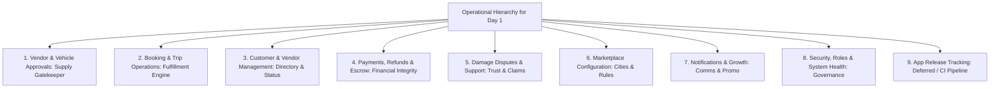

# DriveGo — Admin Control Tower Operational Priorities & Navigation Review

**Document Reference**: `docs/product/drivego-master-baseline/validation/06_ADMIN_PRIORITY_AND_NAVIGATION_REVIEW.md`  
**Evaluation Date**: November 9, 2026  
**Auditor**: Independent Chief Technology Officer & Principal Operations Architect  
**Objective**: Establish a Pragmatic, Day-1 Operationally Ranked Admin Control Tower Structure  
**Classification**: Mandatory Pre-Sprint Validation Audit Gate  

---

## 1. Executive Redesign Philosophy

A common failure mode in enterprise software projects is building secondary, non-operational administrative tools (such as complex CI/CD release consoles, gamified loyalty viewers, or speculative machine-learning fraud graphs) before the primary operational tools required to onboard partners and dispatch cars are hardened.

In accordance with Phase 7 instructions:
> **"Do not build the App Release Management console yet. First verify which existing Admin workflows are genuinely operational. Rank modules according to their ability to operate the rental business."**



---

## 2. Operational Ranking & Module Evaluation (1 to 9)

### Rank 1: Vendor & Vehicle Approvals (Supply Gatekeeper) — CRITICAL DAY 1
- **Operational Reality**: Without verified vehicles and partners, zero rentals can take place.
- **Current Code Status**: **FULLY OPERATIONAL**.
  - Route: `/#/vendors/onboarding` (`vendor_onboarding_page.dart`).
  - Backend: `AdminVendorsController.approveVendor()`, `CarsController.toggleAdminLock()`.
  - Evidence: Verified on live browser ([02_admin_vendors.png](file:///D:/Flutter/car_rental_monorepo/docs/quality/evidence/admin_control_tower/02_admin_vendors.png)).
- **Verdict**: **PRIMARY NAVIGATION PRIORITY #1**.

### Rank 2: Booking & Trip Operations (Fulfillment Engine) — CRITICAL DAY 1
- **Operational Reality**: Operations staff must monitor handovers, active trips, and returns in real-time.
- **Current Code Status**: **FULLY OPERATIONAL**.
  - Route: `/#/bookings` (`bookings_page.dart`), `/#/operations-center`.
  - Backend: `BookingsController.findAllAdmin()`, `OperationsController.getLiveFleet()`.
  - Evidence: Verified on live browser ([04_admin_bookings.png](file:///D:/Flutter/car_rental_monorepo/docs/quality/evidence/admin_control_tower/04_admin_bookings.png)).
- **Verdict**: **PRIMARY NAVIGATION PRIORITY #2**.

### Rank 3: Customer & Vendor Management — CRITICAL DAY 1
- **Operational Reality**: Directory to inspect customer trip history, unblock locked accounts, and review vendor profiles.
- **Current Code Status**: **FULLY OPERATIONAL**.
  - Route: `/#/customers`, `/#/vendors`.
  - Backend: `UsersController.findAll()`, `VendorsController.findAll()`.
- **Verdict**: **PRIMARY NAVIGATION PRIORITY #3**.

### Rank 4: Payments, Refunds, Deposits & Reconciliation — CRITICAL DAY 1
- **Operational Reality**: Financial controllers must track captured funds, authorize manual refunds, review escrow holds, and execute vendor payout batches.
- **Current Code Status**: **FULLY OPERATIONAL**.
  - Route: `/#/reconciliation`, `/#/payouts`.
  - Backend: `FinancialReconciliationService.reconcile()`, `PayoutsService.executeBatch()`.
  - Invariant Guard: Anti-Self-Approval rule enforced (DEC-01).
- **Verdict**: **PRIMARY NAVIGATION PRIORITY #4**.

### Rank 5: Damage Disputes & Support Helpdesk — CRITICAL DAY 1
- **Operational Reality**: Resolving post-trip damage claims before deposit release and handling emergency customer breakdowns.
- **Current Code Status**: **FULLY OPERATIONAL**.
  - Route: `/#/disputes`, `/#/emergency-dispatch`, `/#/support-tickets`.
  - Backend: `DisputesService.resolveDispute()`, `EmergencyService.dispatch()`.
- **Verdict**: **PRIMARY NAVIGATION PRIORITY #5**.

### Rank 6: Marketplace Configuration (Cities, Hubs & Rules) — ESSENTIAL
- **Operational Reality**: Activating new serviceable cities (Hyderabad -> Bengaluru), setting delivery radiuses, and updating commission rates.
- **Current Code Status**: **FULLY OPERATIONAL**.
  - Route: `/#/locations`, `/#/business-rules`.
  - Backend: `LocationsController.updateRules()`, `ConfigEngineService.updateConfig()`.
  - Evidence: Verified on live browser ([05_admin_locations.png](file:///D:/Flutter/car_rental_monorepo/docs/quality/evidence/admin_control_tower/05_admin_locations.png), [07_admin_settings.png](file:///D:/Flutter/car_rental_monorepo/docs/quality/evidence/admin_control_tower/07_admin_settings.png)).
- **Verdict**: **PRIMARY NAVIGATION PRIORITY #6**.

### Rank 7: Communications & Growth (Promotions & Templates) — SECONDARY
- **Operational Reality**: Broadcast push messages, discount promo codes (`CouponsModule`), and DLT SMS delivery monitoring.
- **Current Code Status**: **OPERATIONAL WITH MOCK BACKENDS**.
  - Route: `/#/communications/overview`, `/#/marketing/campaigns`.
  - Backend: `NotificationsController`, `CouponsController`.
  - Evidence: Verified on live browser ([06_admin_communications.png](file:///D:/Flutter/car_rental_monorepo/docs/quality/evidence/admin_control_tower/06_admin_communications.png)).
- **Verdict**: **CONSOLIDATE INTO TABBED VIEW**.

### Rank 8: Security, Roles, Audit & System Health — GOVERNANCE
- **Operational Reality**: Enforcing RBAC, creating staff accounts, revoking active sessions, and forensic audit logging.
- **Current Code Status**: **FULLY OPERATIONAL**.
  - Route: `/#/staff`, `/#/audit-log`, `/#/integrations`.
  - Backend: `AdminStaffService.revokeSessions()`, `AdminAuditLogService.getAuditLogs()`.
- **Verdict**: **RESTRICT ACCESS TO SUPER_ADMIN**.

### Rank 9: App Release Tracking — DEFERRED
- **Operational Reality**: Tracking Play Store / App Store versions inside the Admin panel is non-essential for initial staging; binary deployment is managed via GitHub Actions and Google Play Console.
- **CTO Directive**: **DO NOT BUILD IN SPRINT 1**. Defer TASK-002 until after core marketplace operations and live integrations are certified.

---

## 3. Streamlined Pragmatic 7-Cluster Navigation Structure

To eliminate operational clutter while maintaining complete coverage, the Admin navigation is structured into seven logical clusters without bloating the primary drawer:

```
1. COMMAND CENTER
   ├── Executive Dashboard (GMV, active trips, utilization KPIs)
   └── Operations Live View (City dispatch map, active cars)

2. PARTNERS & FLEET
   ├── Vendor Onboarding Queue (Document review, approve/reject)
   ├── Verified Partners Directory (Active hosts, bank verification)
   └── Fleet Inventory & Compliance (Car catalog, admin emergency locks)

3. BOOKINGS & FIELD OPS
   ├── Booking Pipeline (Handover ready, ongoing, return due)
   ├── Damage Disputes & Claims (Photo arbitration, repair quotes)
   └── Emergency SOS Dispatch (Roadside breakdowns, accidents)

4. FINANCE & SETTLEMENTS
   ├── Daily Reconciliation (Gateway capture vs escrow vs payouts)
   ├── Vendor Payout Batches (Net payout calculation, RazorpayX trigger)
   └── Escrow Deposit Ledger (Held deposits, 24h/48h auto-release status)

5. SERVICE LOCATIONS & PRICING
   ├── Operating Cities & Hubs (Hyderabad, Bengaluru boundaries)
   └── Business Rules Engine (Commission rates, cancellation curves)

6. COMMUNICATIONS & MARKETING
   └── Omnichannel Control (Tabbed: Templates, Delivery Logs, Promo Coupons)

7. PLATFORM GOVERNANCE
   ├── Staff Access & RBAC (Role delegation, session revocation)
   └── Forensic Audit Log (Immutable mutation ledger)
```

---

## 4. Operational Integrity Standard for Administrative Actions

Every administrative mutation must satisfy four mandatory rules:
1. **Real Backend Connection**: No mock endpoints or UI-only buttons; every action calls a verified NestJS controller.
2. **Backend RBAC Enforcement**: Role checks execute on the server via `@Roles('ADMIN')` and `@RequirePermissions()`. Client-side route hiding is never trusted as a security gate.
3. **Forensic Audit Record**: Every mutation writes a record to `AuditLog` containing `adminUserId`, `action`, `entityType`, `entityId`, and `metadata` (before/after JSON snapshot).
4. **Visual Feedback & Error Handling**: UI renders clear confirmation dialogs before destructive actions (suspensions, locks, manual refunds) and displays server response toasts.

