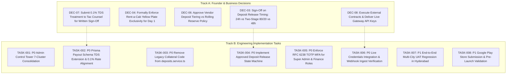

# DriveGo — Corrected Engineering Implementation Backlog & Work Breakdown

**Document Reference**: `docs/product/drivego-master-baseline/validation/07_CORRECTED_IMPLEMENTATION_BACKLOG.md`  
**Evaluation Date**: November 9, 2026  
**Auditor**: Independent Chief Technology Officer & Principal Systems Architect  
**Objective**: Deliver a Reality-Checked, Dependency-Ordered Engineering Backlog with Explicit Separation of Founder Decisions  
**Classification**: Mandatory Pre-Sprint Validation Audit Gate  

---

## 1. Backlog Re-Baselining & Classification Standard

Following the CTO contradiction resolution and operational priority review, the implementation backlog has been rebuilt to eliminate speculative bloat (deferring the App Release Management console) and address real codebase gaps (Prisma payout TDS fields, collateral code cleanup, statutory 0.1% tax rate).

### Priority Taxonomy:
- **P0 (Launch Blocker)**: Must be completed and verified before commercial staging pilot can begin.
- **P1 (Core Operational Requirement)**: Required for field operations and initial commercial launch in Hyderabad.
- **P2 (Growth & Operational Efficiency)**: Post-launch enhancements scheduled for Month 2–3.
- **P3 (Future Scale & Advanced Enterprise)**: Deferred to post-liquidity (Month 4–6).

---

## 2. Segregation of Founder Decisions from Engineering Tasks

---

## 3. Prioritized Engineering Work Packages

### Package P0-1: Platform Consolidation & Schema Hardening

#### TASK-001 (P0): Consolidate Admin Control Tower into 7 Pragmatic Operating Clusters
- **Evidence of Problem**: Admin panel exposes 42 flat sidebar routes, creating severe operational friction and navigation clutter.
- **Source Files Involved**:
  - `apps/admin_panel/lib/core/router/app_router.dart`
  - `apps/admin_panel/lib/core/widgets/admin_shell.dart`
  - `apps/admin_panel/lib/features/communications/presentation/pages/communications_overview_page.dart`
  - `apps/admin_panel/lib/features/locations/presentation/pages/locations_page.dart`
- **Business Owner**: Head of Operations / CTO.
- **Dependencies**: None.
- **Acceptance Criteria**: Sidebar displays exactly 7 primary cluster headers; secondary views (Templates, Delivery Logs, Hub Rules, Coupons) embedded as clean sub-tabs.
- **Automated Test Requirements**: Flutter widget navigation tests (`apps/admin_panel/test/admin_shell_navigation_test.dart`) passing 100%.
- **Definition of Done**: 100% of admin routes navigate cleanly; zero 404s or broken URLs.
- **Rollback Consideration**: Low risk; purely client-side UI reorganization.

---

#### TASK-002 (P0): Extend Prisma Payout Schema with TDS Fields & Align with 0.1% Rate
- **Evidence of Problem**: `model Payout` in `schema.prisma` lacks `tdsAmount`, `tdsRate`, and `panNumber` fields, making statutory tax accounting impossible; baseline incorrectly assumed 1% TDS instead of amended 0.1% rate.
- **Source Files Involved**:
  - `car_rental_backend/prisma/schema.prisma`
  - `car_rental_backend/src/payouts/payouts.service.ts`
  - `car_rental_backend/src/payouts/dto/create-payout.dto.ts`
- **Business Owner**: Finance Controller / FinTech Architect.
- **Dependencies**: Founder decision `DEC-07` (Tax counsel sign-off).
- **Acceptance Criteria**:
  - Prisma schema extended with `tdsAmount Decimal @default(0)`, `tdsRate Decimal @default(0)`, `vendorPanSnapshot String?`.
  - Migration generated and applied safely (`npx prisma migrate dev --name add_payout_tds_fields`).
  - `PayoutsService` computes TDS dynamically: `Math.round(taxableSubtotal * (tdsRate / 100))`.
- **Automated Test Requirements**: Jest integration tests in `payouts-integrity.spec.ts` validating TDS deduction and zero balance discrepancy.
- **Definition of Done**: Payout record persists gross amount, commission deduction, TDS deduction, and net payable.
- **Rollback Consideration**: Additive database migration; non-breaking to existing rows.

---

#### TASK-003 (P0): Remove Legacy Physical Collateral Code from `deposits.service.ts`
- **Evidence of Problem**: `car_rental_backend/src/deposits/deposits.service.ts` line 227 still contains legacy check: `const isCollateral = deposit.razorpayPaymentId && deposit.razorpayPaymentId.startsWith('COLLATERAL:');` which bypasses gateway refunds.
- **Source Files Involved**:
  - `car_rental_backend/src/deposits/deposits.service.ts`
- **Business Owner**: Principal Backend Architect.
- **Dependencies**: None.
- **Acceptance Criteria**: Remove `'COLLATERAL:'` check. All security deposit releases execute through authorized gateway refunds.
- **Automated Test Requirements**: Jest test suite in `deposits/deposits.spec.ts` passing 100%.
- **Definition of Done**: Code cleanly reflects digital monetary escrow policy.
- **Rollback Consideration**: Zero risk; eliminates dead code branch.

---

#### TASK-004 (P0): Formalize Deposit Refund State Machine according to Founder Sign-Off
- **Evidence of Problem**: Code currently releases 100% deposit at 24 hours (`twentyFourHoursAgo`), while baseline proposed Two-Stage release (80% instant, 20% 48h hold).
- **Source Files Involved**:
  - `car_rental_backend/src/deposits/deposits.service.ts`
  - `car_rental_backend/src/payments/payments.service.ts`
  - `apps/customer_app/lib/features/bookings/presentation/pages/booking_details_page.dart`
- **Business Owner**: Head of Product / Founder.
- **Dependencies**: Founder decision `DEC-03` sign-off.
- **Acceptance Criteria**:
  - If Founder approves Option B (Two-Stage): Implement 80% immediate refund dispatch + 48h BullMQ delayed sweep for remaining 20%.
  - If Founder approves Option A: Maintain single 100% release upon return sign-off.
- **Automated Test Requirements**: Jest integration test verifying exact refund amounts and state transitions.
- **Definition of Done**: Deposit records reflect approved timeline with zero trapped customer funds.
- **Rollback Consideration**: Configurable via `SystemConfig` rule flags.

---

#### TASK-005 (P0): Enforce RFC 6238 TOTP MFA for Privileged Administrative Roles
- **Evidence of Problem**: Administrative logins currently authenticate with email/password without two-factor authentication, exposing platform control to credential phishing.
- **Source Files Involved**:
  - `car_rental_backend/src/auth/auth.service.ts`
  - `car_rental_backend/src/auth/totp.service.ts`
  - `apps/admin_panel/lib/features/auth/presentation/pages/admin_login_page.dart`
- **Business Owner**: Principal Security Architect.
- **Dependencies**: None.
- **Acceptance Criteria**: Staff holding `SUPER_ADMIN` or `FINANCE_CONTROLLER` roles must provide a valid 6-digit Google Authenticator TOTP code on login.
- **Automated Test Requirements**: Jest unit tests validating TOTP time-window acceptance and replay rejection.
- **Definition of Done**: Administrative JWT is rejected without verified TOTP verification.
- **Rollback Consideration**: Emergency bypass flag restricted to server console environment variable.

---

### Package P0-2: Third-Party Credential Activation & UAT

#### TASK-006 (P0): Plug In Live Gateway Credentials & Verify Webhook Processing
- **Evidence of Problem**: Platform runs on sandboxed mock providers; public launch requires live payment processing and SMS delivery.
- **Source Files Involved**:
  - `car_rental_backend/.env.production`
  - `car_rental_backend/src/payments/razorpay.service.ts`
  - `car_rental_backend/src/auth/msg91-sms-provider.ts`
- **Business Owner**: Platform Founder / Head of Engineering.
- **Dependencies**: Business owner executes third-party contracts (`DEC-08`).
- **Acceptance Criteria**:
  - Successful end-to-end ₹1.00 live card/UPI capture and automated instant refund.
  - Live transactional SMS OTP delivers to Indian numbers within <5 seconds via DLT header `DRIVGO`.
- **Automated Test Requirements**: Jest integration test verifying Razorpay live webhook HMAC signature validation.
- **Definition of Done**: Live financial transaction captured in live Nodal bank account.
- **Rollback Consideration**: Automated failover to secondary provider (Twilio).

---

#### TASK-007 (P1): Comprehensive Multi-City UAT & Edge-Case Regression in Hyderabad
- **Evidence of Problem**: Need physical field proof across multiple simultaneous users and vehicles prior to store rollout.
- **Source Files Involved**: Full Monorepo Test Harness.
- **Business Owner**: Head of QA / Head of Operations.
- **Dependencies**: TASK-001 through TASK-006.
- **Acceptance Criteria**: 20 end-to-end simulated rentals completed across 5 commercial vehicles in Hyderabad with zero crashes, zero double-bookings, and accurate financial settlements.
- **Definition of Done**: UAT sign-off certificate signed by QA Lead and CTO.

---

#### TASK-008 (P1): Google Play Store Release Track Submission
- **Evidence of Problem**: Apps must be reviewed and approved on Google Play Console for retail public distribution.
- **Source Files Involved**: Signed Android App Bundles (`.aab`).
- **Business Owner**: Lead Mobile Engineer / Founder.
- **Dependencies**: TASK-007.
- **Acceptance Criteria**: Apps pass Google Play Pre-Launch Report with zero crashes; Location Prominent Disclosure approved.
- **Definition of Done**: Apps promoted to Production Track on Google Play Store.

---

## 4. Work Breakdown Sizing & Sprint Sequencing Summary

| Task ID | Task Description | Priority | Sizing (Est.) | Primary Dependencies | Target Sprint |
|---|---|:---:|:---:|---|:---:|
| `TASK-001` | Admin Control Tower 7-Cluster Consolidation | **P0** | 3 Days | None | Sprint 1 |
| `TASK-002` | Prisma Payout Schema TDS Extension & 0.1% Rate | **P0** | 2 Days | Founder Decision `DEC-07` | Sprint 1 |
| `TASK-003` | Remove Collateral Code from deposits.service.ts | **P0** | 0.5 Day | None | Sprint 1 |
| `TASK-004` | Implement Approved Deposit Release State Machine | **P0** | 2 Days | Founder Decision `DEC-03` | Sprint 1 |
| `TASK-005` | Enforce RFC 6238 TOTP MFA for Admin Staff | **P0** | 2 Days | None | Sprint 1 |
| `TASK-006` | Live Gateway Credentials Activation | **P0** | 2 Days | External Contracts (`DEC-08`) | Sprint 2 |
| `TASK-007` | Multi-City Closed Pilot UAT (Hyderabad) | **P1** | 5 Days | TASK-001 through TASK-006 | Sprint 2 |
| `TASK-008` | Google Play Store Submission | **P1** | 3 Days | TASK-007 | Sprint 3 |
| *TASK-DEFER*| App Release Management Console | **P2** | 3 Days | Deferred post-launch | Month 2 |

This corrected backlog eliminates speculative distractions, focuses squarely on operational essentials, and provides an actionable engineering roadmap.

