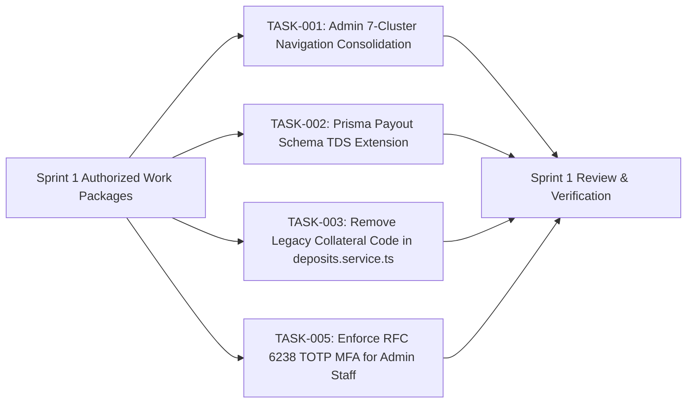

# DriveGo — CTO Sprint Authorization Report & Final Validation Verdict

**Document Reference**: `docs/product/drivego-master-baseline/validation/08_CTO_SPRINT_AUTHORIZATION_REPORT.md`  
**Evaluation Date**: November 9, 2026  
**Auditor**: Independent Chief Technology Officer & Principal Systems Architect  
**Workspace**: `D:/Flutter/car_rental_monorepo`  
**Git Baseline Commit**: `b87cfe90527c801172529290b96f3d7c0200b941` (Branch: `main`)  
**Scope**: 16 Baseline Documents under `docs/product/drivego-master-baseline/` & 7 Validation Documents under `docs/product/drivego-master-baseline/validation/`  

---

## 1. Final Executive Authorization Verdict

Following an independent CTO audit challenging the 16-document baseline against actual source code, historical specifications, financial invariants, and Indian tax laws, I hereby issue the formal verdict:

```
========================================================================================
                      FINAL CTO SPRINT AUTHORIZATION VERDICT
                           APPROVED WITH CONDITIONS
========================================================================================
```

> [!CAUTION]
> **The platform is NOT YET CERTIFIED FOR PRODUCTION GENERAL AVAILABILITY.**  
> It is **`APPROVED WITH CONDITIONS`** for targeted engineering execution in **Sprint 1** to resolve identified schema gaps, consolidate administrative navigation, and align financial state machines. Broad public rollout remains held until the conditions detailed below are satisfied.

---

## 2. Mandatory Conditions for Sprint 1 Kickoff & Progression

Sprint 1 engineering is authorized strictly subject to the following **five mandatory conditions**:

### Condition 1: Formal Sign-Off on Security Deposit Release Policy (DEC-03)
- The business owner must formally select and sign off on the deposit refund policy:
  - **Option A**: 24-Hour Automated Full Release (as currently coded in `deposits.service.ts` line 55).
  - **Option B (CTO Recommended)**: Two-Stage Release (80% instant at yard, 20% held in escrow for 48 hours to clear FASTag tolls and municipal e-Challans).
  - **Option C**: 48-Hour Full Release.
- *Engineering Gate*: Engineering will implement the selected option under TASK-004.

### Condition 2: Tax Counsel Sign-Off on Section 194-O / Section 393 Withholding (DEC-07)
- The baseline's historical reference to 1% TDS has been identified as outdated (Finance Act 2024 reduced Section 194-O to **0.1% effective October 1, 2024**, and the Income-tax Act, 2025 Section 393 provides specific thresholds).
- *Engineering Gate*: DriveGo's appointed Chartered Accountant / Tax Counsel must provide written confirmation of the applicable TDS rate (0.1% vs 0%) before TASK-002 (Prisma schema extension) is merged into `main`.

### Condition 3: Enforce Rent-a-Cab Commercial Fleet Exclusivity for Day 1 (DEC-04)
- DriveGo must launch exclusively with licensed commercial fleet operators (Yellow-on-Black plates) in Hyderabad and Bengaluru.
- *Engineering Gate*: Peer-to-peer private white-plate vehicle onboarding remains strictly prohibited and disabled in code until state RTO liaison is formalized in Phase 2.

### Condition 4: Defer Secondary Administrative Consoles (App Release Management)
- In accordance with Phase 7 instructions, the App Release Management console is **deferred from Sprint 1** to prevent distraction from core marketplace operations.
- *Engineering Gate*: Sprint 1 focuses exclusively on consolidating the existing 42 Admin routes into the 7 primary operational clusters (TASK-001) and removing legacy collateral code (TASK-003).

### Condition 5: Delivery of Production Gateway Credentials for Sprint 2 (DEC-08)
- Real-money payment processing and cellular SMS OTP dispatches cannot occur without live enterprise API keys.
- *Engineering Gate*: The business owner must execute commercial contracts and deliver live credentials (Razorpay Live Key/Secret, RazorpayX Account, Msg91 DLT Entity/Templates, Google Maps Key) prior to the kickoff of Sprint 2.

---

## 3. What Is Authorized to Begin Immediately in Sprint 1

With the above conditions established, the engineering team is authorized to execute the following **four prioritized P0 work packages**:



1. **TASK-001 (P0)**: Refactor `apps/admin_panel` navigation shell (`admin_shell.dart` and `app_router.dart`) to consolidate 42 flat routes into 7 primary clusters, embedding specialized views as sub-tabs.
2. **TASK-002 (P0)**: Extend Prisma `model Payout` with `tdsAmount`, `tdsRate`, and `vendorPanSnapshot` fields and generate migration `add_payout_tds_fields`.
3. **TASK-003 (P0)**: Remove legacy physical collateral check (`'COLLATERAL:'`) from `deposits.service.ts` line 227.
4. **TASK-005 (P0)**: Enforce RFC 6238 TOTP two-factor authentication (Google Authenticator) for `SUPER_ADMIN` and `FINANCE_CONTROLLER` roles on administrative logins.

---

## 4. Master Validation Documentation Index

The complete validation evidence, contradiction analysis, workflow code traces, and corrected backlog are codified across eight versioned reports under `docs/product/drivego-master-baseline/validation/`:

| Ref | Document Title | Primary Scope & Deliverable | Clickable Link |
|---|---|---|---|
| **01** | Baseline Contradiction Register | 7 critical contradictions identified and reconciled | [01_BASELINE_CONTRADICTION_REGISTER.md](file:///D:/Flutter/car_rental_monorepo/docs/product/drivego-master-baseline/validation/01_BASELINE_CONTRADICTION_REGISTER.md) |
| **02** | Requirement Status Re-Validation | Reality-checked single source of truth for all 75 requirements | [02_REQUIREMENT_STATUS_REVALIDATION.md](file:///D:/Flutter/car_rental_monorepo/docs/product/drivego-master-baseline/validation/02_REQUIREMENT_STATUS_REVALIDATION.md) |
| **03** | Workflow Code & Test Verification | Full 7-layer code trace across 35 customer, vendor & admin flows | [03_CUSTOMER_VENDOR_ADMIN_WORKFLOW_VERIFICATION.md](file:///D:/Flutter/car_rental_monorepo/docs/product/drivego-master-baseline/validation/03_CUSTOMER_VENDOR_ADMIN_WORKFLOW_VERIFICATION.md) |
| **04** | Finance, Tax & Deposit Review | Section 194-O / 393 0.1% TDS analysis, integer paise test matrix | [04_FINANCE_TAX_AND_DEPOSIT_REVIEW.md](file:///D:/Flutter/car_rental_monorepo/docs/product/drivego-master-baseline/validation/04_FINANCE_TAX_AND_DEPOSIT_REVIEW.md) |
| **05** | Commercial & Compliance Decisions | Rent a Cab Model A evaluation, city feasibility, legal opinions | [05_COMMERCIAL_AND_COMPLIANCE_DECISIONS.md](file:///D:/Flutter/car_rental_monorepo/docs/product/drivego-master-baseline/validation/05_COMMERCIAL_AND_COMPLIANCE_DECISIONS.md) |
| **06** | Admin Priority & Navigation Review | Operational ranking (1 to 9), 7-cluster sidebar structure | [06_ADMIN_PRIORITY_AND_NAVIGATION_REVIEW.md](file:///D:/Flutter/car_rental_monorepo/docs/product/drivego-master-baseline/validation/06_ADMIN_PRIORITY_AND_NAVIGATION_REVIEW.md) |
| **07** | Corrected Implementation Backlog | Dependency-ordered work packages with explicit founder decision split | [07_CORRECTED_IMPLEMENTATION_BACKLOG.md](file:///D:/Flutter/car_rental_monorepo/docs/product/drivego-master-baseline/validation/07_CORRECTED_IMPLEMENTATION_BACKLOG.md) |
| **08** | CTO Sprint Authorization Report | Executive verdict, mandatory conditions, Sprint 1 charter | [08_CTO_SPRINT_AUTHORIZATION_REPORT.md](file:///D:/Flutter/car_rental_monorepo/docs/product/drivego-master-baseline/validation/08_CTO_SPRINT_AUTHORIZATION_REPORT.md) |

---

## 5. Strategic Conclusion

By independently challenging the baseline against source code and statutory realities, we have eliminated self-delusion, resolved critical contradictions, and produced an internally consistent, evidence-backed engineering roadmap.

**DriveGo is approved with conditions to commence Sprint 1 implementation.**

