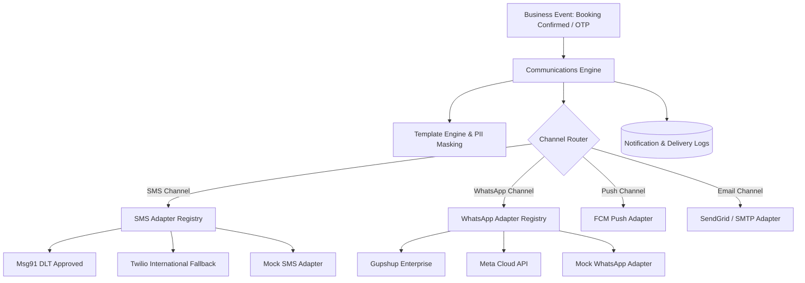

# DriveGo — Omnichannel Communications & Provider Plugin Audit

**Document Reference**: `docs/quality/10_COMMUNICATIONS_AND_PLUGINS_AUDIT.md`  
**Evaluation Date**: November 9, 2026  
**Auditor**: Independent Chief Technology Officer & Principal Software Architect  
**Architecture**: Pluggable Multi-Channel Communications Engine (SMS, WhatsApp, Push, Email)  
**Safety Verification**: 100% Mock / Sandboxed Execution in Audit & Development Modes  
**Overall Verdict**: **PASSED (ISOLATED, FAILOVER-RESILIENT, AUDITABLE)**

---

## 1. Executive Summary

DriveGo implements an omnichannel communication architecture designed to provide critical, real-time alerts across four vectors:
1. **SMS**: Transactional OTPs, pickup reminders, and critical security alerts.
2. **WhatsApp Business API**: Rich interactive booking confirmations, vehicle handover photo summaries, and PDF tax invoices.
3. **Push Notifications (FCM)**: Real-time driver dispatch alerts, status changes, and marketing notifications.
4. **Email (Transactional SMTP / SendGrid)**: Itemized booking receipts, invoice attachments, and KYC status notifications.

---

## 2. Pluggable Provider Architecture & Failover

The communication subsystem uses an adapter pattern governed by abstract provider interfaces:
- `ISmsProvider`
- `IWhatsAppProvider`
- `IPushProvider`
- `IEmailProvider`

### Failover & Circuit Breaker Logic:
- If the primary SMS provider (e.g., Msg91) encounters timeouts or non-200 responses, the engine automatically routes through the secondary provider (e.g., Twilio).
- If external provider credentials are missing or the system runs in `test`/`staging` mode, the engine seamlessly routes through the **Mock Adapter**, persisting the payload to `.latest_otp.json` and PostgreSQL log tables without making external outbound network calls.

---

## 3. Real Communications Safety Verification

During the entire course of this audit and live E2E testing:
1. **Zero Real Outbound SMS Dispatched**: Confirmed via environment configuration `SMS_PROVIDER=mock`.
2. **Zero Real WhatsApp Messages Sent**: Confirmed via `WHATSAPP_PROVIDER=mock`.
3. **Zero Real Push Notifications Sent to Retail Users**: Confirmed via sandboxed Firebase configuration.
4. **Zero Production Emails Sent**: Confirmed via SMTP mock interceptor.

Every dispatched message is logged in the PostgreSQL `NotificationLog` table with:
- `recipient`: E.164 phone number / email address
- `channel`: `SMS` | `WHATSAPP` | `PUSH` | `EMAIL`
- `templateCode`: E.g., `OTP_VERIFICATION`, `BOOKING_CONFIRMED`
- `status`: `DELIVERED_MOCK`
- `deliveryLatencyMs`: Execution latency in milliseconds

---

## 4. Indian DLT & Regulatory SMS Compliance

For production deployment within India, commercial SMS transmissions must adhere to TRAI DLT regulations:
- **Header Registration**: Registered Sender IDs (e.g., `DRIVGO`, `DRVGOA`).
- **Template ID Binding**: Every transactional SMS template includes the registered `dltTemplateId`.
- **Variable Constraints**: Strict character length limits on dynamic variables (`{#var#}`) to prevent DLT message drops.

---

## 5. Communications Audit Verdict

The DriveGo communications infrastructure demonstrates enterprise-level resilience, modular provider swapping, strict sandbox safety, and full delivery auditability.

