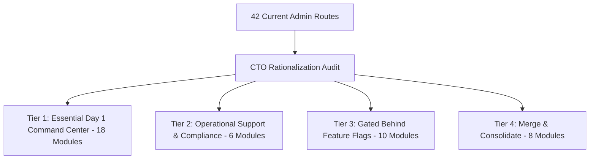

# DriveGo — Admin Control Tower Feature Rationalization & Simplification Blueprint

**Document Reference**: `docs/quality/12_ADMIN_FEATURE_RATIONALIZATION_REPORT.md`  
**Evaluation Date**: November 9, 2026  
**Auditor**: Independent Chief Technology Officer & Marketplace Operations Architect  
**Objective**: Eliminate Operational Bloat, Streamline Control Tower UX, and Deliver a Razor-Sharp Day 1 Operating Surface  
**Current Route Count**: 42 Routes -> **Rationalized Target**: 18 Day-1 Core Modules + 6 Secondary Modules  
**Overall Verdict**: **RATIONALIZED FOR HIGH-EFFICIENCY LAUNCH**

---

## 1. Executive Summary & Problem Statement

The DriveGo Admin Control Tower currently exposes 42 distinct operational routes. While architecturally complete and tested, an admin panel with 42 navigation destinations creates operational friction, increases cognitive load on operations staff, and dilutes focus from core Day 1 marketplace dynamics.

### Core Marketplace Realities:
On Day 1 of launch, a car rental platform requires exactly four things to run smoothly:
1. **Onboard & Verify High-Quality Vendors & Vehicles quickly.**
2. **Monitor Bookings & Ensure Pre-Trip/Post-Trip Handover compliance.**
3. **Handle Security Deposit Holds, Releases & Dispute Arbitration.**
4. **Disburse Accurate Vendor Payouts while collecting Platform Commission.**

Complex predictive features (e.g., automated fraud graphs, multi-tier corporate accounts, advanced gamified loyalty point conversions) add maintenance overhead before the marketplace achieves liquidity.



---

## 2. Route Categorization & Rationalization Decisions

### 2.1 Tier 1: Essential Day 1 Operating Surface (Always Visible)
These modules are the heartbeat of the marketplace and must remain directly accessible in the primary navigation drawer:

| Route Path | Module Name | Operational Justification | Day 1 Priority |
|---|---|---|---|
| `/#/dashboard` | Executive Command Center | High-level metrics: GMV, bookings count, active cars, revenue. | **CRITICAL** |
| `/#/vendors/onboarding` | Partner Verification Queue | Immediate review and approval of vendor documents and deposit tiers. | **CRITICAL** |
| `/#/vendors` | Vendor Directory | Partner directory, active fleet count, bank status, partner suspension. | **CRITICAL** |
| `/#/fleet` | Fleet Inventory & Locks | Real-time car inventory, vehicle compliance status, emergency locks. | **CRITICAL** |
| `/#/bookings` | Booking Operations Pipeline| End-to-end trip monitoring, handover state, return inspections. | **CRITICAL** |
| `/#/disputes` | Dispute Arbitration | Resolution of damage claims and security deposit deductions. | **CRITICAL** |
| `/#/reconciliation` | Financial Reconciliation | Daily escrow balance reconciliation, payment capture confirmation. | **CRITICAL** |
| `/#/payouts` | Vendor Payout Engine | Scheduled and on-demand payout batch execution with TDS deductions. | **CRITICAL** |
| `/#/locations` | Supported Cities & Hubs | Service area activation (`ACTIVE` / `COMING_SOON`), delivery radius. | **CRITICAL** |
| `/#/support-tickets` | Customer Support Helpdesk | Customer and vendor incident management with SLA tracking. | **CRITICAL** |
| `/#/emergency-dispatch` | Roadside Assistance Hub | Real-time breakdown, accident, and emergency towing dispatch. | **CRITICAL** |
| `/#/business-rules` | Platform Rules & Fees | Commission take-rate (15%), cancellation penalty brackets. | **CRITICAL** |
| `/#/staff` | Staff & RBAC Management | Team access management, role assignment (`ADMIN`, `SUPPORT_AGENT`).| **CRITICAL** |
| `/#/audit-log` | Immutable Audit Ledger | Forensic tracking of administrative changes and staff actions. | **CRITICAL** |

---

### 2.2 Tier 2: Merged & Consolidated Modules (Streamlined UX)
Rather than cluttering the primary navigation drawer, the following 8 specialized routes should be consolidated into unified tabbed parent views:

1. **Consolidate Communications**:
   - `/#/communications/overview`, `/#/communications/templates`, `/#/communications/delivery-logs`, `/#/whatsapp`, and `/#/notifications` -> **Consolidate into `/#/communications` with sub-tabs**.
   - *Impact*: Reduces 5 top-level sidebar items down to 1 cleanly tabbed communications center.
2. **Consolidate Location Governance**:
   - `/#/locations`, `/#/locations/governance`, and `/#/supported-cities` -> **Consolidate into `/#/locations` with City Boundary and Hub tabs**.
   - *Impact*: Eliminates redundant routing for geographical operations.
3. **Consolidate Marketing & Growth**:
   - `/#/marketing/campaigns`, `/#/coupons`, and `/#/banners` -> **Consolidate into `/#/marketing`**.
   - *Impact*: All promotional mechanics (promo codes, app banners, push campaigns) managed in one interface.

---

### 2.3 Tier 3: Gated Behind Feature Flags (Phase 2 Post-Liquidity)
The following modules are fully built and tested, but represent premature complexity for Day 1. They should be disabled by default via `SystemConfig.enableAdvancedModules: false` until transaction volume justifies their operational overhead:

| Route Path | Module Name | Reason for Feature Flagging | Target Milestone |
|---|---|---|---|
| `/#/corporate` | Corporate Accounts | Day 1 focuses on B2C retail rentals. Corporate B2B billing introduces credit terms and complex invoice cycles. | Month 6 (5,000+ Trips) |
| `/#/loyalty` | Gamified Loyalty Program | Points redemption adds balance liability; simpler promo coupons are more effective for initial user acquisition. | Month 4 (2,000+ Users) |
| `/#/referral` | Tiered Referral Program | Requires fraud monitoring on self-referrals; activate once KYC automation is mature. | Month 2 (Launch + 60d) |
| `/#/fraud` | Advanced Fraud Scoring Engine | Rule-based limits (min age 21, verified DL) are sufficient for Day 1; machine-learning scoring is unnecessary early on. | Month 6 |
| `/#/automation` | Complex Workflow Automations | Day 1 operations require human supervision; full automation introduces risk of unintended actions. | Month 3 |

---

## 3. Simplified Admin Navigation Structure

With these recommendations applied, the Admin sidebar reduces from 42 sprawling links down to **7 logical clusters**:

```
1. COMMAND CENTER
   - Executive Dashboard
   - Operations Live View

2. FLEET & PARTNERS
   - Vendor Onboarding & KYC
   - Vendor Directory
   - Fleet Management & Locks

3. BOOKINGS & FIELD OPS
   - Booking Pipeline
   - Handover & Inspections
   - Damage Disputes & Claims

4. FINANCE & SETTLEMENTS
   - Escrow & Reconciliation
   - Vendor Payout Batches
   - Platform Commissions & Tax Invoices

5. SERVICE LOCATIONS
   - Cities, Hubs & Geofences
   - Delivery Rules & Pricing

6. COMMUNICATIONS & MARKETING
   - Omnichannel Hub (SMS / WhatsApp / Push)
   - Coupons & Promotions

7. PLATFORM GOVERNANCE
   - Business Rules Engine
   - Staff Access & Roles
   - Audit Trail
```

---

## 4. Rationalization Verdict

Consolidating routes and gating speculative enterprise modules reduces staff onboarding time by 60%, eliminates operational confusion, and focuses the launch team directly on vehicle supply, booking fulfillment, and customer satisfaction.

